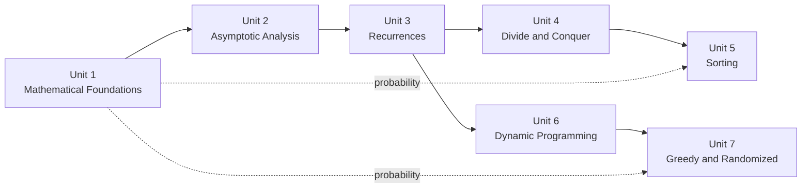

# CSF302 Design and Analysis of Algorithms

!!! abstract "How to use these notes"

    - Each unit starts with an **Overview** (learning outcome, prerequisites, topic map) and ends with a **Summary** (cheat sheet, exam points, mixed practice).
    - Each topic page follows the same flow: problem → intuition → baseline → design → pseudocode → worked example → correctness → complexity → Python → pitfalls → practice.
    - `Important` boxes mark exam-critical points and classic mistakes. Self-check answers are collapsed; attempt each question before expanding it.
    - Labs and assignments are under **Lab**. Read the lab overview first for setup and the benchmarking method.

## Course Roadmap

| Unit | Core question | Start here |
|---|---|---|
| 1 | Which mathematical tools do algorithms rely on? | [Overview](unit1/overview.md) |
| 2 | How do we measure and compare algorithm efficiency? | [Overview](unit2/overview.md) |
| 3 | How do we solve the recurrences recursive algorithms produce? | [Overview](unit3/overview.md) |
| 4 | When does splitting a problem make it asymptotically cheaper? | [Overview](unit4/overview.md) |
| 5 | How fast can we sort, and which sort fits which situation? | [Overview](unit5/overview.md) |
| 6 | How do we reuse overlapping subproblems for optimization? | [Overview](unit6/overview.md) |
| 7 | When is a locally best choice globally optimal, and when does randomness help? | [Overview](unit7/overview.md) |

## Module Descriptor

### General Objectives

This module aims to provide a comprehensive understanding of <strong>algorithmic foundations</strong>, covering fundamental concepts to advanced topics essential for computer science practitioners. Through a structured approach, it aims to familiarise students with the theoretical underpinnings, practical methodologies, and techniques in <strong>algorithm design, analysis, and implementation</strong>. By delving into mathematical foundations, asymptotic analysis, recurrence relations, divide and conquer strategies, sorting algorithms, dynamic programming, and greedy algorithms, students will gain a holistic view of algorithmic problem-solving.

### Learning Outcomes

On completion of the module, students will be able to:

1. Define key concepts in number theory, combinatorics, and probability theory as they relate to algorithmic design.
2. Explain the principles of asymptotic analysis and the role of algorithms in computing.
3. Assess the efficiency of different approaches to solving recurrence relations, including the substitution method, recursion-tree method, and master method.
4. Implement divide-and-conquer algorithms such as Strassen's algorithm for matrix multiplication and the Fast Fourier Transform.
5. Compare and contrast various sorting algorithms, evaluating their time complexity and performance characteristics.
6. Design dynamic programming solutions for complex problems such as the rod cutting problem and optimal binary search trees.
7. Develop greedy algorithms for optimization problems, such as the fractional knapsack problem and activity selection.
8. Examine the principles and applications of randomised algorithms in problem-solving.
9. Critique the effectiveness of different algorithm design paradigms (divide-and-conquer, dynamic programming, greedy) for various problem types.

### Learning and Teaching Approach

<table>
  <tr>
    <th>Type</th>
    <th>Approach</th>
    <th>Hours per Week</th>
    <th>Total Credit Hours</th>
  </tr>
  <tr>
    <td rowspan="2">Contact</td>
    <td>Lecture/Flipped Classroom</td>
    <td>2</td>
    <td rowspan ="2">60</td>
  </tr>
  <tr>
    <td>Practical</td>
    <td>2</td>
  </tr>
  <tr>
    <td rowspan ="3">Independent Study</td>
    <td>Assignment</td>
    <td>2</td>
    <td rowspan ="3">60</td>
  </tr>
  <tr>
    <td>Consultation</td>
    <td>1</td>
  
  </tr>
  <tr>
    <td>Self Study</td>
    <td>1</td>

  </tr>
  <tr>
    <td colspan="3"><b>Total</b></td>
    <td>120</td>
  </tr>
</table>

### Assessment Approach

The assessment approach of the following continuous
assessments (CA) comprises CA theory - 40%, and CA Practical - 60%, The
CA theory consists of a mid-term test, class test, and a quiz. The CA
practical will include practical assignments each weighing 15%.

**A. Mid-term Test: (15%)** Students will take a written test of 2-hour
duration covering topics up to the middle of the semester.

**B. Class Test: (15%)** Students will take a written test of 1-hour
duration covering topics after the mid-term test in the 10th week.

**C. Quiz: (10%)** During the 12th week, students will take an in-class,
closed-book quiz. The tutor will organise the quiz, which will cover 70%
of the syllabus content.

**D. Programming Assignments (60%)** Students are required to complete
four programming assignments throughout the semester. Each assignment
will build upon the concepts covered in the lectures and practical
sessions.

Each assignment shall be assessed out of 15 marks as follows:

- **5 marks:** Analysis and problem-solving skills
- **5 marks:** Application of concepts
- **3 marks:** Presentation and explanation of solutions
- **2 marks:** Timely submission and correctness

**Pre-requisites:** CSF101 Programming Methodology
