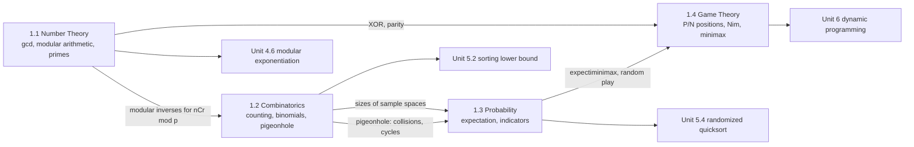

# Mathematical Foundations

!!! success "Learning Outcome"

     
     - {{ lo }}
     

## Why This Unit Matters

Algorithms are reasoned about with mathematics before they are written in code. This unit collects the four mathematical toolkits the rest of the course leans on:

- **Number theory** makes integer algorithms correct and fast: gcd, modular arithmetic and inverses sit underneath RSA/TLS, hashing, checksums and every "answer modulo $10^9+7$" contest problem.
- **Combinatorics** sizes search spaces. Knowing that there are $2^n$ subsets and $n!$ orderings tells you, before you write a line, whether brute force can work — and it is the basis of lower-bound proofs such as the $\Omega(n \log n)$ bound for comparison sorting.
- **Probability** explains why algorithms with bad worst cases (quicksort, hash tables) are fast in practice, and how randomization protects systems from adversarial inputs.
- **Game theory** turns "who wins with optimal play?" into dynamic programming over positions, and introduces the minimax and alpha–beta search used in game AI.

In interviews and programming contests these appear as recurring patterns: modular counting, inclusion–exclusion, expected-value problems, and Nim-style games.

## Prerequisites

- Discrete mathematics: sets, functions, proof by induction and contradiction.
- Basic programming in Python (lists, loops, recursion, dictionaries).
- Helpful but not required: logarithms and summations (collected in the [Unit 1 Summary](summary.md)).

This unit is the first in the course. Later units build on it: asymptotic analysis ([Unit 2](../unit2/topic1.md)), recurrences ([Unit 3](../unit3/topic1.md)), fast modular exponentiation ([Unit 4.6](../unit4/topic6.md)), the sorting lower bound and randomized quicksort ([Unit 5](../unit5/topic2.md)), and dynamic programming ([Unit 6](../unit6/topic1.md)).

## Topic Map

| Topic | Core question | Key result |
| --- | --- | --- |
| [1.1 Number Theory for Algorithms](topic1.md) | How do we compute with divisibility and remainders efficiently and without overflow? | Euclid is $O(\log n)$; $a^{-1} \bmod m$ exists iff $\gcd(a, m) = 1$; sieve in $O(n \log\log n)$ |
| [1.2 Combinatorics](topic2.md) | How many objects are there, and what does that imply for brute force? | $\binom{n}{r} \bmod p$ in $O(1)$ after $O(n)$ setup; pigeonhole; inclusion–exclusion; $\log_2 n! = \Theta(n \log n)$ |
| [1.3 Probability for Algorithm Analysis](topic3.md) | What is the expected cost when inputs or choices are random? | Linearity of expectation + indicators; hiring problem $E = H_n$; birthday bound $\approx \sqrt m$ |
| [1.4 Basics of Game Theory](topic4.md) | Who wins with optimal play, and how do we find the winning move? | P/N classification; Nim P-positions iff XOR $= 0$; Sprague–Grundy; minimax and alpha–beta |

## How to Study This Unit

1. Read the topics in order: each one uses the previous (inverses feed binomials, counting feeds probability, XOR and DP feed games).
2. For every key result, reproduce the short proof yourself — exams ask for them, and the proofs are where the algorithmic ideas live.
3. Run the Python implementations and test them against brute force for small inputs; this habit is the main defence against subtle counting and modular-arithmetic bugs.
4. Do at least the Beginner and Intermediate practice problems of each topic, then the Mixed Practice in the [Unit 1 Summary](summary.md).
5. Use the Summary page as your revision sheet before assessments.
