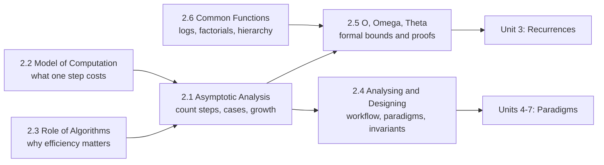

# Asymptotic Analysis and the Role of Algorithms

!!! success "Learning Outcome"

     
     - {{ lo }}
     

## Why This Unit Matters

Every later unit states results such as "Strassen runs in $\Theta(n^{\lg 7})$", "comparison sorting needs $\Omega(n \lg n)$", or "this DP is pseudo-polynomial". This unit supplies the language and the reasoning behind those statements: what is being counted, on what model of machine, for which inputs, and with what notation.

The same skills are used daily in industry and interviews: estimating whether a solution will scale to production data, reading constraints and choosing a target complexity, spotting hidden quadratic behaviour in code review, and explaining trade-offs between time and memory. They are also the tools you need to check complexity claims made by colleagues, documentation, and AI coding assistants.

## Prerequisites

- Programming fundamentals: loops, recursion, arrays, hash maps.
- Discrete mathematics: sums, proof by induction and contradiction, logarithms and exponents.
- [Unit 1: Mathematical Foundations](../unit1/overview.md) for counting, number theory, and the formula reference.

## Topic Map

| Topic | Core question | Key result |
|---|---|---|
| [2.1 Asymptotic Analysis](topic1.md) | How do we measure an algorithm's cost independently of the machine? | Count basic operations as a function $T(n)$; distinguish best, worst, average case; keep the dominant term; verify with doubling experiments |
| [2.2 Model of Computation (Word-RAM)](topic2.md) | What counts as one step? | Word operations and memory accesses are $O(1)$ with $w \ge \lg n$; big integers are not unit cost; the model ignores caches |
| [2.3 Role of Algorithms in Computing](topic3.md) | Why does algorithm choice matter if hardware is fast? | At $n = 10^9$, $n \lg n$ on a 1000× slower machine beats $n^2$; hardware gains barely help exponential algorithms |
| [2.4 Analysing and Designing Algorithms](topic4.md) | How do we design an algorithm and prove it correct? | Design workflow; paradigm overview; time–space trade-offs; loop invariants (Initialization, Maintenance, Termination) |
| [2.5 O, Ω, and Θ Notation](topic5.md) | How do we state and prove growth bounds precisely? | Definitions with $c$ and $n_0$; $\Theta = O \cap \Omega$; limit test; properties |
| [2.6 Standard Notation and Common Functions](topic6.md) | How do common functions compare? | Log identities, $\lg(n!) = \Theta(n \lg n)$, $H_n = \ln n + O(1)$, growth hierarchy |
| [Summary](summary.md) | | Cheat sheet, exam points, mixed practice |

## How to Study This Unit

1. Read 2.3 first if you want motivation, then 2.2 and 2.1 to learn how costs are counted.
2. Work through 2.5 with pen and paper: prove at least five bounds by finding explicit $c$ and $n_0$.
3. Use 2.6 as a reference; memorise the log identities and the growth hierarchy.
4. In 2.4, practise writing loop invariants for small loops until all three parts feel routine.
5. Run the Python examples and do at least one doubling experiment on your own code.
6. Finish with the [summary](summary.md) mixed practice before moving to [Unit 3](../unit3/overview.md).
