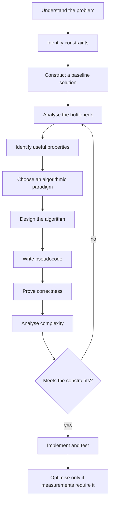

# Analysing and Designing Algorithms

!!! abstract "At a glance"

    - **Problem:** given an unfamiliar problem, how do you systematically arrive at an algorithm that is correct and efficient, and how do you justify both claims?
    - **Key idea:** follow a workflow: specify → baseline → find the bottleneck → exploit structure with a paradigm → prove correctness → analyse cost → implement and test.
    - **Running example:** insertion sort, designed incrementally and proved correct with a **loop invariant** (Initialization, Maintenance, Termination).
    - **Trade-offs:** time can often be bought with memory (hashing, precomputation, memoisation) and vice versa.
    - **Paradigms** (brute force, divide and conquer, dynamic programming, greedy, randomised) are previewed here and developed in Units 4–7.

## Motivation and Problem Context

Most algorithmic failures in practice are not "the developer did not know merge sort". They are:

- solving the wrong problem because the specification was vague (does "sort" need to be stable? are duplicates allowed?);
- writing an algorithm that works on the test cases but fails on an edge case nobody reasoned about;
- shipping a correct but quadratic solution because no one asked what $n$ will be.

A disciplined design process prevents all three. This topic gives that process, the main design paradigms as a map of the rest of the course, the central time–space trade-off, and the standard tool for proving iterative algorithms correct.

## Problem Formulation

Designing an algorithm starts with a precise specification. For the running example:

- **Input:** a sequence $A = \langle a_1, a_2, \dots, a_n \rangle$ of $n \ge 0$ elements drawn from a totally ordered set (any two elements can be compared with $\le$).
- **Output:** a permutation $\langle a'_1, \dots, a'_n \rangle$ of the input such that $a'_1 \le a'_2 \le \dots \le a'_n$.
- **Constraints / assumptions:** sort in place (only $O(1)$ extra memory); the comparison $\le$ is the only way to inspect elements; duplicates allowed.

Writing the specification exposes questions you must answer before designing: Is stability required? Is memory limited? Is the input nearly sorted? Is $n$ ten or ten billion?

## Intuition

Almost every algorithm design is an answer to the question **"what does the brute-force solution waste, and what property of the problem lets me avoid that waste?"** For sorting, the waste in trying all $n!$ orderings is enormous; the property we exploit is that a sorted prefix stays sorted if each new element is inserted in the right place. That observation alone produces insertion sort. Exploiting stronger properties (halves can be sorted independently and merged in linear time) produces merge sort.

## Principles of Algorithm Design

| Principle | Meaning | Example |
|---|---|---|
| Correctness first | an algorithm that is fast but sometimes wrong is not an algorithm for the problem | prove invariants before optimising |
| Precise specification | input, output, constraints, assumptions written down | "stable sort, in place, $n \le 10^6$" |
| Start from a baseline | a simple correct solution gives a reference for testing and a target to beat | brute-force pairs before hashing |
| Find and attack the bottleneck | improve the part that dominates cost | the inner loop of a nested scan |
| Exploit structure | sortedness, monotonicity, optimal substructure, independence of subproblems | binary search needs sortedness |
| Reuse proven components | build on algorithms with known guarantees | sort, then sweep |
| Simplicity | simpler algorithms are easier to prove, test, and maintain | prefer the clear $O(n \log n)$ over the fragile $O(n)$ when $n$ is modest |
| Analyse before implementing | estimate cost against the constraints first | $n = 10^5$ rules out $\Theta(n^2)$ |

### The algorithm design workflow



The loop from "Analyse complexity" back to "Analyse the bottleneck" is the heart of design: each iteration either finds a better algorithm or proves (often via a lower bound) that no better one is possible.

### Paradigm overview

| Paradigm | One-line idea | Signature property to look for | Classic examples | Developed in |
|---|---|---|---|---|
| Brute force / exhaustive search | try every candidate solution | small search space, or need a correctness baseline | all pairs, all subsets, all permutations | throughout (as baseline) |
| Incremental | extend a solution for the first $k$ elements to $k+1$ | a partial solution stays valid when extended | insertion sort | this topic |
| Divide and conquer | split into independent subproblems, solve recursively, combine | subproblems do not overlap; combine step is cheap | merge sort, Strassen, Karatsuba, FFT | [Unit 4](../unit4/topic1.md) |
| Dynamic programming | solve each overlapping subproblem once, store, reuse | optimal substructure + overlapping subproblems | rod cutting, LCS, matrix-chain order | [Unit 6](../unit6/topic1.md) |
| Greedy | make the locally best choice and never undo it | greedy-choice property + optimal substructure | activity selection, Huffman, Dijkstra, MST | [Unit 7](../unit7/topic1.md) |
| Randomised | use random choices to avoid bad cases or to simplify | adversarial inputs, or expected-case suffices | randomised quicksort, hashing | [5.4](../unit5/topic4.md), [Unit 7](../unit7/overview.md) |

!!! warning "Important"

    Paradigms are not interchangeable labels. Greedy is correct only when the greedy-choice property holds (it fails for 0/1 knapsack); DP needs overlapping subproblems to beat plain recursion; divide and conquer pays off only when the combine step is cheaper than solving the whole problem directly. Exam questions often ask you to justify *why* a paradigm applies.

## Baseline Approach

The brute-force sorting algorithm generates permutations until it finds a sorted one:

```text
PERMUTATION-SORT(A)
    for each permutation P of A
        if P is in non-decreasing order then return P
```

Checking one permutation costs $\Theta(n)$ and there are $n!$ permutations, so the worst case is $\Theta(n \cdot n!)$. At $n = 20$ that is already more than $10^{19}$ operations. It is correct and useful as a reference implementation for tiny inputs, but it ignores all structure.

**Bottleneck:** it treats each permutation as unrelated to the others and throws away everything learned from failed candidates.

## Algorithm Design

Exploit the structure of the output instead of searching for it:

1. A sequence of length 1 is trivially sorted.
2. If the first $j-1$ elements are already sorted, placing element $j$ correctly requires only finding its position among them and shifting larger elements one step right.
3. Repeating step 2 for $j = 2, \dots, n$ sorts the whole array.

This is the **incremental** strategy. It replaces "search the space of $n!$ orderings" with "$n-1$ insertions, each costing at most $j-1$ comparisons", giving $O(n^2)$, and it uses only $O(1)$ extra memory, meeting the in-place constraint.

## Pseudocode

```text
INSERTION-SORT(A[1..n])
    for j ← 2 to n
        key ← A[j]
        // Insert key into the sorted prefix A[1..j−1]
        i ← j − 1
        while i ≥ 1 and A[i] > key
            A[i + 1] ← A[i]
            i ← i − 1
        A[i + 1] ← key
```

## Worked Example

Input $A = \langle 5, 2, 4, 6, 1, 3 \rangle$. The sorted prefix is shown in bold.

| $j$ | key | Shifts | Array after iteration |
|---|---|---|---|
| start | – | – | **5** 2 4 6 1 3 |
| 2 | 2 | 1 (5) | **2 5** 4 6 1 3 |
| 3 | 4 | 1 (5) | **2 4 5** 6 1 3 |
| 4 | 6 | 0 | **2 4 5 6** 1 3 |
| 5 | 1 | 4 (6, 5, 4, 2) | **1 2 4 5 6** 3 |
| 6 | 3 | 3 (6, 5, 4) | **1 2 3 4 5 6** |

Total shifts: 9, equal to the number of inversions in the input (each shift fixes exactly one inverted pair).

## Correctness

### Loop invariants

A **loop invariant** is a statement about the program's variables that is true before every iteration of a loop. To use it as a proof you show three things:

| Step | What to show | Analogy with induction |
|---|---|---|
| Initialization | the invariant holds before the first iteration | base case |
| Maintenance | if it holds before an iteration, it holds before the next | inductive step |
| Termination | when the loop ends, the invariant (plus the exit condition) implies the desired result | conclusion |

The termination step is what distinguishes a loop-invariant proof from ordinary induction: the induction stops when the loop stops, and the final invariant must be strong enough to give correctness.

### Proof for insertion sort

**Invariant (outer loop).** At the start of each iteration of the `for` loop with index $j$, the subarray $A[1..j-1]$ consists of exactly the elements originally in $A[1..j-1]$, in non-decreasing order.

- **Initialization.** Before the first iteration $j = 2$, so $A[1..1]$ is a single original element, which is trivially sorted.
- **Maintenance.** Assume $A[1..j-1]$ holds the original first $j-1$ elements, sorted. The body saves $A[j]$ in `key`, then the `while` loop moves each element of $A[1..j-1]$ that is greater than `key` one position right, scanning from $j-1$ downward, and stops at the first $i$ with $A[i] \le$ `key` (or $i = 0$). (Inner-loop invariant: $A[i+2..j]$ holds the elements of the old $A[i+1..j-1]$, all greater than `key`, and $A[1..i]$ is unchanged.) Writing `key` into $A[i+1]$ produces $A[1..j]$ that contains the original first $j$ elements, with everything left of `key` at most `key` and everything right of it greater than `key`; since both sides were already sorted, $A[1..j]$ is sorted. Incrementing $j$ re-establishes the invariant.
- **Termination.** The loop ends when $j = n + 1$. Substituting, $A[1..n]$ consists of the original elements in sorted order, which is exactly the specification.

The inner loop terminates because $i$ decreases each iteration and the loop stops at $i = 0$ at the latest; the outer loop terminates because $j$ increases to $n+1$. Correctness = invariant + termination.

!!! warning "Important"

    In an exam, all three parts are required and the invariant must mention **both** properties: "sorted" *and* "the same elements as originally in $A[1..j-1]$". An invariant that says only "$A[1..j-1]$ is sorted" would also be satisfied by an algorithm that overwrote the array with zeros.

!!! tip "Choosing an invariant"

    Ask: "what has the loop accomplished so far, stated so that at termination it becomes the goal?" For a running sum, "`total` = sum of the first $i$ elements"; for binary search, "if the key is present, it lies in $A[lo..hi]$"; for partition in quicksort, "elements left of the boundary are $\le$ pivot".

## Complexity Analysis

Using the step counting of [2.1](topic1.md) (where the three cases are derived in full):

| Case | When | Comparisons | Time |
|---|---|---|---|
| Best | already sorted | $n - 1$ | $\Theta(n)$ |
| Worst | reverse sorted | $\frac{n(n-1)}{2}$ | $\Theta(n^2)$ |
| Average | random permutation | $\approx \frac{n^2}{4}$ | $\Theta(n^2)$ |

More precisely, the running time is $\Theta(n + I)$ where $I$ is the number of inversions, so insertion sort is **adaptive**: fast on nearly sorted data. Extra space is $\Theta(1)$, and the algorithm is **stable** (the strict test `A[i] > key` never moves an element past an equal one).

## Time–Space Trade-offs

Many speedups work by storing information so it need not be recomputed or searched for. Many memory savings work by recomputing instead of storing.

| Technique | Time without | Time with | Extra space | Example |
|---|---|---|---|---|
| Hashing for lookups | $\Theta(n^2)$ pair scan | $\Theta(n)$ expected | $\Theta(n)$ | two-sum, duplicate detection |
| Precomputation (prefix sums) | $\Theta(n)$ per range-sum query | $\Theta(1)$ per query after $\Theta(n)$ build | $\Theta(n)$ | analytics dashboards, image integral tables |
| Memoisation / DP table | exponential naive recursion (e.g. Fibonacci) | $\Theta(n)$ | $\Theta(n)$, sometimes reducible to $\Theta(1)$ | [Unit 6](../unit6/topic1.md) |
| Lookup tables | compute $f(x)$ each time | $\Theta(1)$ table read | size of domain | CRC tables, bit-count tables |
| Sorting then sweeping | repeated searches | one $\Theta(n \log n)$ sort + linear sweep | $O(1)$ to $O(n)$ | interval merging |
| In-place vs out-of-place | merge sort uses $\Theta(n)$ buffer | heapsort is in place but less cache-friendly | $\Theta(1)$ | memory-constrained systems |
| Approximate structures | exact set: $\Theta(n)$ words | Bloom filter: a few bits per element | small, with false positives | cache filters, databases |

!!! note "The general rule"

    Spending memory is worthwhile when the stored information is reused many times (many queries), or when it removes a factor of $n$ from the running time. It is not worthwhile when memory is the binding constraint (embedded devices, data larger than RAM), in which case recomputation or streaming wins.

## Python Implementation

Insertion sort with an optional executable invariant check, plus the two-sum trade-off and prefix sums. Python indices are 0-based, so `range(1, len(a))` corresponds to $j = 2..n$.

```python
def insertion_sort(a, check_invariant=False):
    """Sort list a in place (ascending) and return it."""
    original = list(a) if check_invariant else None
    for j in range(1, len(a)):
        if check_invariant:
            # Invariant: a[0..j-1] holds the original first j elements, in sorted order.
            assert a[:j] == sorted(original[:j])
        key = a[j]
        i = j - 1
        while i >= 0 and a[i] > key:
            a[i + 1] = a[i]
            i -= 1
        a[i + 1] = key
    if check_invariant:
        assert a == sorted(original)
    return a


def two_sum_bruteforce(nums, target):
    """O(n^2) time, O(1) extra space. Returns indices (i, j), i < j, or None."""
    n = len(nums)
    for i in range(n):
        for j in range(i + 1, n):
            if nums[i] + nums[j] == target:
                return i, j
    return None


def two_sum_hashing(nums, target):
    """O(n) expected time, O(n) extra space. Returns indices (i, j), i < j, or None."""
    seen = {}
    for j, value in enumerate(nums):
        i = seen.get(target - value)
        if i is not None:
            return i, j
        if value not in seen:
            seen[value] = j
    return None


def build_prefix_sums(nums):
    """prefix[k] = nums[0] + ... + nums[k-1]; O(n) time and space, built once."""
    prefix = [0] * (len(nums) + 1)
    for k, value in enumerate(nums):
        prefix[k + 1] = prefix[k] + value
    return prefix


def range_sum(prefix, left, right):
    """Sum of nums[left..right] inclusive in O(1) using precomputed prefix sums."""
    return prefix[right + 1] - prefix[left]
```

Walkthrough:

- `check_invariant=True` turns the proof into a runtime check: the assertion is exactly the outer-loop invariant (it makes the sort $\Theta(n^2 \log n)$, so use it only in tests).
- The `while` condition tests `i >= 0` **before** `a[i]`; reversing the order would read `a[-1]` in Python (the last element) instead of stopping.
- `two_sum_hashing` checks for the complement *before* inserting the current value, so a single element is never paired with itself (e.g. `[3]` with target 6 returns `None`, while `[3, 3]` returns `(0, 1)`).
- `prefix` has length $n+1$ with `prefix[0] = 0`; that sentinel removes the special case for ranges starting at index 0.

## Edge Cases and Pitfalls

| Case / pitfall | What goes wrong | Fix |
|---|---|---|
| Empty array or single element | loops must simply not execute | `range(1, len(a))` is empty for $n \le 1$; test it |
| `while a[i] > key and i >= 0` (wrong order) | out-of-bounds in most languages; silent wrong comparison with `a[-1]` in Python | test the index first; rely on short-circuit `and` |
| Using `>=` instead of `>` in the inner test | still sorts, but equal elements are reordered: no longer stable | use strict `>` |
| Invariant that omits "same elements" | proof would accept an algorithm that destroys data | state both the permutation and the order property |
| Forgetting termination in the proof | the invariant alone says nothing if the loop never ends | argue a strictly monotone loop variable |
| Choosing a paradigm by name, not property | greedy applied to 0/1 knapsack gives wrong answers | check the paradigm's precondition, or find a counterexample |
| Trading space for time without checking memory | a $\Theta(n^2)$ table at $n = 10^5$ needs $10^{10}$ cells | estimate memory just as you estimate time |

## Common Misconceptions

- **"Testing shows correctness."** Tests can show the presence of bugs, not their absence. A loop-invariant proof covers all inputs; tests then check that the implementation matches the proof.
- **"A loop invariant is just a comment."** It is a claim with a three-part proof obligation. If you cannot prove Maintenance, the loop (or the invariant) is wrong.
- **"Design means picking the fanciest paradigm."** Start with the simplest correct baseline; move to a paradigm only when its precondition holds and the baseline is too slow for the constraints.
- **"Faster always means more memory."** Often, but not always: a better algorithm can improve both (insertion sort vs permutation sort), and some memory savings (in-place algorithms) cost nothing asymptotically.
- **"Insertion sort is obsolete."** It is the method of choice for small or nearly sorted inputs and is used inside production hybrid sorts.

## Alternatives and Trade-offs

Proof techniques for correctness:

| Technique | Use for | Example |
|---|---|---|
| Loop invariant | iterative algorithms | insertion sort, binary search, partition |
| Induction on input size | recursive algorithms | merge sort, recursive binary search |
| Exchange argument | greedy algorithms | activity selection, Huffman ([Unit 7](../unit7/topic1.md)) |
| Optimal substructure + recurrence justification | dynamic programming | rod cutting ([Unit 6](../unit6/topic1.md)) |
| Contradiction / adversary arguments | lower bounds, impossibility | $\Omega(n \log n)$ comparison sorting ([5.2](../unit5/topic2.md)) |

When to use the incremental design of insertion sort: small $n$ (tens of elements), nearly sorted input, online input (elements arrive one at a time), stability needed with no extra memory. When **not** to: large random inputs, where $\Theta(n \log n)$ algorithms ([Unit 5](../unit5/overview.md)) are dramatically faster.

## In Practice

- Production sorting libraries use insertion sort (often binary insertion sort) on short runs inside hybrid algorithms; CPython's Timsort/Powersort and typical C++ `std::sort` implementations both do this.
- Invariant-style assertions are used in industry as executable specifications: debug builds check invariants, release builds remove them. Property-based testing (for example the `hypothesis` library in Python) generates many random inputs and checks properties such as "output is sorted and a permutation of the input".
- Formal verification tools (for example Dafny, or proof assistants such as Coq/Rocq and Lean) require exactly the loop invariants taught here; a well-known example is the flaw in the Timsort implementation of the Java standard library that was discovered in 2015 while attempting to formally verify it with the KeY tool.
- Time–space trade-offs drive systems design: caches, indexes, materialised views, and CDNs all spend memory to save time.

## Interview and Competitive Programming

Recognition cues:

| If you see... | Think... |
|---|---|
| "find a pair / complement", "seen before" | hash set or hash map: trade $O(n)$ space for $O(n)$ time |
| many range-sum or range-count queries on a static array | prefix sums |
| "nearly sorted", "each element at most $k$ away" | insertion sort ($O(nk)$) or a size-$k$ heap |
| "minimum number of steps/ways", overlapping choices | dynamic programming |
| "choose the best next item" with an exchange-argument feel | greedy; but prove it or find a counterexample |
| sorted input or monotone condition | binary search / two pointers |

Template for interviews: state the brute force and its complexity → identify the repeated work → name the structure you will exploit → give the improved algorithm, its complexity, and the invariant that makes it correct → mention edge cases → code → test with an edge case.

## Using AI Assistants Critically

- LLM-written insertion sort frequently swaps the loop condition order (`a[i] > key and i >= 0`) or starts the outer loop at 0; check both against the pseudocode.
- Ask the assistant for the loop invariant of the code it generated. A vague invariant ("the array gets more sorted") signals that the code was not reasoned about.
- Assistants often use `>=` in the inner loop and still claim stability; test with records that have equal keys and distinct tags.
- Generated "optimised" versions frequently trade space for time silently (dictionaries, caches); ask for the space complexity explicitly.
- Turn the invariant into an `assert` (as in `check_invariant`) and run it on many random inputs, or use `hypothesis` to generate them; compare against `sorted()` as a brute-force oracle.
- When an assistant claims a greedy solution is optimal, ask for the exchange argument; try a small brute-force search for counterexamples.

## Practice

### Beginner

1. **Trace.** Trace insertion sort on $\langle 31, 41, 59, 26, 41, 58 \rangle$, giving the array after each outer iteration. Difficulty: easy.
2. **Invariant for a sum.** Write a loop invariant for a loop computing the sum of $A[1..n]$ and prove it with all three parts. Difficulty: easy.
3. **Descending order.** Modify the insertion sort pseudocode to sort in non-increasing order. Difficulty: easy.

### Intermediate

1. **Linear search proof.** Write linear search and prove it correct with a loop invariant. Input: array and key; output: index or NOT-FOUND. Difficulty: medium.
2. **Binary insertion sort.** Replace the linear scan with binary search for the insertion point. How many comparisons and how many element moves in the worst case? Difficulty: medium.
3. **Trade-off design.** Answer $q$ queries "how many elements of a static array of $n$ integers in $[0, 10^6]$ are $\le x$?". Give a solution with $O(1)$ per query and state its preprocessing time and space. Difficulty: medium.

### Advanced

1. **Inversions and running time.** Prove that insertion sort performs exactly $I$ shifts, where $I$ is the number of inversions, and conclude its running time is $\Theta(n + I)$. Difficulty: hard.
2. **Paradigm selection.** For coin change with denominations $\{1, 3, 4\}$, show that the greedy "largest coin first" method fails, and identify a paradigm that works. Difficulty: medium-hard.
3. **Bubble sort invariant.** State and prove the outer-loop invariant of bubble sort. Difficulty: medium-hard.

### Interview / Competitive Programming

1. **Two Sum.** LeetCode 1 Two Sum: return indices of two numbers adding to a target. Give brute force and hashing solutions with complexities. Difficulty: easy.
2. **Range Sum Query.** LeetCode 303 Range Sum Query – Immutable: answer many range-sum queries on a fixed array. Difficulty: easy.
3. **Contains Duplicate within distance $k$.** Determine whether any two equal elements have indices at most $k$ apart in $O(n)$ time. Difficulty: medium.

## Self-Check Questions

??? question "Q1. What are the three parts of a loop-invariant proof, and which corresponds to the inductive step?"

    Initialization (holds before the first iteration), Maintenance (preserved by each iteration; this is the inductive step), and Termination (on exit, the invariant implies correctness).

??? question "Q2. Why is 'A[1..j−1] is sorted' not a sufficient invariant for insertion sort?"

    It does not guarantee that the subarray contains the original elements. An algorithm that replaced the prefix with zeros would satisfy it. The invariant must also say that $A[1..j-1]$ is a permutation of the original $A[1..j-1]$.

??? question "Q3. Is insertion sort stable? What single change would break stability?"

    Yes: an element is shifted only if it is strictly greater than `key`, so equal elements keep their relative order. Changing the test to `A[i] >= key` would move equal elements past each other and break stability.

??? question "Q4. Give an example where spending memory reduces time by a factor of $n$."

    Two-sum: the brute-force pair scan is $\Theta(n^2)$ with $O(1)$ space; storing seen values in a hash map gives $\Theta(n)$ expected time with $\Theta(n)$ space.

??? question "Q5. A problem has optimal substructure but no overlapping subproblems. Which paradigm is more natural, DP or divide and conquer?"

    Divide and conquer. DP's benefit comes from reusing solutions to repeated subproblems; with independent subproblems, memoisation stores results that are never reused.

??? question "Q6. Why should you write a baseline solution even if you know it is too slow?"

    It clarifies the specification, gives a correctness oracle for testing the faster solution on small inputs, and exposes the bottleneck to attack.

??? question "Q7. You need to sort 30 nearly sorted sensor readings on a microcontroller with very little RAM. Which algorithm and why?"

    Insertion sort: $\Theta(n + I)$ time is close to linear on nearly sorted data, it uses $O(1)$ extra memory, is stable, and its small code size and low constant factors suit tiny $n$.

## Complexity Summary

| Algorithm / technique | Time | Extra space |
|---|---|---|
| Permutation sort (baseline) | $\Theta(n \cdot n!)$ worst | $O(n)$ |
| Insertion sort best / avg / worst | $\Theta(n)$ / $\Theta(n^2)$ / $\Theta(n^2)$ | $\Theta(1)$ |
| Insertion sort, in terms of inversions $I$ | $\Theta(n + I)$ | $\Theta(1)$ |
| Two-sum brute force | $\Theta(n^2)$ | $\Theta(1)$ |
| Two-sum with hashing | $\Theta(n)$ expected | $\Theta(n)$ |
| Prefix sums: build / query | $\Theta(n)$ / $\Theta(1)$ | $\Theta(n)$ |

## Key Takeaways

- Design starts from a precise specification: input, output, constraints, and assumptions.
- Follow the workflow: baseline, bottleneck, property, paradigm, design, proof, analysis, implementation, testing.
- Each paradigm (divide and conquer, DP, greedy, randomised) has a precondition; justify it before applying the paradigm.
- Loop invariants prove iterative algorithms correct through Initialization, Maintenance, and Termination; the invariant must be strong enough to yield the goal.
- Insertion sort is correct, in place, stable, and adaptive ($\Theta(n + I)$), but $\Theta(n^2)$ in the worst and average case.
- Memory can buy time (hashing, precomputation, memoisation); choose the trade-off based on how often stored information is reused and what resource is scarce.
