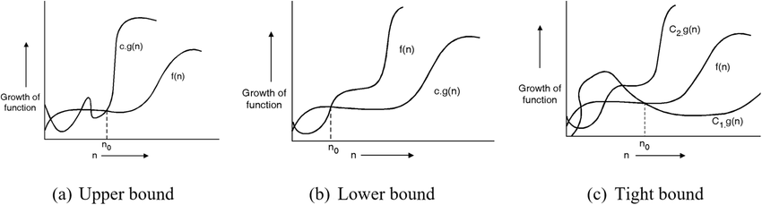

# O, Ω, and Θ Notation

!!! abstract "At a glance"

    - **Problem:** turn the informal "grows like $n^2$" of [2.1](topic1.md) into precise, provable statements.
    - **Definitions:** $O$ = asymptotic upper bound, $\Omega$ = asymptotic lower bound, $\Theta$ = both (tight bound); $o$ and $\omega$ are their strict (non-tight) versions.
    - **Method:** prove $f(n) = O(g(n))$ by exhibiting constants $c > 0$ and $n_0$ with $f(n) \le c\, g(n)$ for all $n \ge n_0$; disprove it by contradiction. The limit of $f(n)/g(n)$ is a fast shortcut.
    - **Classic error:** $O$ is **not** "worst case" and $\Omega$ is **not** "best case"; notation and case are independent choices.

## Motivation and Problem Context

Statements like "merge sort is $n \log n$" and "this loop is quadratic" are used constantly, but informally they are ambiguous. Does "is $n^2$" mean "at most", "at least", or "exactly, up to constants"? For all inputs or some? From which $n$ onward? An exam answer, a design document, or a proof that one algorithm beats another needs a definition precise enough to *prove* things with. Asymptotic notation gives exactly that, and in doing so it formalises the two simplifications of [2.1](topic1.md): ignore constant factors, and ignore behaviour for small $n$.

## Problem Formulation

- **Objects:** functions $f, g : \mathbb{N} \to \mathbb{R}$ that are **asymptotically non-negative** (non-negative for all sufficiently large $n$). Running times and space usage always are.
- **Goal:** compare the growth of $f$ and $g$, ignoring constant factors and finitely many small values of $n$.
- **Typical use:** $f$ is a precise (often messy) cost function such as $T(n) = \frac{n^2}{2} + \frac{7n}{2} - 4$; $g$ is a simple reference such as $n^2$.

## Intuition

Picture plotting $f(n)$ and $c \cdot g(n)$. You are allowed to stretch $g$ vertically by any constant $c$ and to ignore everything left of some point $n_0$. If, after such a stretch, $c\,g$ stays above $f$ forever, then $f = O(g)$. If some stretch of $g$ stays below $f$ forever, $f = \Omega(g)$. If $f$ can be sandwiched between two stretches of $g$, $f = \Theta(g)$.

<figure markdown="span">
    {width="90%"}
    <figcaption>(a) Big-O: beyond n0, f(n) stays below c·g(n). (b) Big-Omega: beyond n0, f(n) stays above c·g(n). (c) Big-Theta: beyond n0, f(n) is sandwiched between c1·g(n) and c2·g(n).</figcaption>
</figure>

## Definitions

For an asymptotically non-negative function $g(n)$:

$$
O(g(n)) = \{\, f(n) : \exists\, c > 0, n_0 > 0 \text{ such that } 0 \le f(n) \le c\, g(n) \text{ for all } n \ge n_0 \,\}
$$

$$
\Omega(g(n)) = \{\, f(n) : \exists\, c > 0, n_0 > 0 \text{ such that } 0 \le c\, g(n) \le f(n) \text{ for all } n \ge n_0 \,\}
$$

$$
\Theta(g(n)) = \{\, f(n) : \exists\, c_1, c_2 > 0, n_0 > 0 \text{ such that } 0 \le c_1 g(n) \le f(n) \le c_2\, g(n) \text{ for all } n \ge n_0 \,\}
$$

$$
o(g(n)) = \{\, f(n) : \forall\, c > 0\ \exists\, n_0 > 0 \text{ such that } 0 \le f(n) < c\, g(n) \text{ for all } n \ge n_0 \,\}
$$

$$
\omega(g(n)) = \{\, f(n) : \forall\, c > 0\ \exists\, n_0 > 0 \text{ such that } 0 \le c\, g(n) < f(n) \text{ for all } n \ge n_0 \,\}
$$

| Notation | Read as | Analogy with numbers | Quantifier on $c$ |
|---|---|---|---|
| $f = O(g)$ | $f$ grows no faster than $g$ | $a \le b$ | there **exists** $c$ |
| $f = \Omega(g)$ | $f$ grows at least as fast as $g$ | $a \ge b$ | there **exists** $c$ |
| $f = \Theta(g)$ | $f$ grows at the same rate as $g$ | $a = b$ | there exist $c_1, c_2$ |
| $f = o(g)$ | $f$ grows strictly slower than $g$ | $a < b$ | **for every** $c$ |
| $f = \omega(g)$ | $f$ grows strictly faster than $g$ | $a > b$ | **for every** $c$ |

!!! warning "Important"

    $f(n) = O(g(n))$ is notation for **set membership**, $f(n) \in O(g(n))$. The "=" is one-way: $n = O(n^2)$ is true, but "$O(n^2) = n$" is meaningless, and from $n = O(n^2)$ and $n^2 = O(n^2)$ you cannot conclude $n = n^2$.

### Theorem: $\Theta$ is $O$ and $\Omega$ together

$f(n) = \Theta(g(n))$ if and only if $f(n) = O(g(n))$ and $f(n) = \Omega(g(n))$.

*Proof.* ($\Rightarrow$) Take $c = c_2$ for $O$ and $c = c_1$ for $\Omega$, with the same $n_0$. ($\Leftarrow$) Given $f \le c_2 g$ for $n \ge n_a$ and $f \ge c_1 g$ for $n \ge n_b$, both hold for $n \ge \max(n_a, n_b)$. $\blacksquare$

### Asymptotic notation inside expressions

When notation appears inside a formula, it stands for **some anonymous function** in that set. $T(n) = 2T(n/2) + \Theta(n)$ means "$2T(n/2) + h(n)$ for some $h(n) \in \Theta(n)$". In $2n^2 + 3n + 1 = 2n^2 + \Theta(n)$, the $\Theta(n)$ stands for $3n + 1$. On the left of an equation, as in $2n^2 + \Theta(n) = \Theta(n^2)$, it means: *whatever* function the left side's $\Theta(n)$ stands for, the equation holds for *some* choice on the right.

## Key Results

### Properties

Let $f, g, h$ be asymptotically positive.

| Property | Statement | Holds for |
|---|---|---|
| Transitivity | $f = X(g)$ and $g = X(h)$ imply $f = X(h)$ | $X \in \{O, \Omega, \Theta, o, \omega\}$ |
| Reflexivity | $f = X(f)$ | $X \in \{O, \Omega, \Theta\}$ (not $o$, $\omega$) |
| Symmetry | $f = \Theta(g) \iff g = \Theta(f)$ | $\Theta$ |
| Transpose symmetry | $f = O(g) \iff g = \Omega(f)$; $f = o(g) \iff g = \omega(f)$ | |
| Constant factors | $c \cdot f = \Theta(f)$ for any constant $c > 0$ | |
| Sum rule | $f_1 = O(g_1), f_2 = O(g_2) \Rightarrow f_1 + f_2 = O(\max(g_1, g_2))$ | also $f + g = \Theta(\max(f, g))$ |
| Product rule | $f_1 = O(g_1), f_2 = O(g_2) \Rightarrow f_1 f_2 = O(g_1 g_2)$ | also for $\Omega$, $\Theta$ |
| Strict implies non-strict | $f = o(g) \Rightarrow f = O(g)$ and $f \ne \Omega(g)$ | |

*Proof of transitivity for $O$.* If $f \le c_1 g$ for $n \ge n_1$ and $g \le c_2 h$ for $n \ge n_2$, then $f \le c_1 c_2 h$ for $n \ge \max(n_1, n_2)$. $\blacksquare$

*Proof of $f + g = \Theta(\max(f, g))$.* For non-negative values, $\max(f, g) \le f + g \le 2 \max(f, g)$; take $c_1 = 1, c_2 = 2$. $\blacksquare$ This is why, in sequential code, the most expensive phase determines the order of growth.

!!! note "Not every pair of functions is comparable"

    Unlike real numbers, two functions need not satisfy $f = O(g)$ or $g = O(f)$. For $f(n) = n$ and $g(n) = n^{1 + \sin n}$, the exponent of $g$ oscillates between 0 and 2, so neither bounds the other. Trichotomy fails for asymptotic notation.

### Polynomials

**Theorem.** If $p(n) = \sum_{i=0}^{d} a_i n^i$ with $a_d > 0$, then $p(n) = \Theta(n^d)$.

*Proof sketch.* Upper: for $n \ge 1$, $p(n) \le \sum_i |a_i| n^i \le \left(\sum_i |a_i|\right) n^d$. Lower: $p(n) \ge a_d n^d - \left(\sum_{i<d} |a_i|\right) n^{d-1} \ge \frac{a_d}{2} n^d$ once $n \ge \frac{2}{a_d}\sum_{i<d}|a_i|$. $\blacksquare$

### The limit test

If $\lim_{n \to \infty} \frac{f(n)}{g(n)} = L$ exists (possibly $\infty$), then:

| Limit $L$ | Conclusion |
|---|---|
| $L = 0$ | $f = o(g)$, hence $f = O(g)$ but $f \ne \Omega(g)$ |
| $0 < L < \infty$ | $f = \Theta(g)$ |
| $L = \infty$ | $f = \omega(g)$, hence $f = \Omega(g)$ but $f \ne O(g)$ |

*Why it works for $0 < L < \infty$:* by the definition of a limit, for large $n$, $\frac{L}{2} \le \frac{f(n)}{g(n)} \le 2L$, which gives the $\Theta$ constants directly.

!!! warning "Important"

    The limit test is **sufficient, not necessary**. If the limit does not exist (e.g. $f(n) = n(2 + \sin n)$, $g(n) = n$), fall back on the definitions: here $n \le f(n) \le 3n$, so $f = \Theta(n)$ even though $f/g$ oscillates.

## Method: Proving and Disproving Bounds

**To prove $f = O(g)$:**

1. Write the inequality $f(n) \le c\, g(n)$.
2. Bound each term of $f$ above by a multiple of $g$ for $n \ge$ some value (replace lower-order terms by the leading one, drop negative terms).
3. Add the multiples to get $c$; the largest threshold used is $n_0$.
4. State the final $c$ and $n_0$ explicitly.

**To prove $f = \Omega(g)$:** bound $f$ **below**: drop positive lower-order terms, and absorb negative terms into a fraction of the leading term.

**To prove $f = \Theta(g)$:** do both, with the same or a combined $n_0$.

**To disprove $f = O(g)$:** assume constants $c, n_0$ exist, rearrange to an inequality like $n \le c$ for all $n \ge n_0$, and choose $n = \max(n_0, \lceil c \rceil + 1)$ to get a contradiction.

**Shortcut:** compute $\lim f/g$ (L'Hôpital's rule for logs and exponentials) and use the table above.

## Worked Examples

### Example 1: $3n^2 + 2n + 1 = O(n^2)$

For $n \ge 1$: $2n \le 2n^2$ and $1 \le n^2$, so $3n^2 + 2n + 1 \le 3n^2 + 2n^2 + n^2 = 6n^2$. Take $c = 6$, $n_0 = 1$.

A smaller $c$ needs a larger $n_0$: $3n^2 + 2n + 1 \le 4n^2 \iff n^2 - 2n - 1 \ge 0 \iff n \ge 1 + \sqrt{2}$, so $c = 4$, $n_0 = 3$ also works. Constants are not unique; any valid pair is a proof.

### Example 2: $3n^2 + 2n + 1 = \Omega(n^2)$, hence $\Theta(n^2)$

For $n \ge 1$, $3n^2 + 2n + 1 \ge 3n^2$. Take $c = 3$, $n_0 = 1$. Combined with Example 1: $3n^2 \le f(n) \le 6n^2$ for $n \ge 1$, so $f = \Theta(n^2)$ with $c_1 = 3$, $c_2 = 6$, $n_0 = 1$.

### Example 3: a negative lower-order term, $2n^2 - 5n = \Omega(n^2)$

We need $2n^2 - 5n \ge c n^2$. With $c = 1$: $2n^2 - 5n \ge n^2 \iff n^2 \ge 5n \iff n \ge 5$. So $c = 1$, $n_0 = 5$. Note that $n_0 = 1$ fails here ($2 - 5 < 1$): the threshold $n_0$ exists precisely to skip such small cases.

### Example 4: $\frac{1}{2}n^2 - 3n = \Theta(n^2)$

Divide by $n^2$: we need $c_1 \le \frac{1}{2} - \frac{3}{n} \le c_2$. The right inequality holds for all $n \ge 1$ with $c_2 = \frac{1}{2}$. The left holds with $c_1 = \frac{1}{14}$ for $n \ge 7$ (at $n = 7$: $\frac12 - \frac37 = \frac{1}{14}$). So $c_1 = \frac{1}{14}$, $c_2 = \frac12$, $n_0 = 7$.

### Example 5: $n^3 \ne O(n^2)$

Suppose $n^3 \le c\, n^2$ for all $n \ge n_0$. Dividing by $n^2$ gives $n \le c$ for all $n \ge n_0$, which fails at $n = \max(n_0, \lfloor c \rfloor + 1)$. Contradiction. More generally $n^a = o(n^b)$ whenever $a < b$.

### Example 6: exponentials with different bases or shifts

- $2^{n+1} = 2 \cdot 2^n$, so $2^{n+1} = \Theta(2^n)$ ($c = 2$). A constant **added to the exponent** is a constant factor.
- $2^{2n} = 4^n$. If $4^n \le c\, 2^n$ then $2^n \le c$ for all large $n$, a contradiction. So $2^{2n} \ne O(2^n)$. A constant **multiplying the exponent** changes the growth class.

### Example 7: logarithms versus polynomials

For any $\varepsilon > 0$: $\lim_{n\to\infty} \frac{\ln n}{n^\varepsilon} = \lim \frac{1/n}{\varepsilon n^{\varepsilon - 1}} = \lim \frac{1}{\varepsilon n^\varepsilon} = 0$ (L'Hôpital). So $\log n = o(n^\varepsilon)$: every positive power of $n$ eventually dominates the logarithm. Consequently $n \log n = o(n^{1.1})$ and $n \log n = \omega(n)$.

### Example 8: what each statement says about insertion sort

| Statement | True? | Why |
|---|---|---|
| Worst-case time is $\Theta(n^2)$ | yes | exact order of the worst case ([2.1](topic1.md)) |
| Running time is $O(n^2)$ | yes | every input takes at most $c n^2$ |
| Running time is $\Omega(n)$ | yes | every input takes at least $c n$ |
| Running time is $\Omega(n^2)$ | **no** | sorted inputs take only $\Theta(n)$ |
| Best-case time is $O(n^2)$ | yes, but loose | $\Theta(n)$ is the informative statement |
| Running time is $O(n^3)$ | yes, but uninformative | valid upper bound, not tight |

## Python Implementation

Numeric checks cannot prove an asymptotic statement (they examine finitely many $n$), but they quickly catch a wrong choice of constants and suggest the limit.

```python
def find_violation(f, g, c, n0, n_max=10 ** 6, kind="O"):
    """Search n0..n_max for an n that violates the claimed bound.

    kind "O":     claim f(n) <= c * g(n) for all n >= n0
    kind "Omega": claim f(n) >= c * g(n) for all n >= n0
    Returns the first violating n, or None. Finding none is evidence, not proof.
    """
    for n in range(n0, n_max + 1):
        if kind == "O" and f(n) > c * g(n):
            return n
        if kind == "Omega" and f(n) < c * g(n):
            return n
    return None


def ratio_trend(f, g, sizes=(10, 10 ** 2, 10 ** 3, 10 ** 4, 10 ** 5, 10 ** 6)):
    """Return [(n, f(n)/g(n))] to suggest the limit used by the limit test."""
    return [(n, f(n) / g(n)) for n in sizes]
```

Walkthrough:

- `find_violation(lambda n: 3*n*n + 2*n + 1, lambda n: n*n, 4, 1)` returns `1`, showing that $c = 4$ needs a larger $n_0$; with `n0=3` it returns `None`, matching Example 1.
- `ratio_trend` for $3n^2 + 2n + 1$ over $n^2$ gives 3.21, 3.02, 3.002, ... approaching 3, so the limit test predicts $\Theta(n^2)$.
- A cautionary case: `ratio_trend` for $n \log_2 n$ over $n^{1.1}$ gives roughly 2.6, 4.2, 5.0, 5.3, 5.3, 5.0 up to $n = 10^6$. The true limit is 0 (Example 7), but the decrease begins only at very large $n$. **Numerical evidence can mislead; proofs settle the question.**

## Edge Cases and Pitfalls

| Case / pitfall | What goes wrong | Fix |
|---|---|---|
| Choosing $c$ but forgetting $n_0$ | the inequality fails for small $n$ (Example 3 at $n = 1$) | always state $n_0$ and check it |
| Letting $c$ depend on $n$ | "$n^2 \le c \cdot n$ with $c = n$" proves nothing | $c$ must be a fixed constant |
| Hidden growing constants in induction | "proving" $\sum_{i=1}^{n} i = O(n)$ by assuming $O(k)$ and adding $k+1$ each step | carry explicit constants through the induction |
| Dropping a negative term in a lower bound | $2n^2 - 5n \ge 2n^2$ is false | absorb it into part of the leading term |
| Treating the limit test as necessary | concluding "not $\Theta$" when the limit does not exist | use the definitions directly |
| Writing $O(n^2)$ for a bound that is actually tight | statement is true but loses information | use $\Theta$ when you have proved both sides |
| $\log(n^k)$ vs $(\log n)^k$ | $\log n^k = k \log n = \Theta(\log n)$, but $(\log n)^k$ is not $\Theta(\log n)$ for $k > 1$ | parenthesise clearly ([2.6](topic6.md)) |

## Common Misconceptions

- **"Big-O means worst case; Omega means best case."** $O$, $\Omega$, $\Theta$ bound *functions*. The worst-case running time is one function, the best-case another; each can be given $O$, $\Omega$ or $\Theta$ bounds. "The best case of insertion sort is $\Theta(n)$" and "the worst case is $\Omega(n^2)$" are both perfectly meaningful.
- **"$O(g)$ is the exact growth rate."** $O$ is only an upper bound; $n = O(n^5)$ is true. In everyday engineering talk "$O$" is often used to mean $\Theta$; in proofs and exams, be precise.
- **"$f = O(g)$ means $f(n) \le g(n)$."** Only up to a constant and only for large $n$: $1000n = O(n)$ even though $1000n > n$.
- **"Every pair of functions is comparable."** See $n$ vs $n^{1 + \sin n}$ above.
- **"Lower bound of an algorithm = lower bound of the problem."** $\Omega$ on one algorithm's running time says nothing about other algorithms; a problem lower bound (e.g. $\Omega(n \log n)$ for comparison sorting, [5.2](../unit5/topic2.md)) must hold for every algorithm.
- **"$O(1)$ means one step."** It means bounded by some constant independent of $n$; $10^6$ steps is $O(1)$.

## Alternatives and Trade-offs

| Tool | Gives | Use when | Avoid when |
|---|---|---|---|
| $\Theta$ | exact order | you can prove matching bounds | only one side is known |
| $O$ | upper bound / guarantee | stating a guarantee; tight analysis is hard | claiming optimality |
| $\Omega$ | lower bound | showing an algorithm is not faster than something; problem lower bounds | describing typical performance |
| $o$, $\omega$ | strict separation | proving one function is strictly dominated (e.g. $\log n = o(n^\varepsilon)$) | ordinary complexity statements |
| Tilde notation $f \sim g$ ($f/g \to 1$) | leading term **with** its constant | comparing algorithms of the same order (e.g. $\sim n^2/2$ vs $\sim n^2/4$ comparisons) | cross-model or cross-machine claims |
| Exact counts | everything | small, critical code paths | general reasoning |

## In Practice

- API documentation states costs with this notation: Python's documentation and the C++ standard specify complexity requirements for container operations (for example, average constant time for hash lookups, logarithmic for ordered-map lookups), usually as upper bounds or amortized bounds.
- Engineers commonly say "$O(n)$" when they mean $\Theta(n)$ in the typical case; in code review, ask which case and whether the bound is tight.
- Performance regression tests sometimes fit measured runtimes against candidate growth functions (the doubling method of [2.1](topic1.md)), an empirical analogue of the limit test.
- Asymptotic notation hides constants that matter in practice: some algorithms with the best known asymptotic bounds (for example, for matrix multiplication) are never used because their constants make them slower for any realistic input.

## Interview and Competitive Programming

- Interviewers usually mean a tight bound when they ask for "the Big-O"; answer with the tight bound and name the case: "$O(n \log n)$ worst case, $O(n)$ extra space".
- Simplify fully: $O(3n^2 + n \log n) \to O(n^2)$; $O(n + m)$ stays two-parameter; $O(\log_3 n) \to O(\log n)$.
- Do **not** simplify away genuinely different parameters: $O(n \cdot m)$ is not $O(n^2)$ unless $m = O(n)$.
- Recognise dominance quickly: $\log n \ll \sqrt{n} \ll n \ll n \log n \ll n^2 \ll 2^n \ll n!$ ([2.6](topic6.md)).
- Trap: "amortized $O(1)$" (dynamic array append) is not "worst-case $O(1)$" per operation.

## Using AI Assistants Critically

- LLM explanations very frequently state "Big-O is the worst case and Omega is the best case". Treat that as a red flag and correct it.
- Generated proofs often choose $c$ correctly but omit $n_0$, or choose an $n_0$ that fails for the stated $c$; check with `find_violation`.
- Watch for constants that secretly depend on $n$ ("choose $c = n$") and for inductive proofs that accumulate hidden constants.
- Assistants may "prove" $f = \Theta(g)$ by showing only one inequality; require both directions.
- When an assistant applies the limit test, check that the limit exists; if it oscillates, ask for a direct proof.
- Do not accept a numeric table as proof of an asymptotic claim; the $n \log n$ vs $n^{1.1}$ example shows why.

## Practice

### Beginner

1. **Find constants.** Prove $5n + 7 = O(n)$ by giving $c$ and $n_0$. Difficulty: easy.
2. **Theta of a polynomial.** Prove $4n^3 - 2n^2 + 10 = \Theta(n^3)$ with explicit $c_1, c_2, n_0$. Difficulty: easy.
3. **True or false.** Decide and justify: $n^2 = O(n^3)$; $n^3 = O(n^2)$; $2^n = \Theta(3^n)$; $\log_2 n = \Theta(\log_{10} n)$. Difficulty: easy.

### Intermediate

1. **Disprove.** Prove $n^2 \ne O(n \log n)$. Difficulty: medium.
2. **Limit test.** Classify $f(n) = n^{0.01}$ against $g(n) = (\log n)^{10}$. Difficulty: medium.
3. **Sum rule.** Prove that if $f_1 = O(g_1)$ and $f_2 = O(g_2)$ then $f_1 + f_2 = O(\max(g_1, g_2))$. Difficulty: medium.

### Advanced

1. **Incomparable functions.** Construct two increasing functions $f, g$ such that neither $f = O(g)$ nor $g = O(f)$. Difficulty: hard.
2. **Bogus induction.** Find the error in this "proof" that $\sum_{i=1}^n i = O(n)$: base case $1 = O(1)$; if $\sum_{i \le k} i = O(k)$, then $\sum_{i \le k+1} i = O(k) + (k+1) = O(k+1)$. Difficulty: medium-hard.
3. **Little-o characterisation.** Prove that $f = o(g)$ if and only if $\lim f/g = 0$, for $g$ positive. Difficulty: hard.

### Interview / Competitive Programming

1. **Simplify.** Give the tightest simple bound: $O(n^2 + 10^6 n)$, $O(n \log n + n\sqrt{n})$, $O(2^n + n^{100})$. Difficulty: easy.
2. **Two parameters.** An algorithm runs in $O(n \log m + m \log n)$. Can it be written as $O((n + m)\log(n + m))$? Is that tight? Difficulty: medium.
3. **Case and notation.** State the best-case, worst-case, and overall bounds of quicksort with a first-element pivot using the correct notation. Difficulty: medium.

## Self-Check Questions

??? question "Q1. State the formal definition of $f(n) = \Theta(g(n))$."

    There exist positive constants $c_1$, $c_2$, $n_0$ such that $0 \le c_1 g(n) \le f(n) \le c_2 g(n)$ for all $n \ge n_0$. Equivalently, $f = O(g)$ and $f = \Omega(g)$.

??? question "Q2. Is $2^{n+1} = O(2^n)$? Is $2^{2n} = O(2^n)$?"

    $2^{n+1} = 2 \cdot 2^n$, so yes with $c = 2$. $2^{2n} = 4^n$; if $4^n \le c \cdot 2^n$ then $2^n \le c$ for all large $n$, impossible. So no.

??? question "Q3. A student writes: 'Insertion sort is $\Omega(n^2)$ because its worst case is $n^2$.' What is wrong?"

    "Insertion sort is $\Omega(n^2)$" claims every input takes at least $c n^2$ time, which is false for sorted inputs ($\Theta(n)$). The correct statement is "the worst-case running time of insertion sort is $\Omega(n^2)$" (indeed $\Theta(n^2)$).

??? question "Q4. What is the difference between $O$ and $o$?"

    $O$ requires the inequality for **some** constant $c$; $o$ requires it for **every** $c > 0$ (with $n_0$ depending on $c$). $2n = O(n)$ but $2n \ne o(n)$; $n = o(n^2)$. Informally, $O$ is $\le$ and $o$ is $<$.

??? question "Q5. Why does the base of the logarithm not matter inside $O$?"

    $\log_a n = \frac{\log_b n}{\log_b a}$, and $\frac{1}{\log_b a}$ is a positive constant for fixed $a, b > 1$. Constant factors are absorbed by $O$, so $O(\log_2 n) = O(\log_{10} n) = O(\ln n)$.

??? question "Q6. Prove $\max(f(n), g(n)) = \Theta(f(n) + g(n))$ for non-negative $f, g$."

    $\max(f, g) \le f + g$ because both are non-negative, and $f + g \le 2\max(f, g)$. So $\frac{1}{2}(f + g) \le \max(f, g) \le 1 \cdot (f + g)$: $c_1 = \frac12$, $c_2 = 1$, $n_0 = 1$.

??? question "Q7. The ratio $f(n)/g(n)$ oscillates between 1 and 3 forever. What can you conclude?"

    The limit does not exist, so the limit test is silent. But $g \le f \le 3g$ for all large $n$, so $f = \Theta(g)$ directly from the definition.

??? question "Q8. Is $n \log n = O(n^{1.1})$? A table of $n \log_2 n / n^{1.1}$ up to $n = 10^6$ shows values near 5 and not clearly decreasing."

    Yes. $\frac{n \log n}{n^{1.1}} = \frac{\log n}{n^{0.1}} \to 0$ by L'Hôpital, so $n \log n = o(n^{1.1})$. The ratio peaks around $n \approx 2.2 \times 10^4$ and then decreases very slowly; finite tables cannot reveal the limit reliably.

## Complexity Summary

| Notation | Definition (for $n \ge n_0$) | Limit of $f/g$ (if it exists) |
|---|---|---|
| $f = O(g)$ | $\exists c$: $f \le c\,g$ | $< \infty$ |
| $f = \Omega(g)$ | $\exists c$: $f \ge c\,g$ | $> 0$ |
| $f = \Theta(g)$ | $\exists c_1, c_2$: $c_1 g \le f \le c_2 g$ | $0 < L < \infty$ |
| $f = o(g)$ | $\forall c$: $f < c\,g$ | $= 0$ |
| $f = \omega(g)$ | $\forall c$: $f > c\,g$ | $= \infty$ |

## Key Takeaways

- $O$, $\Omega$, $\Theta$ are sets of functions defined by constants $c$ (or $c_1, c_2$) and a threshold $n_0$; $o$ and $\omega$ require the inequality for every $c$.
- $\Theta = O \cap \Omega$: a tight bound needs proofs in both directions.
- To prove a bound, exhibit explicit constants; to disprove one, assume constants exist and derive a contradiction.
- The limit of $f/g$ classifies the relationship when it exists; when it does not, use the definitions.
- Asymptotic notation and best/worst/average case are independent: always say which case you are bounding.
- The "=" in $f = O(g)$ means membership and is one-directional.
- Numeric experiments can suggest but never prove asymptotic claims.
