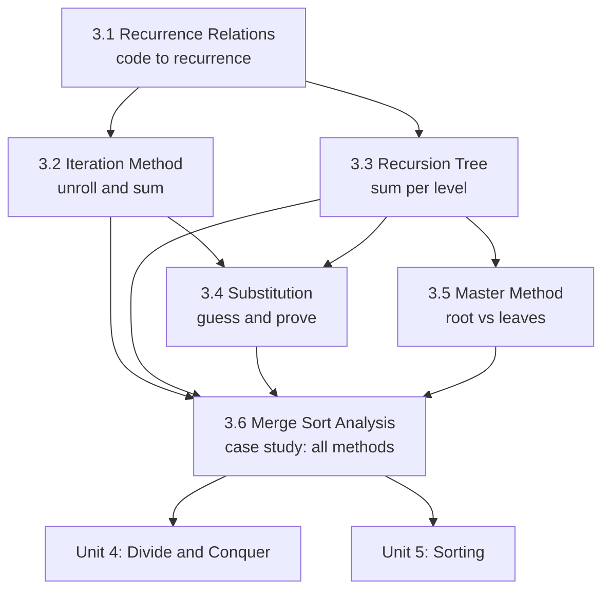

# Recurrences and Their Solution Methods

!!! success "Learning Outcome"

     
     - {{ lo }}
     

## Why This Unit Matters

Every recursive algorithm, and in particular every divide-and-conquer algorithm in Unit 4, is analysed by writing a recurrence and solving it. Statements such as "merge sort is $\Theta(n\log n)$", "Karatsuba is $\Theta(n^{1.585})$" or "binary search is $\Theta(\log n)$" are all solutions of recurrences. This unit teaches you to produce those statements yourself, to choose the right solving method for each recurrence, and to judge when a method's answer can be trusted.

In industry and interviews the same skill appears as: stating the complexity of a recursive solution in one sentence ("two calls on half the input plus linear work: $O(n\log n)$"), spotting accidental exponential recursion, deciding whether reducing the combine step or the number of subproblems will actually speed up an algorithm, and checking complexity claims made by colleagues or AI assistants.

## Prerequisites

- [2.1 Asymptotic Analysis](../unit2/topic1.md): $O$, $\Omega$, $\Theta$, counting steps of loops, best/worst/average case.
- [2.2 Model of Computation](../unit2/topic2.md): what one step costs.
- Discrete mathematics: logarithm identities, arithmetic and geometric series, proof by (strong) induction.
- Programming: recursion and the call stack.

## Topic Map

| Topic | Core question | Key result |
|---|---|---|
| [3.1 Recurrence Relations](topic1.md) | How do I turn recursive code into an equation? | $T(n) = (\text{calls that execute}) + f(n)$; floors and base constants do not change $\Theta$ |
| [3.2 Iteration Method](topic2.md) | Can I just expand the recurrence and sum? | Exact closed forms, e.g. $T(n-1)+n = n(n+1)/2$, $2T(n-1)+1 = 2^n-1$; telescoping |
| [3.3 Recursion Tree](topic3.md) | Where in the recursion is the work done? | Level costs $a^i f(n/b^i)$; root, balanced or leaf dominated; $T(n/3)+T(2n/3)+n = \Theta(n\log n)$ |
| [3.4 Substitution Method](topic4.md) | How do I prove a guessed bound? | Induction with fixed constants; strengthening the hypothesis; change of variables |
| [3.5 Master Method](topic5.md) | Can I read the answer off directly? | Compare $f(n)$ with $n^{\log_b a}$; three cases, regularity, extended case 2, Akra-Bazzi |
| [3.6 Merge Sort Analysis](topic6.md) | How do all methods apply to a real algorithm? | $2T(n/2)+\Theta(n) = \Theta(n\log n)$ in every case; stable; $\Theta(n)$ extra space |

## How to Study This Unit

1. Start with 3.1 and practise writing recurrences from code until you never miscount recursive calls.
2. Learn 3.2 and 3.3 together: iteration follows one path through the recursion tree, the tree adds up all of them.
3. Do 3.4 slowly. Most lost marks come from inductions that end in "$= O(\cdot)$" or skip base cases.
4. Learn the master method (3.5) last among the methods, as a summary of the recursion-tree regimes, not as a formula to memorise. Always check which conditions it needs.
5. Use 3.6 to consolidate: solve merge sort's recurrence with every method and compare.
6. Revise with the [Unit 3 Summary](summary.md), which has the decision guide, the cheat sheet and mixed practice.
