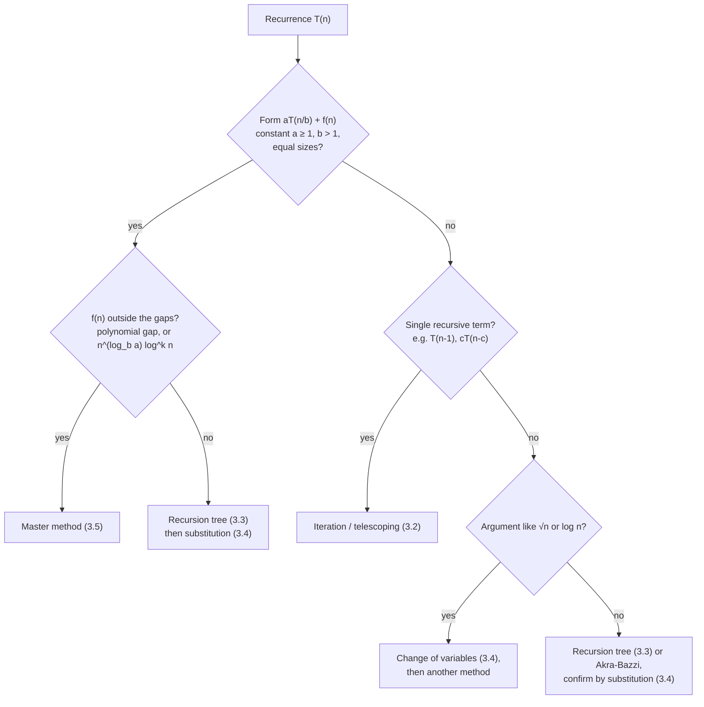

# Unit 3 Summary

## Key Results

### Writing recurrences ([3.1](topic1.md))

| Rule | Detail |
|---|---|
| Form | $T(n) = \sum T(\text{size of each call that executes}) + f(n)$, base $T(n) = \Theta(1)$ for $n \le n_0$ |
| $f(n)$ | Non-recursive work of **one** call, including slicing/copying of arguments |
| Calls in exclusive branches | Count one (binary search: $T(n/2)$, not $2T(n/2)$) |
| Value vs cost | `fact(n) = n * fact(n-1)` costs $T(n-1) + \Theta(1)$, not $nT(n-1)$ |
| Floors/ceilings | Can be dropped for $\Theta$ when $T$ is monotone and the answer is smooth; keep for exact counts and inductions |
| Geometric loop | `j *= 2` up to $n$: $\lfloor\lg n\rfloor + 1$ iterations |

### Cheat sheet of common recurrences

| Recurrence | Solution | Typical algorithm |
|---|---|---|
| $T(n-1) + \Theta(1)$ | $\Theta(n)$ | factorial, linear recursion |
| $T(n-1) + \Theta(n)$ | $\Theta(n^2)$ | quicksort worst case, recursive selection sort |
| $T(n-1) + \Theta(\log n)$ | $\Theta(n\log n)$ | $n$ heap/BST insertions |
| $2T(n-1) + \Theta(1)$ | $\Theta(2^n)$ (Hanoi: exactly $2^n - 1$) | Towers of Hanoi, subsets |
| $T(n-1) + T(n-2) + \Theta(1)$ | $\Theta(\varphi^n)$, $\varphi \approx 1.618$ | naive Fibonacci |
| $T(n/2) + \Theta(1)$ | $\Theta(\log n)$ | binary search, fast power |
| $T(n/2) + \Theta(n)$ | $\Theta(n)$ | halving with linear scan |
| $2T(n/2) + \Theta(1)$ | $\Theta(n)$ | tree traversal, D&C max |
| $2T(n/2) + \Theta(n)$ | $\Theta(n\log n)$ | merge sort, FFT, closest pair |
| $2T(n/2) + \Theta(n\log n)$ | $\Theta(n\log^2 n)$ | closest pair without presorting |
| $2T(n/2) + \Theta(n/\log n)$ | $\Theta(n\log\log n)$ | extended case 2, $k = -1$ |
| $2T(n/2) + \Theta(n^2)$ | $\Theta(n^2)$ | root-dominated |
| $3T(n/2) + \Theta(n)$ | $\Theta(n^{\log_2 3}) \approx n^{1.585}$ | Karatsuba |
| $4T(n/2) + \Theta(n)$ | $\Theta(n^2)$ | naive D&C integer multiplication |
| $7T(n/2) + \Theta(n^2)$ | $\Theta(n^{\log_2 7}) \approx n^{2.807}$ | Strassen |
| $8T(n/2) + \Theta(n^2)$ | $\Theta(n^3)$ | naive D&C matrix multiplication |
| $3T(n/4) + \Theta(n^2)$ | $\Theta(n^2)$ | CLRS recursion-tree example |
| $T(n/3) + T(2n/3) + \Theta(n)$ | $\Theta(n\log n)$ | quicksort with 1:2 split |
| $T(n/5) + T(7n/10) + \Theta(n)$ | $\Theta(n)$ | median of medians |
| $T(\sqrt{n}) + \Theta(1)$ | $\Theta(\log\log n)$ | van Emde Boas |
| $2T(\sqrt{n}) + \Theta(\log n)$ | $\Theta(\log n\log\log n)$ | change of variables |
| $\sqrt{n}\,T(\sqrt{n}) + \Theta(n)$ | $\Theta(n\log\log n)$ | change of variables |

### Useful identities and sums

| Fact | Value |
|---|---|
| Leaves of the tree for $aT(n/b)$ | $a^{\log_b n} = n^{\log_b a}$ |
| $\sum_{i=1}^{n} i$ | $n(n+1)/2$ |
| $\sum_{i=0}^{k} r^i$ | $(r^{k+1} - 1)/(r - 1)$; $\Theta(1)$ if $r < 1$, $\Theta(r^k)$ if $r > 1$ |
| $H_n = \sum 1/i$ | $\ln n + O(1)$ |
| $\log n!$ | $\Theta(n\log n)$ |
| $\log_b a$ | $\ln a/\ln b$; $\log_2 3 \approx 1.585$, $\log_2 7 \approx 2.807$, $\log_4 3 \approx 0.792$, $\log_3 7 \approx 1.771$ |

### Master theorem ([3.5](topic5.md))

$T(n) = aT(n/b) + f(n)$, constants $a \ge 1$, $b > 1$; watershed $n^{\log_b a}$.

| Case | Condition | Result |
|---|---|---|
| 1 | $f(n) = O(n^{\log_b a - \varepsilon})$, $\varepsilon > 0$ | $\Theta(n^{\log_b a})$ |
| 2 | $f(n) = \Theta(n^{\log_b a}\log^k n)$, $k \ge 0$ | $\Theta(n^{\log_b a}\log^{k+1} n)$ |
| 2, $k = -1$ | $f(n) = \Theta(n^{\log_b a}/\log n)$ | $\Theta(n^{\log_b a}\log\log n)$ |
| 2, $k < -1$ | $f(n) = \Theta(n^{\log_b a}\log^k n)$ | $\Theta(n^{\log_b a})$ |
| 3 | $f(n) = \Omega(n^{\log_b a + \varepsilon})$ **and** $af(n/b) \le cf(n)$, $c < 1$ | $\Theta(f(n))$ |

Akra-Bazzi: for $T(n) = \sum a_i T(b_i n) + g(n)$, find $p$ with $\sum a_i b_i^p = 1$; then $T(n) = \Theta\!\left(n^p\left(1 + \int_1^n g(u)/u^{p+1}\,du\right)\right)$.

### Merge sort ([3.6](topic6.md))

| Measure | Value |
|---|---|
| Time (all cases) | $\Theta(n\log n)$ |
| Worst-case comparisons | $n\lceil\lg n\rceil - 2^{\lceil\lg n\rceil} + 1$ |
| Best-case comparisons ($n = 2^m$, sorted) | $\frac{n}{2}\lg n$ |
| Extra space | $\Theta(n)$ for arrays; $\Theta(\log n)$ stack |
| Stable | Yes, because ties take the left element (`<=`) |

## Important for Exams

!!! warning "Classic mistakes"

    - **Counting recursive calls from the source text.** Binary search is $T(n/2) + 1$, not $2T(n/2) + 1$.
    - **Ending an induction with "$= O(g(n))$".** The step must give $T(n) \le c\,g(n)$ with the same $c$. "$cn + n = O(n)$" is the textbook false proof.
    - **Base case $n = 1$ for an $n\log n$ claim.** $c\cdot 1\cdot\log 1 = 0$; start at $n_0 = 2$ and check every small value used by the step.
    - **Case 3 for a logarithmic gap.** $2T(n/2) + n\log n$ is extended case 2, $\Theta(n\log^2 n)$, not $\Theta(n\log n)$.
    - **Skipping regularity in case 3.** State $c < 1$ explicitly.
    - **Watershed typo.** It is $n^{\log_b a}$, not $n^{\log_b n}$.
    - **Applying the master theorem to $T(n-1)$, $T(\sqrt{n})$, or unequal splits.** It needs equal sizes $n/b$ with constant $b > 1$ and constant $a \ge 1$.
    - **Dropping the leaf term** $a^k T(1) = n^{\log_b a}T(1)$ in iteration or recursion trees.
    - **Unbalanced recursion trees.** The longest path gives an upper bound, the shortest path a lower bound; give both.
    - **Merge sort stability.** Depends on `<=` in the merge.

!!! note "What a full-mark answer shows"

    - Master method: $a$, $b$, $f(n)$, watershed, explicit $\varepsilon$ (or $k$), regularity with explicit $c$ for case 3, final $\Theta$.
    - Recursion tree: level cost, height (both heights if unbalanced), number of leaves, the sum, the $\Theta$.
    - Substitution: precise hypothesis with constants, substitution, algebra back to the same form, condition on $c$, base cases.
    - Step count: cost of the non-recursive part (with loop counts), the recurrence with base case, then the solution.

## Choosing the Right Technique

| Method | Best for | Gives | Weak spot |
|---|---|---|---|
| [Iteration](topic2.md) | One recursive term, subtractive recurrences | Exact closed form | Many branches |
| [Telescoping](topic2.md) | Normalisable to $S(k) = S(k-1) + g(k)$; full-history sums | Exact closed form | Two or more recursive arguments |
| [Recursion tree](topic3.md) | Unequal splits, intuition, guessing | $\Theta$ (or an $O$/$\Omega$ pair) | Informal unless summed carefully |
| [Substitution](topic4.md) | Proofs, floors and ceilings, anything with a guess | Rigorous $O$/$\Omega$ | Needs a guess; easy to fake |
| [Master method](topic5.md) | $aT(n/b) + f(n)$ | $\Theta$ in seconds | Gaps, regularity, narrow form |
| Akra-Bazzi | Unequal splits with general $f$ | $\Theta$ | Needs $p$ and an integral |

**Efficiency of the approaches.** The master method is the most efficient when it applies but covers the narrowest class. Recursion trees cost more effort but extend to unequal splits and explain the result. Iteration is efficient for single-term recurrences and gives exact constants. Substitution is the most general and the only fully rigorous method, but it needs a guess, usually supplied by one of the others. In practice: guess with the master method or a tree, then confirm with substitution when rigour is required.

## Mixed Practice

??? question "Q1. Write the recurrence for a function that loops `for i = 1 to n: for (j = 1; j <= n; j *= 2)` and then calls itself twice on $n/2$. Solve it."
    The inner loop runs $\lfloor\lg n\rfloor + 1$ times, so $f(n) = \Theta(n\log n)$. $T(n) = 2T(n/2) + \Theta(n\log n)$. Watershed $n$; $f/n = \log n$ (not polynomial), so extended case 2 with $k = 1$ gives $\Theta(n\log^2 n)$.

??? question "Q2. Solve $T(n) = T(n-1) + n^2$, $T(0) = 0$ exactly."
    Iteration: $T(n) = \sum_{i=1}^{n} i^2 = n(n+1)(2n+1)/6 = \Theta(n^3)$. The master method does not apply (subtractive).

??? question "Q3. Solve $T(n) = T(n/4) + T(3n/4) + n$ and justify both bounds."
    Full levels cost $n$ (children's sizes sum to the parent's). The shortest path, $\log_4 n$, gives $\Omega(n\log n)$; the longest path, $\log_{4/3} n$, gives $O(n\log n)$. So $\Theta(n\log n)$.

??? question "Q4. Find the error: 'Assume $T(k) \le ck^2$. Then $T(n) = 4T(n/2) + n \le cn^2 + n = O(n^2)$.' Then fix it."
    The step gives $cn^2 + n$, not $\le cn^2$. Strengthen to $T(n) \le cn^2 - dn$: $4(cn^2/4 - dn/2) + n = cn^2 - 2dn + n \le cn^2 - dn$ iff $d \ge 1$. Choose $c$ to cover the base case.

??? question "Q5. Solve $T(n) = 2T(n/2) + n^2$ by three methods and check they agree."
    Master: watershed $n$, $f = n^2$ polynomially larger, regularity $2(n/2)^2 = n^2/2$, so $c = 1/2$: $\Theta(n^2)$. Tree: level $i$ costs $n^2/2^i$, sum $< 2n^2$. Iteration with $T(1) = 1$: $T(n) = 2n^2 - n$. All give $\Theta(n^2)$.

??? question "Q6. Solve $T(n) = 2T(\sqrt{n}) + 1$."
    With $n = 2^m$ and $S(m) = T(2^m)$: $S(m) = 2S(m/2) + 1 = \Theta(m)$, so $T(n) = \Theta(\log n)$.

??? question "Q7. Solve $T(n) = 3T(n/3) + n/\log n$."
    Watershed $n$; $f = n\log^{-1} n$, so $k = -1$: extended case 2, $\Theta(n\log\log n)$. The classic three cases do not apply.

??? question "Q8. Why does merge sort take $\Theta(n\log n)$ on every input, while quicksort's time depends on the input?"
    Merge sort's split point depends only on indices, so its recursion tree is always balanced: $2T(n/2) + \Theta(n)$. Quicksort's split depends on the pivot's rank; a bad pivot gives $T(n-1) + \Theta(n) = \Theta(n^2)$.

??? question "Q9. Which is faster asymptotically: $T_1(n) = 5T(n/2) + n^2$ or $T_2(n) = 3T(n/2) + n^2$?"
    $T_1$: watershed $n^{\log_2 5} \approx n^{2.32}$ beats $n^2$: case 1, $\Theta(n^{2.32})$. $T_2$: watershed $n^{1.585}$, $f = n^2$ is larger, regularity $c = 3/4$: case 3, $\Theta(n^2)$. $T_2$ is faster.

??? question "Q10. Solve $T(n) = T(n-1) + T(n-2) + 1$ to within a constant base, and give a one-line fix that makes the computation linear."
    $\Theta(\varphi^n)$ with $\varphi = (1+\sqrt{5})/2$ (substitution with $T(n) \le c\varphi^n - d$). Memoise (or iterate bottom-up): each of the $n$ subproblems is then solved once, giving $\Theta(n)$.

??? question "Q11. Iteration drill: solve each, or explain why it cannot be solved. (a) $T(n) = T(n+1) + 1$, $T(1) = 1$; (b) $T(n) = T(n/2 + 1) + 1$, $T(1) = 1$; (c) $T(n) = T(n-1) + 2$, $T(1) = 1$; (d) $T(n) = 2T(n/2) + n^2$, $T(1) = 1$."
    (a) **Ill-posed.** The argument grows ($n + 1 > n$), so the expansion never reaches the base case; a cost recurrence must recurse on *smaller* inputs. Formally it only says $T(n+1) = T(n) - 1$, which with $T(1) = 1$ gives a decreasing, eventually negative function, impossible for a running time.

    (b) $\Theta(\log n)$. Let $m = n - 2$: then $(n/2 + 1) - 2 = m/2$, so the distance to 2 halves at each step and the depth is about $\log_2(n - 2)$. Note that $n = 2$ maps to itself ($2/2 + 1 = 2$), so a base case is needed for every $n \le 2$; the given $T(1) = 1$ alone is not enough.

    (c) $T(n) = 1 + 2(n - 1) = 2n - 1 = \Theta(n)$.

    (d) Level $i$ costs $n^2/2^i$; with $n = 2^m$, $T(n) = n^2(2 - 2/n) + n\,T(1) = 2n^2 - n = \Theta(n^2)$.

??? question "Q12. Master method drill (21 recurrences). For each, apply the classic theorem if possible; otherwise say so and use the extended form or another argument."
    | # | Recurrence | Watershed | Verdict | $T(n)$ |
    |---|---|---|---|---|
    | 1 | $3T(n/2) + n^2$ | $n^{1.585}$ | Case 3; regularity $c = 3/4$ | $\Theta(n^2)$ |
    | 2 | $4T(n/2) + n^2$ | $n^2$ | Case 2 | $\Theta(n^2\log n)$ |
    | 3 | $T(n/2) + 2^n$ | $1$ | Case 3; $2^{n/2} \le c\,2^n$ for any $c > 0$ once $n$ is large | $\Theta(2^n)$ |
    | 4 | $2^n T(n/2) + n^n$ | n/a | **Does not apply**: $a = 2^n$ is not constant | not by master |
    | 5 | $16T(n/4) + n$ | $n^2$ | Case 1, $\varepsilon = 1$ | $\Theta(n^2)$ |
    | 6 | $2T(n/2) + n\log n$ | $n$ | Classic: gap. Extended case 2, $k = 1$ | $\Theta(n\log^2 n)$ |
    | 7 | $2T(n/2) + n/\log n$ | $n$ | Classic: gap. Extended, $k = -1$ | $\Theta(n\log\log n)$ |
    | 8 | $2T(n/4) + n^{0.51}$ | $n^{0.5}$ | Case 3, $\varepsilon = 0.01$; regularity $2/4^{0.51} \approx 0.986 < 1$ | $\Theta(n^{0.51})$ |
    | 9 | $0.5T(n/2) + 1/n$ | n/a | **Does not apply**: $a < 1$ (and $f$ is not a meaningful cost) | not by master |
    | 10 | $16T(n/4) + n!$ | $n^2$ | Case 3; $16\,(n/4)! \le c\,n!$ for large $n$ | $\Theta(n!)$ |
    | 11 | $\sqrt{2}\,T(n/2) + \log n$ | $n^{0.5}$ | Case 1, since $\log n = O(n^{0.5 - \varepsilon})$ | $\Theta(\sqrt{n})$ |
    | 12 | $3T(n/2) + n$ | $n^{1.585}$ | Case 1 | $\Theta(n^{\log_2 3})$ |
    | 13 | $3T(n/3) + \sqrt{n}$ | $n$ | Case 1, $\varepsilon = 1/2$ | $\Theta(n)$ |
    | 14 | $4T(n/2) + cn$ | $n^2$ | Case 1 | $\Theta(n^2)$ |
    | 15 | $3T(n/4) + n\log n$ | $n^{0.792}$ | Case 3; regularity $c = 3/4$ | $\Theta(n\log n)$ |
    | 16 | $3T(n/3) + n/2$ | $n$ | Case 2 | $\Theta(n\log n)$ |
    | 17 | $6T(n/3) + n^2\log n$ | $n^{1.631}$ | Case 3; regularity $c = 2/3$ | $\Theta(n^2\log n)$ |
    | 18 | $4T(n/2) + n/\log n$ | $n^2$ | Case 1 | $\Theta(n^2)$ |
    | 19 | $64T(n/8) - n^2\log n$ | n/a | **Does not apply**: $f(n)$ is negative | not by master |
    | 20 | $7T(n/3) + n^2$ | $n^{1.771}$ | Case 3; regularity $c = 7/9$ | $\Theta(n^2)$ |
    | 21 | $4T(n/2) + \log n$ | $n^2$ | Case 1 | $\Theta(n^2)$ |
