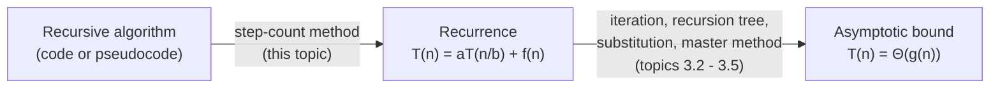

# Recurrence Relations

!!! abstract "At a glance"

    - **Problem:** a loop's cost can be counted directly, but a recursive algorithm's cost is defined *in terms of itself*. We need an equation that captures that self-reference.
    - **Key idea:** charge each call for the work it does *outside* its recursive calls, $f(n)$, and add the cost of the recursive calls on smaller inputs. The result is a **recurrence** such as $T(n) = 2T(n/2) + \Theta(n)$.
    - **Output of this topic:** a correct recurrence with base case. Solving it is the job of the methods in topics 3.2 to 3.5.
    - **Where it is used:** every divide-and-conquer algorithm (Unit 4), sorting analysis (Unit 5), recursive DP before memoisation (Unit 6), and everyday code review of recursive functions.

## Motivation and Problem Context

Consider binary search. A loop-free description is "look at the middle element, then search one half". Asking "how many comparisons?" leads straight back to the same question on a smaller array. The cost is self-referential:

$$
\text{cost}(n) = \text{cost}(n/2) + 1 .
$$

This is not a closed formula yet; it is a **specification** of the cost that we must then solve. Every recursive algorithm you will analyse in this course goes through the same two-stage pipeline:



Getting the first arrow wrong makes everything downstream wrong, no matter how carefully the recurrence is solved. In exams, most lost marks on recurrence questions come from a wrong $f(n)$ or a wrong number of recursive calls, not from algebra.

## Problem Formulation

- **Input:** a recursive procedure, with an identified input-size measure $n$ (array length, number of bits, value of an integer argument, number of nodes).
- **Output:** a recurrence for its running time $T(n)$ (or its space $S(n)$), consisting of
    1. a **recursive case** valid for $n > n_0$: $T(n) = \sum_{i} T(n_i) + f(n)$, where $n_i < n$ are the sizes passed to the recursive calls and $f(n)$ is the non-recursive work, and
    2. a **base case**: $T(n) = \Theta(1)$ for $n \le n_0$.
- **Assumptions:** the unit-cost Word-RAM model ([2.2](../unit2/topic2.md)); each primitive operation costs $O(1)$; the recursive calls are on inputs of a size that depends only on $n$ (worst-case, best-case, or average-case analysis must be stated explicitly when it does not).

## Intuition

Think of the recursion as a tree of calls. Each call is a node that does some local work (looping, partitioning, merging) and then delegates to its children. The **recurrence is simply a description of one node**: "my cost is my local work plus the cost of my children". All the global information (how deep the tree is, how many nodes it has) is hidden inside the self-reference and is recovered later by solving.

!!! tip "Mental model"
    A recurrence describes *one generic call*. Write down what that call does by itself ($f(n)$), how many times it recurses ($a$), and on what size ($n/b$, $n-1$, ...). Do not try to think about the whole recursion at once.

## Definitions

**Recurrence.** An equation or inequality that defines a function on integers in terms of its values at smaller arguments, together with one or more base values. Example: $T(n) = T(n-1) + n$ for $n > 1$, $T(1) = 1$.

**Cost recurrence vs value recurrence.** These are different objects and are often confused.

| Function computed | Value recurrence (what the function *returns*) | Cost recurrence (how *long* it takes) |
|---|---|---|
| `fact(n)` | $F(n) = n \cdot F(n-1)$, $F(0) = 1$ | $T(n) = T(n-1) + \Theta(1)$, i.e. $\Theta(n)$ |
| `fib(n)` (naive) | $F(n) = F(n-1) + F(n-2)$ | $T(n) = T(n-1) + T(n-2) + \Theta(1)$, i.e. $\Theta(\varphi^n)$ |
| `power(x, n)` by squaring | $P(n) = P(n/2)^2$ (times $x$ if $n$ odd) | $T(n) = T(n/2) + \Theta(1)$, i.e. $\Theta(\log n)$ |

!!! warning "Important"
    The multiplication in `fact(n) = n * fact(n-1)` is **one** $O(1)$ operation in the cost model, not "$n$ times the cost of the subproblem". Writing $T(n) = n \cdot T(n-1)$ for factorial's running time is a classic error: it would give $\Theta(n!)$ instead of $\Theta(n)$.

**Closed form.** An expression for $T(n)$ with no self-reference, e.g. $T(n) = n(n+1)/2$.

**Asymptotic solution.** A tight bound $T(n) = \Theta(g(n))$. In algorithm analysis this is usually all we need, which is why we can be relaxed about constants and rounding (see below).

**Divide-and-conquer form.** The most common shape in this course:

$$
T(n) = a\,T\!\left(\frac{n}{b}\right) + f(n), \qquad a \ge 1,\; b > 1,
$$

where $a$ is the number of recursive calls (branching factor), $n/b$ is the size of each subproblem, and $f(n)$ is the cost of dividing and combining. The quantity $n^{\log_b a}$ (the number of leaves of the recursion tree) is called the **critical** or **watershed** function; comparing $f(n)$ with it is the heart of the [master method](topic5.md).

**Subtract-and-conquer form.** $T(n) = a\,T(n - c) + f(n)$ with constant $c \ge 1$. These do **not** fit the master method; use [iteration](topic2.md) or [substitution](topic4.md).

## Writing a Recurrence from Code: the Step-Count Method

### Procedure

1. **Fix the size measure** $n$. For an array, the length; for an integer argument, its value (or its number of bits, if numbers are huge).
2. **Base case.** Find the input sizes for which the function returns without recursing. Their cost is $\Theta(1)$ (unless the base case itself loops).
3. **Count the non-recursive work** $f(n)$: everything the call executes except the recursive calls themselves. Count loops with sums, exactly as in Unit 2. Include the cost of building arguments (slicing `a[:mid]` in Python costs $\Theta(n)$).
4. **Count the recursive calls** and the size passed to each. Calls inside a loop are multiplied by the number of iterations. Calls in different branches of an `if` are *not* added; take the branch relevant to the case you are analysing (worst, best).
5. **Assemble:** $T(n) = (\text{sum of } T(\text{size}_i)) + f(n)$, plus the base case.

### Worked examples (graded)

!!! example "Example 1 (linear recursion): array sum"

    ```text
    SUM(A, n)
        if n == 0: return 0
        return A[n-1] + SUM(A, n-1)
    ```

    One recursive call on size $n-1$; constant extra work.
    $T(n) = T(n-1) + c$, $T(0) = c_0$. Solution: $\Theta(n)$ ([iteration](topic2.md)).

!!! example "Example 2 (halving): binary search"

    ```text
    BINARY-SEARCH(A, lo, hi, x)
        if lo > hi: return NOT-FOUND
        mid = floor((lo + hi) / 2)
        if A[mid] == x: return mid
        if A[mid] <  x: return BINARY-SEARCH(A, mid+1, hi, x)
        else:           return BINARY-SEARCH(A, lo, mid-1, x)
    ```

    Only **one** of the two recursive calls executes in any given call (they are in different branches). The surviving range has at most $\lfloor n/2 \rfloor$ elements.
    Worst case: $T(n) = T(\lfloor n/2 \rfloor) + c$, $T(0) = c_0$. Solution: $\Theta(\log n)$. Best case (found at the first probe): $\Theta(1)$.

!!! example "Example 3 (two halves plus linear work): merge sort"

    Two recursive calls, each on about half of the array, and a merge that costs $\Theta(n)$.
    $T(n) = T(\lceil n/2 \rceil) + T(\lfloor n/2 \rfloor) + \Theta(n)$, usually written $T(n) = 2T(n/2) + \Theta(n)$. Solution: $\Theta(n \log n)$ ([3.6](topic6.md)).

!!! example "Example 4 (exponential branching): Towers of Hanoi"

    ```text
    HANOI(n, src, dst, via)
        if n == 0: return
        HANOI(n-1, src, via, dst)
        move disk n from src to dst
        HANOI(n-1, via, dst, src)
    ```

    Two calls, each on $n-1$ (subtract, not divide). $T(n) = 2T(n-1) + 1$, $T(0) = 0$. Solution: $T(n) = 2^n - 1$ exactly ([iteration](topic2.md)).

!!! example "Example 5 (loops around recursion): non-trivial $f(n)$"

    ```text
    WORK(n)
        if n <= 1: return
        for i = 1 to n:
            for j = 1 to i:
                count = count + 1
        WORK(n/3); WORK(n/3); WORK(n/3)
    ```

    The double loop executes $\sum_{i=1}^{n} i = n(n+1)/2 = \Theta(n^2)$ increments. Three calls on $n/3$.
    $T(n) = 3T(n/3) + \Theta(n^2)$. Here $n^{\log_3 3} = n$ and $f(n) = n^2$ dominates, so $T(n) = \Theta(n^2)$ ([master method, case 3](topic5.md)).

!!! example "Example 6 (recursion inside a loop): subset enumeration"

    ```text
    SUBSETS(k)            // print all subsets of the first k items
        if k == 0: output current subset; return
        SUBSETS(k-1)               // exclude item k
        include item k; SUBSETS(k-1); remove item k
    ```

    Two calls on $k-1$ plus $O(1)$ bookkeeping (ignoring output cost): $T(k) = 2T(k-1) + \Theta(1) = \Theta(2^k)$. Compare with Example 4: same shape, same growth.

!!! warning "Important"
    Count **calls that actually execute**, not calls that appear in the source. Binary search has two recursive calls in its text but one per execution; Hanoi has two in its text and two per execution. Conversely, a call inside a loop that runs $n$ times contributes $n$ recursive terms.

## Base Cases

- Every recurrence needs a base case; without it, $T(n) = T(n-1) + 1$ is satisfied by $T(n) = n + 7$, $n - 100$, and infinitely many other functions.
- For **asymptotic** analysis the exact base value rarely matters: if $T(n_0) = \Theta(1)$, changing that constant changes $T(n)$ by at most a constant factor *per leaf*. Since the number of leaves is itself what we are counting, the bound is unchanged.
- The base case **does** matter for **exact** answers (Hanoi's $2^n - 1$ depends on $T(0) = 0$) and for correctness of induction proofs ([substitution method](topic4.md) needs base cases that satisfy the claimed bound).
- Convention: unless stated otherwise, $T(n) = \Theta(1)$ for all $n \le n_0$ for some constant $n_0$. This is justified because any algorithm on a constant-sized input runs in constant time.

## Floors, Ceilings, and Why They Can Usually Be Ignored

Real algorithms split $n$ into $\lfloor n/2 \rfloor$ and $\lceil n/2 \rceil$. The exact recurrence for merge sort is

$$
T(n) = T(\lceil n/2 \rceil) + T(\lfloor n/2 \rfloor) + \Theta(n).
$$

We almost always solve $T(n) = 2T(n/2) + \Theta(n)$ instead, assuming $n$ is a power of 2. Two facts justify this.

**1. Sandwich by monotonicity.** Running times are non-decreasing in $n$. For any $n$ there is a power of two $2^k$ with $2^{k} \le n < 2^{k+1}$. Then

$$
T(2^k) \le T(n) \le T(2^{k+1}).
$$

If $T(2^k) = \Theta(2^k \cdot k)$, both ends are $\Theta(n \log n)$ because $2^k$ and $2^{k+1}$ are within a factor of 2 of $n$. This works whenever the answer $g(n)$ is **smooth**: $g(2n) = O(g(n))$. Polynomials and polylogarithms are smooth; $2^n$ is not, but exponential solutions come from subtract-and-conquer recurrences that have no floors anyway.

**2. The theorems already cover rounding.** The master theorem holds with $T(\lfloor n/b \rfloor)$ or $T(\lceil n/b \rceil)$ in place of $T(n/b)$ (CLRS proves this), and the Akra-Bazzi theorem tolerates perturbations of size $O(n / \log^2 n)$ in the argument ([3.5](topic5.md)). So $T(n) = 2T(n/2 + 17) + n$ is still $\Theta(n \log n)$.

!!! note "When rounding does matter"
    - **Exact counts:** the worst-case number of comparisons of merge sort is exactly $n\lceil \lg n \rceil - 2^{\lceil \lg n \rceil} + 1$, which differs from $n \lg n$ for non-powers of 2. Exact answers need the exact recurrence.
    - **Induction proofs:** in the substitution method, $\lfloor n/2 \rfloor$ can reach the base case earlier than you expect (for $n = 3$, $\lfloor 3/2 \rfloor = 1$), so you must check base cases for every small $n$ that the step relies on.
    - **Shrinkage that is not a constant fraction:** $T(n) = T(n - \sqrt{n}) + 1$ is not of the form $T(n/b)$ at all; dropping the structure changes the answer.

## Common Recurrence Shapes

Learn to recognise these. Each row is solved in a later topic; the right-hand column tells you where the answer comes from.

| Recurrence | Solution | Typical algorithm | Solved by |
|---|---|---|---|
| $T(n) = T(n-1) + \Theta(1)$ | $\Theta(n)$ | factorial, linear search, list traversal | [iteration](topic2.md) |
| $T(n) = T(n-1) + \Theta(n)$ | $\Theta(n^2)$ | recursive selection/insertion sort, quicksort worst case | [iteration](topic2.md) |
| $T(n) = T(n-1) + \Theta(\log n)$ | $\Theta(n \log n)$ | inserting $n$ items one at a time into a balanced BST/heap | [iteration](topic2.md) |
| $T(n) = 2T(n-1) + \Theta(1)$ | $\Theta(2^n)$ | Towers of Hanoi, subset enumeration | [iteration](topic2.md) |
| $T(n) = T(n-1) + T(n-2) + \Theta(1)$ | $\Theta(\varphi^n)$, $\varphi \approx 1.618$ | naive Fibonacci | [substitution](topic4.md) |
| $T(n) = T(n/2) + \Theta(1)$ | $\Theta(\log n)$ | binary search, fast exponentiation | [master](topic5.md) |
| $T(n) = T(n/2) + \Theta(n)$ | $\Theta(n)$ | halving with a linear scan (e.g. one-sided recursion after a balanced partition) | [master](topic5.md) |
| $T(n) = 2T(n/2) + \Theta(1)$ | $\Theta(n)$ | tree traversal, divide-and-conquer max | [master](topic5.md) |
| $T(n) = 2T(n/2) + \Theta(n)$ | $\Theta(n \log n)$ | merge sort, balanced quicksort, closest pair | [all methods](topic6.md) |
| $T(n) = 2T(n/2) + \Theta(n \log n)$ | $\Theta(n \log^2 n)$ | naive closest-pair (re-sorting at every level) | [extended master](topic5.md) |
| $T(n) = 3T(n/2) + \Theta(n)$ | $\Theta(n^{\log_2 3}) \approx \Theta(n^{1.585})$ | Karatsuba multiplication ([4.3](../unit4/topic3.md)) | [master](topic5.md) |
| $T(n) = 7T(n/2) + \Theta(n^2)$ | $\Theta(n^{\log_2 7}) \approx \Theta(n^{2.807})$ | Strassen ([4.2](../unit4/topic2.md)) | [master](topic5.md) |
| $T(n) = 8T(n/2) + \Theta(n^2)$ | $\Theta(n^3)$ | naive recursive matrix multiplication | [master](topic5.md) |
| $T(n) = T(n/3) + T(2n/3) + \Theta(n)$ | $\Theta(n \log n)$ | quicksort with a guaranteed 1:2 split | [recursion tree](topic3.md) |
| $T(n) = T(n/5) + T(7n/10) + \Theta(n)$ | $\Theta(n)$ | median of medians (deterministic selection) | [recursion tree](topic3.md) |
| $T(n) = T(\sqrt{n}) + \Theta(1)$ | $\Theta(\log \log n)$ | van Emde Boas tree operations | [change of variables](topic4.md) |

## Methods for Solving Recurrences

| Method | Idea | Strength | Weakness | Topic |
|---|---|---|---|---|
| Iteration (expansion) | Substitute the recurrence into itself until a pattern appears, then sum | Mechanical; gives exact closed forms | Algebra gets messy for multi-branch recurrences | [3.2](topic2.md) |
| Telescoping | Rewrite so consecutive terms cancel when added | Very short when it applies | Needs a single recursive term | [3.2](topic2.md) |
| Recursion tree | Draw the call tree, sum cost per level, sum the levels | Visual; handles unbalanced splits; great for guessing | Informal unless the sum is done carefully | [3.3](topic3.md) |
| Substitution | Guess the answer, prove it by induction | Rigorous; works for almost anything once you have a guess | Needs a good guess; easy to fake a proof | [3.4](topic4.md) |
| Change of variables | Rename $n = 2^m$ to turn an odd recurrence into a familiar one | Handles $\sqrt{n}$, $\log n$ arguments | Only a transformation; still needs another method | [3.4](topic4.md) |
| Master method | Compare $f(n)$ with $n^{\log_b a}$; read off the answer | Seconds per recurrence | Only $aT(n/b) + f(n)$; has gaps | [3.5](topic5.md) |
| Akra-Bazzi | Generalised master theorem for unequal splits | Covers $T(n/3) + T(2n/3) + n$ | Requires an integral; rarely examined | [3.5](topic5.md) |

[Merge sort](topic6.md) is used as the running case study: its recurrence is solved by every method in this unit so that you can compare them side by side.

## Python Implementation

Two tools that make recurrences concrete: an instrumented recursive routine that **counts** its own operations, and an evaluator that computes $T(n)$ **exactly** from the recurrence, with a chosen rounding. Comparing both against a guessed bound is a quick sanity check (not a proof).

```python
import math
from functools import lru_cache


def count_ops(n):
    """Run the recursive routine and return how many basic operations it executes."""
    if n <= 1:
        return 1                      # base case: constant work
    ops = 0
    for _ in range(n):                # non-recursive work: n iterations
        ops += 1
    return ops + count_ops(n // 2) + count_ops(n - n // 2)


def make_recurrence(a, b, f, rounding):
    """Return T(n) = a * T(rounding(n / b)) + f(n), with T(n) = 1 for n <= 1."""
    @lru_cache(maxsize=None)
    def T(n):
        if n <= 1:
            return 1
        return a * T(rounding(n / b)) + f(n)
    return T


if __name__ == "__main__":
    T_floor = make_recurrence(2, 2, lambda n: n, math.floor)
    T_ceil = make_recurrence(2, 2, lambda n: n, math.ceil)
    for n in [2**10, 10**3, 2**15, 10**5, 2**18]:
        g = n * math.log2(n)
        print(n, round(count_ops(n) / g, 3),
              round(T_floor(n) / g, 3), round(T_ceil(n) / g, 3))
```

Output (ratios to $n \lg n$):

| $n$ | `count_ops` | floor version | ceiling version |
|---|---|---|---|
| 1024 | 1.100 | 1.100 | 1.100 |
| 1000 | 1.101 | 0.915 | 1.119 |
| 32768 | 1.067 | 1.067 | 1.067 |
| 100000 | 1.065 | 0.997 | 1.155 |
| 262144 | 1.056 | 1.056 | 1.056 |

- `count_ops` splits into `n // 2` and `n - n // 2`, exactly like merge sort, so its recurrence is $T(n) = T(\lfloor n/2 \rfloor) + T(\lceil n/2 \rceil) + n$. For $n = 2^k$ it returns exactly $n\lg n + n$.
- All three ratios stay bounded and close to each other: rounding moves the constant, not the growth rate. That is the empirical face of the floors-and-ceilings argument.
- `lru_cache` makes the evaluator fast because floor/ceil recurrences revisit only $O(\log n)$ distinct sizes per level. Do not use it on `count_ops`, which is meant to execute the real work.

## Edge Cases and Pitfalls

| Case / pitfall | What goes wrong | Fix |
|---|---|---|
| Counting calls in the source text | Binary search written as $2T(n/2) + 1$ gives $\Theta(n)$ instead of $\Theta(\log n)$ | Count calls that execute on one path |
| Forgetting argument-building cost | Python `merge_sort(a[:mid])` slices cost $\Theta(n)$; harmless for merge sort but turns a $\Theta(\log n)$ binary search into $\Theta(n)$ | Include slicing/copying in $f(n)$; pass indices instead |
| Value recurrence used as cost recurrence | Factorial "$T(n) = nT(n-1)$" gives $\Theta(n!)$ | Ask "how much work", not "what is returned" |
| Wrong size measure | For `power(x, n)` the input size is $\log n$ bits; $\Theta(\log n)$ multiplications is *linear* in input length | State the size measure explicitly |
| Missing base case | Recurrence has infinitely many solutions; induction has nothing to stand on | Always write $T(n) = \Theta(1)$ for $n \le n_0$ |
| Mixing worst and best case in one recurrence | Quicksort written as $2T(n/2) + n$ "in general" | Write a separate recurrence per case: worst $T(n-1) + n$, best $2T(n/2) + n$ |
| Loop with multiplicative step | `for j = 1; j <= n; j *= 2` runs $\lfloor \lg n \rfloor + 1$ times, not $n$ | Count geometric loops as $\Theta(\log n)$ |
| Recursion depth limits | A $T(n-1)$ recursion on $n = 10^6$ overflows Python's default stack (about 1000 frames) | Convert to iteration, or recurse on the smaller half only |

## Common Misconceptions

- **"A recurrence is the answer."** It is a specification. $T(n) = 2T(n/2) + n$ tells you nothing about growth until solved.
- **"Two recursive calls means exponential time."** Only if each call shrinks the input by a *constant amount*. Two calls on halves give $\Theta(n)$ or $\Theta(n \log n)$; two calls on $n-1$ give $\Theta(2^n)$. The shrink rule matters as much as the number of calls.
- **"Floors and ceilings change the complexity."** For polynomially bounded, monotone running times they change only constants. They matter for exact counts and inside induction proofs.
- **"The base case value affects the Θ bound."** Not if it is a constant; it scales the leaf contribution by a constant factor.
- **"$f(n)$ is the cost of the whole algorithm."** $f(n)$ is the cost of *one call*, excluding its recursive calls.

## Alternatives and Trade-offs

Recurrences are not the only way to analyse a recursive algorithm.

| Approach | Use when | Avoid when |
|---|---|---|
| Recurrence + solving method | The algorithm is recursive with clear subproblem sizes | Sizes depend on data in complicated ways (use probabilistic analysis, Unit 5) |
| Direct counting (sum over all calls) | You can characterise every call (e.g. "each element is merged once per level") | The call structure is irregular |
| Amortised analysis | The cost of an operation varies but the total is bounded (dynamic arrays, union-find) | You need per-call bounds |
| Empirical timing (doubling experiments) | Sanity-checking an analysis or comparing constants | Proving a bound; small $n$ where constants dominate |

## In Practice

- **Code review of recursive functions.** Engineers rarely write a formal recurrence, but they do ask the step-count questions: how many recursive calls, on what size, and what work per call. Hidden $\Theta(n)$ work per call (string concatenation, list slicing, copying a path) is a common source of accidental $\Theta(n^2)$ behaviour in production code.
- **Library design.** Standard-library sorts are recursive (or simulate recursion) and are designed so that the recurrence is $\Theta(n \log n)$ in the worst case. C++ `std::sort` is typically introsort: quicksort whose recursion depth is capped, falling back to heapsort, precisely to avoid the $T(n) = T(n-1) + \Theta(n)$ worst case.
- **Stack depth.** A recurrence also tells you the recursion depth: $T(n) = T(n-1) + \cdot$ has depth $n$, $T(n/2)$-type recurrences have depth $\log n$. Python's default recursion limit (about 1000 frames) makes linear-depth recursion impractical for large inputs.
- **Divide-and-conquer in parallel systems.** Fork/join frameworks and parallel sorts use the same recurrence with a different reading: the total work is $T(n)$ and the critical path (span) is a second recurrence, e.g. $S(n) = S(n/2) + \Theta(n)$ for a sequential merge.

## Interview and Competitive Programming

- **Recognition cues.** "Halve the search space each step" means $T(n/2) + O(1)$, i.e. $O(\log n)$. "Solve both halves, then combine linearly" means $O(n \log n)$. "Try include/exclude for every element" means $2T(n-1)$, i.e. $O(2^n)$, so only viable for $n \le 20$ to $25$.
- **Constraints to complexity:** $n \le 20$: $O(2^n)$ or $O(n 2^n)$; $n \le 500$: $O(n^3)$; $n \le 5000$: $O(n^2)$; $n \le 10^5$ to $10^6$: $O(n \log n)$; $n \le 10^{18}$: $O(\log n)$ (fast exponentiation, binary search on the answer).
- **Interview habit.** After writing a recursive solution, state the recurrence out loud ("two calls on half the input plus a linear merge, so $2T(n/2) + O(n) = O(n \log n)$"). Interviewers look for this sentence.
- **Trap:** memoisation changes the recurrence. Naive Fibonacci is $T(n-1) + T(n-2) + O(1)$; with memoisation, each distinct subproblem is solved once, so the cost is (number of states) $\times$ (work per state) $= O(n)$. That is the bridge to dynamic programming (Unit 6).

## Using AI Assistants Critically

- LLMs frequently write the recurrence from the *source text* rather than the execution path: e.g. stating $T(n) = 2T(n/2) + O(1)$ for binary search because two recursive calls appear. Check which calls execute together.
- They often ignore hidden costs in the generated code itself: Python slicing, `list.pop(0)`, string concatenation in a loop. Re-derive $f(n)$ from the code you will actually run.
- Watch for "value recurrence as cost recurrence" errors (factorial is $O(n!)$) and for unjustified "the base case does not matter" claims in exact-count questions.
- When an assistant states a complexity, ask it for the recurrence *and* the method used to solve it; inconsistent intermediate steps are an easy tell.
- Verify empirically: instrument the code with an operation counter (as in `count_ops` above) and run a doubling experiment ($n, 2n, 4n, \ldots$). $\Theta(n \log n)$ should roughly double plus a little; $\Theta(n^2)$ should quadruple.

## Practice

### Beginner

1. **Recurrence from code.** Given a recursive function that prints an array in reverse by printing the last element and recursing on the first $n-1$ elements, write its time recurrence and base case. *Input:* the pseudocode. *Output:* $T(n)$ with base case. *Difficulty:* easy.
2. **Count the calls.** A function `f(n)` calls `f(n/2)` once inside an `if` and once inside the `else`, plus $O(1)$ work. Write its recurrence. *Difficulty:* easy.
3. **Geometric loop.** Determine $f(n)$ for a call whose non-recursive part is `for i = 1; i < n; i = i * 3: work()`. *Output:* $f(n)$ in $\Theta$ form. *Difficulty:* easy.

### Intermediate

1. **Loops around recursion.** A function runs a loop `for i in 1..n: for j in 1..log n: O(1)` and then calls itself 4 times on $n/2$. Write the recurrence and identify $a$, $b$, $f(n)$ and $n^{\log_b a}$. *Difficulty:* medium.
2. **Slicing cost.** A Python binary search recurses on `a[:mid]` or `a[mid+1:]`. Write the recurrence including slicing cost and explain how it changes the bound compared with an index-based version. *Difficulty:* medium.
3. **Space recurrence.** Write a recurrence for the *auxiliary space* (stack plus heap) of merge sort that allocates a new buffer in every merge and frees it on return. *Output:* $S(n)$ and its solution. *Difficulty:* medium.

### Advanced

1. **Exact vs asymptotic.** For $T(n) = T(\lfloor n/2 \rfloor) + 1$, $T(1) = 0$, find an exact closed form valid for *all* $n \ge 1$ (not just powers of 2) and prove it. *Difficulty:* hard.
2. **Smoothness.** Show that the "powers of $b$" shortcut can fail for a non-smooth answer by constructing a monotone function that is $\Theta(n)$ on powers of 2 but not $\Theta(n)$ overall, then explain why monotonicity plus smoothness of the bound repairs the argument. *Difficulty:* hard.
3. **Data-dependent recursion.** Quicksort's recursive calls have sizes $k$ and $n-1-k$ where $k$ depends on the pivot. Write the worst-case recurrence, the best-case recurrence, and the expected-case recurrence for a uniformly random pivot (do not solve the last one). *Difficulty:* hard.

### Interview / CP

1. **Pow(x, n).** Implement $x^n$ for 32-bit integer $n$ (possibly negative) in $O(\log |n|)$ multiplications and state the recurrence (this is LeetCode 50 "Pow(x, n)"). *Constraints:* $-2^{31} \le n \le 2^{31} - 1$. *Difficulty:* medium.
2. **Recursion depth budget.** You must process a linked list of $10^6$ nodes recursively in Python. State the recurrence for depth and explain why the program fails; propose a fix that keeps the same $T(n)$. *Difficulty:* medium.
3. **Which constraint fits?** For each of $T(n) = 2T(n-1) + O(1)$, $T(n) = 2T(n/2) + O(n)$, $T(n) = T(n/2) + O(1)$, give the largest $n$ that runs in about one second at $10^8$ simple operations per second. *Difficulty:* easy-medium.

## Self-Check Questions

??? question "Q1. Why is $T(n) = n \cdot T(n-1)$ wrong for the running time of a recursive factorial?"
    It confuses the *value* returned ($n! = n \cdot (n-1)!$) with the *cost*. The call performs one multiplication ($O(1)$) and one recursive call on $n-1$, so $T(n) = T(n-1) + \Theta(1) = \Theta(n)$ (in the unit-cost model; with big-integer arithmetic each multiplication costs more, which is a different size measure).

??? question "Q2. Binary search contains two recursive calls in its code. Why is its recurrence $T(n) = T(n/2) + \Theta(1)$ and not $2T(n/2) + \Theta(1)$?"
    The two calls are in mutually exclusive branches; exactly one executes per invocation. The recurrence models execution, not source text. $2T(n/2) + \Theta(1)$ would be $\Theta(n)$, which is the cost of visiting both halves (a full traversal).

??? question "Q3. Write the recurrence for a function that does $\Theta(n \log n)$ work and then calls itself on $n/2$ twice."
    $T(n) = 2T(n/2) + \Theta(n \log n)$, $T(1) = \Theta(1)$. Here $n^{\log_2 2} = n$ and $f(n) = n \log n$ is larger only by a log factor, so the classic master theorem does not apply; the extended case 2 gives $\Theta(n \log^2 n)$ ([3.5](topic5.md)).

??? question "Q4. Give a short argument that solving $T(n) = 2T(n/2) + n$ only for powers of 2 is enough to conclude $\Theta(n \log n)$ for all $n$."
    $T$ is non-decreasing. For $2^k \le n < 2^{k+1}$, $T(2^k) \le T(n) \le T(2^{k+1})$. Both ends are $\Theta(n \log n)$ because $2^k \ge n/2$, $2^{k+1} \le 2n$, and $g(n) = n\log n$ satisfies $g(2n) = O(g(n))$.

??? question "Q5. Two functions both make two recursive calls and $O(1)$ extra work. One is $\Theta(n)$ and the other is $\Theta(2^n)$. How?"
    The first recurses on $n/2$: $2T(n/2) + O(1) = \Theta(n)$ (a balanced tree with about $n$ leaves). The second recurses on $n-1$: $2T(n-1) + O(1) = \Theta(2^n)$ (a full binary tree of depth $n$). Shrinking by a constant *factor* gives logarithmic depth; shrinking by a constant *amount* gives linear depth.

??? question "Q6. A recursive function's non-recursive part is `for i = 1 to n: for j = i to n: O(1)`, followed by three calls on $n/3$. Write the recurrence."
    The double loop runs $\sum_{i=1}^{n}(n - i + 1) = n(n+1)/2 = \Theta(n^2)$ times. $T(n) = 3T(n/3) + \Theta(n^2)$, $T(1) = \Theta(1)$, which solves to $\Theta(n^2)$.

??? question "Q7. When can you not ignore floors and ceilings?"
    When you need an exact count (e.g. the exact worst-case comparisons of merge sort), when an induction step relies on $\lfloor n/2 \rfloor$ being at least some $n_0$ (base cases must cover the small values reached), and when the shrink is not a constant fraction at all.

??? question "Q8. Which method would you choose first for (a) $T(n) = T(n-1) + n^2$, (b) $T(n) = 9T(n/3) + n$, (c) $T(n) = T(n/4) + T(3n/4) + n$?"
    (a) Iteration: it unrolls to $\sum i^2 = \Theta(n^3)$; the master method does not apply. (b) Master method: $n^{\log_3 9} = n^2$ dominates $f(n) = n$, case 1, $\Theta(n^2)$. (c) Recursion tree: unequal split; every full level costs $n$ and depth is $\Theta(\log n)$, giving $\Theta(n \log n)$, then confirm by substitution.

## Complexity Summary

| Shape | Depth of recursion | Solution |
|---|---|---|
| $T(n-1) + \Theta(1)$ | $n$ | $\Theta(n)$ |
| $T(n-1) + \Theta(n)$ | $n$ | $\Theta(n^2)$ |
| $2T(n-1) + \Theta(1)$ | $n$ | $\Theta(2^n)$ |
| $T(n/2) + \Theta(1)$ | $\log n$ | $\Theta(\log n)$ |
| $2T(n/2) + \Theta(1)$ | $\log n$ | $\Theta(n)$ |
| $2T(n/2) + \Theta(n)$ | $\log n$ | $\Theta(n \log n)$ |
| $aT(n/b) + f(n)$ | $\log_b n$ | compare $f(n)$ with $n^{\log_b a}$ ([3.5](topic5.md)) |

## Key Takeaways

- A recurrence describes one generic call: local work $f(n)$ plus the cost of the recursive calls that actually execute.
- Distinguish the value a function returns from the cost of computing it.
- Every recurrence needs a base case; its constant value does not affect $\Theta$ bounds but does affect exact answers and induction proofs.
- Floors and ceilings can be dropped for asymptotic analysis of monotone, polynomially bounded running times; keep them for exact counts.
- The shrink rule matters as much as the number of calls: constant-factor shrink gives logarithmic depth, constant-amount shrink gives linear depth.
- Recognise the common shapes in the table above; most exam and interview recurrences are one of them.
- Choose the solving method by shape: master method for $aT(n/b) + f(n)$, iteration for subtract-and-conquer, recursion tree for unequal splits, substitution to make any guess rigorous.
