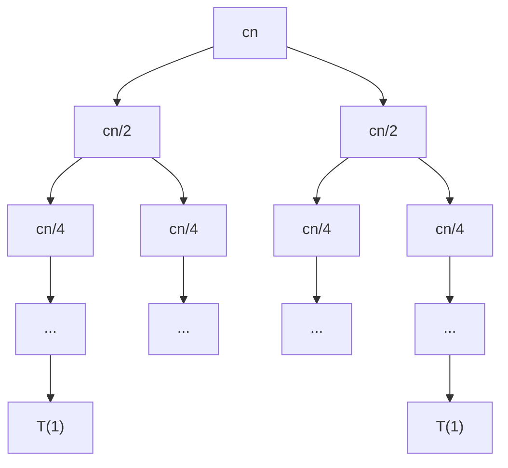
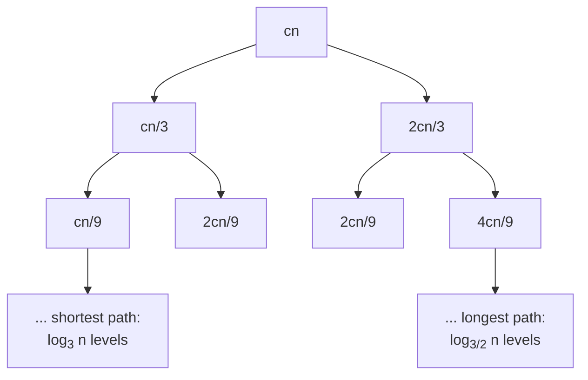

# Recursion Tree Method

!!! abstract "At a glance"

    - **Problem:** find a good bound for recurrences with several recursive terms, including *unequal* splits such as $T(n) = T(n/3) + T(2n/3) + n$.
    - **Key idea:** draw the tree of recursive calls, label each node with its non-recursive cost, sum each level, then sum the levels.
    - **What decides the answer:** how level costs change with depth. Decreasing geometrically: the root dominates. Equal: (level cost) $\times$ (depth). Increasing geometrically: the leaves dominate.
    - **Use:** to produce a guess for the [substitution method](topic4.md), to understand *why* the [master method](topic5.md) gives the answer it does, and as a stand-alone argument when the sum is evaluated carefully.

## Motivation and Problem Context

The [iteration method](topic2.md) follows a single chain of expansions, which breaks down as soon as a call spawns subproblems of different sizes. Quicksort with a guaranteed 1:2 split, deterministic selection (median of medians, $T(n/5) + T(7n/10) + n$), and many geometric algorithms produce such recurrences. The master method does not apply to them either. A recursion tree turns the problem into a picture in which the total cost is a double sum, over levels and over nodes within a level, and the shape of the tree tells you which part of the computation is expensive.

## Problem Formulation

- **Input:** a recurrence $T(n) = \sum_{j=1}^{a} T(\alpha_j n) + f(n)$ with constants $0 < \alpha_j < 1$, or the uniform special case $T(n) = aT(n/b) + f(n)$, and a base case $T(n) = \Theta(1)$ for small $n$.
- **Output:** an asymptotic bound $\Theta(g(n))$ (or separate $O$ and $\Omega$ bounds when the tree is unbalanced).
- **Assumptions:** sizes are treated as real numbers (floors and ceilings ignored, see [3.1](topic1.md#floors-ceilings-and-why-they-can-usually-be-ignored)); a node of size at most 1 is a leaf of cost $\Theta(1)$.

## Intuition

Each node of the tree is one call; its label is the work that call does itself, $f(\text{size})$. The total running time is the sum of all labels. Instead of adding them in arbitrary order, we add them **level by level**, because within a level all nodes are "equally deep" and, in balanced trees, equally sized. The level sums usually form a recognisable series, and the behaviour of that series (shrinking, constant, or growing) tells you where the work concentrates.

!!! tip "Mental model"
    Ask two questions about the tree: *how many nodes on level $i$* and *how big is each one*. The level cost is their product (for balanced trees, $a^i \cdot f(n/b^i)$). Everything else is summing a series.

## Definitions and Key Results

For the uniform recurrence $T(n) = aT(n/b) + f(n)$:

| Quantity | Value | Reason |
|---|---|---|
| Subproblem size at depth $i$ | $n/b^i$ | divided by $b$ per level |
| Nodes at depth $i$ | $a^i$ | each node has $a$ children |
| Cost of level $i$ (internal) | $a^i f(n/b^i)$ | nodes $\times$ cost per node |
| Height (depth of the leaves) | $\log_b n$ | $n/b^h = 1$ |
| Number of leaves | $a^{\log_b n} = n^{\log_b a}$ | identity from [3.2](topic2.md#definitions-and-key-results) |
| Cost of the leaf level | $\Theta(n^{\log_b a})$ | each leaf is $\Theta(1)$ |

Summing:

$$
T(n) = \underbrace{\sum_{i=0}^{\log_b n - 1} a^i f\!\left(\frac{n}{b^i}\right)}_{\text{internal levels}} + \underbrace{\Theta\!\left(n^{\log_b a}\right)}_{\text{leaves}} .
$$

**The three regimes.** Let $r$ be the ratio between consecutive level costs (when it is roughly constant).

| Regime | Level costs | Sum dominated by | Result |
|---|---|---|---|
| $r < 1$ | decreasing geometric | the root | $\Theta(f(n))$ |
| $r = 1$ | all equal to $f(n)$ | every level equally | $\Theta(f(n) \log n)$ |
| $r > 1$ | increasing geometric | the leaves | $\Theta(n^{\log_b a})$ |

This table *is* the master theorem in disguise; [3.5](topic5.md) states it precisely, including the conditions under which "roughly constant ratio" can be trusted.

!!! warning "Important"
    The leaf level is not optional. For $T(n) = 4T(n/2) + 1$ the internal levels sum to only about $n^2$ and the leaves contribute $n^2$ as well; for $T(n) = 8T(n/2) + n^2$, the internal-level sum *grows* toward the leaves. Always compute the number of leaves, $n^{\log_b a}$, and compare.

## Method

1. **Root:** write $f(n)$ and the sizes of its children.
2. **Expand two or three levels**, writing every node's size and cost.
3. **Level cost:** sum each level; find the general level-$i$ cost.
4. **Height:** find the depth at which sizes reach 1 (for unbalanced trees, find both the *shortest* and the *longest* root-to-leaf path).
5. **Leaves:** count them and multiply by $\Theta(1)$.
6. **Sum** the levels (usually a geometric or arithmetic series) and add the leaf cost.
7. **Confirm** the result with the [substitution method](topic4.md) if a rigorous proof is required (always for unbalanced trees, where steps 4 to 6 give only bounds).

## Worked Examples

### Example 1: $T(n) = 2T(n/2) + cn$ (equal levels)



| Level $i$ | Nodes | Size | Level cost |
|---|---|---|---|
| 0 | 1 | $n$ | $cn$ |
| 1 | 2 | $n/2$ | $2 \cdot cn/2 = cn$ |
| 2 | 4 | $n/4$ | $4 \cdot cn/4 = cn$ |
| $i$ | $2^i$ | $n/2^i$ | $cn$ |
| $\log_2 n$ (leaves) | $n$ | 1 | $\Theta(n)$ |

$$
T(n) = \sum_{i=0}^{\log_2 n - 1} cn + \Theta(n) = cn\log_2 n + \Theta(n) = \Theta(n \log n).
$$

Every level does the same work, so the answer is (work per level) $\times$ (number of levels). This is merge sort's tree ([3.6](topic6.md)).

### Example 2: $T(n) = 3T(n/4) + cn^2$ (decreasing levels)

| Level $i$ | Nodes | Size | Level cost |
|---|---|---|---|
| 0 | 1 | $n$ | $cn^2$ |
| 1 | 3 | $n/4$ | $3c(n/4)^2 = \frac{3}{16}cn^2$ |
| 2 | 9 | $n/16$ | $9c(n/16)^2 = \left(\frac{3}{16}\right)^2 cn^2$ |
| $i$ | $3^i$ | $n/4^i$ | $\left(\frac{3}{16}\right)^i cn^2$ |
| $\log_4 n$ (leaves) | $n^{\log_4 3} \approx n^{0.79}$ | 1 | $\Theta(n^{\log_4 3})$ |

$$
T(n) < \sum_{i=0}^{\infty}\left(\frac{3}{16}\right)^i cn^2 + \Theta(n^{\log_4 3}) = \frac{16}{13}cn^2 + o(n^2) = O(n^2).
$$

The root alone costs $cn^2$, so $T(n) = \Omega(n^2)$ and therefore $T(n) = \Theta(n^2)$. With ratio $r = 3/16 < 1$, the root dominates: the subproblems shrink faster (squared cost, quartered size) than they multiply.

### Example 3: $T(n) = 3T(n/2) + n$, $T(1) = 1$ (increasing levels)

| Level $i$ | Nodes | Size | Level cost |
|---|---|---|---|
| 0 | 1 | $n$ | $n$ |
| 1 | 3 | $n/2$ | $\frac{3}{2}n$ |
| 2 | 9 | $n/4$ | $\left(\frac{3}{2}\right)^2 n$ |
| 3 | 27 | $n/8$ | $\left(\frac{3}{2}\right)^3 n$ |
| $i$ | $3^i$ | $n/2^i$ | $\left(\frac{3}{2}\right)^i n$ |
| $\log_2 n$ (leaves) | $3^{\log_2 n} = n^{\log_2 3}$ | 1 | $n^{\log_2 3}$ |

The internal levels form an increasing geometric series with $r = 3/2$:

$$
\sum_{i=0}^{\log_2 n - 1}\left(\frac{3}{2}\right)^i n = n \cdot \frac{(3/2)^{\log_2 n} - 1}{3/2 - 1} = 2n\left(n^{\log_2 3 - 1} - 1\right) = 2n^{\log_2 3} - 2n,
$$

using $(3/2)^{\log_2 n} = n^{\log_2 (3/2)} = n^{\log_2 3 - 1}$. Adding the leaves:

$$
T(n) = 3n^{\log_2 3} - 2n = \Theta(n^{\log_2 3}) \approx \Theta(n^{1.585}).
$$

(Check: $T(2) = 3 \cdot 1 + 2 = 5 = 3 \cdot 3 - 4$.) This is Karatsuba's recurrence ([4.3](../unit4/topic3.md)): splitting into three half-size products beats four, because the leaves, not the combine step, set the cost.

### Example 4: $T(n) = T(n/3) + T(2n/3) + cn$ (unbalanced tree)



**Level costs.** The two children of a node of size $m$ have sizes $m/3$ and $2m/3$, which sum to $m$. Hence the sizes on any *complete* level sum to $n$, and the level costs $cn$:

$$
\text{level 1: } \frac{cn}{3} + \frac{2cn}{3} = cn, \qquad \text{level 2: } \frac{cn}{9} + \frac{2cn}{9} + \frac{2cn}{9} + \frac{4cn}{9} = cn .
$$

**Height.** The leftmost path shrinks fastest: $n/3^h = 1$ at $h = \log_3 n$. The rightmost path shrinks slowest: $n(2/3)^h = 1$ at $h = \log_{3/2} n \approx 1.71\log_2 n$. Below depth $\log_3 n$, levels are incomplete (some branches have already ended) and cost **at most** $cn$.

**Upper bound.** At most $\log_{3/2} n + 1$ levels, each costing at most $cn$, plus the leaves:

$$
T(n) \le cn(\log_{3/2} n + 1) + \Theta(\#\text{leaves}).
$$

**Leaves.** A crude count treats the tree as complete: $2^{\log_{3/2} n} = n^{\log_{3/2} 2} \approx n^{1.71}$, which would be superlinear and spoil the bound. A sharper argument: the leaves are disjoint pieces of the original input whose sizes sum to $n$, and each leaf has size at least a constant (a node of size above 1 creates children of size above $1/3$). So there are $O(n)$ leaves, contributing $O(n)$.

**Lower bound.** The first $\log_3 n$ levels are complete, each costing exactly $cn$:

$$
T(n) \ge cn\log_3 n = \Omega(n \log n).
$$

Together: $T(n) = \Theta(n \log n)$. The [substitution method](topic4.md) confirms this with the guess $T(n) \le dn\log n$.

!!! warning "Important"
    In an unbalanced tree the levels below the shortest path are **not** full. Multiplying "$cn$ per level" by the *longest* path gives an upper bound only; multiplying by the *shortest* path gives a lower bound only. State both, then conclude $\Theta$ only when they match asymptotically (here both are $\Theta(n\log n)$ because $\log_3 n$ and $\log_{3/2} n$ differ by a constant factor).

### Example 5: $T(n) = T(n/5) + T(7n/10) + cn$ (unbalanced, decreasing)

The children of a size-$m$ node have total size $m/5 + 7m/10 = 9m/10 < m$. So level $i$ costs at most $(9/10)^i cn$:

$$
T(n) \le cn\sum_{i=0}^{\infty}\left(\frac{9}{10}\right)^i = 10cn = O(n), \qquad T(n) \ge cn .
$$

Therefore $T(n) = \Theta(n)$. This is the recurrence of deterministic selection (median of medians): because $1/5 + 7/10 < 1$, the work shrinks geometrically down the tree.

!!! tip "Rule of thumb for $T(\alpha_1 n) + T(\alpha_2 n) + \Theta(n)$"
    If $\alpha_1 + \alpha_2 < 1$: $\Theta(n)$ (root dominates). If $\alpha_1 + \alpha_2 = 1$: $\Theta(n \log n)$ (equal levels). If $\alpha_1 + \alpha_2 > 1$: polynomially more than $n$; the exponent is found by the [Akra-Bazzi](topic5.md#beyond-the-master-method-akra-bazzi) equation $\alpha_1^p + \alpha_2^p = 1$.

### Example 6: $T(n) = 2T(n/2) + n^2$ (decreasing, balanced)

Level $i$: $2^i (n/2^i)^2 = n^2/2^i$. The series $n^2(1 + 1/2 + 1/4 + \cdots) < 2n^2$; the root contributes $n^2$. So $T(n) = \Theta(n^2)$: the combine step at the root dominates everything below it.

## Algorithmic Applications

| Algorithm | Recurrence | Tree shape | Result |
|---|---|---|---|
| Merge sort | $2T(n/2) + n$ | balanced, equal levels | $\Theta(n \log n)$ |
| Quicksort with 1:9 split every time | $T(n/10) + T(9n/10) + n$ | unbalanced, equal full levels | $\Theta(n \log n)$ |
| Median of medians | $T(n/5) + T(7n/10) + n$ | unbalanced, decreasing | $\Theta(n)$ |
| Karatsuba | $3T(n/2) + n$ | balanced, increasing | $\Theta(n^{\log_2 3})$ |
| Strassen | $7T(n/2) + n^2$ | balanced, increasing ($r = 7/4$) | $\Theta(n^{\log_2 7})$ |
| Naive D&C matrix multiply | $8T(n/2) + n^2$ | balanced, increasing ($r = 2$) | $\Theta(n^3)$ |

The quicksort row explains a famous fact: even a consistently lopsided split (1:9) still gives $\Theta(n \log n)$, because the depth is $\log_{10/9} n$, a constant multiple of $\log n$.

## Python Implementation

A recursion tree can be computed level by level. Grouping nodes that have the same size keeps this fast even when the tree has millions of nodes.

```python
from collections import Counter


def recursion_tree_levels(n, children, cost, leaf_cost=1):
    """Build a recursion tree level by level and return per-level totals.

    children(size) -> list of child subproblem sizes
    cost(size)     -> non-recursive work done at one node of that size
    A node of size <= 1 is a leaf and costs leaf_cost.
    Returns a list of (number_of_nodes, total_cost) for levels 0, 1, 2, ...
    """
    levels = []
    frontier = Counter({n: 1})          # size -> how many nodes have that size
    while frontier:
        nodes, level_cost, next_frontier = 0, 0, Counter()
        for size, count in frontier.items():
            nodes += count
            if size <= 1:
                level_cost += count * leaf_cost
            else:
                level_cost += count * cost(size)
                for child in children(size):
                    next_frontier[child] += count
        levels.append((nodes, level_cost))
        frontier = next_frontier
    return levels


if __name__ == "__main__":
    n = 4**8                            # 65536: an exact power of 2 and of 4
    examples = {
        "2T(n/2) + n":          (lambda s: [s / 2, s / 2],     lambda s: s),
        "3T(n/4) + n^2":        (lambda s: [s / 4] * 3,        lambda s: s * s),
        "4T(n/2) + n":          (lambda s: [s / 2] * 4,        lambda s: s),
        "T(n/3) + T(2n/3) + n": (lambda s: [s / 3, 2 * s / 3], lambda s: s),
    }
    for name, (children, cost) in examples.items():
        levels = recursion_tree_levels(n, children, cost)
        total = sum(c for _, c in levels)
        ratios = [round(levels[i + 1][1] / levels[i][1], 3) for i in range(3)]
        print(f"{name:22} levels={len(levels):3d} total={total:14.0f} "
              f"level-to-level ratios={ratios}")
```

Output:

```text
2T(n/2) + n            levels= 17 total=       1114112 level-to-level ratios=[1.0, 1.0, 1.0]
3T(n/4) + n^2          levels=  9 total=    5286112081 level-to-level ratios=[0.188, 0.188, 0.188]
4T(n/2) + n            levels= 17 total=    8589869056 level-to-level ratios=[2.0, 2.0, 2.0]
T(n/3) + T(2n/3) + n   levels= 29 total=       1291266 level-to-level ratios=[1.0, 1.0, 1.0]
```

- The printed ratio is the $r$ of the three-regime table: $1$ (equal levels), $3/16 \approx 0.188$ (root dominates), $2$ (leaves dominate).
- For the unbalanced tree there are 29 levels, close to $\log_{3/2} 65536 \approx 27.4$ plus the leaf levels, against only 17 for the balanced tree; yet the total is still within a small constant of $n\log_2 n \approx 1.05 \times 10^6$.
- `children` returns *real* sizes, matching the "ignore floors" convention; replacing them with `s // 2` and `s - s // 2` reproduces the exact integer recurrence.

## Edge Cases and Pitfalls

| Case / pitfall | What goes wrong | Fix |
|---|---|---|
| Forgetting the leaves | $4T(n/2) + 1$ looks like $\Theta(n)$ from the internal levels alone | Always add $n^{\log_b a} \cdot \Theta(1)$ |
| Using the longest path for a $\Theta$ claim in an unbalanced tree | Gives only an upper bound | Use the shortest path for the lower bound; compare |
| Crude leaf count in unbalanced trees | $2^{\text{height}}$ overestimates leaves ($n^{1.71}$ instead of $O(n)$) | Use "leaf sizes sum to at most $n$" |
| Mislabelling nodes with sizes instead of costs | For $f(n) = n^2$, a node of size $n/4$ costs $n^2/16$, not $n/4$ | Write both size and cost at each node |
| Wrong number of levels | Using $\log_2 n$ when $b = 4$ | Height is $\log_b n$ |
| Summing an increasing series as if bounded | $\sum (3/2)^i$ treated as a constant | Identify $r$; for $r > 1$ the last term dominates |
| Arithmetic slips at deep levels | E.g. level 3 of $3T(n/2) + n$ is $27n/8$, not $36n/8$ | Derive the general term $a^i f(n/b^i)$ and check it against levels 1 and 2 |

## Common Misconceptions

- **"The tallest path determines the cost."** The cost is the sum over all nodes. A tall but sparse branch (the $2/3$ path) contributes little per level; the lower bound comes from complete levels.
- **"Every level costs the same in every divide-and-conquer tree."** Only when $a f(n/b) = f(n)$. Karatsuba's levels grow; the CLRS example $3T(n/4) + n^2$ shrinks.
- **"An unbalanced split always hurts asymptotically."** Any constant-ratio split gives logarithmic depth. 1:9 quicksort is still $\Theta(n \log n)$; only splits like $0 : n-1$ give $\Theta(n^2)$.
- **"A recursion tree is a proof."** It is a rigorous proof only if the sum is computed exactly (as in Example 3). Bounds obtained by "at most $cn$ per level" should be confirmed by substitution.
- **"The number of leaves is always $n$."** It is $n^{\log_b a}$: $n$ for merge sort, $n^{1.585}$ for Karatsuba, $n^{0.79}$ for $3T(n/4) + n^2$.

## Alternatives and Trade-offs

| Method | Use when | Avoid when |
|---|---|---|
| Recursion tree | Multiple recursive terms, unequal splits, building intuition or a guess | You need exact constants for a single-term recurrence (iteration is faster) |
| [Iteration](topic2.md) | One recursive term | Several terms with different sizes |
| [Master method](topic5.md) | Uniform $aT(n/b) + f(n)$, quick answer | Unequal splits, subtractive recurrences, gaps |
| [Substitution](topic4.md) | Turning the tree's guess into a proof | No guess available |
| [Akra-Bazzi](topic5.md#beyond-the-master-method-akra-bazzi) | Unequal splits where $\sum \alpha_j \ne 1$ and the exponent is not obvious | Simple cases the tree settles in two lines |

## In Practice

- **Profiling recursion.** A flame graph of a recursive program is essentially a recursion tree whose node widths are measured times. Reading it with the three regimes in mind tells you whether to optimise the combine step (root-dominated), the base case (leaf-dominated), or the whole structure (balanced).
- **Hybrid algorithms cut the leaves.** In leaf-dominated or leaf-heavy trees, most calls are tiny and the per-call overhead dominates. Production code stops recursing below a cutoff and switches to a simple algorithm: Timsort and many merge sort implementations use insertion sort on small runs; Karatsuba and Strassen implementations switch to the schoolbook method below a threshold. The tree explains why the cutoff matters: it removes the bottom levels, which contain most of the nodes.
- **Parallelism.** In a balanced tree, each level is a batch of independent tasks. Fork/join schedulers exploit exactly this; the depth of the tree bounds the critical path.
- **Unbalanced partitions in databases and search.** Data-dependent splits (quicksort pivots, k-d tree construction, B-tree splits) produce unbalanced trees; the tree analysis shows that any split ratio bounded away from $0$ keeps depth logarithmic, which is why randomised pivots and median-based splits are enough.

## Interview and Competitive Programming

- **Recognition cue:** "two recursive calls with different fractions" (e.g. $n/3$ and $2n/3$) means: add the fractions. Sum $= 1$ means $O(n \log n)$; sum $< 1$ means $O(n)$ (with linear work per call).
- **Lopsided recursion still logarithmic:** if each call discards a constant *fraction* of the input, the depth is $O(\log n)$, whatever the fraction.
- **Explaining complexity on a whiteboard:** draw three levels, write the level costs, and say "constant per level times $\log n$ levels". Interviewers value this more than quoting the master theorem.
- **Trap:** for $T(n) = 2T(n/2) + O(n^2)$ some candidates say "$n^2 \log n$" by analogy with merge sort; the levels shrink by half, so it is $O(n^2)$.

## Using AI Assistants Critically

- LLM-drawn recursion trees often label nodes with sizes but sum them as costs; for $f(n) = n^2$ this produces wrong level totals. Ask for both size and cost per node.
- A frequent error is claiming $\Theta(n \log n)$ for $T(n/3) + T(2n/3) + n$ "because the height is $\log_{3/2} n$" without a lower-bound argument, or claiming $n^{1.71}$ leaves as the true leaf count. Check that both bounds are given.
- Assistants commonly misread the ratio regime: e.g. treating $3T(n/2) + n$ as $\Theta(n \log n)$. Compute $a/b^k$ (here $3/2 > 1$) yourself.
- Verify a claimed tree analysis with a level-cost calculator such as `recursion_tree_levels`: the printed level ratios should match the claimed regime, and the total should track the claimed bound under doubling of $n$.
- Ask the assistant for the exact sum, not just the conclusion; skipped steps hide the dropped leaf term.

## Practice

### Beginner

1. Draw the recursion tree of $T(n) = 2T(n/2) + 1$ for $n = 16$, give level costs and the total. *Output:* table of levels and $\Theta$ bound. *Difficulty:* easy.
2. Use a recursion tree to solve $T(n) = T(n/2) + n$. *Difficulty:* easy.
3. For $T(n) = 4T(n/4) + n$, give the height, the number of leaves, and the cost of each level. *Difficulty:* easy.

### Intermediate

1. Solve $T(n) = 4T(n/2) + n^2$ with a recursion tree and explain which regime it is in. *Difficulty:* medium.
2. Solve $T(n) = T(n/4) + T(3n/4) + n$, giving both the shortest and longest path lengths and matching upper and lower bounds. *Difficulty:* medium.
3. Solve $T(n) = 2T(n/4) + \sqrt{n}$ with a recursion tree. *Difficulty:* medium.

### Advanced

1. Solve $T(n) = T(n/2) + T(n/4) + T(n/8) + n$. *Output:* $\Theta$ bound with justification of the level-cost ratio. *Difficulty:* hard.
2. Solve $T(n) = T(n/2) + T(n/3) + n^2$ and state which part of the tree dominates. *Difficulty:* hard.
3. Show that $T(n) = T(\alpha n) + T((1-\alpha)n) + n$ is $\Theta(n \log n)$ for every constant $0 < \alpha < 1$, and explain how the hidden constant depends on $\alpha$. *Difficulty:* hard.

### Interview / CP

1. A divide-and-conquer solution always splits an array at a position chosen so that the left part has at least 10% of the elements, then does linear work. Bound its worst-case time. *Difficulty:* medium.
2. Explain, using a recursion tree, why stopping merge sort's recursion at subarrays of size 32 and insertion-sorting them keeps $O(n \log n)$ while reducing the number of calls by a factor of about 32. *Difficulty:* medium.
3. A recursive function on a tree-shaped input (each node has two children whose subtree sizes sum to $0.9\times$ the node's size) does linear work in the size of the current subtree. Bound the total time. *Difficulty:* medium.

## Self-Check Questions

??? question "Q1. For $T(n) = 3T(n/4) + n^2$, how many leaves does the recursion tree have, and do they matter?"
    $3^{\log_4 n} = n^{\log_4 3} \approx n^{0.79}$ leaves, contributing $\Theta(n^{0.79}) = o(n^2)$. They do not affect the bound, which is set by the root: $\Theta(n^2)$.

??? question "Q2. Why do the complete levels of $T(n) = T(n/3) + T(2n/3) + n$ each cost exactly $n$?"
    A node of size $m$ has children of sizes $m/3$ and $2m/3$ summing to $m$. By induction on depth, the sizes on any complete level partition $n$, and since the cost is linear in size, the level cost is $n$.

??? question "Q3. In an unbalanced recursion tree, why is $(\text{cost per level}) \times (\text{longest path})$ only an upper bound?"
    Levels deeper than the shortest root-to-leaf path are incomplete; some branches have already terminated, so those levels cost less than a full level. The product therefore overcounts.

??? question "Q4. Without computing the full sum, classify $T(n) = 7T(n/2) + n^2$."
    Level ratio $r = a/b^k = 7/2^2 = 7/4 > 1$: increasing levels, leaves dominate. $T(n) = \Theta(n^{\log_2 7}) \approx \Theta(n^{2.807})$.

??? question "Q5. Solve $T(n) = T(n/4) + T(3n/4) + n^2$."
    Level 1 costs $(n/4)^2 + (3n/4)^2 = \frac{10}{16}n^2$; in general level $i$ costs at most $(5/8)^i n^2$, a decreasing geometric series. Upper bound $\frac{8}{3}n^2$; the root gives $\Omega(n^2)$. So $\Theta(n^2)$.

??? question "Q6. Why is median of medians linear even though it makes two recursive calls?"
    Its calls are on sizes $n/5$ and $7n/10$, whose sum $9n/10$ is a constant fraction less than $n$. Each level of the tree does at most $9/10$ of the work of the level above, so the total is at most $10$ times the root's linear work.

??? question "Q7. Your recursion tree for $T(n) = 2T(n/2) + n\log n$ shows level $i$ costing $n\log(n/2^i)$. What is the total?"
    $\sum_{i=0}^{\log n - 1} n(\log n - i) = n\sum_{j=1}^{\log n} j = \Theta(n\log^2 n)$. The levels are *not* equal (they decrease arithmetically), which is why the answer is not $\Theta(n\log n)$.

## Complexity Summary

| Recurrence | Regime | Result |
|---|---|---|
| $2T(n/2) + n$ | equal | $\Theta(n \log n)$ |
| $2T(n/2) + n^2$ | decreasing ($r = 1/2$) | $\Theta(n^2)$ |
| $3T(n/4) + n^2$ | decreasing ($r = 3/16$) | $\Theta(n^2)$ |
| $3T(n/2) + n$ | increasing ($r = 3/2$) | $\Theta(n^{\log_2 3})$ |
| $4T(n/2) + n$ | increasing ($r = 2$) | $\Theta(n^2)$ |
| $T(n/3) + T(2n/3) + n$ | equal (full levels) | $\Theta(n \log n)$ |
| $T(n/5) + T(7n/10) + n$ | decreasing ($r \le 9/10$) | $\Theta(n)$ |
| $2T(n/2) + n\log n$ | arithmetically decreasing | $\Theta(n \log^2 n)$ |

## Key Takeaways

- A recursion tree turns a recurrence into a double sum: over levels, then over nodes in a level.
- Level cost for uniform recurrences is $a^i f(n/b^i)$; the leaf level costs $\Theta(n^{\log_b a})$ and must always be included.
- The ratio between level costs decides everything: root-dominated, balanced ($\times \log n$), or leaf-dominated.
- Unbalanced trees need two path lengths: the shortest gives a lower bound, the longest an upper bound.
- In $T(\alpha_1 n) + T(\alpha_2 n) + \Theta(n)$, compare $\alpha_1 + \alpha_2$ with 1.
- Recursion trees are the best tool for guessing; confirm guesses with the substitution method.
- The master method is the three-regime table made precise.
