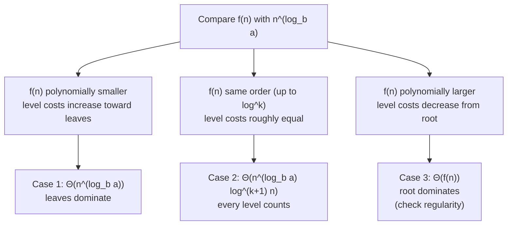

# Master Method

!!! abstract "At a glance"

    - **Problem:** solve divide-and-conquer recurrences $T(n) = aT(n/b) + f(n)$ quickly and correctly.
    - **Key idea:** compare the work at the root, $f(n)$, with the work at the leaves, $n^{\log_b a}$. Whichever is polynomially larger wins; if they balance, multiply by $\log n$.
    - **Three cases** (plus an extended case 2 for $\log$ factors); case 3 also requires the **regularity condition**.
    - **Limits:** it does not apply to subtractive recurrences, unequal splits, non-constant $a$ or $b$, or functions in the "gaps" between cases. The **Akra-Bazzi** theorem generalises it to unequal splits.

## Motivation and Problem Context

Most divide-and-conquer algorithms split the input into $a$ subproblems of equal size $n/b$ and spend $f(n)$ dividing and combining: merge sort ($2T(n/2) + n$), binary search ($T(n/2) + 1$), Karatsuba ($3T(n/2) + n$), Strassen ($7T(n/2) + n^2$). Drawing a [recursion tree](topic3.md) for each one is slow, and in every case the tree analysis follows the same pattern. The master method packages that pattern into a theorem: identify $a$, $b$, $f(n)$, compare two functions, and read off the answer. It is the fastest tool in this unit and the one most used in exams, interviews, and algorithm design discussions ("if we can get the combine step down to linear, the whole algorithm becomes $n\log n$").

## Problem Formulation

- **Input:** a recurrence $T(n) = aT(n/b) + f(n)$ where
    - $a \ge 1$ is a **constant** (number of subproblems),
    - $b > 1$ is a **constant** (shrink factor), every subproblem having the same size $n/b$ (floors or ceilings allowed),
    - $f(n)$ is **asymptotically positive** (the divide-and-combine cost).
- **Output:** a tight bound $T(n) = \Theta(\cdot)$, or the conclusion that the master method does not apply.
- **Assumption:** $T(n) = \Theta(1)$ for sufficiently small $n$.

## Intuition

The recursion tree of $aT(n/b) + f(n)$ has height $\log_b n$ and $a^{\log_b n} = n^{\log_b a}$ leaves. The total cost has two competing parts:

- the **root**, which costs $f(n)$, and more generally the internal levels, costing $a^i f(n/b^i)$;
- the **leaves**, which cost $\Theta(n^{\log_b a})$ in total.

The function $n^{\log_b a}$ is called the **watershed** (or critical) function. Comparing $f(n)$ with it tells you which way the level costs trend ([three regimes](topic3.md#definitions-and-key-results)):



!!! tip "Mental model"
    Root versus leaves. The leaves cost $n^{\log_b a}$; the root costs $f(n)$. If one beats the other by a polynomial factor $n^\varepsilon$, it wins outright. If they tie, every one of the $\log n$ levels contributes equally.

## Definitions

**Critical exponent.** $c_{\text{crit}} = \log_b a$. Examples: $\log_2 4 = 2$, $\log_2 3 \approx 1.585$, $\log_4 3 \approx 0.792$, $\log_2 7 \approx 2.807$.

**Polynomially smaller / larger.** $f(n)$ is polynomially smaller than $g(n)$ if $f(n) = O(g(n)\,n^{-\varepsilon})$ for some constant $\varepsilon > 0$. For example, $n$ is polynomially smaller than $n^2$ ($\varepsilon = 1$) and than $n^{1.585}$ ($\varepsilon = 0.585$), but $n/\log n$ is **not** polynomially smaller than $n$: the ratio is only $\log n$, which is smaller than $n^\varepsilon$ for every $\varepsilon > 0$.

**Regularity condition** (case 3 only). There exist a constant $c < 1$ and $n_0$ such that

$$
a\,f(n/b) \le c\,f(n) \quad\text{for all } n \ge n_0 .
$$

In tree terms: the total cost of the children's local work is at most a constant fraction of the parent's local work, so level costs decrease geometrically.

## The Master Theorem

Let $a \ge 1$ and $b > 1$ be constants, $f(n)$ asymptotically positive, and $T(n) = aT(n/b) + f(n)$ (with $n/b$ read as $\lfloor n/b \rfloor$ or $\lceil n/b \rceil$).

!!! success "The three cases"

    **Case 1 (leaves dominate).** If $f(n) = O\!\left(n^{\log_b a - \varepsilon}\right)$ for some constant $\varepsilon > 0$, then
    $$T(n) = \Theta\!\left(n^{\log_b a}\right).$$

    **Case 2 (balanced; extended form).** If $f(n) = \Theta\!\left(n^{\log_b a}\log^k n\right)$ for a constant $k \ge 0$, then
    $$T(n) = \Theta\!\left(n^{\log_b a}\log^{k+1} n\right).$$
    The basic form is $k = 0$: $f(n) = \Theta(n^{\log_b a}) \Rightarrow T(n) = \Theta(n^{\log_b a}\log n)$.

    **Case 3 (root dominates).** If $f(n) = \Omega\!\left(n^{\log_b a + \varepsilon}\right)$ for some constant $\varepsilon > 0$, **and** the regularity condition $a f(n/b) \le c f(n)$ holds for some $c < 1$ and all large $n$, then
    $$T(n) = \Theta(f(n)).$$

!!! note "Extended case 2 for negative $k$"
    The Akra-Bazzi theorem (below) also settles the balanced case when the log exponent is negative:

    - $f(n) = \Theta\!\left(n^{\log_b a}/\log n\right)$ ($k = -1$): $T(n) = \Theta\!\left(n^{\log_b a}\log\log n\right)$.
    - $f(n) = \Theta\!\left(n^{\log_b a}\log^k n\right)$ with $k < -1$: $T(n) = \Theta\!\left(n^{\log_b a}\right)$.

    These are *not* part of the classic three-case theorem, and an exam answer should say which version it uses.

### Equivalent "$a$ versus $b^k$" form

When $f(n) = \Theta(n^k\log^p n)$, many textbooks state the theorem by comparing $a$ with $b^k$ (equivalently $k$ with $\log_b a$):

| Condition | Sub-condition | $T(n)$ |
|---|---|---|
| $a > b^k$ ($k < \log_b a$) | any $p$ | $\Theta(n^{\log_b a})$ |
| $a = b^k$ ($k = \log_b a$) | $p > -1$ | $\Theta(n^k\log^{p+1} n)$ |
| | $p = -1$ | $\Theta(n^k\log\log n)$ |
| | $p < -1$ | $\Theta(n^k)$ |
| $a < b^k$ ($k > \log_b a$) | $p \ge 0$ | $\Theta(n^k\log^p n)$ |
| | $p < 0$ | $\Theta(n^k\log^p n)$, i.e. $\Theta(f(n))$ |

!!! warning "Important"
    In the last row ($a < b^k$, $p < 0$) the answer is $\Theta(f(n)) = \Theta(n^k\log^p n)$, for example $T(n) = T(n/2) + n/\log n = \Theta(n/\log n)$. Some summaries (including an earlier version of these notes) give $\Theta(n^k)$ here; that is only an upper bound ($O(n^k)$), not a tight one. For $f(n) = n^k\log^p n$ with $k > \log_b a$, regularity holds automatically, so case 3 applies and $T(n) = \Theta(f(n))$.

## Proof Sketch

From the [recursion tree](topic3.md), for $n$ a power of $b$:

$$
T(n) = \Theta\!\left(n^{\log_b a}\right) + \sum_{i=0}^{\log_b n - 1} a^i f\!\left(n/b^i\right).
$$

- **Case 1.** With $f(m) \le C m^{\log_b a - \varepsilon}$, level $i$ costs at most $C\,a^i (n/b^i)^{\log_b a - \varepsilon} = C\,n^{\log_b a - \varepsilon}(b^\varepsilon)^i$, since $a^i / (b^i)^{\log_b a} = 1$. This is an increasing geometric series with ratio $b^\varepsilon > 1$, dominated by its last term, which is $O(n^{\log_b a})$. Adding the leaves gives $\Theta(n^{\log_b a})$.
- **Case 2** ($k = 0$). Level $i$ costs $a^i\,\Theta((n/b^i)^{\log_b a}) = \Theta(n^{\log_b a})$, the same at every level. There are $\log_b n$ levels, so the sum is $\Theta(n^{\log_b a}\log n)$. For $k > 0$, level $i$ costs $\Theta(n^{\log_b a}(\log_b n - i)^k)$, and $\sum_{j=1}^{\log_b n} j^k = \Theta(\log^{k+1} n)$.
- **Case 3.** Regularity gives $a^i f(n/b^i) \le c^i f(n)$, so the sum is at most $f(n)\sum c^i = f(n)/(1-c) = O(f(n))$. The root alone gives $\Omega(f(n))$, and $f(n)$ is polynomially larger than the leaf cost, so $T(n) = \Theta(f(n))$.

Extending from powers of $b$ to all $n$ (with floors and ceilings) is a technical argument given in CLRS; the cases and answers are unchanged.

## Method

1. **Check the form:** $T(n) = aT(n/b) + f(n)$ with constant $a \ge 1$, constant $b > 1$, equal-size subproblems, positive $f$. If any condition fails, stop (see [When the master method does not apply](#when-the-master-method-does-not-apply)).
2. **Identify** $a$, $b$, $f(n)$.
3. **Compute the watershed** $n^{\log_b a}$ (compute $\log_b a$ numerically if needed: $\log_b a = \ln a/\ln b$).
4. **Compare** $f(n)$ with $n^{\log_b a}$:
    - smaller by a factor $n^\varepsilon$: case 1;
    - equal up to $\log^k n$: case 2 (extended);
    - larger by a factor $n^\varepsilon$: case 3, then **verify regularity**;
    - otherwise: gap, the theorem does not apply.
5. **Write the answer**, and in exams state $\varepsilon$ (cases 1 and 3), $k$ (case 2), or $c$ (regularity) explicitly.

## Worked Examples

### Example 1: $T(n) = 4T(n/2) + n$

$a = 4$, $b = 2$, $f(n) = n$. Watershed $n^{\log_2 4} = n^2$. $f(n) = n = O(n^{2 - \varepsilon})$ with $\varepsilon = 1$. **Case 1**: $T(n) = \Theta(n^2)$.

### Example 2: $T(n) = T(n/2) + 1$

$a = 1$, $b = 2$, $f(n) = 1$. Watershed $n^{\log_2 1} = n^0 = 1$. $f(n) = \Theta(1) = \Theta(n^{\log_b a})$. **Case 2** ($k = 0$): $T(n) = \Theta(\log n)$. (Binary search.)

### Example 3: $T(n) = 2T(n/2) + n^4$

$a = 2$, $b = 2$, watershed $n$. $f(n) = n^4 = \Omega(n^{1+\varepsilon})$ with $\varepsilon = 3$. **Case 3** candidate. Regularity: $a f(n/b) = 2(n/2)^4 = n^4/8 \le c\,n^4$ with $c = 1/8 < 1$. Holds. $T(n) = \Theta(n^4)$.

### Example 4: $T(n) = T(2n/3) + 1$

$a = 1$, $b = 3/2$ (the shrink factor need not be an integer). Watershed $n^{\log_{3/2} 1} = 1 = \Theta(f(n))$. **Case 2**: $T(n) = \Theta(\log n)$.

### Example 5: $T(n) = 3T(n/4) + n\log n$

$a = 3$, $b = 4$, watershed $n^{\log_4 3} \approx n^{0.793}$. $f(n) = n\log n = \Omega(n^{0.793 + \varepsilon})$ with $\varepsilon \approx 0.2$. Regularity: $3\cdot\frac{n}{4}\log\frac{n}{4} \le \frac{3}{4}n\log n$, so $c = 3/4$. **Case 3**: $T(n) = \Theta(n\log n)$.

### Example 6: $T(n) = 7T(n/2) + n^2$ (Strassen)

Watershed $n^{\log_2 7} \approx n^{2.807}$. $f(n) = n^2 = O(n^{2.807 - \varepsilon})$ with $\varepsilon \approx 0.8$. **Case 1**: $T(n) = \Theta(n^{\log_2 7})$. Replacing 8 recursive multiplications by 7 lowers the exponent from 3 to 2.807 ([4.2](../unit4/topic2.md)).

### Example 7: $T(n) = 2T(n/2) + n\log n$ (gap for the classic theorem)

Watershed $n$. $f(n)/n = \log n$: larger, but not by any $n^\varepsilon$, so **classic case 3 does not apply** (and case 2 with $k = 0$ does not either). The extended case 2 with $k = 1$ applies: $T(n) = \Theta(n\log^2 n)$. Confirmed by [iteration](topic2.md).

!!! warning "Important"
    "$f(n)$ is bigger than $n^{\log_b a}$, so case 3" is wrong when the gap is only logarithmic. Case 3 needs a **polynomial** gap $n^\varepsilon$. $n\log n$ versus $n$ is extended case 2, not case 3.

### Example 8: $T(n) = 2T(n/2) + n/\log n$

Watershed $n$; $f(n) = n\log^{-1} n$, so $k = -1$. Classic cases: none apply (gap). Extended rule: $T(n) = \Theta(n\log\log n)$.

### Example 9: $T(n) = 8T(n/2) + n^2$

Watershed $n^3$; $f(n) = n^2 = O(n^{3-1})$. **Case 1**: $\Theta(n^3)$. This is naive divide-and-conquer matrix multiplication: no better than the triple loop.

### Example 10: $T(n) = 2T(n/4) + \sqrt{n}$

Watershed $n^{\log_4 2} = n^{1/2}$. $f(n) = \Theta(n^{1/2})$. **Case 2**: $\Theta(\sqrt{n}\log n)$.

## When the Master Method Does Not Apply

| Recurrence | Why the master method fails | What to use |
|---|---|---|
| $T(n) = 2T(n-1) + n$ | Subtractive: no constant $b > 1$ | [Iteration](topic2.md) |
| $T(n) = T(n/3) + T(2n/3) + n$ | Unequal subproblem sizes | [Recursion tree](topic3.md), Akra-Bazzi |
| $T(n) = 2^n T(n/2) + n^n$ | $a$ is not a constant | Iteration / ad hoc |
| $T(n) = 0.5\,T(n/2) + n$ | $a < 1$ (fewer than one subproblem makes no sense) | Iteration: $\Theta(n)$ |
| $T(n) = 2T(\sqrt{n}) + \log n$ | Shrink is not by a constant factor | [Change of variables](topic4.md#change-of-variables) |
| $T(n) = 64T(n/8) - n^2\log n$ | $f(n)$ is negative | Not a valid cost recurrence |
| $T(n) = 2T(n/2) + n\log n$ | Classic theorem: gap between cases 2 and 3 | Extended case 2 |
| $T(n) = T(n/2) + n(2 - \cos n)$ | Case 3 growth holds but regularity fails | Direct bounding (here $\Theta(n)$) |

**On the last row.** $f(n) = n(2 - \cos n)$ lies between $n$ and $3n$, so it is polynomially larger than the watershed $n^0 = 1$. But when $n/2$ is close to an odd multiple of $\pi$, $\cos(n/2) \approx -1$ while $\cos n = 2\cos^2(n/2) - 1 \approx 1$, so $f(n/2)/f(n) \approx (3n/2)/n = 3/2 > 1$. No $c < 1$ works for all large $n$, so the theorem cannot be invoked. (Here a direct bound, $n \le T(n) \le \sum_i 3n/2^i + O(1)$, still gives $\Theta(n)$; in general, without regularity the conclusion $\Theta(f(n))$ is not guaranteed.)

## Beyond the Master Method: Akra-Bazzi

The **Akra-Bazzi theorem** (1998) handles recurrences with subproblems of *different* sizes:

$$
T(x) = g(x) + \sum_{i=1}^{k} a_i\,T(b_i x + h_i(x)),
$$

with constants $a_i > 0$, $0 < b_i < 1$, $g$ of polynomial growth, and perturbations $|h_i(x)| = O(x/\log^2 x)$ (which absorbs floors and ceilings). Let $p$ be the unique real number with

$$
\sum_{i=1}^{k} a_i b_i^{\,p} = 1 .
$$

Then

$$
T(x) = \Theta\!\left(x^p\left(1 + \int_1^x \frac{g(u)}{u^{p+1}}\,du\right)\right).
$$

| Recurrence | Equation for $p$ | $p$ | Integral | Result |
|---|---|---|---|---|
| $T(n/3) + T(2n/3) + n$ | $(1/3)^p + (2/3)^p = 1$ | $1$ | $\int_1^n u^{-1}du = \ln n$ | $\Theta(n\log n)$ |
| $T(n/5) + T(7n/10) + n$ | $(1/5)^p + (7/10)^p = 1$ | $\approx 0.84$ | $\Theta(n^{1-p})$ | $\Theta(n)$ |
| $2T(n/2) + n/\log n$ | $2(1/2)^p = 1$ | $1$ | $\int_1^n \frac{du}{u\log u} \approx \ln\ln n$ | $\Theta(n\log\log n)$ |

The master theorem is the special case $k = 1$: then $a b^{-p} = 1$ gives $p = \log_b a$. In this course Akra-Bazzi is for awareness; exams use the master method and recursion trees.

## Algorithmic Applications

| Algorithm | Recurrence | Case | Result |
|---|---|---|---|
| Binary search | $T(n/2) + 1$ | 2 | $\Theta(\log n)$ |
| Merge sort | $2T(n/2) + n$ | 2 | $\Theta(n\log n)$ |
| Divide-and-conquer max / tree traversal | $2T(n/2) + 1$ | 1 | $\Theta(n)$ |
| Karatsuba multiplication | $3T(n/2) + n$ | 1 | $\Theta(n^{1.585})$ |
| Strassen | $7T(n/2) + n^2$ | 1 | $\Theta(n^{2.807})$ |
| Closest pair (with presorting) | $2T(n/2) + n$ | 2 | $\Theta(n\log n)$ |
| Closest pair (re-sorting each call) | $2T(n/2) + n\log n$ | extended 2 | $\Theta(n\log^2 n)$ |
| FFT | $2T(n/2) + n$ | 2 | $\Theta(n\log n)$ |

The table is also a design guide: to speed up a divide-and-conquer algorithm, either reduce $a$ (Karatsuba, Strassen: fewer subproblems lowers the leaf exponent) or reduce $f(n)$ (presorting in closest pair removes a log factor). Which one helps depends on which case you are in.

## Python Implementation

A solver for the common case $f(n) = \Theta(n^k\log^p n)$, using the "$a$ versus $b^k$" table. It is useful for checking hand calculations.

```python
import math


def master(a, b, k, p=0):
    """Solve T(n) = a*T(n/b) + Theta(n^k * log^p n) with the master method.

    Returns (case_label, bound) where bound = (n_exponent, log_exponent, loglog)
    means Theta(n^n_exponent * log^log_exponent n * (log log n if loglog)).
    For f(n) of this form, case 3's regularity condition holds automatically.
    """
    if a < 1 or b <= 1:
        raise ValueError("master method needs constants a >= 1 and b > 1")
    crit = math.log(a) / math.log(b)                 # critical exponent log_b a
    if math.isclose(k, crit, abs_tol=1e-9):          # f matches the leaves: case 2
        if p > -1:
            return "case 2", (crit, p + 1, False)
        if p == -1:
            return "case 2 (p = -1)", (crit, 0, True)
        return "case 2 (p < -1)", (crit, 0, False)
    if k < crit:                                     # leaves dominate
        return "case 1", (crit, 0, False)
    return "case 3", (k, p, False)                   # root dominates: Theta(f(n))


def show(bound):
    """Format a bound triple as readable text, e.g. (1, 1, False) -> 'Theta(n log n)'."""
    e, lp, loglog = bound
    e_txt = f"{e:.3f}".rstrip("0").rstrip(".")
    parts = [] if e == 0 else ["n" if e_txt == "1" else f"n^{e_txt}"]
    if lp:
        q = abs(lp)
        log_txt = "log n" if q == 1 else f"log^{q} n"
        parts.append(log_txt if lp > 0 else "/ " + log_txt)
    if loglog:
        parts.append("log log n")
    return "Theta(" + (" ".join(parts) or "1") + ")"


if __name__ == "__main__":
    examples = [
        ("2T(n/2) + n",         2, 2, 1, 0),
        ("4T(n/2) + n",         4, 2, 1, 0),
        ("T(n/2) + 1",          1, 2, 0, 0),
        ("3T(n/4) + n^2",       3, 4, 2, 0),
        ("7T(n/2) + n^2",       7, 2, 2, 0),
        ("2T(n/2) + n log n",   2, 2, 1, 1),
        ("2T(n/2) + n/log n",   2, 2, 1, -1),
        ("T(n/2) + n/log n",    1, 2, 1, -1),
        ("3T(n/3) + sqrt(n)",   3, 3, 0.5, 0),
    ]
    for name, a, b, k, p in examples:
        label, bound = master(a, b, k, p)
        print(f"{name:20} {label:16} {show(bound)}")
```

Output:

```text
2T(n/2) + n          case 2           Theta(n log n)
4T(n/2) + n          case 1           Theta(n^2)
T(n/2) + 1           case 2           Theta(log n)
3T(n/4) + n^2        case 3           Theta(n^2)
7T(n/2) + n^2        case 1           Theta(n^2.807)
2T(n/2) + n log n    case 2           Theta(n log^2 n)
2T(n/2) + n/log n    case 2 (p = -1)  Theta(n log log n)
T(n/2) + n/log n     case 3           Theta(n / log n)
3T(n/3) + sqrt(n)    case 1           Theta(n)
```

- `math.isclose` is essential: $\log_2 8$ computed in floating point may be $2.9999999999999996$, and an exact `==` would misclassify a case-2 recurrence.
- The solver only accepts $f(n) = n^k\log^p n$. For other $f$ (e.g. $n(2-\cos n)$, $2^n$) you must check regularity by hand.
- Each answer was checked against an exact evaluation of the recurrence at $n = b^{20}, b^{30}, b^{40}$: the ratio $T(n)/\text{bound}$ stayed within a constant factor.

## Edge Cases and Pitfalls

| Case / pitfall | What goes wrong | Fix |
|---|---|---|
| Writing the watershed as $n^{\log_b n}$ | Typo turns a polynomial into $n^{\log n}$ (an earlier version of these notes had this) | It is $n^{\log_b a}$ |
| Calling a log gap "case 3" | $2T(n/2) + n\log n$ "is $\Theta(n\log n)$" | Require a polynomial gap; use extended case 2 |
| Skipping regularity in case 3 | Conclusion may be false for oscillating $f$ | Always state $c < 1$ explicitly |
| Applying to $T(n-1)$ | No valid $b$ | Use iteration |
| Applying to unequal splits | No single $b$ | Recursion tree or Akra-Bazzi |
| Floating-point comparison of $k$ and $\log_b a$ | Case 2 misread as case 1 or 3 | Compare with a tolerance or exactly (e.g. $a = b^k$) |
| Confusing $a$ and $b$ | $4T(n/2)$ read as $a = 2$, $b = 4$ | $a$ multiplies $T$; $b$ divides $n$ |
| Mislabelling extended-case conditions | Using "$k < 1$" instead of "$k < -1$" (an error in an earlier version of these notes) | $k > -1$, $k = -1$, $k < -1$ |

## Common Misconceptions

- **"Bigger $f(n)$ means case 3."** Only if bigger by a factor $n^\varepsilon$; a log factor puts you in extended case 2 (or a gap).
- **"Case 3 never needs regularity for 'normal' functions."** True for $n^k\log^p n$ (it holds automatically), but you must still state it in an exam, and it can fail for oscillating functions.
- **"The master method covers all divide-and-conquer recurrences."** It covers only equal splits with constant $a, b$. Median of medians, quicksort with uneven splits, and $\sqrt{n}$ recursions are outside it.
- **"In case 1 the combine step is irrelevant."** It is irrelevant to the *asymptotic* bound, but it still affects constants and the crossover point where a hybrid should switch to a simpler algorithm.
- **"$\log_b a$ must be an integer."** Fractional exponents are normal: $n^{1.585}$, $n^{2.807}$, $n^{0.793}$.

## Alternatives and Trade-offs

| Method | Advantage over master | Disadvantage |
|---|---|---|
| Master method | Seconds per recurrence | Narrow applicability; gaps |
| [Recursion tree](topic3.md) | Shows *why*; handles unequal splits | Slower; informal |
| [Iteration](topic2.md) | Exact constants; subtractive recurrences | Messy for many branches |
| [Substitution](topic4.md) | Rigorous for anything | Needs a guess |
| Akra-Bazzi | Unequal splits, log factors | Requires solving for $p$ and an integral |

**When to use:** any $aT(n/b) + f(n)$ where you need only $\Theta$. **When not to use:** subtractive or unequal recurrences, exact counts, or when the problem explicitly asks for a recursion tree or an induction proof.

## In Practice

- **Algorithm design by recurrence.** The master theorem tells designers where to invest. Karatsuba (1960s) and Strassen (1969) reduce $a$; the theory of fast matrix multiplication since then is largely a search for decompositions that lower $\log_b a$. FFT-based polynomial multiplication reaches $\Theta(n\log n)$ by making the combine step linear ([4.4](../unit4/topic4.md)).
- **Hybrid cutoffs.** In case 1, most of the work is in the leaves, so the cost of the base case matters a lot in practice. Production implementations of Karatsuba and Strassen switch to the schoolbook method below a tuned size threshold; libraries such as GMP use several multiplication algorithms selected by operand size for exactly this reason.
- **Parallel span.** The same theorem solves span recurrences of parallel algorithms, e.g. parallel merge sort with a parallel merge, where the critical path satisfies a recurrence like $S(n) = S(n/2) + \Theta(\log^2 n)$, which is $\Theta(\log^3 n)$ by extended case 2 ($a = 1$, watershed $1$, $k = 2$).
- **Code review heuristic.** "Two recursive calls on half the input with linear extra work" is the most common shape in real code (sorting, tree algorithms, divide-and-conquer DP optimisations); being able to say "$n\log n$ by the master theorem" in a review is routine.

## Interview and Competitive Programming

- **Recognition cue:** any time you split into equal parts, write $aT(n/b) + f(n)$ and apply the theorem out loud.
- **Fast mental table:** $T(n/2) + O(1) = O(\log n)$; $T(n/2) + O(n) = O(n)$; $2T(n/2) + O(1) = O(n)$; $2T(n/2) + O(n) = O(n\log n)$; $2T(n/2) + O(n\log n) = O(n\log^2 n)$; $4T(n/2) + O(n) = O(n^2)$.
- **CP context:** divide-and-conquer techniques (CDQ divide and conquer, centroid decomposition) often have $2T(n/2) + O(n\log n)$ shape; the extra log matters for $n = 2 \times 10^5$ with tight time limits ($n\log^2 n \approx 6 \times 10^7$, usually fine; $n^{1.5}$ about $9 \times 10^7$, borderline).
- **Trap:** the master theorem bounds time, not recursion depth. $2T(n/2) + O(1)$ is $O(n)$ time but only $O(\log n)$ depth; $T(n-1) + O(1)$ is $O(n)$ time **and** $O(n)$ depth, which can overflow the stack.

## Using AI Assistants Critically

- The most common LLM error is applying case 3 to a logarithmic gap ($2T(n/2) + n\log n \to \Theta(n\log n)$). Ask the assistant to state $\varepsilon$ explicitly; it cannot, because none exists.
- Assistants often skip the regularity check or "verify" it with the wrong inequality direction. Recompute $a f(n/b)/f(n)$ yourself.
- Expect wrong arithmetic for $\log_b a$ with non-power bases (e.g. $\log_4 6 \approx 1.292$, $\log_3 7 \approx 1.771$); compute $\ln a/\ln b$.
- Assistants will happily apply the master theorem to $T(n-1)$, $T(\sqrt{n})$, or $T(n/3) + T(2n/3)$; check the form first.
- Check claimed results with an exact evaluator at $n = b^{20}, b^{30}, b^{40}$: $T(n)/\text{bound}$ should be roughly constant. The solver above is a convenient cross-check, but it inherits any error in how you extract $k$ and $p$ from $f(n)$.

## Practice

### Beginner

1. Solve $T(n) = 9T(n/3) + n$ with the master method; state $\varepsilon$. *Difficulty:* easy.
2. Solve $T(n) = 2T(n/2) + n^3$; verify regularity. *Difficulty:* easy.
3. Solve $T(n) = 4T(n/2) + n^2$. *Difficulty:* easy.

### Intermediate

1. Solve $T(n) = 3T(n/3) + n\log^2 n$ (extended case 2). *Difficulty:* medium.
2. For each of $T(n) = 2T(n/2) + n/\log^2 n$, $T(n) = 16T(n/4) + n^2/\log n$, and $T(n) = 5T(n/2) + n^2\log n$, state which case applies (classic or extended) and the result. *Difficulty:* medium.
3. Decide whether the master method applies to $T(n) = 2T(n/2) + 2^n$ and, if so, solve it, checking regularity. *Difficulty:* medium.

### Advanced

1. Use Akra-Bazzi to solve $T(n) = T(n/2) + T(n/4) + n$. *Difficulty:* hard.
2. Give constants $a \ge 1$, $b > 1$ and a function $f$ satisfying the growth condition of case 3 but not regularity, different from the $\cos$ example, and argue why regularity fails. *Difficulty:* hard.
3. Prove case 2 with $k = 1$ directly from the recursion-tree sum for $n$ a power of $b$. *Difficulty:* hard.

### Interview / CP

1. You can split a problem of size $n$ into 3 subproblems of size $n/2$ with $O(n)$ combine, or 4 subproblems of size $n/2$ with $O(1)$ combine. Which is asymptotically faster, and by how much? *Difficulty:* medium.
2. A divide-and-conquer solution has recurrence $T(n) = 2T(n/2) + O(n\log n)$ and $n = 2 \times 10^5$. Estimate operations and decide whether it fits a 1-second limit. *Difficulty:* easy-medium.
3. LeetCode 50 "Pow(x, n)" and LeetCode 4 "Median of Two Sorted Arrays" both have logarithmic solutions. Write a plausible recurrence for each standard solution and solve it with the master method. *Difficulty:* medium.

## Self-Check Questions

??? question "Q1. Why does $T(n) = 2T(n/2) + n\log n$ fall in a gap of the classic master theorem?"
    The watershed is $n$. $f(n)/n = \log n$, which is not $\Theta(1)$ (so not case 2 with $k = 0$) and is $o(n^\varepsilon)$ for every $\varepsilon > 0$ (so not case 3). The extended case 2 with $k = 1$ applies: $\Theta(n\log^2 n)$.

??? question "Q2. State the regularity condition and explain it in recursion-tree language."
    $a f(n/b) \le c f(n)$ for some constant $c < 1$ and all large $n$. The children of a node together do at most a $c$ fraction of the node's local work, so level costs shrink geometrically and the root level dominates.

??? question "Q3. Solve $T(n) = 6T(n/4) + n^{1.5}$."
    $\log_4 6 \approx 1.292$. $f(n) = n^{1.5} = \Omega(n^{1.292 + 0.2})$: case 3. Regularity: $6(n/4)^{1.5} = (6/8)n^{1.5} = 0.75\,n^{1.5}$, so $c = 0.75$. $T(n) = \Theta(n^{1.5})$.

??? question "Q4. Why can't the master method solve $T(n) = T(n/3) + T(2n/3) + n$, and what is the answer?"
    The two subproblems have different sizes, so there is no single $b$. A recursion tree (or Akra-Bazzi with $p = 1$) gives $\Theta(n\log n)$.

??? question "Q5. Karatsuba has recurrence $3T(n/2) + n$. Would making the combine step $O(1)$ improve the asymptotic complexity?"
    No. It is case 1: the leaves, $n^{\log_2 3}$, dominate. Reducing $f(n)$ further does not change $\Theta(n^{\log_2 3})$. Only reducing the number of subproblems relative to $b$ (changing $\log_b a$) helps.

??? question "Q6. Solve $T(n) = T(n/2) + n/\log n$ and explain why $\Theta(n)$ is wrong."
    Watershed $n^0 = 1$. $f(n) = n/\log n$ is polynomially larger than $1$; regularity: $\frac{n/2}{\log(n/2)} \le c\frac{n}{\log n}$ with any $c$ slightly above $1/2$ for large $n$. Case 3: $T(n) = \Theta(n/\log n)$. $\Theta(n)$ is only an upper bound, since $n/\log n = o(n)$.

??? question "Q7. A student writes the watershed for $T(n) = 4T(n/2) + n$ as $n^{\log_2 n}$. What goes wrong?"
    The watershed is $n^{\log_b a} = n^{\log_2 4} = n^2$, a polynomial depending only on $a$ and $b$. $n^{\log_2 n}$ is super-polynomial, so every $f$ would appear to be in case 1 with a wildly wrong answer.

??? question "Q8. Which case applies to $T(n) = 2T(n/4) + \sqrt{n}\log n$, and what is the answer?"
    Watershed $n^{\log_4 2} = n^{1/2}$. $f(n) = n^{1/2}\log^1 n$: extended case 2 with $k = 1$. $T(n) = \Theta(\sqrt{n}\log^2 n)$.

## Complexity Summary

| Case | Condition on $f(n)$ | Extra condition | $T(n)$ |
|---|---|---|---|
| 1 | $O(n^{\log_b a - \varepsilon})$ | none | $\Theta(n^{\log_b a})$ |
| 2 | $\Theta(n^{\log_b a}\log^k n)$, $k \ge 0$ | none | $\Theta(n^{\log_b a}\log^{k+1} n)$ |
| 2 ($k = -1$) | $\Theta(n^{\log_b a}/\log n)$ | none | $\Theta(n^{\log_b a}\log\log n)$ |
| 2 ($k < -1$) | $\Theta(n^{\log_b a}\log^k n)$ | none | $\Theta(n^{\log_b a})$ |
| 3 | $\Omega(n^{\log_b a + \varepsilon})$ | regularity, $c < 1$ | $\Theta(f(n))$ |

## Key Takeaways

- Identify $a$, $b$, $f(n)$; compute the watershed $n^{\log_b a}$; compare.
- Cases 1 and 3 need a **polynomial** gap $n^\varepsilon$; logarithmic gaps belong to extended case 2 or are not covered.
- Case 3 always requires the regularity condition; for $f(n) = n^k\log^p n$ it holds automatically, but say so.
- The extended case 2 handles $\log^k n$ factors: $k > -1$ adds one log, $k = -1$ gives $\log\log n$, $k < -1$ drops the log.
- The method does not apply to subtractive recurrences, unequal splits, non-constant $a$ or $b$, or negative $f$.
- Akra-Bazzi generalises the theorem to unequal splits via $\sum a_i b_i^p = 1$.
- Use the theorem as a design tool: lower $\log_b a$ in case 1, lower $f(n)$ in cases 2 and 3.
