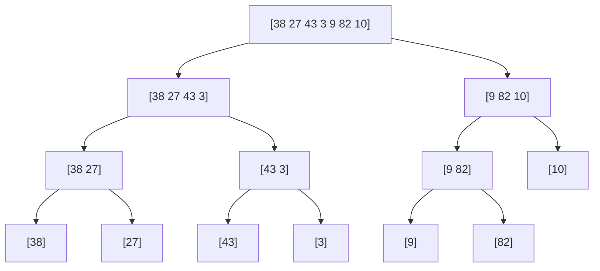
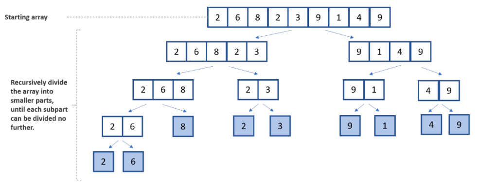
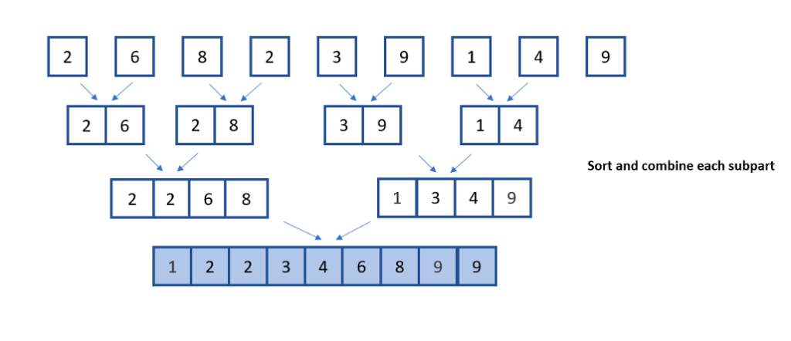

# Merge Sort Analysis

!!! abstract "At a glance"

    - **Problem:** sort $n$ comparable items, with a worst-case guarantee and stability.
    - **Key idea:** split the array in half, sort each half recursively, then **merge** two sorted halves in linear time.
    - **Complexity:** $\Theta(n\log n)$ time in the best, average and worst case; $\Theta(n)$ auxiliary space for arrays; stable.
    - **Where it is used:** the core of Timsort/Powersort (Python, Java objects), external sorting in databases, sorting linked lists, and counting inversions. In this unit it is the case study whose recurrence is solved by every method.

## Motivation and Problem Context

Sorting is the most frequently executed non-trivial algorithm in computing: databases sort for `ORDER BY`, joins and index builds; search engines merge sorted posting lists; build systems, compilers and data pipelines sort constantly. Simple sorts (insertion, selection) take $\Theta(n^2)$ time: for $n = 10^6$ that is about $10^{12}$ operations, hours of CPU. Merge sort, attributed to John von Neumann (1945), was one of the first algorithms to guarantee $\Theta(n\log n)$ (about $2 \times 10^7$ comparisons for $n = 10^6$) in **every** case, and it remains the basis of the stable sorts in today's standard libraries.

For this unit, merge sort plays a second role: its recurrence $T(n) = 2T(n/2) + \Theta(n)$ is the canonical example, solved below by all four methods so that you can compare them.

## Problem Formulation

- **Input:** an array $A[0..n-1]$ of elements from a totally ordered set (any type with a consistent `<=`).
- **Output:** a permutation of $A$ in non-decreasing order.
- **Requirement (stability):** elements with equal keys keep their original relative order.
- **Model:** comparison-based; cost measured in key comparisons and element moves.

## Intuition

Merging two *already sorted* lists is easy: repeatedly compare their front elements and take the smaller, like merging two sorted piles of exam scripts into one. Each comparison outputs one element, so merging costs linear time. Merge sort reduces sorting to merging: a list of one element is sorted, and two sorted halves can be merged. The recursion just creates sorted halves to merge.

!!! tip "Mental model"
    All the real work happens in the merge, on the way back up the recursion. The splitting is trivial (compute a midpoint); every level of the recursion merges all $n$ elements once; there are $\log_2 n$ levels.

## Baseline Approach

**Insertion sort** grows a sorted prefix by inserting each new element into place: $\Theta(n^2)$ comparisons and moves in the worst case (reverse-sorted input), $\Theta(n)$ on sorted input.

**Bottleneck:** each insertion fixes the position of only one element, and may compare it against everything placed so far. Information gained from one comparison is not reused. Equivalently, insertion sort removes at most one inversion per swap, and an array can have $n(n-1)/2$ inversions.

## Algorithm Design

1. **What makes the baseline slow?** Elements are placed one at a time against a growing sorted region.
2. **Exploit structure:** if we had two sorted sequences, we could combine them with at most $n - 1$ comparisons, because each comparison permanently places one element.
3. **Create that structure recursively** (divide and conquer, [Unit 4](../unit4/topic1.md)):
    - **Divide:** split $A[lo..hi]$ at $mid = \lfloor (lo+hi)/2 \rfloor$. Cost $\Theta(1)$.
    - **Conquer:** sort $A[lo..mid]$ and $A[mid+1..hi]$ recursively.
    - **Combine:** merge the two sorted runs. Cost $\Theta(n)$.
4. **Base case:** a range with at most one element is sorted.
5. **Stability decision:** on ties, take from the **left** run (`<=`, not `<`), so equal elements keep their original order.
6. **Space decision:** merging needs somewhere to put the output. Allocate one auxiliary buffer of size $n$ once and reuse it, instead of allocating at every call.

## Pseudocode

```text
MERGE-SORT(A)
    aux = new array of length n
    SORT(A, aux, 0, n - 1)

SORT(A, aux, lo, hi)                     // sorts A[lo..hi], inclusive
    if lo >= hi
        return
    mid = floor((lo + hi) / 2)
    SORT(A, aux, lo, mid)
    SORT(A, aux, mid + 1, hi)
    MERGE(A, aux, lo, mid, hi)

MERGE(A, aux, lo, mid, hi)               // A[lo..mid] and A[mid+1..hi] are sorted
    copy A[lo..hi] into aux[lo..hi]
    i = lo ; j = mid + 1
    for k = lo to hi
        if i > mid                       // left run exhausted
            A[k] = aux[j] ; j = j + 1
        else if j > hi                   // right run exhausted
            A[k] = aux[i] ; i = i + 1
        else if aux[i] <= aux[j]         // ties go left: stable
            A[k] = aux[i] ; i = i + 1
        else
            A[k] = aux[j] ; j = j + 1
```

## Worked Example

Sort $A = [38, 27, 43, 3, 9, 82, 10]$ ($n = 7$).

**Divide phase** (midpoints $\lfloor (lo+hi)/2 \rfloor$):



**Combine phase** (bottom to top): $[38],[27] \to [27, 38]$; $[43],[3] \to [3, 43]$; $[27, 38],[3, 43] \to [3, 27, 38, 43]$; $[9],[82] \to [9, 82]$; $[9, 82],[10] \to [9, 10, 82]$; final merge below.

**Trace of the final merge**, $L = [3, 27, 38, 43]$ (indices $i$) and $R = [9, 10, 82]$ (indices $j$):

| Step $k$ | $L[i]$ | $R[j]$ | Comparison | Output so far |
|---|---|---|---|---|
| 0 | 3 | 9 | $3 \le 9$, take left | 3 |
| 1 | 27 | 9 | $27 > 9$, take right | 3, 9 |
| 2 | 27 | 10 | $27 > 10$, take right | 3, 9, 10 |
| 3 | 27 | 82 | $27 \le 82$, take left | 3, 9, 10, 27 |
| 4 | 38 | 82 | $38 \le 82$, take left | 3, 9, 10, 27, 38 |
| 5 | 43 | 82 | $43 \le 82$, take left | 3, 9, 10, 27, 38, 43 |
| 6 | (exhausted) | 82 | none, copy rest | 3, 9, 10, 27, 38, 43, 82 |

Six comparisons for seven outputs: a merge of $n$ elements uses at most $n - 1$ comparisons, and as few as $\min(|L|, |R|)$ when one run is exhausted early.

The figures below show the same two phases on a nine-element array.

<figure markdown="span">
    {width="90%"}
    <figcaption>Divide phase: the array is split recursively into halves until every piece has one element.</figcaption>
    <p align='right' style="font-size:0.8em"><i>Image Source: <a href="https://developer.nvidia.com/blog/merge-sort-explained-a-data-scientists-algorithm-guide/"> NVIDIA Technical Blog</a></i></p>
</figure>

<figure markdown="span">
    {width="90%"}
    <figcaption>Combine phase drawn as bottom-up pairwise merging (runs of 1, then 2, then 4). Note that it pairs neighbouring elements left to right, which is how bottom-up merge sort groups them; it does not exactly mirror the top-down split in the previous figure, but the final result is the same.</figcaption>
    <p align='right' style="font-size:0.8em"><i>Image Source: <a href="https://developer.nvidia.com/blog/merge-sort-explained-a-data-scientists-algorithm-guide/"> NVIDIA Technical Blog</a></i></p>
</figure>

## Correctness

### MERGE: loop invariant

**Invariant.** At the start of each iteration of the `for k` loop:

1. $A[lo..k-1]$ contains the $k - lo$ smallest elements of $aux[lo..mid] \cup aux[mid+1..hi]$, in sorted order;
2. $aux[i]$ (if $i \le mid$) and $aux[j]$ (if $j \le hi$) are the smallest elements of their runs not yet copied to $A$.

**Initialization.** $k = lo$: $A[lo..lo-1]$ is empty, which trivially holds the 0 smallest elements. $i = lo$ and $j = mid + 1$ point to the first, hence smallest, elements of the two sorted runs.

**Maintenance.** Suppose both runs are non-empty and $aux[i] \le aux[j]$. By part 2, $aux[i]$ is the smallest uncopied element of the left run and $aux[j]$ the smallest of the right, so $aux[i]$ is the smallest uncopied element overall. Writing it to $A[k]$ makes $A[lo..k]$ the $k - lo + 1$ smallest elements, in sorted order (it is at least every element already placed, because those were chosen as minima before it). Incrementing $i$ moves to the next element of a sorted run, preserving part 2. The case $aux[i] > aux[j]$ and the exhausted-run cases are symmetric.

**Termination.** The loop ends at $k = hi + 1$. By the invariant, $A[lo..hi]$ contains all $hi - lo + 1$ elements of the two runs in sorted order. Each element was copied exactly once, so $A[lo..hi]$ is a sorted permutation of the input range.

### MERGE-SORT: strong induction on $n = hi - lo + 1$

- **Base:** $n \le 1$: a range of zero or one element is sorted; `SORT` returns without changing it.
- **Step:** for $n \ge 2$, both halves have sizes $\lceil n/2 \rceil$ and $\lfloor n/2 \rfloor$, both strictly less than $n$. By the inductive hypothesis, the recursive calls sort them. `MERGE` then produces a sorted permutation of the range, by the invariant above.

### Stability

When $aux[i] = aux[j]$, the `<=` test takes the left element. Every element of the left run precedes every element of the right run in the original order, so equal keys are output in their original order. By induction, every merge preserves the relative order of equal keys, so merge sort is stable. Changing `<=` to `<` keeps the output sorted but breaks stability.

!!! warning "Important"
    Stability depends on a single character: `<=` in the merge comparison. Stable sorting is what lets you sort by a secondary key and then by a primary key (for example, sort students by name, then stably by marks, to get marks order with ties broken by name).

## Complexity Analysis

### The recurrence

Let $T(n)$ be the worst-case time on $n$ elements. The divide step is $\Theta(1)$, the two recursive calls are on $\lceil n/2 \rceil$ and $\lfloor n/2 \rfloor$, and `MERGE` is $\Theta(n)$ (one loop iteration per element plus the copy):

$$
T(n) = T(\lceil n/2 \rceil) + T(\lfloor n/2 \rfloor) + \Theta(n), \qquad T(1) = \Theta(1).
$$

For asymptotic purposes this is $T(n) = 2T(n/2) + cn$ ([why floors can be dropped](topic1.md#floors-ceilings-and-why-they-can-usually-be-ignored)).

### Solved four ways

| Method | Key step | Result |
|---|---|---|
| [Iteration](topic2.md) (Example 5) | $T(n) = 2^k T(n/2^k) + kcn$; stop at $k = \log_2 n$ | $T(n) = cn\log_2 n + nT(1)$ |
| [Telescoping](topic2.md) (Example 10) | $T(n)/n = T(n/2)/(n/2) + c$ | $T(n)/n = T(1) + c\log_2 n$ |
| [Recursion tree](topic3.md) (Example 1) | every level costs $cn$; $\log_2 n$ levels plus $n$ leaves | $cn\log_2 n + \Theta(n)$ |
| [Substitution](topic4.md) (Example 1) | claim $T(n) \le 2n\lg n$ for $n \ge 2$, with real floors | $O(n\log n)$, and $\Omega$ similarly |
| [Master method](topic5.md#the-master-theorem) | $a = 2$, $b = 2$, $f(n) = \Theta(n) = \Theta(n^{\log_2 2})$: case 2 | $\Theta(n\log n)$ |

All agree: $T(n) = \Theta(n\log n)$. Comparing them: the master method is fastest, the tree explains *why* (equal work per level), iteration gives the exact constant, and substitution handles the real floors and ceilings rigorously.

### Best, average, worst case

The recursion structure does not depend on the data: merge sort always makes the same calls on the same index ranges. Only the number of comparisons inside each merge varies, between $\min(|L|, |R|)$ and $|L| + |R| - 1$. Hence:

| Case | Comparisons | Time |
|---|---|---|
| Best (e.g. already sorted, $n = 2^m$) | $\frac{n}{2}\log_2 n$ | $\Theta(n\log n)$ |
| Worst | exactly $n\lceil\lg n\rceil - 2^{\lceil\lg n\rceil} + 1$ | $\Theta(n\log n)$ |
| Average (random permutation) | $n\lg n - \Theta(n)$ | $\Theta(n\log n)$ |

The worst-case count comes from the exact recurrence $C(n) = C(\lceil n/2\rceil) + C(\lfloor n/2\rfloor) + n - 1$, $C(1) = 0$ (verified for all $n < 5000$ in the tests for this page). Since any comparison sort needs $\lceil\lg n!\rceil = n\lg n - \Theta(n)$ comparisons in the worst case ([lower bound, Unit 5](../unit5/topic2.md)), merge sort is **asymptotically optimal** among comparison sorts, and within a lower-order term of the exact optimum.

### Space

- **Auxiliary buffer:** $\Theta(n)$ (allocated once).
- **Recursion stack:** depth $\lceil\lg n\rceil$, so $\Theta(\log n)$.
- **Total auxiliary space:** $\Theta(n)$. Merge sort on arrays is **not in place**. (In-place stable merging is possible but complicated and slower in practice.)
- **Linked lists:** merging relinks nodes, so no buffer is needed: $\Theta(\log n)$ stack for top-down, $O(1)$ extra for bottom-up.

## Python Implementation

```python
def merge_sort(a):
    """Sort list a in place (stable) using top-down merge sort."""
    aux = [None] * len(a)                # one buffer, reused by every merge
    _merge_sort(a, aux, 0, len(a) - 1)


def _merge_sort(a, aux, lo, hi):
    if lo >= hi:                         # 0 or 1 element: already sorted
        return
    mid = (lo + hi) // 2
    _merge_sort(a, aux, lo, mid)
    _merge_sort(a, aux, mid + 1, hi)
    merge(a, aux, lo, mid, hi)


def merge(a, aux, lo, mid, hi):
    """Merge sorted runs a[lo..mid] and a[mid+1..hi] (inclusive) into a[lo..hi]."""
    aux[lo:hi + 1] = a[lo:hi + 1]
    i, j = lo, mid + 1
    for k in range(lo, hi + 1):
        if i > mid:                      # left run exhausted
            a[k] = aux[j]; j += 1
        elif j > hi:                     # right run exhausted
            a[k] = aux[i]; i += 1
        elif aux[i] <= aux[j]:           # '<=' takes the left item on ties: stable
            a[k] = aux[i]; i += 1
        else:
            a[k] = aux[j]; j += 1


if __name__ == "__main__":
    data = [38, 27, 43, 3, 9, 82, 10]
    merge_sort(data)
    print(data)                          # [3, 9, 10, 27, 38, 43, 82]
```

- Inclusive bounds `lo..hi` match the pseudocode; the empty list works because `_merge_sort(a, aux, 0, -1)` returns immediately.
- `aux` is allocated once in `merge_sort`; only the slice `lo..hi` is copied in each merge, so total copying per level is $n$.
- The order of the four branches matters: the exhaustion checks must come before the comparison, or `aux[j]` is read past the right run.
- Tested against `sorted()` on 3000 random lists (sizes 0 to 50, many duplicates), and for stability using records with equal keys.

### Extension: counting inversions

An **inversion** is a pair $i < j$ with $A[i] > A[j]$; the count measures how far an array is from sorted (used in ranking similarity, e.g. Kendall tau distance). Brute force is $\Theta(n^2)$. During a merge, when the right run's front element $R[j]$ is output before the remaining left elements $L[i..]$, it forms an inversion with **each** of them, so we add `len(left) - i` in $O(1)$. The recurrence is unchanged, so counting costs $\Theta(n\log n)$.

```python
def sort_and_count(a):
    """Return (sorted copy of a, number of inversions i < j with a[i] > a[j])."""
    if len(a) <= 1:
        return list(a), 0
    mid = len(a) // 2
    left, inv_left = sort_and_count(a[:mid])
    right, inv_right = sort_and_count(a[mid:])
    merged, cross = [], 0
    i = j = 0
    while i < len(left) and j < len(right):
        if left[i] <= right[j]:
            merged.append(left[i])
            i += 1
        else:
            merged.append(right[j])
            cross += len(left) - i       # right[j] is smaller than every remaining left item
            j += 1
    merged.extend(left[i:])
    merged.extend(right[j:])
    return merged, inv_left + inv_right + cross


print(sort_and_count([2, 4, 1, 3, 5])[1])   # 3 inversions: (2,1), (4,1), (4,3)
```

The `<=` matters here too: equal elements are not inversions, so ties must go left. This version slices for clarity (still $\Theta(n\log n)$ because slicing costs $\Theta(n)$ per level). Inversion counting is developed further in [Unit 5](../unit5/topic7.md).

## Edge Cases and Pitfalls

| Case / pitfall | What goes wrong | Fix |
|---|---|---|
| Empty array or one element | Index errors if the base case is `lo == hi` only | Use `lo >= hi` |
| `<` instead of `<=` in merge | Output still sorted, but sort becomes unstable; inversion count wrong with duplicates | Use `<=` |
| Missing exhaustion checks | Reads past the end of one run | Check `i > mid` and `j > hi` first, or append leftovers after the loop |
| Allocating a new buffer in every merge | $\Theta(n\log n)$ total allocation; slow in practice | Allocate one buffer of size $n$ |
| `mid = (lo + hi) // 2` in fixed-width languages | `lo + hi` can overflow 32-bit integers for huge arrays | `mid = lo + (hi - lo) // 2` |
| Splitting as `[lo..mid-1]`, `[mid..hi]` with floor midpoint | For two elements, `mid = lo`, left part is empty and right part is the whole range: infinite recursion | Split as `[lo..mid]`, `[mid+1..hi]` |
| Python recursion on huge inputs | Depth is only $\lg n$, so fine; but slicing versions use $\Theta(n\log n)$ total copying | Pass indices; or use bottom-up merge sort |
| Already sorted input | Still $\Theta(n\log n)$ | Check `a[mid] <= a[mid+1]` before merging to skip it (gives $\Theta(n)$ on sorted input) |

## Common Misconceptions

- **"Merge sort's worst case is worse than its average case."** All cases are $\Theta(n\log n)$; the recursion is data-independent.
- **"Merge sort is in place."** Array merge sort needs $\Theta(n)$ extra space. Quicksort and heapsort are the (essentially) in-place alternatives.
- **"The divide step does the sorting."** Splitting just computes an index; the merge does all comparisons.
- **"Merge sort is always faster than quicksort because its worst case is better."** In memory, a well-implemented quicksort (introsort/pdqsort) is usually faster due to in-place access and fewer moves; merge sort wins when stability, worst-case guarantees, linked lists or external data matter.
- **"Stability is automatic."** It depends on breaking ties toward the left run.

## Alternatives and Trade-offs

| Algorithm | Time (worst) | Time (avg) | Extra space | Stable | Notes |
|---|---|---|---|---|---|
| Merge sort | $\Theta(n\log n)$ | $\Theta(n\log n)$ | $\Theta(n)$ | Yes | Predictable; good for lists and external data |
| Quicksort (random pivot) | $\Theta(n^2)$ | $\Theta(n\log n)$ | $\Theta(\log n)$ stack | No | Fastest in memory in practice |
| Heapsort | $\Theta(n\log n)$ | $\Theta(n\log n)$ | $O(1)$ | No | In place, worst-case guarantee, poor cache behaviour |
| Insertion sort | $\Theta(n^2)$ | $\Theta(n^2)$ | $O(1)$ | Yes | Best for tiny or nearly sorted arrays |
| Timsort / Powersort | $\Theta(n\log n)$ | $\Theta(n\log n)$ | $O(n)$ | Yes | Adaptive: $\Theta(n)$ on sorted input |
| Counting / radix sort | $\Theta(n + k)$ / $\Theta(d(n + k))$ | same | $\Theta(n + k)$ | Yes | Not comparison-based; needs integer-like keys |

**Use merge sort when:** you need stability with a worst-case guarantee; data is in a linked list; data is too large for memory (external sorting); you need a parallel or distributed sort; you need inversion counts.
**Avoid it when:** memory is tight (use heapsort or in-place quicksort); arrays are small (insertion sort); keys are small integers (counting/radix sort).

## In Practice

- **Python:** `list.sort()` and `sorted()` use **Timsort**, a hybrid of merge sort and insertion sort that detects existing sorted runs and merges them; since Python 3.11 the run-merging policy is **Powersort**. Both are stable and run in $\Theta(n)$ on already sorted data.
- **Java:** `Arrays.sort` on object arrays and `Collections.sort` use a Timsort (stable, required by the specification); primitive arrays use dual-pivot quicksort, since stability is meaningless for primitives.
- **C++:** `std::stable_sort` is typically a merge sort that uses a buffer if available and falls back to a slower $O(n\log^2 n)$ in-place merge otherwise; `std::sort` is unstable (introsort).
- **Databases:** when a sort does not fit in its memory budget, PostgreSQL switches to an external merge sort (`EXPLAIN ANALYZE` reports "Sort Method: external merge"): sort memory-sized runs, write them to disk, then merge them $k$ at a time. Sort-merge join uses the same merge step.
- **Storage engines:** LSM-tree databases (LevelDB, RocksDB) keep data in sorted files and periodically *compact* them by $k$-way merging, which is merge sort's combine step at scale.
- **Distributed systems:** MapReduce-style shuffles sort map outputs locally and merge them at the reducers.
- **Performance realities:** pure top-down merge sort is slowed by the many tiny calls near the leaves; real implementations insertion-sort small runs (tens of elements), skip merging when `a[mid] <= a[mid+1]`, and alternate the roles of `a` and `aux` to avoid copying.

## Interview and Competitive Programming

- **Recognition cues:** "count pairs $i < j$ with a condition across halves" (inversions, reverse pairs, smaller elements after self) means merge-sort-based divide and conquer; "sort a linked list in $O(n\log n)$" means merge sort; "merge $k$ sorted lists/files" means a heap-based $k$-way merge, $O(N\log k)$.
- **Template:** recurse on halves, then in the merge step do a **two-pointer pass that counts cross pairs** before (or while) merging; the counting pass must use the sorted halves.
- **Constraints:** $n \le 10^5$ to $10^6$ with "count pairs" means $O(n\log n)$: merge-sort counting or a Fenwick tree.
- **Traps:** counting with `<` vs `<=` (strict vs non-strict conditions); integer overflow when inversions reach about $n^2/2 \approx 5 \times 10^{11}$ for $n = 10^6$ (use 64-bit integers in C++/Java); for reverse pairs ($a_i > 2a_j$) the count pass must be separate from the merge, because the merge condition differs.

## Using AI Assistants Critically

- Generated merge functions often use `<` instead of `<=`, silently breaking stability; test with records that have equal keys and distinct tags.
- Watch for off-by-one splits (`mid` vs `mid + 1`, inclusive vs exclusive bounds) that cause infinite recursion on two-element ranges or drop an element. Test sizes 0, 1, 2, 3 explicitly.
- LLM code frequently slices and concatenates (`merge_sort(a[:mid]) + ...`) and then claims $O(\log n)$ or $O(1)$ extra space; the true auxiliary space is $\Theta(n)$ at least, and slicing adds copying.
- Inversion-count code is often wrong with duplicates, or adds `mid - i` with the wrong index base. Cross-check against an $O(n^2)$ brute force on thousands of small random arrays with repeated values.
- Verify complexity empirically: doubling $n$ should multiply time by slightly more than 2; a factor near 4 indicates hidden quadratic work (e.g. `list.pop(0)` in the merge).
- If `hypothesis` is available, a property test `merge_sort(xs) == sorted(xs)` over random lists covers most of these bugs in a few lines.

## Practice

### Beginner

1. **Trace.** Show every merge (with comparison counts) when merge sort runs on $[5, 2, 4, 6, 1, 3, 2, 6]$. *Output:* the list after each merge. *Difficulty:* easy.
2. **Merge two sorted arrays** of lengths $m$ and $n$ into a new sorted array (LeetCode 88 "Merge Sorted Array" is the in-place variant). *Constraints:* $m, n \le 10^5$. *Difficulty:* easy.
3. **Comparison count.** How many comparisons does merge sort make on an already sorted array of $n = 16$ elements? Of reverse-sorted? *Difficulty:* easy.

### Intermediate

1. **Bottom-up merge sort.** Implement merge sort without recursion by merging runs of width 1, 2, 4, ... and prove it does $\lceil\lg n\rceil$ passes. *Difficulty:* medium.
2. **Sort a linked list** in $O(n\log n)$ time and $O(\log n)$ extra space (LeetCode 148 "Sort List"). *Constraints:* up to $5 \times 10^4$ nodes. *Difficulty:* medium.
3. **3-way merge sort.** Write the recurrence for splitting into thirds with a 3-way merge, solve it, and compare comparison counts with 2-way merge sort. *Difficulty:* medium.

### Advanced

1. **External sort design.** Sort 100 GB of records with 1 GB of RAM. Determine the number of initial runs, the merge fan-in $k$, and the number of passes over the data; express total I/O in terms of $N$, $M$ (memory) and $k$. *Difficulty:* hard.
2. **Merge $k$ sorted lists** with a total of $N$ elements in $O(N\log k)$ (LeetCode 23 "Merge k Sorted Lists"). Prove the bound and compare with merging the lists one by one. *Difficulty:* hard.
3. **Natural merge sort.** Design a merge sort that first detects maximal non-decreasing runs and prove it runs in $O(n\log r)$ where $r$ is the number of runs. *Difficulty:* hard.

### Interview / CP

1. **Count inversions** of an array of $n \le 10^6$ integers in $O(n\log n)$. *Output:* a 64-bit count. *Difficulty:* medium.
2. **Reverse pairs:** count pairs $i < j$ with $a_i > 2a_j$ (LeetCode 493 "Reverse Pairs"). *Constraints:* $n \le 5 \times 10^4$, values fit in 32-bit signed integers. *Difficulty:* hard.
3. **Count of smaller numbers after self:** for each $i$, count $j > i$ with $a_j < a_i$ (LeetCode 315 "Count of Smaller Numbers After Self"). *Constraints:* $n \le 10^5$. *Difficulty:* hard.

## Self-Check Questions

??? question "Q1. Why is merge sort $\Theta(n\log n)$ even on already sorted input?"
    The recursion structure ignores the data: it always splits into halves to depth $\lceil\lg n\rceil$ and merges every level. On sorted input each merge does fewer comparisons ($\min(|L|,|R|)$), but still copies all elements, giving $\Theta(n)$ per level and $\Theta(n\log n)$ total. Adding the check `a[mid] <= a[mid+1]` to skip merges would make it $\Theta(n)$ on sorted input.

??? question "Q2. State the loop invariant of MERGE and explain what the termination step proves."
    At the start of iteration $k$, $A[lo..k-1]$ holds the $k - lo$ smallest elements of both runs in sorted order, and $aux[i]$, $aux[j]$ are the smallest uncopied elements of their runs. At termination $k = hi + 1$, so $A[lo..hi]$ holds all elements of both runs in sorted order.

??? question "Q3. What single change makes merge sort unstable, and why?"
    Using `<` instead of `<=` in the comparison. On equal keys the right-run element is then taken first, placing it before an equal element that originally preceded it.

??? question "Q4. Solve merge sort's recurrence with the master method and explain the result using the recursion tree."
    $a = 2$, $b = 2$, $f(n) = \Theta(n) = \Theta(n^{\log_2 2})$: case 2, $\Theta(n\log n)$. In the tree, level $i$ has $2^i$ merges of size $n/2^i$, so each level costs $\Theta(n)$, and there are $\log_2 n$ levels: the balanced regime.

??? question "Q5. What is the auxiliary space of array merge sort, and of merge sort on a linked list?"
    Arrays: $\Theta(n)$ buffer plus $\Theta(\log n)$ stack. Linked lists: merging relinks nodes, so only $\Theta(\log n)$ stack (top-down) or $O(1)$ (bottom-up).

??? question "Q6. In inversion counting, why is `len(left) - i` added when `right[j]` is output?"
    `left` is sorted and `left[i] > right[j]`, so every element `left[i..]` is greater than `right[j]`, and each of them precedes `right[j]` in the original array. That is exactly `len(left) - i` inversions involving `right[j]` and the left half.

??? question "Q7. Given that quicksort is often faster in practice, why do Python and Java use merge-based sorts for objects?"
    They guarantee stability (required by the APIs), $\Theta(n\log n)$ worst case, and adaptivity: Timsort/Powersort exploit existing runs and run in near-linear time on partially sorted data, which is common in real workloads. For objects, comparisons are expensive relative to moves, and merge-based sorts use close to the minimum number of comparisons.

??? question "Q8. A 3-way merge sort has recurrence $T(n) = 3T(n/3) + \Theta(n)$. Is it asymptotically faster than 2-way?"
    No: master case 2 gives $\Theta(n\log n)$ either way. The depth drops from $\log_2 n$ to $\log_3 n$, but each 3-way merge needs about 2 comparisons per element (or a heap), so the comparison count is not better; only the constants and memory-access pattern change.

## Complexity Summary

| Measure | Best | Average | Worst |
|---|---|---|---|
| Time | $\Theta(n\log n)$ | $\Theta(n\log n)$ | $\Theta(n\log n)$ |
| Comparisons ($n = 2^m$) | $\frac{n}{2}\lg n$ | $n\lg n - \Theta(n)$ | $n\lg n - n + 1$ |
| Auxiliary space (array) | $\Theta(n)$ | $\Theta(n)$ | $\Theta(n)$ |
| Recursion depth | $\lceil\lg n\rceil$ | $\lceil\lg n\rceil$ | $\lceil\lg n\rceil$ |
| Inversion counting | $\Theta(n\log n)$ | $\Theta(n\log n)$ | $\Theta(n\log n)$ |
| Stable | yes | | |

## Key Takeaways

- Merge sort = trivial split + recursive sort + linear-time merge; the merge does all the comparing.
- The recurrence $T(n) = 2T(n/2) + \Theta(n)$ gives $\Theta(n\log n)$ by every method in this unit; the recursion tree shows why (equal cost per level).
- Running time is data-independent: best, average and worst case are all $\Theta(n\log n)$, which is optimal for comparison sorting.
- Correctness rests on the merge loop invariant; stability rests on `<=`.
- Array merge sort needs $\Theta(n)$ extra space; linked-list merge sort does not.
- Production sorts (Timsort, Powersort, external merge sort, LSM compaction) are merge sort adapted for runs, memory hierarchy and disks.
- The merge step is a reusable pattern: counting inversions and other cross-half pair problems in $O(n\log n)$.
