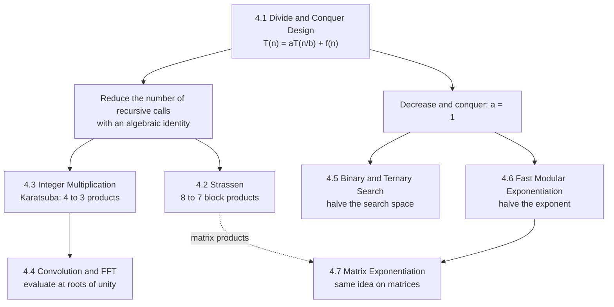

# Divide and Conquer Algorithms

!!! success "Learning Outcome"

     
     - {{ lo }}
     

## Why This Unit Matters

Divide and conquer is the paradigm behind many of the fastest algorithms you use every day without noticing: library sorting routines, big-integer arithmetic in cryptography, the FFT inside audio, image and signal processing, binary search over indexes, and fast exponentiation in RSA. In interviews it is one of the most frequently tested patterns ("count pairs with a merge sort", "binary search on the answer", "compute $a^b \bmod m$", "the $10^{18}$-th Fibonacci number"). It is also where the analysis tools of Unit 3 pay off: every algorithm in this unit is designed, and then justified, through a recurrence.

The central lesson is a design habit rather than a list of algorithms: split the problem, ask what the recursion cannot see, make the combine step cheap, and, when the recursion is leaf-dominated, look for an algebraic identity that needs **fewer recursive calls**.

## Prerequisites

- Asymptotic notation and growth rates: [Unit 2.1](../unit2/topic1.md).
- The word-RAM cost model, and when it does not apply (big integers): [Unit 2.2](../unit2/topic2.md).
- Recurrences and how to solve them: [Iterative Method](../unit3/topic2.md), [Recursion Trees](../unit3/topic3.md), [Substitution](../unit3/topic4.md), [Master Method](../unit3/topic5.md), and the worked [Merge Sort Analysis](../unit3/topic6.md).
- Basic linear algebra (matrix product), polynomials, complex numbers (for the FFT), and modular arithmetic (for Topics 4.6 and 4.7).

## Topic Map

| Topic | Core question | Key result |
| --- | --- | --- |
| [4.1 Divide and Conquer Design](topic1.md) | How do you derive a divide-and-conquer algorithm and prove and analyse it? | Design by "what does the recursion not see?"; correctness by strong induction; cost $T(n) = aT(n/b) + f(n)$. Maximum subarray and closest pair in $\Theta(n\log n)$ |
| [4.2 Strassen's Algorithm](topic2.md) | Can matrix multiplication beat $\Theta(n^3)$? | 7 block products instead of 8: $\Theta(n^{\log_2 7}) \approx \Theta(n^{2.807})$; needs a ring with subtraction and a cutoff in practice |
| [4.3 Integer Multiplication](topic3.md) | Can $n$-digit multiplication beat $\Theta(n^2)$? | Karatsuba: 3 half-size products instead of 4, $\Theta(n^{\log_2 3}) \approx \Theta(n^{1.585})$; generalises to Toom–Cook |
| [4.4 Convolution and FFT](topic4.md) | How fast can two polynomials (or sequences) be multiplied? | Evaluate at roots of unity, multiply pointwise, interpolate: $\Theta(n\log n)$ |
| [4.5 Binary and Ternary Search](topic5.md) | How do you search sorted data or a unimodal function quickly? | Binary search: $\Theta(\log n)$ comparisons; ternary search finds the extremum of a unimodal function in $\Theta(\log n)$ evaluations |
| [4.6 Fast Modular Exponentiation](topic6.md) | How do you compute $a^b \bmod m$ for huge $b$? | Repeated squaring: $O(\log b)$ modular multiplications instead of $b - 1$ |
| [4.7 Matrix Exponentiation](topic7.md) | How do you jump to the $n$-th term of a linear recurrence? | $A^n \bmod m$ by repeated squaring: $O(D^3\log n)$ for a $D \times D$ matrix; Fibonacci in $O(\log n)$ |

## How to Study This Unit

1. Start with **4.1** and learn the five design decisions (what to split, how many calls, what crosses the boundary, base case, recursion contract). Every later topic is an instance of them.
2. Read **4.3 before 4.2**: Karatsuba's $4 \to 3$ is the simpler version of Strassen's $8 \to 7$, and both lead naturally to the FFT in **4.4**.
3. Treat **4.5–4.7** as decrease and conquer ($a = 1$): one subproblem, logarithmic depth. Pay attention to loop invariants and off-by-one boundaries; they are where marks and interview points are lost.
4. For every algorithm, write the recurrence from the code yourself and solve it two ways (Master method and recursion tree) before reading the notes' derivation.
5. Run the Python implementations, then break them on purpose (wrong base case, wrong sign, wrong `mid`) and watch which tests catch the bug.
