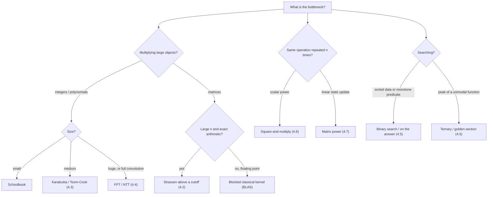

# Unit 4 Summary

This page is a revision sheet for Unit 4. Each topic page has the full derivations, proofs and code:
[4.1 Divide and Conquer Design](topic1.md) ·
[4.2 Strassen](topic2.md) ·
[4.3 Integer Multiplication](topic3.md) ·
[4.4 Convolution and FFT](topic4.md) ·
[4.5 Binary and Ternary Search](topic5.md) ·
[4.6 Modular Exponentiation](topic6.md) ·
[4.7 Matrix Modular Exponentiation](topic7.md).

## Key Results

### The paradigm in one line

Divide an instance into $a$ subproblems of size $n/b$, solve them recursively, and combine them in $f(n)$ time:

$$
T(n) = a\,T(n/b) + f(n), \qquad \text{then compare } f(n) \text{ with } n^{\log_b a}.
$$

The comparison is the [Master Method](../unit3/topic5.md).

| Shape | Recurrence | Solution | Example |
| --- | --- | --- | --- |
| Decrease and conquer (1 subproblem) | $T(n) = T(n/2) + O(1)$ | $\Theta(\log n)$ | Binary search, fast power |
| Balanced, linear combine | $T(n) = 2T(n/2) + \Theta(n)$ | $\Theta(n \log n)$ | Merge sort, FFT, max subarray, closest pair |
| Fewer subproblems than naive | $T(n) = 3T(n/2) + \Theta(n)$ | $\Theta(n^{\log_2 3}) \approx \Theta(n^{1.585})$ | Karatsuba |
| Fewer subproblems than naive | $T(n) = 7T(n/2) + \Theta(n^2)$ | $\Theta(n^{\log_2 7}) \approx \Theta(n^{2.807})$ | Strassen |
| Naive block split | $T(n) = 4T(n/2) + \Theta(n)$ / $8T(n/2) + \Theta(n^2)$ | $\Theta(n^2)$ / $\Theta(n^3)$ | Schoolbook integer / matrix multiplication |

### Cheat sheet by topic

| Topic | Problem | Baseline | Divide-and-conquer result | Key identity / idea |
| --- | --- | --- | --- | --- |
| 4.1 D&C design | Max subarray; closest pair | $\Theta(n^2)$ | $\Theta(n \log n)$ | Solve halves; the combine step handles what crosses the boundary (crossing sum; strip of width $2\delta$ with $O(1)$ neighbours per point) |
| 4.2 Strassen | $n \times n$ matrix product | $\Theta(n^3)$ | $\Theta(n^{\log_2 7}) \approx \Theta(n^{2.807})$ | 7 block products instead of 8, paid for with 18 block additions/subtractions |
| 4.3 Karatsuba | $n$-digit integer product | $\Theta(n^2)$ | $\Theta(n^{\log_2 3}) \approx \Theta(n^{1.585})$ | $x_1y_0 + x_0y_1 = (x_1+x_0)(y_1+y_0) - x_1y_1 - x_0y_0$ |
| 4.4 FFT | Convolution / polynomial product | $\Theta(nm)$ | $\Theta(N \log N)$, $N \ge n + m - 1$ | $\omega_N^2 = \omega_{N/2}$; butterfly $X[k], X[k+N/2] = E[k] \pm \omega_N^{-k}O[k]$; convolution theorem |
| 4.5 Binary search | Search sorted data / monotone predicate | $\Theta(n)$ | $\Theta(\log n)$, $\lfloor\log_2 n\rfloor + 1$ probes | Invariant: the answer stays in the window |
| 4.5 Ternary search | Max of a strictly unimodal $f$ | $\Theta(\text{range})$ | $O(\log(L/\varepsilon))$ evaluations | Compare $f(m_1)$ and $f(m_2)$ and discard a third |
| 4.6 Modular power | $a^b \bmod m$ | $\Theta(b)$ multiplications | $\Theta(\log b)$, $\le 2\lfloor\log_2 b\rfloor + 2$ | $a^b = (a^{\lfloor b/2\rfloor})^2 a^{b \bmod 2}$; reduce after every multiplication |
| 4.7 Matrix power | $A^n \bmod m$, $D \times D$ | $\Theta(nD^3)$ (or $\Theta(nD)$ by iterating the recurrence) | $\Theta(D^3 \log n)$ | Same algorithm; associativity, identity $I$ |

### Formulas worth memorising

| Item | Value |
| --- | --- |
| $\log_2 3$ | $\approx 1.585$ |
| $\log_2 7$ | $\approx 2.807$ |
| Toom-3 exponent $\log_3 5$ | $\approx 1.465$ |
| FFT butterflies | $\tfrac{N}{2}\log_2 N$ |
| Ternary vs binary search probes on an array | $2\log_3 n \approx 1.26\log_2 n$ vs $\log_2 n$ |
| Square-and-multiply, MSB-first | $\lfloor\log_2 b\rfloor$ squarings + $(\nu(b) - 1)$ multiplications, where $\nu(b)$ = number of 1-bits |
| Fibonacci Q-matrix | $\begin{bmatrix}1&1\\1&0\end{bmatrix}^n = \begin{bmatrix}F_{n+1}&F_n\\F_n&F_{n-1}\end{bmatrix}$ |
| Fermat inverse ($p$ prime, $p \nmid a$) | $a^{-1} \equiv a^{p-2} \pmod p$ |
| Integer multiplication milestones | Schönhage–Strassen $O(n\log n\log\log n)$ (1971); Harvey–van der Hoeven $O(n\log n)$ (2019, theoretical) |

## Important for Exams

!!! warning "Classic mistakes"

    - **Splitting alone does not speed anything up.** $4T(n/2) + \Theta(n)$ is still $\Theta(n^2)$. The gain comes from **fewer subproblems** (Karatsuba 4 to 3, Strassen 8 to 7) or from a **cheap combine** (FFT, merge sort).
    - **Decrease and conquer is not divide and conquer.** Binary search and fast power keep one subproblem and have no combine step: $T(n) = T(n/2) + O(1)$.
    - **FFT convolution needs padding to at least $n + m - 1$.** Otherwise the result is circular convolution, with wrap-around.
    - **Ternary search on arrays is not faster than binary search.** It uses fewer iterations but more comparisons. Ternary search is for strictly unimodal functions.
    - **Never reduce an exponent mod $m$.** Reduce after every *multiplication*. Exponents reduce mod $\varphi(m)$, and only when $\gcd(a, m) = 1$.
    - **Matrix power starts from $I$, not $A$.** It relies on associativity, and on the fact that powers of one matrix commute, not on general commutativity.
    - **$O(b)$ is exponential in the input size** of $b$ (which is $\log b$ bits). $O(\log b)$ is linear in it.
    - **$(A^n)_{ij}$ counts walks, not simple paths.**

**Typical exam tasks and how to approach them**

| Task | What the examiner wants |
| --- | --- |
| "Derive the recurrence and solve it" | Count the subproblems ($a$), their size ($n/b$) and the non-recursive work ($f(n)$); name the Master case, or unroll with a recursion tree |
| "Prove correctness" | Induction on $n$ for recursive D&C (base, hypothesis, step); a loop invariant (initialization, maintenance, termination) for binary search and fast power |
| "Trace the algorithm" | A table with one row per step: Strassen's $M_1..M_7$ on $2\times2$; Karatsuba's $z_0, z_1, z_2$; FFT butterflies for $N = 4$; `low/high/mid`; bit, square, multiply |
| "Compare / justify the choice" | Asymptotics **and** constants, crossover sizes, numerical stability (Strassen, FFT), exactness (NTT vs floating-point FFT), memory |
| "Why does X work?" | The identity being exploited: Karatsuba's middle term, $\omega_N^2 = \omega_{N/2}$, $(xy) \bmod m$, sortedness/monotonicity, associativity |

## Choosing the Right Technique

| If the problem says… | Think… | Complexity |
| --- | --- | --- |
| "sorted", "minimise the maximum", "smallest $x$ such that…" | Binary search (on the answer) | $O(\log n)$ or $O(C\log R)$ |
| "maximise a convex/concave cost over one parameter" | Ternary search | $O(\log(L/\varepsilon))$ |
| "$a^b \bmod m$", "divide modulo a prime" | `pow(a, b, m)`, `pow(a, -1, m)` | $O(\log b)$ |
| "$n \le 10^{18}$, linear recurrence, mod $10^9 + 7$" | Companion matrix power | $O(D^3\log n)$ |
| "multiply polynomials or big numbers, $n \sim 10^5$–$10^6$" | FFT / NTT | $O(n\log n)$ |
| "for every $s$, count pairs with sum $s$" | Convolution of frequency arrays | $O(V\log V)$ |
| "multiply 1000-digit integers in hand-written code" | Karatsuba | $O(n^{1.585})$ |
| "multiply large dense matrices exactly (finite field)" | Strassen with a cutoff | $O(n^{2.807})$ |
| "range maximum subarray with updates" | D&C combine rule in a segment tree | $O(\log n)$ per query |

**When not to use divide and conquer:** for small inputs (use a base-case cutoff), when subproblems overlap heavily (use dynamic programming, Unit 6), when a simple linear scan exists (Kadane's $\Theta(n)$ maximum subarray), or when numerical stability matters more than the exponent (Strassen in floating point).

## Mixed Practice

??? question "Q1. Classify and solve: (a) T(n) = 2T(n/2) + n, (b) T(n) = T(n/2) + 1, (c) T(n) = 3T(n/2) + n, (d) T(n) = 7T(n/2) + n^2."

    (a) Case 2: $\Theta(n\log n)$ (merge sort, FFT). (b) Case 2 with $a = 1$: $\Theta(\log n)$ (binary search, fast power). (c) Case 1, since $n^{\log_2 3}$ dominates $n$: $\Theta(n^{1.585})$ (Karatsuba). (d) Case 1, since $n^{\log_2 7}$ dominates $n^2$: $\Theta(n^{2.807})$ (Strassen).

??? question "Q2. Karatsuba, Strassen and the FFT are all divide and conquer. What does each one reduce to beat the naive method?"

    Karatsuba reduces the **number of subproblems** from 4 to 3 using an algebraic identity. Strassen does the same for matrices, from 8 to 7. The FFT keeps 2 subproblems but makes the **combine linear**: it changes representation so that multiplication becomes pointwise, and uses the symmetry of roots of unity so that evaluation splits in half.

??? question "Q3. Compute 3^13 mod 7 with square-and-multiply and state the number of multiplications."

    $13 = 1101_2$. MSB-first: start with $3$; next bit 1 gives $3^2 \cdot 3 = 27 \equiv 6$; bit 0 gives $6^2 = 36 \equiv 1$; bit 1 gives $1^2 \cdot 3 = 3$. So $3^{13} \equiv 3 \pmod 7$. That is 3 squarings and 2 multiplications (skipping the trivial first step). Check with Fermat: $3^6 \equiv 1$, so $3^{13} = 3^{12}\cdot 3 \equiv 3$.

??? question "Q4. Why must the FFT input be split by even and odd index rather than into halves?"

    Only the even/odd split makes each half a genuine DFT of size $N/2$, because $\omega_N^{2} = \omega_{N/2}$. Contiguous halves do not turn into smaller DFTs, so no recursion is possible.

??? question "Q5. You need F(10^18) mod 10^9+7 and the number of length-10^9 walks between two vertices in a 30-vertex graph. Which technique and what cost?"

    Both are matrix exponentiation. Fibonacci uses the $2\times2$ Q-matrix: about 120 products of $2\times2$ matrices, essentially instant. Walks use the adjacency matrix power $A^{10^9}$: about 30 squarings and up to 30 multiplications of $30\times30$ matrices, i.e. at most $60 \cdot 27{,}000 \approx 1.6\times10^6$ multiply-adds.

??? question "Q6. A binary search on the answer returns wrong results on some inputs. What two things do you check first?"

    (1) That the feasibility predicate is really **monotone**: if $t$ is feasible, so is every larger $t$ (for minimisation). (2) The boundaries: the initial range must contain the answer, and the loop must use one consistent interval convention (half-open with `hi = mid`, or closed with `hi = mid - 1`), so that it neither skips the answer nor loops forever.

??? question "Q7. Strassen is asymptotically faster. Why do NumPy/BLAS matrix multiplications not use it?"

    Strassen has a larger constant (18 additions per level), worse memory locality, extra temporary storage, and weaker floating-point error bounds. Tuned classical blocked kernels with SIMD and multithreading are faster at practical sizes and more stable. Strassen is used in exact arithmetic (finite fields, computer algebra), sometimes for one or two levels above a tuned kernel.

??? question "Q8. Multiply 1234 x 5678 with one level of Karatsuba (split into two-digit halves)."

    $x_1 = 12$, $x_0 = 34$, $y_1 = 56$, $y_0 = 78$. $z_2 = 12 \cdot 56 = 672$, $z_0 = 34 \cdot 78 = 2652$, and $z_1 = (12+34)(56+78) - 672 - 2652 = 46 \cdot 134 - 3324 = 6164 - 3324 = 2840$. Result: $672\cdot10^4 + 2840\cdot10^2 + 2652 = 6{,}720{,}000 + 284{,}000 + 2{,}652 = 7{,}006{,}652$.

??? question "Q9. Why is FFT-based multiplication not exact, and what is the exact alternative?"

    It uses floating-point complex roots of unity, so rounding error accumulates and grows with $N$ and with coefficient size. For integer results you must round, and that fails once the error exceeds $0.5$. The Number-Theoretic Transform uses roots of unity in $\mathbb{Z}_p$ (e.g. $p = 998244353$), which is exact modulo $p$. Several primes combined with CRT give exact large results.

??? question "Q10. Maximum subarray: D&C gives Theta(n log n), Kadane gives Theta(n). Is D&C worth knowing here?"

    Yes. Its combine information (total, best prefix, best suffix, best inner) is exactly what a segment tree stores to answer range maximum-subarray queries with point updates in $O(\log n)$. Kadane cannot do that. The D&C recurrence $2T(n/2) + \Theta(n)$ is also a standard exam derivation.

??? question "Q11. Ternary search returned a wrong maximum on f = [1, 5, 5, 5, 5, 9, 2]. Explain."

    $f$ has a plateau before the peak, so it is not strictly unimodal. With $m_1, m_2$ both on the plateau, $f(m_1) = f(m_2)$ and the algorithm discards the right part, which contains the true maximum 9. Ternary search requires strict unimodality (or plateaus only at the maximum).

??? question "Q12. Order these by growth for large n: n^{log2 7}, n^3, n log n, n^{log2 3}, n^2, log n."

    $\log n < n\log n < n^{\log_2 3} \approx n^{1.585} < n^2 < n^{\log_2 7} \approx n^{2.807} < n^3$.
