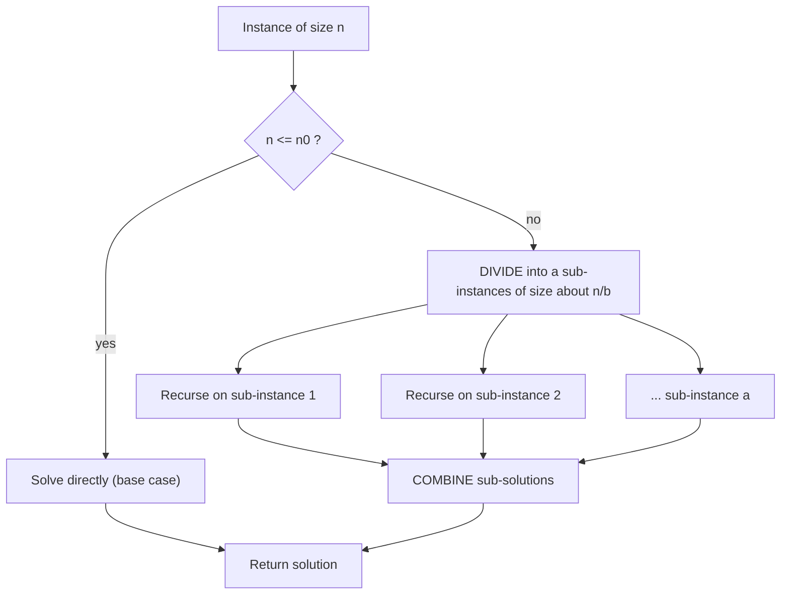
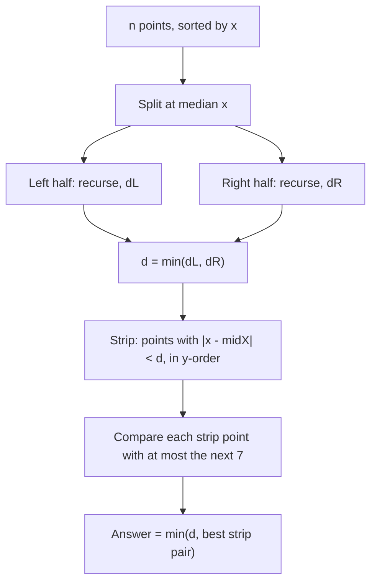

# Divide and Conquer Algorithm Design

!!! abstract "At a glance"

    - **What it is:** a design paradigm, not a single algorithm. Split an instance into smaller instances of the *same* problem, solve them recursively, and combine their answers.
    - **Key idea:** solve each part in isolation, then repair only what crosses the boundary. Whatever the recursion cannot see is exactly what the combine step must compute.
    - **Cost model:** $T(n) = a\,T(n/b) + f(n)$, decided by comparing $f(n)$ with $n^{\log_b a}$ ([Master Method](../unit3/topic5.md)).
    - **Running examples:** maximum subarray ($\Theta(n^2) \to \Theta(n\log n)$) and closest pair of points ($\Theta(n^2) \to \Theta(n\log n)$).
    - **Where it is used:** library sorts, external sorting in databases, big-number and matrix arithmetic, FFT, segment trees, fork/join and MapReduce-style parallelism.

## Motivation and Problem Context

Sorting one million records with insertion sort costs on the order of $n^2 = 10^{12}$ comparisons, roughly 17 minutes at $10^9$ operations per second. Merge sort needs about $n\log_2 n \approx 2\times10^7$, which finishes in about 20 ms. The improvement does not come from faster comparisons or better hardware. It comes from **restructuring the work**.

Insertion sort is quadratic because any element may be compared with any other. If the list is split into two halves and each half is sorted independently, the merge never compares two elements of the *same* half again; it only interleaves two ordered runs, which costs $\Theta(n)$ instead of $\Theta(n^2)$. That is the general pattern:

> A quadratic amount of interaction between elements is replaced by a cheap amount of interaction **between sub-solutions**, applied recursively.

The same move appears far from sorting. Schoolbook multiplication of two $n$-digit integers lets every digit meet every other digit, $\Theta(n^2)$. Karatsuba splits each number in half and needs only three half-size products instead of four, giving $\Theta(n^{\log_2 3}) \approx \Theta(n^{1.585})$ ([Topic 4.3](topic3.md)). Strassen does the same for matrices, 8 products down to 7 ([Topic 4.2](topic2.md)).

| Complexity | Operations at $n = 10^6$ | Time at $10^9$ ops/s |
| --- | --- | --- |
| $\Theta(n\log n)$ | $\approx 2\times10^7$ | $\approx 20$ ms |
| $\Theta(n^{1.585})$ | $\approx 3.2\times10^9$ | $\approx 3$ s |
| $\Theta(n^2)$ | $10^{12}$ | $\approx 17$ minutes |

!!! tip

    The question that motivates divide and conquer is: **can the interaction between distant parts of the input be summarised cheaply, instead of being examined pairwise?** If yes, splitting is likely to pay off.

## Problem Formulation

Divide and conquer is a meta-technique, so the "problem" is a *class* of problems. A problem $P$ is a candidate when it satisfies:

```text
Input:   an instance x of problem P, of size n.
Output:  a solution S(x).

Self-similarity:
    There are functions Divide and Combine such that
        Divide(x) = (x_1, ..., x_a), each x_i an instance of the SAME problem P,
        size(x_i) <= n / b for some constant b > 1,
        S(x) = Combine(S(x_1), ..., S(x_a), x).

Base case:
    There is a constant n_0 such that instances of size <= n_0 are solved directly.

Independence:
    The sub-instances can be solved without each other's answers,
    and they do not substantially overlap.
```

Assumptions and constraints:

- $b > 1$ strictly: every recursive call must receive a strictly smaller instance, or the recursion never terminates.
- Divide + Combine must be cheaper than solving the problem directly, otherwise the recursion is pure overhead.
- Edge cases to check in every design: $n = 0$, $n = 1$, $n$ not a power of $b$ (uneven split), and degenerate inputs (all elements equal, sorted, reverse sorted).

!!! warning "Important"

    The **independence** requirement is the one students most often ignore. If sub-instances overlap heavily (Fibonacci, edit distance, knapsack), plain recursion recomputes the same sub-answers exponentially many times. That is the signal for **dynamic programming** ([Unit 6](../unit6/topic1.md)), not divide and conquer.

## Intuition

Counting a stadium crowd: you split the stadium in two and give each half to an assistant, who does the same, until a section is small enough to count at a glance. Counts flow back up and are added in pairs. Two features matter: the sub-task is the **same task**, and the combine step (adding two numbers) is **cheap**. Counting gains nothing asymptotically ($\Theta(n)$ either way); the paradigm pays off only when the direct method is *superlinear*.



Three numbers describe any divide-and-conquer algorithm:

| Symbol | Meaning | Merge sort | Binary search | Karatsuba | Strassen |
| --- | --- | --- | --- | --- | --- |
| $a$ | number of recursive calls | 2 | 1 | 3 | 7 |
| $b$ | shrink factor of each call | 2 | 2 | 2 | 2 |
| $f(n)$ | divide + combine cost | $\Theta(n)$ | $\Theta(1)$ | $\Theta(n)$ | $\Theta(n^2)$ |

$a$ and $b$ are **independent**: $a$ is decided by how many sub-answers the combine step needs, not by how many pieces the input was cut into. The **critical exponent** $\alpha = \log_b a$ gives the number of leaves of the recursion tree, $a^{\log_b n} = n^{\log_b a}$. Comparing $f(n)$ with $n^{\alpha}$ tells you whether the cost lives at the leaves, at the root, or evenly across levels.

!!! note "Decrease and conquer"

    When $a = 1$, only one sub-instance is pursued and nothing is really combined. Binary search ([Topic 4.5](topic5.md)), exponentiation by squaring ([Topic 4.6](topic6.md)) and Euclid's GCD belong to this family, usually called **decrease and conquer**. The recurrence machinery is identical.

## Baseline Approach

Take the **maximum subarray problem** as the running example.

```text
Input:  an array A[0..n-1] of integers (possibly negative), n >= 1.
Output: the maximum of A[i] + A[i+1] + ... + A[j] over all 0 <= i <= j < n
        (the subarray must be non-empty).
```

The brute force fixes each start $i$ and extends $j$, keeping a running sum:

```text
ALGORITHM MaxSubarrayBruteForce(A)
    best ← -INFINITY
    FOR i ← 0 TO n - 1
        sum ← 0
        FOR j ← i TO n - 1
            sum ← sum + A[j]
            best ← max(best, sum)
    RETURN best
```

Time $\Theta(n^2)$, space $\Theta(1)$. **Bottleneck:** every pair $(i, j)$ is examined, and nothing learnt about one region is reused for a larger region containing it.

## Algorithm Design

### From the bottleneck to the split

Split at the midpoint $m$. Every subarray falls into **exactly one** of three classes:

1. entirely inside the left half $A[lo..m]$;
2. entirely inside the right half $A[m+1..hi]$;
3. **crossing** the midpoint, so it contains both $A[m]$ and $A[m+1]$.

Classes 1 and 2 are the same problem on half the input, so recursion handles them. Class 3 is a **new but easy** problem: a crossing subarray is a suffix of the left half glued to a prefix of the right half, and the two choices are independent, so the best crossing sum is (best suffix of left) + (best prefix of right), found by two linear scans.

```text
Brute force Θ(n²)  →  bottleneck: all pairs  →  observation: left / right / crossing
→  T(n) = 2T(n/2) + Θ(n)  →  Θ(n log n)
```

### The five design decisions

Making these decisions explicitly is what turns "guess an algorithm" into "derive an algorithm".

| Decision | Question to ask | Maximum subarray |
| --- | --- | --- |
| 1. What to split | Along which dimension is the problem self-similar? (index range, value, coordinate, quadrant, digit string) | index range |
| 2. How many calls, $a$ | How many sub-answers does the combine step need? | 2 |
| 3. Cross-boundary cases | What can the recursion *not* see? | subarrays crossing the midpoint |
| 4. Base case | Smallest instance solvable directly that every path reaches | one element |
| 5. Recursion contract | One sentence stating what each call returns | `MaxSubarray(A, lo, hi)` returns the best sum over non-empty subarrays of `A[lo..hi]` |

Decision 3 is the intellectual core. The recursion only ever sees each sub-instance in isolation, so anything spanning the boundary must be recovered by the combine step.

| Problem | What the recursion misses | Combine step |
| --- | --- | --- |
| Merge sort | relative order of elements in different halves | merge two sorted runs, $\Theta(n)$ |
| Maximum subarray | subarrays crossing the midpoint | best suffix + best prefix, $\Theta(n)$ |
| Counting inversions ([Topic 5.7](../unit5/topic7.md)) | inversions with one index in each half | count during the merge, $\Theta(n)$ |
| Closest pair of points | pairs with one point in each half | scan a narrow strip, $\Theta(n)$ |
| Binary search | nothing: the target is in exactly one half | none, $\Theta(1)$ |

!!! tip "The most powerful lever"

    Reducing $a$ while keeping $b$ fixed changes the **exponent** $\log_b a$; tuning $f(n)$ usually only changes a lower-order term. Karatsuba ($4 \to 3$) and Strassen ($8 \to 7$) are both exactly this move: buy one fewer recursive call with a constant number of extra additions.

### A second design: closest pair of points

```text
Input:  n >= 2 points in the plane.
Output: the minimum Euclidean distance between two of them.
```

Brute force is $\Theta(n^2)$. Apply the five decisions:

1. **Split** by a vertical line at the median $x$-coordinate ($b = 2$).
2. **Recurse** on both halves ($a = 2$), getting $d_L$ and $d_R$; let $d = \min(d_L, d_R)$.
3. **Cross-boundary pairs:** one point in each half. Both points must lie within $d$ of the dividing line, so only the vertical **strip** of width $2d$ matters.
4. **Combine:** walk the strip in $y$-order and compare each point only with the next **at most 7** strip points (the packing lemma, proved under Correctness).
5. **Base case:** $n \le 3$, solved by brute force.

If the $y$-ordered list is produced by merging the children's $y$-ordered lists (exactly as in merge sort), the combine is $\Theta(n)$ and $T(n) = 2T(n/2) + \Theta(n) = \Theta(n\log n)$. Re-sorting the strip by $y$ in every call instead gives $2T(n/2) + \Theta(n\log n) = \Theta(n\log^2 n)$: the combine cost alone decides the final complexity.

## Pseudocode

### The generic schema

```text
ALGORITHM DivideAndConquer(x)
    IF size(x) <= n0
        RETURN SolveDirectly(x)
    (x1, ..., xa) ← Divide(x)
    FOR i ← 1 TO a
        si ← DivideAndConquer(xi)
    RETURN Combine(s1, ..., sa, x)
```

### Maximum subarray

```text
ALGORITHM MaxSubarray(A, lo, hi)
    // Best sum over all non-empty subarrays of A[lo..hi]; requires lo <= hi.
    IF lo = hi
        RETURN A[lo]
    mid ← lo + floor((hi - lo) / 2)
    leftBest  ← MaxSubarray(A, lo, mid)
    rightBest ← MaxSubarray(A, mid + 1, hi)
    crossBest ← MaxCrossing(A, lo, mid, hi)
    RETURN max(leftBest, rightBest, crossBest)

ALGORITHM MaxCrossing(A, lo, mid, hi)
    sum ← 0;  bestLeft ← -INFINITY
    FOR i ← mid DOWNTO lo                // best suffix of the left half
        sum ← sum + A[i]
        bestLeft ← max(bestLeft, sum)
    sum ← 0;  bestRight ← -INFINITY
    FOR j ← mid + 1 TO hi                // best prefix of the right half
        sum ← sum + A[j]
        bestRight ← max(bestRight, sum)
    RETURN bestLeft + bestRight
```

### Closest pair of points

```text
ALGORITHM ClosestPair(P)                 // |P| >= 2
    Px ← P sorted by x
    (d, _) ← ClosestRec(Px)
    RETURN d

ALGORITHM ClosestRec(Px)                 // returns (best distance, points sorted by y)
    n ← |Px|
    IF n <= 3
        RETURN (brute-force minimum distance, Px sorted by y)
    mid ← floor(n / 2);  midX ← Px[mid].x
    (dL, Ly) ← ClosestRec(Px[0 .. mid-1])
    (dR, Ry) ← ClosestRec(Px[mid .. n-1])
    d  ← min(dL, dR)
    Py ← MergeByY(Ly, Ry)
    S  ← points p of Py with |p.x - midX| < d        // the strip, still in y-order
    FOR i ← 0 TO |S| - 1
        FOR j ← i + 1 TO min(i + 7, |S| - 1)
            IF S[j].y - S[i].y >= d
                BREAK
            d ← min(d, dist(S[i], S[j]))
    RETURN (d, Py)
```

## Worked Example

### Maximum subarray on `[-2, 1, -3, 4, -1, 2, 1, -5, 4]`

The top-level split is `[0..4]` and `[5..8]`. Calls are listed in the order they return.

| Call range | Left best | Right best | Cross best | Returned |
| --- | --- | --- | --- | --- |
| [0..0] | — | — | — | -2 |
| [1..1] | — | — | — | 1 |
| [0..1] | -2 | 1 | -1 | 1 |
| [2..2] | — | — | — | -3 |
| [0..2] | 1 | -3 | -2 | 1 |
| [3..3] | — | — | — | 4 |
| [4..4] | — | — | — | -1 |
| [3..4] | 4 | -1 | 3 | 4 |
| [0..4] | 1 | 4 | 2 | 4 |
| [5..5] | — | — | — | 2 |
| [6..6] | — | — | — | 1 |
| [5..6] | 2 | 1 | 3 | 3 |
| [7..7] | — | — | — | -5 |
| [8..8] | — | — | — | 4 |
| [7..8] | -5 | 4 | -1 | 4 |
| [5..8] | 3 | 4 | 2 | 4 |
| [0..8] | 4 | 4 | **6** | **6** |

The answer comes from the crossing case: the best suffix of `A[0..4]` is `[4, -1]` (sum 3) and the best prefix of `A[5..8]` is `[2, 1]` (sum 3), giving `[4, -1, 2, 1]` with sum 6. Neither half alone contains it, which is exactly why the combine step exists.

### Closest pair: one combine step



For points $\{(0,0), (3,4), (6,0), (7,1), (10,5), (11,5)\}$: the split line is $x = 7$, the left half $\{(0,0),(3,4),(6,0)\}$ gives $d_L = 5$, the right half $\{(7,1),(10,5),(11,5)\}$ gives $d_R = 1$, so $d = 1$. The strip $|x - 7| < 1$ contains only $(7,1)$, so no crossing pair can beat 1. Had the right half been far apart, the strip would have caught the crossing pair $(6,0)$–$(7,1)$ at distance $\sqrt 2$.

## Correctness

Divide-and-conquer algorithms are proved correct by **strong induction on the instance size**. Strong (not ordinary) induction is needed because the recursive calls may be on size $n/2$, $n/3$, or anything smaller, not just $n-1$.

**Template.** Let $Q(n)$: "the algorithm is correct on every instance of size $n$".

1. **Base case.** `SolveDirectly` is correct for all $n \le n_0$.
2. **Inductive hypothesis.** $Q(k)$ holds for all $k < n$.
3. **Inductive step.** (a) `Divide` produces genuine instances of the same problem, each strictly smaller than $n$ (this also proves termination); (b) by the hypothesis each recursive call is correct; (c) `Combine`, given correct sub-answers, is correct for the whole.

Steps (a) and (c) are the real work; (b) is free.

### Maximum subarray (case exhaustion)

**Claim.** `MaxSubarray(A, lo, hi)` returns $\max\{\sum_{t=i}^{j} A[t] : lo \le i \le j \le hi\}$.

*Base case.* $lo = hi$: the only non-empty subarray is $A[lo]$, which is returned.

*Termination.* For $lo < hi$, $mid = lo + \lfloor (hi-lo)/2 \rfloor$ satisfies $lo \le mid < hi$, so both ranges are non-empty and strictly shorter.

*Inductive step.* Let $[i, j]$ be an optimal subarray of $A[lo..hi]$. Exactly one of these holds:

- $j \le mid$: then $[i, j] \subseteq [lo, mid]$, and by the hypothesis `leftBest` $\ge$ its sum.
- $i > mid$: symmetrically, `rightBest` $\ge$ its sum.
- $i \le mid < j$: its sum is $\sum_{t=i}^{mid} A[t] + \sum_{t=mid+1}^{j} A[t]$. `MaxCrossing` maximises the first term over all suffixes of the left half and the second over all prefixes of the right half; the two choices are independent, so `crossBest` $\ge$ its sum.

So the returned maximum is at least the optimum. Conversely, each of the three values is the sum of some genuine subarray of $A[lo..hi]$, so it is at most the optimum. Hence equality. $\blacksquare$

!!! tip

    The case analysis **mirrors the divide**. When the combine step is designed by asking "what does the recursion not see?", the proof writes itself as "inside left / inside right / across the boundary".

### Closest pair: the packing lemma

**Lemma.** Let $d = \min(d_L, d_R)$ and let $S$ be the strip points sorted by $y$. If two strip points $p, q$ with $p$ before $q$ are at distance $< d$, then $q$ is among the next 7 points after $p$ in $S$.

*Proof.* Such a $q$ satisfies $0 \le q.y - p.y < d$, so $q$ lies in the $2d \times d$ rectangle centred on the dividing line, with $p$ on its bottom edge. Cut the rectangle into eight $\tfrac d2 \times \tfrac d2$ squares, four on each side of the line. Each square has diameter $d/\sqrt 2 < d$, and all points in one square lie on the same side of the line, so two of them would be at distance $< d$ within one half, contradicting the definition of $d$. Hence each square holds at most one point, the rectangle holds at most 8 strip points including $p$, and $q$ is among the next 7. $\blacksquare$

With the lemma, the combine step examines every crossing pair that could beat $d$, and the three cases (both left, both right, crossing) are exhaustive, so the induction goes through exactly as for maximum subarray. The early `BREAK` on $S[j].y - S[i].y \ge d$ is safe because later points in $y$-order are even farther away vertically.

## Complexity Analysis

### Reading the recurrence off the code

1. Count the recursive calls and their sizes: this gives $a$ and $b$.
2. Add up the non-recursive work: this gives $f(n)$.
3. State the base case.

For maximum subarray: two calls on halves, a $\Theta(n)$ crossing scan, $T(1) = \Theta(1)$:

$$
T(n) = 2T(n/2) + \Theta(n).
$$

**Recursion tree.** Depth $i$ has $a^i$ nodes of size $n/b^i$, so

$$
T(n) = \sum_{i=0}^{\log_b n - 1} a^i f\!\left(\frac{n}{b^i}\right) + \Theta\!\left(n^{\log_b a}\right).
$$

Here every level costs $cn$ and there are $\log_2 n$ levels, so $T(n) = \Theta(n\log n)$. In Master-method terms, $a = b = 2$, $n^{\log_2 2} = n$, $f(n) = \Theta(n)$: case 2. See [Recursion Trees](../unit3/topic3.md) and [Master Method](../unit3/topic5.md) for the full machinery.

| Algorithm | Recurrence | Regime | Result |
| --- | --- | --- | --- |
| Binary search | $T(n/2) + \Theta(1)$ | balanced (case 2) | $\Theta(\log n)$ |
| Merge sort, max subarray, closest pair | $2T(n/2) + \Theta(n)$ | balanced (case 2) | $\Theta(n\log n)$ |
| Karatsuba | $3T(n/2) + \Theta(n)$ | leaves dominate (case 1) | $\Theta(n^{\log_2 3})$ |
| Block matrix multiply | $8T(n/2) + \Theta(n^2)$ | leaves dominate (case 1) | $\Theta(n^3)$ |
| Strassen | $7T(n/2) + \Theta(n^2)$ | leaves dominate (case 1) | $\Theta(n^{\log_2 7})$ |
| Closest pair, strip re-sorted | $2T(n/2) + \Theta(n\log n)$ | case 2 with $k = 1$ | $\Theta(n\log^2 n)$ |
| Quadratic combine | $2T(n/2) + \Theta(n^2)$ | root dominates (case 3) | $\Theta(n^2)$ |

### Recurrences the Master method cannot solve

- **Unequal constant-fraction splits.** $T(n) = T(n/3) + T(2n/3) + n$: every full level costs $n$ and the depth lies between $\log_3 n$ and $\log_{3/2} n$, so $T(n) = \Theta(n\log n)$. Any split into constant fractions gives $\Theta(n\log n)$; only asymptotically unbalanced splits ($1$ versus $n-1$) degrade to $\Theta(n^2)$.
- **Median of medians.** $T(n) \le T(n/5) + T(7n/10) + \Theta(n)$. Since $\tfrac15 + \tfrac{7}{10} = \tfrac{9}{10} < 1$, level costs shrink geometrically and $T(n) = \Theta(n)$. What matters is the *sum of the fractions*, not the number of calls.

### Space

Two contributions must be counted separately:

- **Auxiliary data** allocated by divide/combine: $\Theta(1)$ for maximum subarray, $\Theta(n)$ for merge sort and closest pair.
- **Recursion stack**: depth $\times$ frame size, $\Theta(\log n)$ for balanced splits, $\Theta(n)$ for degenerate ones.

### Best, average, worst case

When the split is fixed by position (merge sort, maximum subarray, closest pair), the three cases coincide. They differ only when the split depends on the data: quicksort is $\Theta(n\log n)$ on average but $\Theta(n^2)$ in the worst case ([Topic 5.3](../unit5/topic3.md)).

!!! warning "Important"

    Always say **which case** a bound refers to. "Quicksort is $O(n\log n)$" is an average-case statement; its worst case is $\Theta(n^2)$. Merge sort is $\Theta(n\log n)$ in every case.

## Python Implementation

```python
import math


def max_crossing(a, lo, mid, hi):
    """Best sum of a subarray that contains both a[mid] and a[mid + 1]."""
    total, best_left = 0, -math.inf
    for i in range(mid, lo - 1, -1):          # best suffix of the left half
        total += a[i]
        best_left = max(best_left, total)

    total, best_right = 0, -math.inf
    for j in range(mid + 1, hi + 1):          # best prefix of the right half
        total += a[j]
        best_right = max(best_right, total)

    return best_left + best_right


def max_subarray_range(a, lo, hi):
    """Maximum sum over all non-empty subarrays of a[lo..hi] (inclusive)."""
    if lo == hi:
        return a[lo]
    mid = lo + (hi - lo) // 2
    left_best = max_subarray_range(a, lo, mid)
    right_best = max_subarray_range(a, mid + 1, hi)
    cross_best = max_crossing(a, lo, mid, hi)
    return max(left_best, right_best, cross_best)


def max_subarray(a):
    if not a:
        raise ValueError("maximum subarray of an empty array is undefined")
    return max_subarray_range(a, 0, len(a) - 1)


def dist(p, q):
    return math.hypot(p[0] - q[0], p[1] - q[1])


def merge_by_y(left, right):
    merged, i, j = [], 0, 0
    while i < len(left) and j < len(right):
        if left[i][1] <= right[j][1]:
            merged.append(left[i])
            i += 1
        else:
            merged.append(right[j])
            j += 1
    merged.extend(left[i:])
    merged.extend(right[j:])
    return merged


def closest_rec(px):
    """px is sorted by x. Returns (smallest distance, the same points sorted by y)."""
    n = len(px)
    if n <= 3:
        best = min((dist(px[i], px[j]) for i in range(n) for j in range(i + 1, n)),
                   default=math.inf)
        return best, sorted(px, key=lambda p: p[1])

    mid = n // 2
    mid_x = px[mid][0]
    d_left, left_y = closest_rec(px[:mid])
    d_right, right_y = closest_rec(px[mid:])
    d = min(d_left, d_right)

    py = merge_by_y(left_y, right_y)
    strip = [p for p in py if abs(p[0] - mid_x) < d]
    for i, p in enumerate(strip):
        for q in strip[i + 1:i + 8]:          # at most 7 neighbours can matter
            if q[1] - p[1] >= d:
                break
            d = min(d, dist(p, q))
    return d, py


def closest_pair(points):
    if len(points) < 2:
        raise ValueError("need at least two points")
    best, _ = closest_rec(sorted(points))
    return best


if __name__ == "__main__":
    print(max_subarray([-2, 1, -3, 4, -1, 2, 1, -5, 4]))      # 6
    print(max_subarray([-5, -2, -9]))                          # -2
    print(closest_pair([(0, 0), (3, 4), (6, 0), (7, 1), (10, 5), (11, 5)]))  # 1.0
```

Walkthrough of the non-obvious lines:

- `mid = lo + (hi - lo) // 2` guarantees `lo <= mid < hi` whenever `lo < hi`, so both halves are non-empty and strictly smaller. (In Python integers do not overflow, but the same form avoids overflow in C, C++ and Java.)
- `best_left` and `best_right` start at $-\infty$, not 0: both the suffix and the prefix must be non-empty, otherwise an all-negative array would wrongly report a crossing sum of 0.
- `closest_rec` returns the points sorted by $y$ alongside the distance, and the parent obtains its own $y$-order by **merging**, not re-sorting. This is what keeps the combine at $\Theta(n)$.
- `strip[i + 1:i + 8]` encodes the packing lemma; the `break` on the $y$-gap is a safe early exit.
- These implementations were checked against brute force on thousands of random inputs, including all-negative arrays, duplicate points and collinear points.

## Edge Cases and Pitfalls

| Case or pitfall | What goes wrong | Fix |
| --- | --- | --- |
| Empty input | `len(a) - 1 = -1`; indexing fails or recursion is meaningless | Validate at the public entry point (`max_subarray` raises) |
| Base case `lo == hi` only, called with `lo > hi` | Infinite recursion or index errors | Guarantee non-empty ranges, or use `lo >= hi` where an empty range is legal (merge sort) |
| `mid` rounded up, recursing on `[lo, mid]` and `[mid, hi]` | When `hi = lo + 1`, a child receives the parent's range: infinite recursion | Use `[lo, mid]` and `[mid + 1, hi]` with `mid = lo + (hi - lo) // 2` |
| Best initialised to 0 | All-negative array returns 0 instead of the largest element | Initialise to $-\infty$ (or to the first element) |
| Midpoint `(lo + hi) / 2` in fixed-width languages | Overflow for large indices | `lo + (hi - lo) / 2` |
| Re-sorting inside the recursion (closest pair) | $\Theta(n\log^2 n)$ instead of $\Theta(n\log n)$ | Return sorted order from children and merge |
| Allocating new arrays at every level | Constant factors dominated by allocation | Hoist a single buffer out of the recursion |
| Unbalanced splits | Depth $\Theta(n)$: time degrades and the stack may overflow | Force balanced splits; recurse on the smaller side and loop on the larger |
| Large values in sums | 32-bit accumulators overflow in C/C++/Java | Use 64-bit accumulators |
| Mixing inclusive `[lo, hi]` and half-open `[lo, hi)` ranges | Off-by-one errors at every boundary | Pick one convention per codebase |

## Common Misconceptions

- **"Divide and conquer always makes things faster."** Summing an array by splitting it is still $\Theta(n)$ and now uses $\Theta(\log n)$ stack. The speedup appears only when the direct method is superlinear and the combine is cheap.
- **"Any recursive algorithm is divide and conquer."** Recursion is a *mechanism*; divide and conquer is a *strategy*. Naive recursive Fibonacci is recursion over overlapping subproblems, a failed dynamic program.
- **"Splitting into halves is what gives the speedup."** The naive four-product split for integer multiplication, $4T(n/2) + \Theta(n)$, is still $\Theta(n^2)$. The gain comes from reducing $a$ or making $f(n)$ cheap, not from halving.
- **"More recursive calls means a deeper tree."** Depth is set by $b$ (about $\log_b n$); $a$ sets the breadth. Karatsuba's three calls give the same depth as merge sort's two.
- **"$O(n\log n)$ always beats $O(n^2)$."** Only for large enough $n$. Below a cutoff (typically tens of elements) insertion sort beats merge sort, which is why real library sorts are hybrids.
- **"The Master method solves every recurrence."** It does not handle unequal splits such as $T(n/3) + T(2n/3) + n$, or $f(n)$ falling in the gaps between cases. Use a recursion tree or Akra–Bazzi.

## Alternatives and Trade-offs

| Paradigm | Sub-instances | Relationship | Property exploited |
| --- | --- | --- | --- |
| Divide and conquer | same problem, smaller | disjoint, independent | self-similarity + cheap combine |
| Decrease and conquer | one smaller instance | — | size reduction, no combine |
| Dynamic programming | same problem, smaller | heavily overlapping | optimal substructure + overlap (cache answers) |
| Greedy | one instance after a local choice | sequential | greedy-choice property |
| Backtracking | many, pruned | independent, exponentially many | constraint pruning |

For the maximum subarray problem specifically, divide and conquer is **not** the fastest:

| Approach | Time | Extra space | Comment |
| --- | --- | --- | --- |
| Brute force over all pairs | $\Theta(n^2)$ | $O(1)$ | baseline |
| Divide and conquer | $\Theta(n\log n)$ | $O(\log n)$ stack | generalises to range queries |
| Kadane's algorithm (DP) | $\Theta(n)$ | $O(1)$ | optimal, single pass |

!!! note

    Divide and conquer still matters here: its combine rule (store total, best prefix, best suffix, best inner) is exactly what a **segment tree** node stores to answer maximum-subarray queries on arbitrary ranges with point updates. Kadane's algorithm does not generalise that way. Choose a paradigm for the problem you will actually face, including its future variants.

**Use divide and conquer when** the problem is self-similar, sub-instances are disjoint, the combine is asymptotically cheaper than the baseline, you need a guaranteed worst-case bound with balanced splits, the work should run in parallel (independent sub-instances), or the data does not fit in memory (external merge sort).

**Do not use it when** sub-instances overlap (use DP), the combine is as expensive as the original problem, the problem is not self-similar (the median of two halves does not give the median of the whole), a simpler linear or greedy algorithm exists, $n$ is small, or deep recursion is unsafe (embedded systems, tiny stacks).

## In Practice

- **Standard library sorts are hybrid divide and conquer.** CPython's `list.sort` is Timsort, a merge-based adaptive sort; since Python 3.11 it uses the Powersort merge policy. C++ `std::sort` in libstdc++ is introsort: quicksort that falls back to heapsort when recursion gets too deep and to insertion sort below a small cutoff. `std::stable_sort` is a merge sort. Java's `Arrays.sort` uses a dual-pivot quicksort for primitives and TimSort for objects.
- **Databases.** When a sort does not fit in memory, engines such as PostgreSQL fall back to an external merge sort: sort runs that fit in RAM, write them out, then merge them.
- **Parallel runtimes.** Java's fork/join framework and similar task-parallel libraries are built around recursively splitting work until pieces are small enough to run sequentially. The same "split, process independently, combine" shape is the core of MapReduce-style aggregation.
- **Version control.** Git's diff engine (xdiff) implements Myers' algorithm with a recursive "find the middle snake, split, recurse" refinement that keeps memory linear.
- **Arithmetic and signal processing.** Karatsuba and Toom–Cook in big-integer libraries, FFT-based convolution ([Topic 4.4](topic4.md)), and Strassen-style fast matrix multiplication in exact linear algebra.
- **Performance realities.** Recursion has call overhead, so real implementations switch to a simple algorithm below a **cutoff** (often 16–64 elements). Recursive splitting is naturally cache-friendly: once a sub-instance fits in cache, all its remaining work stays there. Parallel versions need a separate, larger **parallel cutoff**, because spawning a task costs far more than a function call.

## Interview and Competitive Programming

Recognition cues:

- "The answer for a range can be built from the answers for two halves plus something crossing the middle" → divide and conquer on index ranges (maximum subarray, inversions, reverse pairs, segment trees).
- "Count pairs $i < j$ with some property" and $n \le 10^5$ → a modified merge sort that counts cross pairs during the merge.
- A monotone yes/no predicate over the answer → binary search on the answer ([Topic 4.5](topic5.md)).
- Points sorted by a coordinate, or "closest", "dominating" → split by the median coordinate.
- $n \le 40$ with subsets → **meet in the middle**: split into halves, enumerate $2^{n/2}$ on each side, combine by sorting and searching.
- A recurrence in the statement, "answer for $n$ depends on answer for $n/2$" → exponentiation-by-squaring style ([Topics 4.6](topic6.md), [4.7](topic7.md)).

| Constraint on $n$ | Target complexity |
| --- | --- |
| $\le 20$ | $O(2^n \cdot n)$ |
| $\le 40$ | $O(2^{n/2} \cdot n)$ (meet in the middle) |
| $\le 500$ | $O(n^3)$ |
| $\le 5000$ | $O(n^2)$ |
| $\le 2\times10^5$ | $O(n\log n)$ or $O(n\log^2 n)$ |
| $\le 10^6$ | $O(n)$ or $O(n\log n)$ with small constants |

Reusable "count across the boundary while merging" template:

```text
SortAndCount(A, lo, hi):
    IF hi - lo <= 1: RETURN 0
    mid ← (lo + hi) / 2
    c ← SortAndCount(A, lo, mid) + SortAndCount(A, mid, hi)
    c ← c + CountCrossPairs(A[lo..mid), A[mid..hi))   // both halves already sorted: two pointers, O(n)
    Merge A[lo..mid) and A[mid..hi)
    RETURN c
```

Common traps: counting cross pairs *after* merging (the halves are no longer separate), half-open versus inclusive bounds, `int` overflow in counts (up to $n^2/2$), and recursion depth limits in Python (`sys.setrecursionlimit`, or an iterative bottom-up version). Well-known practice problems: LeetCode 53 *Maximum Subarray*, 315 *Count of Smaller Numbers After Self*, 493 *Reverse Pairs*, 4 *Median of Two Sorted Arrays*, 218 *The Skyline Problem*.

## Using AI Assistants Critically

- **Wrong base cases.** Generated recursive code often handles `lo == hi` but not empty ranges, or vice versa. Call it with $n = 0, 1, 2, 3$ before anything else.
- **Non-shrinking splits.** Look for `[lo, mid]` / `[mid, hi]` with `mid` rounded up; this recurses forever on two elements. Assert `lo <= mid < hi` while testing.
- **Hidden extra cost in the combine.** A common LLM version of closest pair sorts the strip inside every call and still claims $O(n\log n)$; it is $O(n\log^2 n)$. Re-derive the recurrence from the code yourself.
- **Overconfident complexity claims.** Assistants frequently quote "$O(n\log n)$" for anything recursive. Check with a doubling experiment: if doubling $n$ roughly doubles the time (plus a little), it is near $n\log n$; if it quadruples, it is quadratic.
- **Missing cross-boundary cases.** Ask "what does the recursion not see?" and check that the combine covers exactly that. Then cross-check against brute force on thousands of small random inputs, ideally with property-based testing (`hypothesis`).
- **Python recursion limits.** Generated code that recurses $n$ deep (unbalanced splits) hits `RecursionError` near 1000 frames; balanced splits stay at $O(\log n)$.

## Practice

### Beginner

1. **Recursive maximum.** Input: array of $n \ge 1$ integers. Output: the maximum, computed by splitting in half. Constraints: $n \le 10^5$. Give and solve the recurrence. Difficulty: easy.
2. **Trace a merge.** Input: `[5, 2, 9, 1, 7, 6, 3]`. Output: the merge sort recursion tree and the number of comparisons in each merge. Difficulty: easy.
3. **Classify recurrences.** For $4T(n/2)+n$, $4T(n/2)+n^2$, $4T(n/2)+n^3$, $T(n/2)+n$: give $a$, $b$, $\log_b a$, the Master case and the closed form. Difficulty: easy.

### Intermediate

1. **Counting inversions.** Input: $n$ distinct integers. Output: the number of pairs $i<j$ with $A[i] > A[j]$. Constraints: $n \le 2\times10^5$; required $O(n\log n)$. Difficulty: medium.
2. **Majority element by divide and conquer.** Input: $n$ elements. Output: the element occurring more than $n/2$ times, or "none". Constraints: $n \le 10^5$. Derive the recurrence of your algorithm. Difficulty: medium.
3. **Peak finding.** Input: array with no two adjacent equal elements. Output: the index of any local peak. Constraints: $n \le 10^6$; required $O(\log n)$. Prove that halving is justified. Difficulty: medium.

### Advanced

1. **Worst-case linear selection.** Input: $n$ elements and $k$. Output: the $k$-th smallest in worst-case $O(n)$. Prove the $7n/10$ bound for groups of 5 and show why groups of 3 fail. Difficulty: hard.
2. **Range maximum subarray.** Input: $n$ integers, $q$ queries "best subarray sum inside $[l, r]$" interleaved with point updates. Constraints: $n, q \le 2\times10^5$. Design the segment-tree node and its merge rule. Difficulty: hard.
3. **Closest pair in $O(n\log n)$.** Input: $n \le 10^5$ points with integer coordinates up to $10^9$. Output: the squared minimum distance, computed exactly with integers. Prove the strip lemma for your implementation. Difficulty: hard.

### Interview / CP

1. **LeetCode 493 Reverse Pairs.** Count pairs $i<j$ with $A[i] > 2A[j]$, $n \le 5\times10^4$, values up to $2^{31}$ in magnitude. Explain why counting must precede merging. Difficulty: hard.
2. **LeetCode 4 Median of Two Sorted Arrays.** Sizes $m, n$; required $O(\log(\min(m,n)))$. State the partition invariant. Difficulty: hard.
3. **Meet in the middle.** Input: $n \le 40$ integers and a target $S$. Output: number of subsets summing to $S$. State the complexity of your method. Difficulty: medium-hard.

## Self-Check Questions

??? question "Q1. Why must $b > 1$, and why is strong induction (not ordinary induction) used for correctness?"

    $b > 1$ guarantees each recursive call is strictly smaller, which is both the termination argument and what makes the induction well-founded. Strong induction is needed because the recursive calls are on sizes like $n/2$ or $n/3$, not $n - 1$; the hypothesis must cover every smaller size.

??? question "Q2. An algorithm splits size $n$ into 5 instances of size $n/3$ and spends $\Theta(n^2)$ combining. What is its running time?"

    $\log_3 5 \approx 1.465 < 2$, so $f(n) = n^2$ dominates polynomially; the regularity condition holds ($5(n/3)^2 = \tfrac59 n^2$). Master case 3: $\Theta(n^2)$. The recursion buys nothing; the root's work dominates.

??? question "Q3. Why are the three cases in the maximum-subarray proof exhaustive and mutually exclusive?"

    For a subarray $[i, j]$ with $lo \le i \le j \le hi$, compare $j$ and $i$ with $mid$: either $j \le mid$ (left), or $i > mid$ (right), or $i \le mid < j$ (crossing). These conditions partition all pairs $i \le j$, so every subarray is in exactly one class.

??? question "Q4. Divide and conquer versus dynamic programming: what single property decides between them?"

    Overlap of subproblems. If different branches of the recursion ask the same question many times, cache the answers (DP). If sub-instances are disjoint, plain recursion solves each once (divide and conquer).

??? question "Q5. Closest pair re-sorts the strip by $y$ inside every call. It is correct. What is its complexity, and how do you fix it?"

    The combine costs $\Theta(n\log n)$, so $T(n) = 2T(n/2) + \Theta(n\log n) = \Theta(n\log^2 n)$. Fix: have each call return its points sorted by $y$, and merge the two children's lists in $\Theta(n)$, restoring $\Theta(n\log n)$.

??? question "Q6. Why does the divide-and-conquer maximum subarray still deserve study when Kadane's $\Theta(n)$ algorithm exists?"

    Its combine rule generalises: a segment tree storing (total, best prefix, best suffix, best inner) per node answers range maximum-subarray queries with updates in $O(\log n)$ each. Kadane's single pass does not support arbitrary ranges with updates.

??? question "Q7. Give a scenario where merge sort is preferable to quicksort despite quicksort usually being faster."

    Sorting data larger than memory (external merge sort), needing a stable sort, needing a guaranteed $\Theta(n\log n)$ worst case under adversarial input, or sorting linked lists, where merging needs no random access.

??? question "Q8. A student writes `mid = (lo + hi + 1) // 2` and recurses on `[lo, mid - 1]` and `[mid, hi]`. Is that correct?"

    Yes, as long as the base case covers single elements: for `lo < hi`, `lo < mid <= hi`, so both ranges are non-empty and strictly smaller. The bug appears only when rounding up is combined with `[lo, mid]` and `[mid + 1, hi]`, or rounding down with `[lo, mid - 1]` and `[mid, hi]`; those can produce an empty child and a child equal to the parent.

## Complexity Summary

| Algorithm | Recurrence | Time | Extra space (aux + stack) |
| --- | --- | --- | --- |
| Binary search (iterative) | $T(n/2) + \Theta(1)$ | $\Theta(\log n)$ | $\Theta(1)$ |
| Merge sort | $2T(n/2) + \Theta(n)$ | $\Theta(n\log n)$ all cases | $\Theta(n) + \Theta(\log n)$ |
| Quicksort | $T(k) + T(n-k-1) + \Theta(n)$ | $\Theta(n\log n)$ avg, $\Theta(n^2)$ worst | $\Theta(\log n)$ with smaller-side recursion |
| Maximum subarray (D&C) | $2T(n/2) + \Theta(n)$ | $\Theta(n\log n)$ | $\Theta(\log n)$ |
| Closest pair | $2T(n/2) + \Theta(n)$ | $\Theta(n\log n)$ | $\Theta(n)$ |
| Median of medians | $T(n/5) + T(7n/10) + \Theta(n)$ | $\Theta(n)$ worst | $\Theta(\log n)$ stack |
| Karatsuba | $3T(n/2) + \Theta(n)$ | $\Theta(n^{\log_2 3})$ | $\Theta(n)$ |
| Strassen | $7T(n/2) + \Theta(n^2)$ | $\Theta(n^{\log_2 7})$ | $\Theta(n^2)$ |

## Key Takeaways

- Divide and conquer is a schema: merge sort, Karatsuba, Strassen, FFT and closest pair are the same three steps with different divide and combine content.
- The design question that generates the algorithm is: *if I solve both halves perfectly, what do I still not know?* The answer defines the combine step, and the correctness proof is a case analysis over exactly those cases.
- Read $T(n) = aT(n/b) + f(n)$ directly off the code; $a$ and $b$ are independent, and $\log_b a$ decides where the cost lives.
- Reducing $a$ changes the exponent; making the combine cheaper matters when it dominates. Splitting alone buys nothing.
- Overlapping subproblems break the paradigm; that is the dividing line with dynamic programming.
- Analyse space as auxiliary data plus recursion depth; unbalanced splits silently degrade both time and stack.
- Real systems are hybrids with cutoffs; the paradigm's practical strengths (parallelism, cache behaviour, external memory) are invisible in the asymptotic notation but often decisive.
