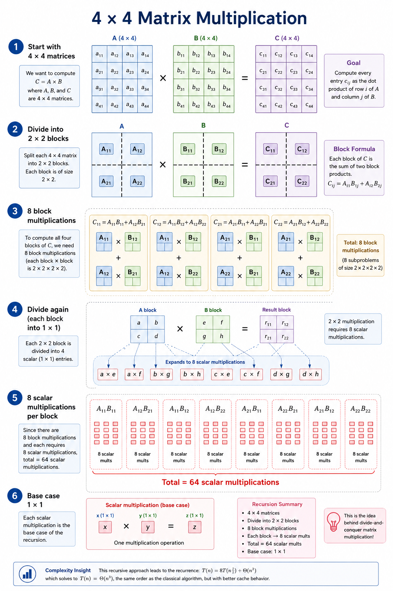
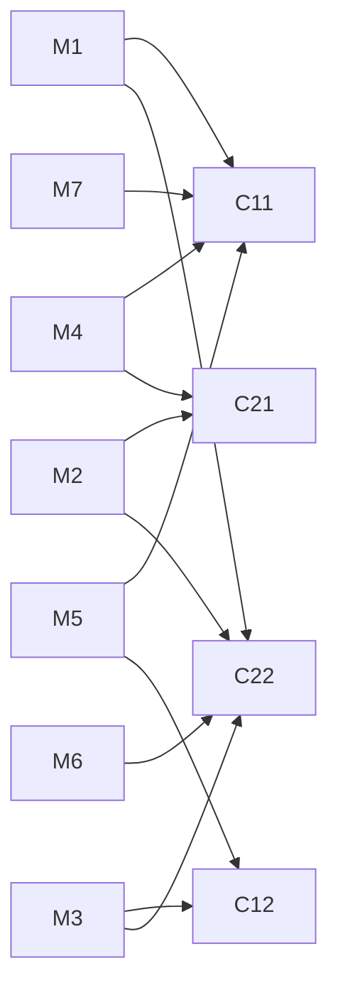
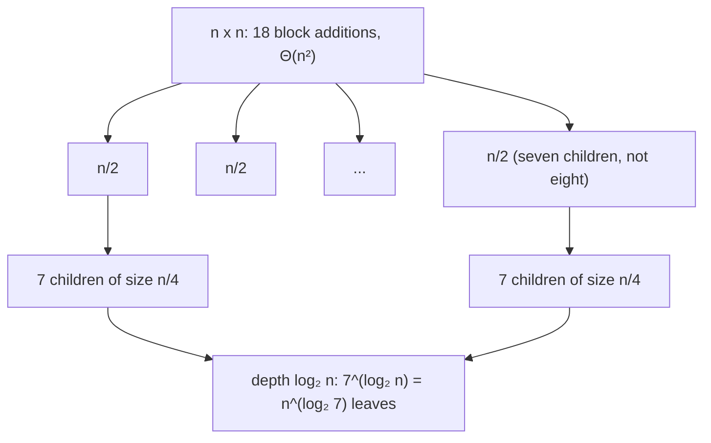

# Strassen's Algorithm for Matrix Multiplication

!!! abstract "At a glance"

    - **Problem:** multiply two dense $n \times n$ matrices. The definition costs $\Theta(n^3)$ scalar multiplications.
    - **Key idea:** split into $2\times2$ blocks. The obvious block formula needs **8** half-size products; Strassen's identity needs only **7**, paid for with extra additions. Recursion turns one saved product into a smaller exponent.
    - **Complexity:** $T(n) = 7T(n/2) + \Theta(n^2) = \Theta(n^{\log_2 7}) \approx \Theta(n^{2.807})$ time, $\Theta(n^2)$ extra space.
    - **Where it is used:** exact linear algebra over finite fields and computer algebra; occasionally one or two levels on top of tuned kernels. Mainstream floating-point libraries use classical blocked $\Theta(n^3)$ kernels.

## Motivation and Problem Context

Matrix multiplication is the bottleneck of a remarkable number of computations:

- **Machine learning.** A dense layer over a batch computes $Y = WX$; transformer attention is built from matrix products. GPUs and tensor cores exist largely for this one operation.
- **Graphics.** Rotations, scalings and projections are matrices, composed by multiplication.
- **Graphs.** If $A$ is an adjacency matrix, $(A^k)_{ij}$ counts walks of length $k$ from $i$ to $j$; Boolean products give reachability.
- **Scientific computing.** Linear systems, inverses, determinants and LU factorisation all reduce to matrix multiplication by block recursion, so a better exponent for multiplication gives a better exponent for all of them.

The definition needs $n^3$ multiplications, and the growth is brutal:

| $n$ | $n^3$ | At $10^9$ ops/s |
| --- | --- | --- |
| $10^3$ | $10^9$ | 1 s |
| $10^4$ | $10^{12}$ | about 17 minutes |
| $10^5$ | $10^{15}$ | about 11.6 days |

Doubling $n$ multiplies the work by 8; with exponent $2.807$ it multiplies by about 7. For a long time $n^3$ was assumed to be a barrier. In 1969 Volker Strassen published *"Gaussian elimination is not optimal"*, showing it is not: the first sub-cubic matrix multiplication algorithm, and the canonical example of divide and conquer combined with an **algebraic identity** ([Topic 4.1](topic1.md)).

## Problem Formulation

```text
Input:   n x n matrices A and B with entries from a ring R
         (integers, reals, integers mod p, polynomials, or matrices themselves).
Output:  C = A B, with C[i][j] = sum over k = 1..n of A[i][k] * B[k][j].
Measure: number of scalar multiplications and additions.
```

Assumptions:

- Only $+$, $-$ and $\times$ are used; **no division**, and **multiplication need not commute**. This matters: in the recursion the "entries" are submatrices, and $XY \ne YX$ for matrices.
- For the clean presentation $n = 2^k$, so every split gives integer sizes. General $n$, and rectangular $m \times n$ by $n \times p$ products, are handled by **zero-padding**: embed $A$ and $B$ in $\hat n \times \hat n$ matrices (the next power of two) filled with zeros. Since the added rows and columns are zero,
  $$
  \hat A \hat B = \begin{pmatrix} AB & 0 \\ 0 & 0 \end{pmatrix},
  $$
  so the top-left block of the padded product is exactly $AB$. Padding is exact, never approximate.
- The matrices are dense; no structure (sparsity, symmetry, bandedness) is exploited.

!!! warning "Important"

    Strassen needs a **ring**: subtraction must exist. Boolean (OR, AND) products and min-plus products for shortest paths have no additive inverse, so Strassen does **not** apply to them. "Speed up Floyd–Warshall with Strassen" is a classic trap.

## Intuition

Look at the $2 \times 2$ case:

$$
\begin{aligned}
c_{11} &= a_{11}b_{11} + a_{12}b_{21}, & c_{12} &= a_{11}b_{12} + a_{12}b_{22}, \\
c_{21} &= a_{21}b_{11} + a_{22}b_{21}, & c_{22} &= a_{21}b_{12} + a_{22}b_{22}.
\end{aligned}
$$

Eight products $a_{ik}b_{kj}$ appear, and it seems obvious that all eight must be computed. That reaction is wrong. We need the four **sums**, not the eight products individually. A product of sums such as $(a_{11}+a_{22})(b_{11}+b_{22})$ produces four useful terms at once, plus two unwanted cross terms. If other cleverly chosen products supply exactly those unwanted terms with opposite signs, they cancel.

> Compute products that **overshoot**, then **cancel** the overshoot with other products you needed anyway. Additions are cheap; multiplications are what recursion multiplies.

The same move gave Karatsuba's $4 \to 3$ for integers ([Topic 4.3](topic3.md)): $x_1y_0 + x_0y_1 = (x_1+x_0)(y_1+y_0) - x_1y_1 - x_0y_0$. Strassen is the matrix version, $8 \to 7$, with a harder-to-find identity.

Why one product is worth so much: if $2 \times 2$ blocks can be multiplied with $r$ block products, recursion gives $T(n) = rT(n/2) + \Theta(n^2) = \Theta(n^{\log_2 r})$ for $r > 4$.

| $r$ | $\log_2 r$ | Status |
| --- | --- | --- |
| 8 | 3.000 | the definition |
| 7 | 2.807 | Strassen; proved optimal for $2\times2$ blocks |
| 6 or fewer | $\le 2.585$ | impossible for $2\times2$ (Winograd, Hopcroft–Kerr, 1971) |

## Baseline Approach

### The definition

```text
ALGORITHM StandardMultiply(A, B)          // n x n
    C ← n x n zero matrix
    FOR i ← 1 TO n
        FOR j ← 1 TO n
            FOR k ← 1 TO n
                C[i][j] ← C[i][j] + A[i][k] * B[k][j]
    RETURN C
```

Each of the $n^2$ entries is a dot product of length $n$: exactly $n^3$ multiplications and $n^2(n-1) = n^3 - n^2$ additions, so $\Theta(n^3)$ in every case (no branch depends on the data). $\Omega(n^2)$ is a trivial lower bound, since every output entry must be written.

### Block divide and conquer, which does not help

Partition every matrix into four $\tfrac n2 \times \tfrac n2$ quadrants:

$$
A = \begin{pmatrix} A_{11} & A_{12} \\ A_{21} & A_{22}\end{pmatrix},\quad
B = \begin{pmatrix} B_{11} & B_{12} \\ B_{21} & B_{22}\end{pmatrix},\quad
C = \begin{pmatrix} C_{11} & C_{12} \\ C_{21} & C_{22}\end{pmatrix}.
$$

Then the $2\times2$ formulas hold with blocks in place of scalars (proved under Correctness):

$$
\begin{aligned}
C_{11} &= A_{11}B_{11} + A_{12}B_{21}, & C_{12} &= A_{11}B_{12} + A_{12}B_{22}, \\
C_{21} &= A_{21}B_{11} + A_{22}B_{21}, & C_{22} &= A_{21}B_{12} + A_{22}B_{22}.
\end{aligned}
$$

This gives **8** recursive products plus 4 block additions ($n^2$ scalar additions):

$$
T(n) = 8T(n/2) + \Theta(n^2).
$$

With $a = 8$, $b = 2$, $n^{\log_2 8} = n^3$ dominates $f(n) = n^2$ (Master case 1), so $T(n) = \Theta(n^3)$. **No gain.** For a $4\times4$ product the recursion makes 8 block products of $2\times2$ matrices, each needing 8 scalar products: $8^2 = 64 = 4^3$ scalar multiplications, the same as the triple loop.

<figure markdown="span">
    {width="100%"}
    <figcaption>A 4x4 product by naive block divide and conquer: 8 block products at the first level, each splitting into 8 scalar products, 64 in total.</figcaption>
    <p align='right' style="font-size:0.8em"><i>Image Source: AI generated (Google Gemini)</i></p>
</figure>

**Bottleneck.** The cost lives at the leaves: there are $8^{\log_2 n} = n^3$ of them. The $\Theta(n^2)$ additions per level are asymptotically irrelevant. So the only lever that moves the exponent is the branching factor $a = 8$.

## Algorithm Design

```text
Definition Θ(n³)
  → block recursion 8T(n/2) + Θ(n²) = Θ(n³)          (no gain)
  → bottleneck: n^(log₂ 8) leaves, driven by a = 8
  → additions live in f(n) and are asymptotically free
  → find an identity with a = 7, whatever it costs in additions
  → Strassen 7T(n/2) + Θ(n²) = Θ(n^(log₂ 7))
```

Strassen's identity uses ten sums/differences of quadrants:

$$
\begin{array}{lllll}
S_1 = A_{11} + A_{22} & S_3 = A_{21} + A_{22} & S_5 = A_{11} + A_{12} & S_7 = A_{21} - A_{11} & S_9 = A_{12} - A_{22} \\
S_2 = B_{11} + B_{22} & S_4 = B_{12} - B_{22} & S_6 = B_{21} - B_{11} & S_8 = B_{11} + B_{12} & S_{10} = B_{21} + B_{22}
\end{array}
$$

seven products, with every $A$-side factor on the **left** and every $B$-side factor on the **right**:

$$
\begin{aligned}
M_1 &= (A_{11} + A_{22})(B_{11} + B_{22}) & M_5 &= (A_{11} + A_{12})\,B_{22} \\
M_2 &= (A_{21} + A_{22})\,B_{11} & M_6 &= (A_{21} - A_{11})(B_{11} + B_{12}) \\
M_3 &= A_{11}\,(B_{12} - B_{22}) & M_7 &= (A_{12} - A_{22})(B_{21} + B_{22}) \\
M_4 &= A_{22}\,(B_{21} - B_{11}) &&
\end{aligned}
$$

and eight additions to assemble the result:

$$
\boxed{
C_{11} = M_1 + M_4 - M_5 + M_7,\quad
C_{12} = M_3 + M_5,\quad
C_{21} = M_2 + M_4,\quad
C_{22} = M_1 - M_2 + M_3 + M_6 }
$$

| Per level | Block recursion | Strassen |
| --- | --- | --- |
| Recursive products of size $n/2$ | 8 | 7 |
| Block additions/subtractions | 4 | 10 + 8 = 18 |
| Scalar additions at this level | $n^2$ | $18(n/2)^2 = 4.5n^2$ |



The pattern is asymmetric: $C_{11}$ and $C_{22}$ use four products each, $C_{12}$ and $C_{21}$ only two. This is part of why the identity was hard to find; derive or verify it, do not try to recall it by symmetry.

!!! note "The Winograd variant"

    Winograd rearranged the computation to use the same 7 products but only **15** additions instead of 18 (using $S_1 = A_{21}+A_{22}$, $S_2 = S_1 - A_{11}$, $S_3 = A_{11}-A_{21}$, $S_4 = A_{12}-S_2$, $T_1 = B_{12}-B_{11}$, $T_2 = B_{22}-T_1$, $T_3 = B_{22}-B_{12}$, $T_4 = T_2-B_{21}$, then $M_1 = A_{11}B_{11}$, $M_2 = A_{12}B_{21}$, $M_3 = S_4B_{22}$, $M_4 = A_{22}T_4$, $M_5 = S_1T_1$, $M_6 = S_2T_2$, $M_7 = S_3T_3$ and $U_1 = M_1+M_2$, $U_2 = M_1+M_6$, $U_3 = U_2+M_7$, $U_4 = U_2+M_5$, giving $C_{11} = U_1$, $C_{12} = U_4+M_3$, $C_{21} = U_3-M_4$, $C_{22} = U_3+M_5$). The exponent is unchanged; only the constant improves. Practical "Strassen" implementations usually mean this variant.

## Pseudocode

```text
ALGORITHM Strassen(A, B, cutoff)
    // A, B are n x n, n a power of two. Returns A * B.
    n ← rows(A)
    IF n <= cutoff
        RETURN StandardMultiply(A, B)

    Partition A into A11, A12, A21, A22 and B into B11, B12, B21, B22   (each n/2 x n/2)

    M1 ← Strassen(A11 + A22, B11 + B22, cutoff)
    M2 ← Strassen(A21 + A22, B11,       cutoff)
    M3 ← Strassen(A11,       B12 - B22, cutoff)
    M4 ← Strassen(A22,       B21 - B11, cutoff)
    M5 ← Strassen(A11 + A12, B22,       cutoff)
    M6 ← Strassen(A21 - A11, B11 + B12, cutoff)
    M7 ← Strassen(A12 - A22, B21 + B22, cutoff)

    C11 ← M1 + M4 - M5 + M7
    C12 ← M3 + M5
    C21 ← M2 + M4
    C22 ← M1 - M2 + M3 + M6
    RETURN the matrix assembled from C11, C12, C21, C22

ALGORITHM StrassenGeneral(A, B, cutoff)
    // A is m x n, B is n x p, any sizes.
    size ← smallest power of two >= max(m, n, p)
    Pad A and B with zeros to size x size
    C ← Strassen(padded A, padded B, cutoff)
    RETURN the top-left m x p block of C
```

## Worked Example

$$
A = \begin{pmatrix} 1 & 3 \\ 7 & 5 \end{pmatrix}, \qquad
B = \begin{pmatrix} 6 & 8 \\ 4 & 2 \end{pmatrix}, \qquad
AB = \begin{pmatrix} 18 & 14 \\ 62 & 66 \end{pmatrix} \text{ (by the definition).}
$$

With $A_{11}=1, A_{12}=3, A_{21}=7, A_{22}=5$ and $B_{11}=6, B_{12}=8, B_{21}=4, B_{22}=2$:

| Product | Expression | Arithmetic | Value |
| --- | --- | --- | --- |
| $M_1$ | $(A_{11}+A_{22})(B_{11}+B_{22})$ | $(1+5)(6+2)$ | 48 |
| $M_2$ | $(A_{21}+A_{22})B_{11}$ | $(7+5)\cdot 6$ | 72 |
| $M_3$ | $A_{11}(B_{12}-B_{22})$ | $1\cdot(8-2)$ | 6 |
| $M_4$ | $A_{22}(B_{21}-B_{11})$ | $5\cdot(4-6)$ | $-10$ |
| $M_5$ | $(A_{11}+A_{12})B_{22}$ | $(1+3)\cdot 2$ | 8 |
| $M_6$ | $(A_{21}-A_{11})(B_{11}+B_{12})$ | $(7-1)(6+8)$ | 84 |
| $M_7$ | $(A_{12}-A_{22})(B_{21}+B_{22})$ | $(3-5)(4+2)$ | $-12$ |

| Block | Formula | Arithmetic | Value |
| --- | --- | --- | --- |
| $C_{11}$ | $M_1 + M_4 - M_5 + M_7$ | $48 - 10 - 8 - 12$ | **18** |
| $C_{12}$ | $M_3 + M_5$ | $6 + 8$ | **14** |
| $C_{21}$ | $M_2 + M_4$ | $72 - 10$ | **62** |
| $C_{22}$ | $M_1 - M_2 + M_3 + M_6$ | $48 - 72 + 6 + 84$ | **66** |

Seven multiplications instead of eight, but 18 additions instead of 4: $25$ operations against $12$. At $n = 2$ Strassen **loses**. The payoff appears only when each $M_t$ is itself an expensive recursive block product.

**Scaling up.** Recursing to scalars on a $4\times4$ product: the root does $18\cdot 2^2 = 72$ scalar additions, its 7 children do $7\cdot18\cdot1 = 126$, and there are $7^2 = 49$ leaf multiplications. Totals: 49 multiplications and 198 additions, against the classical 64 and 48.



## Correctness

### Block multiplication is valid

**Claim.** With conformal $\tfrac n2 \times \tfrac n2$ partitions, $C_{11} = A_{11}B_{11} + A_{12}B_{21}$, and similarly for the other three blocks.

**Proof.** Let $n = 2m$ and take $i, j \le m$ (so $C_{ij}$ lies in $C_{11}$). Split the summation index:

$$
C_{ij} = \sum_{k=1}^{2m} A_{ik}B_{kj}
= \underbrace{\sum_{k=1}^{m} A_{ik}B_{kj}}_{(A_{11}B_{11})_{ij}}
+ \underbrace{\sum_{k=m+1}^{2m} A_{ik}B_{kj}}_{(A_{12}B_{21})_{ij}} .
$$

For $k \le m$, $A_{ik}$ is an entry of $A_{11}$ and $B_{kj}$ of $B_{11}$; for $k > m$ they lie in $A_{12}$ and $B_{21}$. The other blocks follow by choosing $i, j$ in the appropriate halves. No property of the entries beyond the ring axioms is used. $\blacksquare$

This is what makes matrix multiplication **self-similar**: an $n\times n$ product reduces to $\tfrac n2 \times \tfrac n2$ products.

### Strassen's identity

Expand each product, keeping $A$-factors on the left:

$$
\begin{aligned}
M_1 &= A_{11}B_{11} + A_{11}B_{22} + A_{22}B_{11} + A_{22}B_{22} \\
M_2 &= A_{21}B_{11} + A_{22}B_{11} \\
M_3 &= A_{11}B_{12} - A_{11}B_{22} \\
M_4 &= A_{22}B_{21} - A_{22}B_{11} \\
M_5 &= A_{11}B_{22} + A_{12}B_{22} \\
M_6 &= A_{21}B_{11} + A_{21}B_{12} - A_{11}B_{11} - A_{11}B_{12} \\
M_7 &= A_{12}B_{21} + A_{12}B_{22} - A_{22}B_{21} - A_{22}B_{22}
\end{aligned}
$$

For $C_{11} = M_1 + M_4 - M_5 + M_7$, track every monomial:

| Term | $M_1$ | $M_4$ | $-M_5$ | $M_7$ | Net |
| --- | --- | --- | --- | --- | --- |
| $A_{11}B_{11}$ | $+1$ | | | | $+1$ |
| $A_{11}B_{22}$ | $+1$ | | $-1$ | | 0 |
| $A_{22}B_{11}$ | $+1$ | $-1$ | | | 0 |
| $A_{22}B_{22}$ | $+1$ | | | $-1$ | 0 |
| $A_{22}B_{21}$ | | $+1$ | | $-1$ | 0 |
| $A_{12}B_{22}$ | | | $-1$ | $+1$ | 0 |
| $A_{12}B_{21}$ | | | | $+1$ | $+1$ |

Five monomials cancel; the survivors are $A_{11}B_{11} + A_{12}B_{21} = C_{11}$. The other blocks are shorter:

$$
\begin{aligned}
M_3 + M_5 &= A_{11}B_{12} + A_{12}B_{22} = C_{12}, \\
M_2 + M_4 &= A_{21}B_{11} + A_{22}B_{21} = C_{21}, \\
M_1 - M_2 + M_3 + M_6 &= A_{21}B_{12} + A_{22}B_{22} = C_{22}.
\end{aligned}
$$

(For $C_{22}$: $A_{11}B_{11}$, $A_{11}B_{22}$, $A_{22}B_{11}$, $A_{21}B_{11}$ and $A_{11}B_{12}$ each appear once with each sign.)

!!! warning "Important"

    The expansion **never rewrites $XY$ as $YX$**: only distributivity, associativity of addition and additive inverses are used. That is exactly what allows the scalars $A_{ij}, B_{ij}$ to be replaced by submatrices in the recursion. Schemes with fewer multiplications that silently use commutativity work for $2\times2$ scalars but break as soon as the entries are matrices, so they give no asymptotic gain.

### The recursion, by strong induction

**Contract.** `Strassen(X, Y, cutoff)` returns $XY$ for $m \times m$ inputs, $m$ a power of two.

- **Base case** ($n \le$ cutoff, including $n = 1$): `StandardMultiply` computes $\sum_k A_{ik}B_{kj}$ by definition.
- **Inductive step** ($n = 2^k >$ cutoff): $n$ is even, so each quadrant and each $S_i$ is a valid $\tfrac n2 \times \tfrac n2$ matrix, strictly smaller (this also gives termination). By the hypothesis each $M_t$ is the exact product of its operands. By the identity, the four assembled blocks equal the four blocks of $AB$, and by block multiplication the assembled matrix is $AB$. $\blacksquare$

Correctness for arbitrary $m \times n$ by $n \times p$ inputs then follows from the exactness of zero-padding.

## Complexity Analysis

### Recurrence

Read off the pseudocode: 7 recursive calls on size $n/2$ ($a = 7$, $b = 2$); 10 operand sums ($2.5n^2$ scalar operations) and 8 assembly sums ($2n^2$), plus partitioning, all $\Theta(n^2)$:

$$
T(n) = 7T(n/2) + \Theta(n^2), \qquad T(1) = \Theta(1).
$$

**Master method.** $\log_2 7 = 2.807354\ldots$ and $f(n) = n^2 = O(n^{\log_2 7 - \varepsilon})$ (e.g. $\varepsilon = 0.5$): case 1, leaf-dominated, so $T(n) = \Theta(n^{\log_2 7})$.

**Recursion tree (to see why).** Level $i$ has $7^i$ nodes of size $n/2^i$:

$$
T(n) = \sum_{i=0}^{\log_2 n - 1} 7^i \, c\left(\frac{n}{2^i}\right)^2 + n^{\log_2 7}\,T(1)
= cn^2\sum_{i=0}^{\log_2 n - 1}\left(\frac74\right)^i + n^{\log_2 7}\,T(1).
$$

The ratio $7/4 > 1$ means each level costs more than the one above, so the bottom dominates. Using $\sum_{i<L} (7/4)^i = \tfrac43\left[(7/4)^L - 1\right]$ and $(7/4)^{\log_2 n} = n^{\log_2 7 - 2}$, the internal work is $\tfrac{4c}{3}(n^{\log_2 7} - n^2)$, and $T(n) = \Theta(n^{\log_2 7})$. With 8 children the ratio is $8/4 = 2$ (giving $n^3$); with 4 it would be 1 (giving $n^2\log n$).

### Exact operation counts (recursing to $n = 1$)

Multiplications: $P(n) = 7P(n/2)$, $P(1) = 1$, so $P(n) = 7^{\log_2 n} = n^{\log_2 7}$ exactly.

Additions: $A(n) = 7A(n/2) + 18(n/2)^2 = 7A(n/2) + \tfrac92 n^2$, $A(1) = 0$. Try $A(n) = c(n^{\log_2 7} - n^2)$:

$$
7c\left(\frac{n^{\log_2 7}}{7} - \frac{n^2}{4}\right) + \frac92 n^2 = c\,n^{\log_2 7} - c\,n^2
\iff -\frac{7c}{4} + \frac92 = -c \iff c = 6 .
$$

$$
\boxed{A(n) = 6\left(n^{\log_2 7} - n^2\right)}
$$

| $n$ | Classical $n^3 + (n^3 - n^2)$ | Strassen $n^{\log_2 7} + 6(n^{\log_2 7} - n^2)$ |
| --- | --- | --- |
| 2 | 12 | 25 |
| 4 | 112 | 247 |
| 16 | 7 936 | 15 271 |
| 32 | 64 512 | 111 505 |
| 512 | $2.68\times10^8$ | $2.81\times10^8$ |
| 1024 | $2.15\times10^9$ | $1.97\times10^9$ |

(These counts were reproduced by an instrumented implementation for $n = 2$ to $32$.)

!!! warning "Important"

    The exponent improves, but the addition constant is **6** against the classical 1. Recursing all the way to scalars, Strassen loses on total operation count until $n$ is between 512 and 1024. In practice a **cutoff** is mandatory: below it, switch to a classical kernel.

### Effect of a cutoff

Counting flops, one level of Strassen on top of a classical $2n^3$ kernel costs $7\cdot 2(n/2)^3 + 18(n/2)^2 = \tfrac74 n^3 + \tfrac92 n^2$, which beats $2n^3$ when $n > 18$. Measured crossovers against tuned kernels are much higher (commonly hundreds to around a thousand), because tuned classical kernels run near peak arithmetic throughput while Strassen's additions are limited by memory bandwidth. With cutoff $n_0$, the leading term is $2n^{\log_2 7} n_0^{\,3 - \log_2 7} = 2n^{\log_2 7} n_0^{\,0.193}$: the exponent is unchanged; only the constant moves.

### Space and cases

- Temporaries per frame are $\Theta((n/2^i)^2)$, and only one root-to-leaf path is live at a time, so they form a geometric series with ratio $1/4$: $\Theta(n^2)$ auxiliary space in total, plus $\Theta(\log n)$ stack depth. The classical algorithm needs $\Theta(1)$ beyond the output.
- No branch depends on entry values, so best = average = worst = $\Theta(n^{\log_2 7})$.
- At $n = 4096$ the ideal advantage is $n^{3 - \log_2 7} \approx 5\times$; at $n = 1024$ about $3.8\times$, before constants are paid.

## Python Implementation

```python
def standard_multiply(A, B):
    """Definition-based product of an m x n and an n x p matrix (i, k, j loop order)."""
    m, n, p = len(A), len(B), len(B[0])
    if len(A[0]) != n:
        raise ValueError("inner dimensions differ")
    C = [[0] * p for _ in range(m)]
    for i in range(m):
        for k in range(n):
            a_ik = A[i][k]
            for j in range(p):
                C[i][j] += a_ik * B[k][j]
    return C


def add(X, Y):
    return [[x + y for x, y in zip(rx, ry)] for rx, ry in zip(X, Y)]


def sub(X, Y):
    return [[x - y for x, y in zip(rx, ry)] for rx, ry in zip(X, Y)]


def split(M):
    """Four quadrants of an even-sized square matrix."""
    h = len(M) // 2
    return ([row[:h] for row in M[:h]], [row[h:] for row in M[:h]],
            [row[:h] for row in M[h:]], [row[h:] for row in M[h:]])


def join(C11, C12, C21, C22):
    return [r1 + r2 for r1, r2 in zip(C11, C12)] + [r1 + r2 for r1, r2 in zip(C21, C22)]


def strassen_pow2(A, B, cutoff):
    """Strassen on n x n matrices, n a power of two."""
    n = len(A)
    if n <= cutoff:
        return standard_multiply(A, B)

    A11, A12, A21, A22 = split(A)
    B11, B12, B21, B22 = split(B)

    # Seven products; every left factor comes from A, every right factor from B.
    M1 = strassen_pow2(add(A11, A22), add(B11, B22), cutoff)
    M2 = strassen_pow2(add(A21, A22), B11, cutoff)
    M3 = strassen_pow2(A11, sub(B12, B22), cutoff)
    M4 = strassen_pow2(A22, sub(B21, B11), cutoff)
    M5 = strassen_pow2(add(A11, A12), B22, cutoff)
    M6 = strassen_pow2(sub(A21, A11), add(B11, B12), cutoff)
    M7 = strassen_pow2(sub(A12, A22), add(B21, B22), cutoff)

    C11 = add(sub(add(M1, M4), M5), M7)       # M1 + M4 - M5 + M7
    C12 = add(M3, M5)
    C21 = add(M2, M4)
    C22 = add(add(sub(M1, M2), M3), M6)       # M1 - M2 + M3 + M6
    return join(C11, C12, C21, C22)


def strassen(A, B, cutoff=64):
    """Multiply an m x n matrix by an n x p matrix, zero-padding to a power of two."""
    if not A or not A[0] or not B or not B[0]:
        raise ValueError("empty matrix")
    m, n, p = len(A), len(B), len(B[0])
    if len(A[0]) != n:
        raise ValueError("inner dimensions differ")

    size = 1
    while size < max(m, n, p):
        size *= 2
    if size <= cutoff:
        return standard_multiply(A, B)

    Ap = [row + [0] * (size - n) for row in A] + [[0] * size for _ in range(size - m)]
    Bp = [row + [0] * (size - p) for row in B] + [[0] * size for _ in range(size - n)]
    Cp = strassen_pow2(Ap, Bp, max(cutoff, 1))
    return [row[:p] for row in Cp[:m]]


if __name__ == "__main__":
    print(strassen([[1, 3], [7, 5]], [[6, 8], [4, 2]], cutoff=1))   # [[18, 14], [62, 66]]
    A = [[1, 2, 3], [4, 5, 6]]
    B = [[7, 8], [9, 10], [11, 12]]
    print(strassen(A, B, cutoff=1))                                  # [[58, 64], [139, 154]]
```

Walkthrough:

- `strassen_pow2` is a line-by-line transcription of the pseudocode. Its precondition (square, power-of-two size) is established by the wrapper `strassen`, which pads, validates dimensions and trims the result. Keeping the two separate keeps the recursion contract explicit.
- `cutoff` is the base case. With `cutoff=1` the code recurses to scalars and is slower than `standard_multiply` at every practical size; with a cutoff of tens it hands the deepest, most numerous levels to a tight loop.
- `split` and `add`/`sub` allocate new lists at every level. This is $\Theta(n^2)$ per level (asymptotically fine) but a large constant; serious implementations use index views and a preallocated workspace.
- `standard_multiply` uses the `i, k, j` loop order, which walks rows of `B` and `C` contiguously; it performs the same $n^3$ multiply-adds as `i, j, k` with better locality.
- The code was tested with random **asymmetric** integer matrices of all shapes up to $12 \times 12$, for cutoffs 1, 2, 4, 8 and 64, against `standard_multiply`, and with a pair satisfying $AB \ne BA$ to catch factor-order bugs.

## Edge Cases and Pitfalls

| Case or pitfall | What goes wrong | Fix |
| --- | --- | --- |
| $n = 1$ | Nothing to split | Base case: return the scalar product (any cutoff $\ge 1$ covers it) |
| $n$ odd or not a power of two | Quadrant split undefined | Zero-pad (exact) or peel off the last row/column |
| $n$ just above a power of two (e.g. 1025) | Padding nearly doubles $n$: up to about $2^{2.807} \approx 7\times$ the work | Pad only to a multiple of $2^\ell$ for the $\ell$ levels actually used, or peel |
| Rectangular inputs | Square blocks assumed | Pad all of $m$, $n$, $p$; trim the result to $m \times p$ |
| Forgetting to trim after padding | Result has extra zero rows/columns | Return the top-left $m \times p$ block |
| Sign error in assembly ($-M_5$ in $C_{11}$, $-M_2$ in $C_{22}$) | Right shape, wrong values | Test every block against the definition |
| Reversed factor order (e.g. $B_{11}(A_{21}+A_{22})$) | Passes on symmetric/diagonal/identity tests, fails on general matrices | Always test random asymmetric matrices with $AB \ne BA$ |
| No cutoff | Correct but slower than the triple loop | Cutoff tuned by measurement |
| Integer overflow in intermediates | Sums like $A_{11}+A_{22}$ and $M_1+M_4-M_5+M_7$ exceed the range of the final entries | Use an accumulator wide enough for the intermediates (or reduce modulo $p$ throughout) |
| Floating-point comparison | Different summation order gives different rounding | Compare with a tolerance proportional to $\varepsilon\|A\|\|B\|$, never bit-for-bit |
| Sparse or structured matrices | Additions of quadrants destroy sparsity | Use sparse or structure-exploiting methods |
| Semirings (Boolean, min-plus) | No subtraction: the identity does not exist | Use classical or specialised methods (e.g. bitsets for Boolean) |

## Common Misconceptions

- **"7 instead of 8 products makes Strassen 12.5% cheaper."** One level saves a factor $7/8$; full recursion compounds it over $\log_2 n$ levels, turning $n^3$ leaves into $n^{\log_2 7}$, a factor $n^{0.193}$ that grows without bound.
- **"Any recursive matrix multiplication is Strassen."** The 8-product block recursion is still $\Theta(n^3)$. What makes Strassen different is the identity that lowers $a$, not the recursion.
- **"Fewer additions would improve the exponent."** Additions live in $f(n)$, which the leaves dominate. Winograd's 15-addition variant has exactly the same exponent; only the constant improves.
- **"Strassen is always faster for large matrices."** Its exponent wins eventually, but constants, memory traffic and workspace mean tuned classical kernels often win at practical sizes. The crossover must be measured.
- **"Mathematically equal means numerically equal."** In floating point Strassen loses the classical componentwise error bound; only a weaker normwise bound survives, with a constant that grows with recursion depth.
- **"The record exponent $\approx 2.371$ means near-quadratic matrix multiplication in practice."** Those algorithms are *galactic*: their constants make them slower than the classical algorithm for any realisable $n$.

## Alternatives and Trade-offs

| Algorithm | Products per $2\times2$ step | Time | Extra space | Practicality |
| --- | --- | --- | --- | --- |
| Triple loop / blocked classical | 8 | $\Theta(n^3)$ | $\Theta(1)$ | the practical standard; near-peak throughput with blocking and vectorisation |
| Recursive block (8 products) | 8 | $\Theta(n^3)$ | $\Theta(\log n)$ stack | cache-oblivious; same operation count |
| Strassen | 7 (18 additions) | $\Theta(n^{2.807})$ | $\Theta(n^2)$ | above a measured crossover, with a cutoff |
| Strassen–Winograd | 7 (15 additions) | $\Theta(n^{2.807})$ | $\Theta(n^2)$ | the usual fast variant in practice |
| Coppersmith–Winograd and successors | — | down to $\approx O(n^{2.371})$ | large | galactic; never faster in practice |
| Sparse methods | — | depends on nonzeros | varies | the right tool for sparse inputs |

| Trade-off | How it shows up |
| --- | --- |
| Exponent vs constant | $0.193$ off the exponent, but the addition constant is 6 times larger |
| Time vs space | Classical: $\Theta(1)$ workspace. Strassen: $\Theta(n^2)$ with a sizeable constant |
| Speed vs accuracy | Weaker (normwise) floating-point error bound; a larger cutoff improves both speed and accuracy |
| Simplicity vs performance | Padding, cutoff and workspace management roughly triple the code for a gain that appears only at large $n$ |

**Use Strassen when** matrices are large and dense, entries are exact (integers, $\mathbb{Z}_p$, polynomials), multiplying entries costs much more than adding them (entries that are big integers, polynomials or blocks), and memory for the $\Theta(n^2)$ workspace is available.

**Avoid it when** $n$ is small or moderate, matrices are sparse or structured, memory is tight, componentwise floating-point accuracy is required, the algebra has no subtraction, or a tuned BLAS/GPU path is available.

## In Practice

- **Floating-point libraries.** NumPy's `A @ B` calls a BLAS `gemm` routine (OpenBLAS, Intel MKL, BLIS, Apple Accelerate). These implement classical $\Theta(n^3)$ multiplication with cache blocking, vectorisation and multithreading, not Strassen by default. On GPUs, cuBLAS and tensor cores likewise run classical blocked kernels.
- **Exact linear algebra.** Libraries for linear algebra over finite fields (for example FFLAS-FFPACK) use Strassen–Winograd above a threshold, where the accuracy objection disappears and the flop saving is real. Computer-algebra systems benefit similarly when entries are big integers or polynomials.
- **Theory with practical consequences.** Matrix inversion, determinants, LU factorisation, transitive closure and triangle counting can all be done in $O(n^\omega)$ given an $O(n^\omega)$ multiplier. Strassen gave the first $\omega < 3$.
- **AI-discovered algorithms.** In 2022, DeepMind's AlphaTensor used reinforcement learning to search for low-rank decompositions of the matrix-multiplication tensor and found, for example, a $4\times4$ scheme with 47 multiplications in arithmetic modulo 2 (Strassen applied twice uses 49). The search space is exactly the "products of linear combinations" idea behind Strassen.
- **Performance realities.** A blocked classical kernel is compute-bound and keeps fused multiply-add units busy; Strassen's matrix additions do one flop per element loaded and are memory-bound. A 12.5% flop saving per level therefore does not translate into 12.5% less time. The usual professional order when a product is slow: confirm it is the bottleneck, exploit sparsity or structure, use a tuned library or GPU, consider lower precision, and only then consider a fast algorithm.

## Interview and Competitive Programming

Strassen is far more often an **interview discussion topic** than something you implement under time pressure. Expect: "Can matrix multiplication beat $n^3$?" (7 products instead of 8, $T(n) = 7T(n/2) + \Theta(n^2)$), "Why is it rarely used?" (constants, memory, numerical stability, tuned BLAS), and "How does it relate to Karatsuba?" (the same reduce-$a$ trade).

Recognition cues and what to do instead in contests:

| You see | Think |
| --- | --- |
| Linear recurrence, index up to $10^{18}$ | matrix exponentiation by squaring, $O(d^3\log k)$ ([Topic 4.7](topic7.md)); Strassen is irrelevant for $d \le 100$ |
| Boolean matrix product, $n \le 4000$ | bitsets: $O(n^3/64)$, faster than any sub-cubic method at this size |
| Shortest paths via min-plus products | no subtraction: Strassen cannot apply |
| Counting walks of length $k$ / triangles | $A^k$ by repeated squaring; triangles $= \operatorname{tr}(A^3)/6$ |
| Dense product, $n \le 500$ | classical `i, k, j` loop; $1.25\times10^8$ multiply-adds |

Common traps: recursing to $n = 1$ and being slower than the triple loop, copying submatrices at every level, losing the sign of $-M_5$, padding without trimming, and taking moduli inconsistently so intermediates overflow.

## Using AI Assistants Critically

- **Sign and operand errors.** Generated Strassen code frequently swaps $B_{11}$ and $B_{12}$ in $M_2$, or flips the sign of $M_5$ or $M_2$ in the assembly. Never accept the formulas without a test against `standard_multiply`.
- **Commuted factors.** LLMs sometimes write $M_2 = B_{11}(A_{21}+A_{22})$, which is correct for scalars and wrong for blocks. Test with random asymmetric matrices where $AB \ne BA$; identity, diagonal and symmetric tests hide this bug.
- **Wrong complexity claims.** "Strassen is $O(n^{2.8})$ and therefore faster" ignores the constant of 6 on additions and the $\Theta(n^2)$ workspace. Ask for exact operation counts, or count them yourself with an instrumented run ($7^{\log_2 n}$ multiplications; $8^{\log_2 n}$ means an eighth product slipped in).
- **Missing padding and trimming.** Generated code often assumes powers of two silently. Test sizes 1, 3, 5, 7 and rectangular shapes.
- **Timing sanity check.** Doubling $n$ should multiply time by about 7 for a pure Strassen (about 8 for classical). A ratio near 8 means you are not running what you think.
- **Applying it to semirings.** If an assistant suggests Strassen for min-plus or Boolean products, it has missed the need for subtraction.

## Practice

### Beginner

1. **Hand trace.** Input: $A = \begin{pmatrix}2&1\\4&3\end{pmatrix}$, $B = \begin{pmatrix}5&6\\7&8\end{pmatrix}$. Output: $M_1, \dots, M_7$, the four blocks of $C$, and a check against the definition. Difficulty: easy.
2. **Operation counts.** Input: $n = 2, 4, 8, 16, 32$. Output: classical and Strassen multiplication and addition counts from the closed forms, and the smallest $n$ (if any) in this range where Strassen uses fewer total operations. Difficulty: easy.
3. **Recurrence comparison.** For $8T(n/2)+n^2$, $7T(n/2)+n^2$, $4T(n/2)+n^2$, $3T(n/2)+n^2$: give the Master case and closed form, and explain what changes between them. Difficulty: easy.

### Intermediate

1. **Cutoff experiment.** Implement Strassen with a cutoff and find, by timing, the cutoff that minimises runtime for $n = 256$ and $n = 512$ on your machine. Explain why it differs from the flop-model value 18. Difficulty: medium.
2. **Arbitrary sizes.** Multiply $m \times n$ by $n \times p$ matrices using (a) static padding and (b) peeling the odd row/column at each level. Compare work for $m = n = p = 1025$. Difficulty: medium.
3. **Verify Winograd.** Implement the 15-addition variant, prove its four assembly identities by expansion, and confirm the addition count with an instrumented run. Difficulty: medium.

### Advanced

1. **Fast inversion.** Using block recursion and an $O(n^\omega)$ multiplier, design an $O(n^\omega)$ algorithm to invert a matrix whose leading principal submatrices are nonsingular. State the recurrence and justify it with the Schur complement. Difficulty: hard.
2. **Numerical behaviour.** Measure the relative error of Strassen versus classical multiplication in double precision for badly scaled matrices (row $i$ scaled by $10^i$), as a function of the number of Strassen levels. Relate the result to the normwise bound. Difficulty: hard.
3. **Hypothetical $3\times3$ scheme.** If $3\times3$ matrices could be multiplied with 21 noncommutative multiplications, what exponent would recursion give? What about 23? Compare with $\log_2 7$. Difficulty: hard.

### Interview / CP

1. **Boolean product.** Two $n\times n$ Boolean matrices, $n \le 4000$, 2-second limit. Describe the bitset approach and explain why Strassen is not the tool here. Difficulty: medium.
2. **Linear recurrence.** Order $d \le 60$, index $k \le 10^{18}$, modulo $10^9+7$. Give the full method and its complexity, and decide whether Strassen would help. Difficulty: medium.
3. **Explain and estimate.** "We multiply $8192\times8192$ float matrices in a hot path. Would Strassen help?" Give a structured answer covering the ideal gain, constants, memory, accuracy, and three alternatives to try first. Difficulty: medium-hard.

## Self-Check Questions

??? question "Q1. Why does the block recursion $8T(n/2) + \Theta(n^2)$ give no improvement over the triple loop?"

    The recursion is leaf-dominated: $n^{\log_2 8} = n^3$ leaves, each a scalar product, dominate the $\Theta(n^2)$ per-level additions. It performs exactly the same $n^3$ scalar multiplications, just in a different order.

??? question "Q2. Why does reducing 8 products to 7 change the exponent, while reducing 18 additions to 15 does not?"

    The number of recursive calls $a$ sits in the exponent $\log_2 a$, because it determines the number of leaves $a^{\log_2 n}$. Additions contribute only to $f(n) = \Theta(n^2)$, which is dominated by the leaves, so changing their count only changes a constant.

??? question "Q3. Why must Strassen's identity be valid in a noncommutative ring?"

    In the recursion, the symbols $A_{ij}$ and $B_{ij}$ are matrices, and matrix multiplication does not commute. An identity that used $XY = YX$ anywhere would be correct for scalars but wrong for blocks, so it could not be applied recursively.

??? question "Q4. Derive the exact number of scalar additions when recursing to $n = 1$."

    $A(n) = 7A(n/2) + 18(n/2)^2$ with $A(1) = 0$. Substituting $A(n) = c(n^{\log_2 7} - n^2)$ gives $-\tfrac{7c}{4} + \tfrac92 = -c$, so $c = 6$ and $A(n) = 6(n^{\log_2 7} - n^2)$.

??? question "Q5. Does a cutoff $n_0$ change the asymptotic complexity?"

    No. The leading term becomes $2n^{\log_2 7} n_0^{3 - \log_2 7}$: the exponent in $n$ is unchanged, and the constant grows slightly as $n_0^{0.193}$. In practice a cutoff makes the program much faster because the leaves become efficient classical kernels.

??? question "Q6. Why can Strassen not speed up all-pairs shortest paths via min-plus products?"

    Min-plus is a semiring: $\min$ has no inverse operation, so there is no subtraction. Strassen's products rely on cancellation ($+$ and $-$ of the same term), which does not exist there.

??? question "Q7. A team multiplies $300\times300$ double-precision matrices and wants Strassen. What do you advise?"

    Do not. At $n = 300$ the classical kernel is faster: Strassen's addition constant and workspace dominate, and its error bound is weaker. Use a tuned BLAS call (NumPy's `@`), check for structure or sparsity, and consider batching or GPU offload.

??? question "Q8. Why is zero-padding exact, and what can it cost?"

    Added rows and columns are zero, so they contribute nothing to any dot product in the original index range; the top-left block of the padded product is exactly $AB$. Cost: padding $n = 2^k + 1$ up to $2^{k+1}$ nearly doubles $n$, up to about $2^{\log_2 7} = 7$ times the ideal work.

## Complexity Summary

| Algorithm | Recurrence | Multiplications | Time | Aux space |
| --- | --- | --- | --- | --- |
| Definition (triple loop) | — | $n^3$ | $\Theta(n^3)$ | $\Theta(1)$ |
| Block divide and conquer | $8T(n/2) + \Theta(n^2)$ | $n^3$ | $\Theta(n^3)$ | $\Theta(\log n)$ stack |
| Strassen (to $n = 1$) | $7T(n/2) + \Theta(n^2)$ | $n^{\log_2 7}$; additions $6(n^{\log_2 7} - n^2)$ | $\Theta(n^{\log_2 7}) \approx \Theta(n^{2.807})$ | $\Theta(n^2)$ |
| Strassen, cutoff $n_0$ | same | $\approx (n/n_0)^{\log_2 7} n_0^3$ | $\Theta(n^{\log_2 7})$, constant $\propto n_0^{0.193}$ | $\Theta(n^2)$ |
| Best known theoretical | — | — | $\approx O(n^{2.371})$ | galactic |

## Key Takeaways

- Block multiplication makes matrix multiplication self-similar, but with 8 recursive products the recursion is still $\Theta(n^3)$.
- In a leaf-dominated recurrence only the branching factor moves the exponent; additions are asymptotically free. Strassen trades one product for extra additions: $8 \to 7$, exponent $3 \to \log_2 7 \approx 2.807$.
- The identity works because products of sums overshoot and cancel, and it never commutes a factor, which is what lets it recurse on blocks.
- Exact counts matter: $n^{\log_2 7}$ multiplications but $6(n^{\log_2 7} - n^2)$ additions, so a cutoff to a classical kernel is mandatory in practice.
- Strassen needs a ring with subtraction; it does not apply to Boolean or min-plus products.
- In floating point it has a weaker error bound and needs $\Theta(n^2)$ workspace; mainstream BLAS libraries use classical blocked kernels instead.
- The transferable lesson, shared with Karatsuba: find an algebraic identity that reduces the number of recursive calls, then check honestly whether the constants let the asymptotic gain survive.
