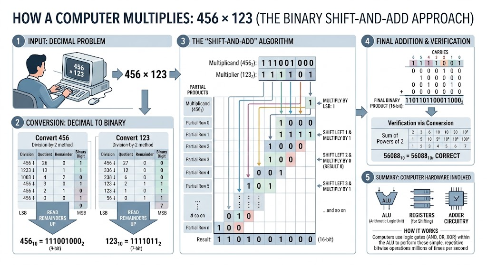
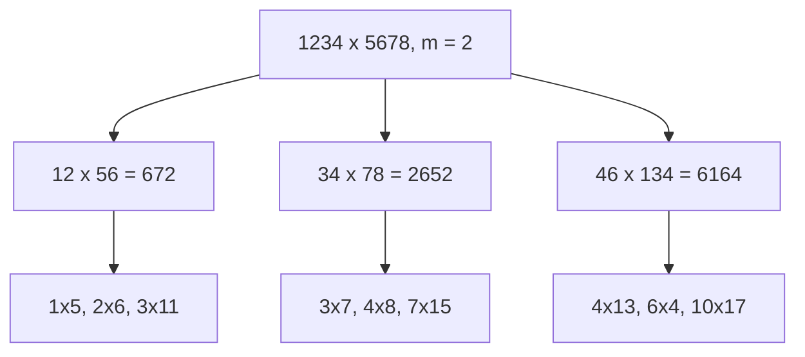
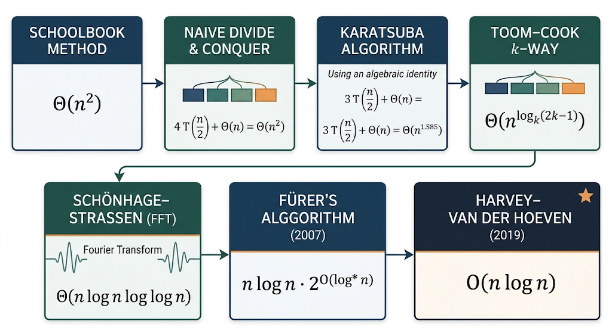

# Integer Multiplication

!!! abstract "At a glance"

    - **Problem:** multiply two $n$-digit integers too large for a machine word (cryptography, computer algebra, high-precision numerics).
    - **Key idea:** split each number in half. The obvious expansion needs **4** half-size products; Karatsuba's identity $x_1y_0 + x_0y_1 = (x_1+x_0)(y_1+y_0) - x_1y_1 - x_0y_0$ needs only **3**.
    - **Complexity:** schoolbook $\Theta(n^2)$; Karatsuba $T(n) = 3T(n/2) + \Theta(n) = \Theta(n^{\log_2 3}) \approx \Theta(n^{1.585})$ digit operations, $\Theta(n)$ extra space.
    - **Where it is used:** inside every big-integer library (CPython `int`, Java `BigInteger`, GMP) as one tier of a size-dispatched hybrid: schoolbook, Karatsuba, Toom–Cook, FFT.

## Motivation and Problem Context

On a 64-bit CPU, multiplying two 64-bit integers is one instruction. The algorithmic problem appears when integers are far larger than a word:

- **Public-key cryptography.** RSA uses 2048–4096-bit moduli; every key operation is a modular exponentiation ([Topic 4.6](topic6.md)), i.e. thousands of big-integer multiplications.
- **Computer algebra and exact arithmetic.** Exact rationals, polynomial arithmetic over $\mathbb{Z}$, and factorisation multiply numbers with thousands to millions of digits.
- **High-precision constants.** Record computations of $\pi$ are dominated by multiplication cost.

The schoolbook method multiplies every digit of $x$ by every digit of $y$: for two 10 000-digit numbers, $10^8$ digit products for *one* multiplication. Is that pairwise work necessary, or an artefact of the method? Around 1960 Kolmogorov conjectured that $\Omega(n^2)$ digit operations were unavoidable. Anatoly Karatsuba, then a student attending Kolmogorov's seminar, refuted the conjecture within about a week with a sub-quadratic algorithm: the first proof that the "obvious" algorithm for a basic arithmetic problem is not optimal.

## Problem Formulation

```text
Input:   radix B >= 2;
         X = (x_0, ..., x_{n-1}), 0 <= x_i < B, representing x = sum x_i B^i
         Y = (y_0, ..., y_{m-1}), 0 <= y_j < B, representing y = sum y_j B^j
Output:  the digits of z = x * y  (n + m or n + m - 1 digits).
Measure: digit operations (bit operations when B = 2).
```

Assumptions: operands are non-negative (signs handled separately in $O(1)$); digits are stored in an indexable array; a product of two digits plus carries fits in a double-width word.

!!! warning "Important"

    $n$ is the **number of digits**, not the value. $\Theta(n^2)$ is quadratic in the length, i.e. polylogarithmic in the value. Confusing the two is the most common error in arithmetic complexity. In the **word-RAM** model ([Topic 2.2](../unit2/topic2.md)), multiplying word-sized numbers is $O(1)$; for cryptographic-size numbers that model is wrong, and we count digit (bit) operations instead.

## Intuition

An integer is a polynomial evaluated at the radix. With $X(t) = \sum_i x_i t^i$, we have $x = X(B)$, $y = Y(B)$, and

$$
x \cdot y = (X \cdot Y)(B).
$$

So **integer multiplication = polynomial multiplication (a convolution) + carrying**. The product polynomial has coefficients $c_k = \sum_{i+j=k} x_i y_j$, which may exceed $B$; one $\Theta(n)$ carry pass fixes that. Every algorithm in this topic speeds up the convolution; none touches the carrying. (Convolution in general, and its $\Theta(n\log n)$ FFT solution, is [Topic 4.4](topic4.md).)

The key observation is about **what we really need**. Split $x = x_1B^m + x_0$ and $y = y_1B^m + y_0$:

$$
xy = \underbrace{x_1y_1}_{z_2}B^{2m} + \underbrace{(x_1y_0 + x_0y_1)}_{z_1}B^m + \underbrace{x_0y_0}_{z_0}.
$$

The two cross products are only ever needed **as a sum**. One product contains that sum together with things we compute anyway:

$$
(x_1 + x_0)(y_1 + y_0) = z_2 + z_1 + z_0 \quad\Longrightarrow\quad z_1 = (x_1+x_0)(y_1+y_0) - z_2 - z_0 .
$$

> Buy one multiplication, pay with a few additions. Additions cost $\Theta(n)$; a multiplication of $n$-digit numbers costs superlinearly, and recursion multiplies the saving at every level.

## Baseline Approach

### Schoolbook multiplication

```text
ALGORITHM SchoolbookMultiply(X, Y, B)      // little-endian digits: X[0] least significant
    n ← length(X);  m ← length(Y)
    Z ← array of n + m zeros
    FOR i ← 0 TO n - 1
        carry ← 0
        FOR j ← 0 TO m - 1
            t ← Z[i + j] + X[i] * Y[j] + carry
            Z[i + j] ← t mod B
            carry ← floor(t / B)
        Z[i + m] ← Z[i + m] + carry
    RETURN Z with leading zeros removed
```

The accumulator never overflows a double-width word: $Z[i+j] \le B-1$, $X[i]Y[j] \le (B-1)^2$ and $\text{carry} \le B-1$, so $t \le B^2 - 1$ and the new carry is again at most $B-1$. That is why $B = 2^{32}$ with 64-bit accumulators works, while $B = 2^{64}$ needs 128-bit arithmetic.

The inner body runs exactly $nm$ times: $\Theta(nm)$, or $\Theta(n^2)$ when $n = m$; $\Theta(1)$ auxiliary space.

With $B = 2$ each digit is a bit, so each partial product is either $0$ or a shifted copy of $y$: "for every set bit of $x$, add a left-shifted $y$". This **shift-and-add** procedure is what hardware multipliers implement.

<figure markdown="span">
    {width="100%"}
    <figcaption>How a computer multiplies 456 x 123 using binary shift-and-add: decimal-to-binary conversion, partial products, and the final addition.</figcaption>
    <p align='right' style="font-size:0.8em"><i>Image Source: AI generated (Google Gemini)</i></p>
</figure>

Trace for $1234 \times 5678$ ($B = 10$, $X = (4,3,2,1)$):

| $i$ | $x_i$ | $x_i \cdot y$ | shifted by $10^i$ | running total |
| --- | --- | --- | --- | --- |
| 0 | 4 | 22 712 | 22 712 | 22 712 |
| 1 | 3 | 17 034 | 170 340 | 193 052 |
| 2 | 2 | 11 356 | 1 135 600 | 1 328 652 |
| 3 | 1 | 5 678 | 5 678 000 | 7 006 652 |

**Bottleneck.** All $n^2$ digit products are formed explicitly to produce an answer of only $2n$ digits. Whenever the intermediate work is asymptotically larger than the output, look for an identity that needs fewer intermediates.

### Naive divide and conquer, which does not help

Using the split above directly needs four half-size products ($x_1y_1$, $x_1y_0$, $x_0y_1$, $x_0y_0$) plus $\Theta(n)$ shifts and additions:

$$
T(n) = 4T(n/2) + \Theta(n) \;\Rightarrow\; n^{\log_2 4} = n^2 \text{ dominates (case 1)} \;\Rightarrow\; T(n) = \Theta(n^2).
$$

No improvement: recursion merely reorders the same $n^2$ digit products.

!!! warning "Important"

    Splitting a problem in half does not by itself make it faster. The speedup comes from solving **fewer** subproblems than the naive decomposition: $a = 4 \to 3$ with $b = 2$ moves the exponent from $\log_2 4 = 2$ to $\log_2 3 \approx 1.585$.

## Algorithm Design

### From four products to three

$$
z_2 = x_1y_1, \qquad z_0 = x_0y_0, \qquad z_1 = (x_1 + x_0)(y_1 + y_0) - z_2 - z_0 .
$$

Three recursive products of about half size, plus $\Theta(n)$ additions, subtractions and shifts. Multiplying by $B^m$ is a **digit shift**, never a recursive multiplication.

### Evaluation and interpolation: the deeper reason

Let $X(t) = x_1t + x_0$ and $Y(t) = y_1t + y_0$. Their product $P(t) = z_2t^2 + z_1t + z_0$ is a quadratic, so **three values determine it**. Karatsuba evaluates at $t = 0, 1, \infty$ (where "$\infty$" means the leading coefficient):

| Point | $X$ | $Y$ | $P = XY$ |
| --- | --- | --- | --- |
| $t = 0$ | $x_0$ | $y_0$ | $z_0$ |
| $t = 1$ | $x_1 + x_0$ | $y_1 + y_0$ | $z_2 + z_1 + z_0$ |
| $t = \infty$ | $x_1$ | $y_1$ | $z_2$ |

Interpolation recovers $z_1 = P(1) - P(\infty) - P(0)$. Seen this way, Karatsuba is the smallest member of a family: split into $k$ parts and evaluate at $2k-1$ points (Toom–Cook), or use roots of unity as points (FFT).

### Two practical details

- **The sums can be one digit longer.** $x_1 + x_0$ may need $m+1$ digits, so the third call has size up to $\lceil n/2 \rceil + 1$. This does not change the asymptotics ($3T(n/2 + 1) + cn$ is still $\Theta(n^{\log_2 3})$), but a fixed-width buffer that ignores the extra digit is silently wrong. Libraries either allocate the extra limb or use the **subtractive variant** $z_1 = z_2 + z_0 - (x_1 - x_0)(y_1 - y_0)$, which keeps operands within $m$ digits at the cost of tracking a sign.
- **Base case.** Below a cutoff, schoolbook (or a single machine multiply) is faster. The cutoff is also needed for **termination**: $\lceil n/2 \rceil + 1 < n$ fails for $n \le 3$.

## Pseudocode

```text
ALGORITHM Karatsuba(x, y)
    // x, y non-negative integers in radix B; n = digits of the longer operand
    n ← max(digits(x), digits(y))
    IF n <= CUTOFF                         // CUTOFF >= 4 for termination
        RETURN SchoolbookMultiply(x, y)
    m ← floor(n / 2)
    x1 ← floor(x / B^m);  x0 ← x mod B^m   // digit shift and mask, Θ(n)
    y1 ← floor(y / B^m);  y0 ← y mod B^m
    z2 ← Karatsuba(x1, y1)
    z0 ← Karatsuba(x0, y0)
    z1 ← Karatsuba(x1 + x0, y1 + y0) - z2 - z0
    RETURN z2 * B^(2m) + z1 * B^m + z0     // shifts and additions, Θ(n)
```

## Worked Example

$x = 1234$, $y = 5678$, $B = 10$, $n = 4$, $m = 2$ (single digits as the base case):

| Quantity | Value |
| --- | --- |
| $x_1, x_0$ / $y_1, y_0$ | $12, 34$ / $56, 78$ |
| $z_2 = 12 \times 56$ | 672 |
| $z_0 = 34 \times 78$ | 2652 |
| $(x_1+x_0)(y_1+y_0) = 46 \times 134$ | 6164 |
| $z_1 = 6164 - 672 - 2652$ | 2840 |
| $z_2\cdot10^4 + z_1\cdot10^2 + z_0$ | $6\,720\,000 + 284\,000 + 2\,652 = 7\,006\,652$ |

Each of the three sub-products recurses the same way, again with **three** children:



For example $34 \times 78$: $z_2 = 3\cdot7 = 21$, $z_0 = 4\cdot8 = 32$, $z_1 = 7\cdot15 - 21 - 32 = 52$, giving $2100 + 520 + 32 = 2652$. Note that $134$ has three digits, so $46 \times 134$ splits at $m = 1$ with $x_1 = 4$, $y_1 = 13$; unequal lengths are normal, not an error. At this tiny size schoolbook is faster in wall-clock terms; the point is the count of recursive products.

## Correctness

### Schoolbook (loop invariant)

Let $X^{(i)} = \sum_{k<i} x_kB^k$. **Invariant:** before outer iteration $i$, the array $Z$ (read as a number) equals $X^{(i)} \cdot y$, and every entry is a valid digit.

- *Initialization.* $i = 0$: $Z = 0 = X^{(0)} y$.
- *Maintenance.* Iteration $i$ adds $x_iy_jB^{i+j}$ for every $j$, propagating carries so each position stays a valid digit and the value is preserved; the new value is $X^{(i)}y + x_iyB^i = X^{(i+1)}y$.
- *Termination.* At $i = n$, $Z = X^{(n)}y = xy$. $\blacksquare$

### Karatsuba (strong induction on $n$)

*Base case.* $n \le$ CUTOFF: schoolbook is correct.

*Inductive step.* Let $n >$ CUTOFF $\ge 4$ and $m = \lfloor n/2 \rfloor \ge 2$. By the division algorithm, $x = x_1B^m + x_0$ with $0 \le x_0 < B^m$ (and likewise for $y$), which is exactly what the shift and mask compute. Every operand of a recursive call has at most $\lceil n/2 \rceil + 1 < n$ digits (true for $n \ge 4$), so the calls are on strictly smaller instances, which also proves termination. By the hypothesis they return $x_1y_1$, $x_0y_0$ and $(x_1+x_0)(y_1+y_0)$. Expanding,

$$
z_1 = x_1y_1 + x_1y_0 + x_0y_1 + x_0y_0 - x_1y_1 - x_0y_0 = x_1y_0 + x_0y_1,
$$

so the returned value is $x_1y_1B^{2m} + (x_1y_0 + x_0y_1)B^m + x_0y_0 = (x_1B^m + x_0)(y_1B^m + y_0) = xy$. $\blacksquare$

!!! note

    The expansion keeps every product in $x$-then-$y$ order, so Karatsuba's identity holds in **any** ring, commutative or not. It applies verbatim to polynomials whose coefficients are matrices, as long as the variable $t$ commutes with the coefficients.

## Complexity Analysis

**Recurrence.** Three recursive calls on about $n/2$ digits ($a = 3$, $b = 2$); splitting, the two sums, the two subtractions and the final shifted additions are each $\Theta(n)$:

$$
T(n) = 3T(n/2) + \Theta(n), \qquad T(1) = \Theta(1).
$$

**Master method.** $\log_2 3 = 1.58496\ldots > 1$, so $f(n) = n = O(n^{\log_2 3 - \varepsilon})$: case 1, $T(n) = \Theta(n^{\log_2 3})$.

**Recursion tree.** Level $i$ has $3^i$ subproblems of size $n/2^i$:

$$
T(n) = \sum_{i=0}^{\log_2 n - 1} 3^i \cdot c\,\frac{n}{2^i} + n^{\log_2 3}\,T(1)
= cn\sum_{i=0}^{\log_2 n - 1}\left(\frac32\right)^i + \Theta(n^{\log_2 3}).
$$

The geometric sum equals $2\left[(3/2)^{\log_2 n} - 1\right] = 2(n^{\log_2 3 - 1} - 1)$, so the internal work is $2c(n^{\log_2 3} - n)$ and $T(n) = \Theta(n^{1.585})$.

| Level | Subproblems | Size | Work at level |
| --- | --- | --- | --- |
| 0 | 1 | $n$ | $cn$ |
| 1 | 3 | $n/2$ | $1.5\,cn$ |
| $i$ | $3^i$ | $n/2^i$ | $(3/2)^i cn$ |
| $\log_2 n$ | $n^{\log_2 3}$ | 1 | $\Theta(n^{\log_2 3})$ |

The ratio $3/2 > 1$ says the bottom level dominates. With 4 children the ratio is 2 ($\Theta(n^2)$); with 2 it would be 1 ($\Theta(n\log n)$).

**Space.** Recursion depth $\Theta(\log n)$; temporaries along one root-to-leaf path sum to $\sum_i \Theta(n/2^i) = \Theta(n)$. **Cases.** The algorithm branches only on lengths, so best = average = worst.

| $n$ (digits) | $n^2$ | $n^{\log_2 3}$ | ratio |
| --- | --- | --- | --- |
| $10^2$ | $10^4$ | $1.5\times10^3$ | 6.6 |
| $10^3$ | $10^6$ | $5.7\times10^4$ | 17 |
| $10^4$ | $10^8$ | $2.2\times10^6$ | 46 |
| $10^6$ | $10^{12}$ | $3.2\times10^9$ | 313 |

These ratios ignore constants. Karatsuba does several extra $\Theta(n)$ passes per level, so its constant is larger and the real crossover with schoolbook lies at tens of machine words, not at $n = 2$.

## Python Implementation

```python
BASE = 10          # radix of the digit-list routines
CUTOFF = 32        # bits; below this, use one machine multiply (must be >= 4)


def to_digits(value, base=BASE):
    """Little-endian digits of a non-negative integer."""
    if value == 0:
        return [0]
    digits = []
    while value:
        digits.append(value % base)
        value //= base
    return digits


def from_digits(digits, base=BASE):
    total = 0
    for d in reversed(digits):
        total = total * base + d
    return total


def schoolbook_digits(x, y, base=BASE):
    """Product of two little-endian digit lists: Theta(len(x) * len(y))."""
    n, m = len(x), len(y)
    z = [0] * (n + m)
    for i in range(n):
        carry = 0
        for j in range(m):
            t = z[i + j] + x[i] * y[j] + carry      # t <= base**2 - 1
            z[i + j] = t % base
            carry = t // base
        z[i + m] += carry
    while len(z) > 1 and z[-1] == 0:                # strip leading zeros
        z.pop()
    return z


def karatsuba(x, y):
    """Product of two non-negative ints, splitting on bits."""
    n = max(x.bit_length(), y.bit_length())
    if n <= CUTOFF:
        return x * y                                # fits in one machine word

    m = n // 2
    mask = (1 << m) - 1
    x1, x0 = x >> m, x & mask                       # x = x1 * 2^m + x0
    y1, y0 = y >> m, y & mask

    z2 = karatsuba(x1, y1)
    z0 = karatsuba(x0, y0)
    z1 = karatsuba(x1 + x0, y1 + y0) - z2 - z0      # = x1*y0 + x0*y1

    return (z2 << (2 * m)) + (z1 << m) + z0


def multiply(x, y):
    """Sign-aware wrapper."""
    sign = -1 if (x < 0) != (y < 0) else 1
    return sign * karatsuba(abs(x), abs(y))


if __name__ == "__main__":
    print(from_digits(schoolbook_digits(to_digits(1234), to_digits(5678))))   # 7006652
    print(karatsuba(1234, 5678))                                            # 7006652
    print(multiply(-1234, 5678))                                            # -7006652
    a, b = 3 ** 5000, 7 ** 5000
    assert karatsuba(a, b) == a * b
```

Walkthrough:

- `schoolbook_digits` mirrors the pseudocode line by line and makes the $nm$ digit operations visible; the comment records the carry bound.
- `karatsuba` uses radix $B = 2$: the split is a shift `>>` and a mask `&`, both genuinely $\Theta(n)$. Computing `2 ** m` and dividing would hide extra arithmetic; recomputing $B^m$ with your own multiply routine would destroy the complexity.
- The only real multiplications are on operands of at most `CUTOFF` bits, which fit in a machine word, so the base case is honestly $O(1)$. `CUTOFF` must be at least 4 for termination; 32 is chosen for speed.
- `x1 + x0` may have one more bit than `m`; Python integers grow automatically, which is exactly the "extra digit" that fixed-width implementations must allocate.
- The code was tested against Python's built-in multiplication for every bit length up to 200, unbalanced operands, all-ones operands (maximum carries), zero, and signs. Doubling the operand size from 4 000 to 32 000 bits multiplied the running time by about 2.95 each time, close to the predicted $2^{\log_2 3} = 3$ and far from the quadratic 4.

!!! note

    This is a teaching implementation. CPython's built-in `int` multiplication already switches from schoolbook to Karatsuba above a threshold (`KARATSUBA_CUTOFF`, 70 internal 30-bit digits, roughly 630 decimal digits) and runs in C, so `x * y` is faster than this code at every size.

## Edge Cases and Pitfalls

| Case or pitfall | What goes wrong | Fix |
| --- | --- | --- |
| $x = 0$ or $y = 0$ | Leading-zero garbage, or recursion on empty halves | Return 0 early or let the base case handle it; normalise output |
| `CUTOFF` below 4 | For $n \le 3$ the sum operands are not shorter: infinite recursion | Base case at least 4 digits/bits |
| Ignoring the extra digit of $x_1 + x_0$ | Silent truncation, only for some inputs | Allocate $m + 1$ digits, or use the subtractive $(x_1 - x_0)(y_1 - y_0)$ variant with a sign |
| Computing $B^m$ by multiplication | Turns a free shift into extra work; with a home-made multiply it breaks the complexity | Use shifts / digit offsets |
| Unequal lengths $n \ne m$ | Code that assumes equal lengths indexes out of range | Split at $\lfloor \max(n, m)/2 \rfloor$; a high part may be 0, which is legal |
| Very unbalanced, $n \gg m$ | Plain Karatsuba wastes work on zero high parts | Cut the long operand into $\lceil n/m \rceil$ blocks of $m$ digits and multiply block-wise: $\Theta((n/m)\,m^{\log_2 3})$ |
| Accumulator overflow in schoolbook | $t$ needs twice the digit width | Choose $B$ so that $B^2$ fits (e.g. $B = 2^{32}$ with 64-bit words) |
| Result buffer of $n + m - 1$ digits | The top digit is lost | Allocate $n + m$, then strip leading zeros |
| Negative operands in digit routines | Wrong digits | Strip signs, multiply magnitudes, reapply the sign |
| Squaring with the general routine | Misses an easy saving | Dedicated squaring: in schoolbook each cross product $x_ix_j$ ($i \ne j$) appears twice, so it can be computed once and doubled |

## Common Misconceptions

- **"Karatsuba is 25% faster because it uses 3 products instead of 4."** The saving compounds at every level: the exponent drops from 2 to 1.585, an unbounded gain. At small $n$ the extra additions actually make it slower.
- **"Dividing the problem in half is what makes it fast."** $4T(n/2) + \Theta(n)$ is still $\Theta(n^2)$. Only reducing the number of subproblems helps.
- **"Multiplication is $O(1)$."** True for word-sized integers in the word-RAM model; false for arbitrary-precision integers. Know which model you are in.
- **"Karatsuba needs commutativity, unlike Strassen."** Its identity keeps every product in order and holds in any ring. (It does not speed up matrix multiplication directly because a matrix product is not a polynomial product in a split variable.)
- **"Toom-$k$ with huge $k$ approaches linear time."** The interpolation constant grows with $k$, so each Toom variant has its own crossover; letting $k$ grow with $n$ is essentially what the FFT does, and it lands at about $n\log n$, not $n$.
- **"$O(n\log n)$ integer multiplication exists, so big-number arithmetic is now near-linear in practice."** The Harvey–van der Hoeven algorithm is galactic; real libraries still use Toom–Cook and FFT-based methods with $\Theta(n\log n\log\log n)$-type costs.

## Alternatives and Trade-offs

Generalising the evaluation–interpolation view: split into $k$ parts and evaluate at $2k-1$ points, giving $T(n) = (2k-1)T(n/k) + \Theta(n) = \Theta(n^{\log_k(2k-1)})$.

| Algorithm | Year | Method | Time (bit operations) | Practical range |
| --- | --- | --- | --- | --- |
| Schoolbook | ancient | direct convolution | $\Theta(n^2)$ | up to tens of machine words |
| Karatsuba (Toom-2) | 1960 | $3T(n/2) + \Theta(n)$ | $\Theta(n^{1.585})$ | tens to low hundreds of words |
| Toom-3 | 1963 (Toom), 1966 (Cook) | $5T(n/3) + \Theta(n)$ | $\Theta(n^{1.465})$ | hundreds of words |
| Toom-4 | — | $7T(n/4) + \Theta(n)$ | $\Theta(n^{1.404})$ | low thousands of words |
| Schönhage–Strassen | 1971 | FFT over $\mathbb{Z}/(2^K+1)$, recursive | $\Theta(n\log n\log\log n)$ | very large operands |
| Fürer | 2007 | FFT with fast roots of unity | $n\log n\,2^{O(\log^* n)}$ | never |
| Harvey–van der Hoeven | 2019 | multidimensional FFT | $O(n\log n)$ | never (galactic) |

<figure markdown="span">
    {width="80%"}
    <figcaption>Evolution of integer multiplication complexity, from the schoolbook algorithm through Karatsuba, Toom–Cook, Schönhage–Strassen, and the theoretical near-linear algorithms.</figcaption>
    <p align='right' style="font-size:0.8em"><i>Image Source: AI generated (Google Gemini)</i></p>
</figure>

!!! info "The current frontier"

    Harvey and van der Hoeven (published 2021) reached $O(n\log n)$, the bound Schönhage and Strassen conjectured in 1971. Their analysis only beats Schönhage–Strassen for astronomically large inputs (their argument applies for $n \ge 2^{1729^{12}}$ bits), so nobody will run it. No unconditional $\Omega(n\log n)$ lower bound is known for general models of computation.

| Trade-off | How it shows up |
| --- | --- |
| Exponent vs constant | Karatsuba wins asymptotically, loses below the crossover; the correct implementation is a hybrid |
| Multiplications vs additions | One product traded for $\Theta(n)$ additions: profitable because products cost superlinearly |
| Time vs space | Schoolbook $\Theta(1)$ auxiliary; Karatsuba $\Theta(n)$ temporaries plus $\Theta(\log n)$ stack |
| Speed vs security | Cryptographic code must be constant-time; data-dependent shortcuts (skipping zero limbs) leak timing |

**Use Karatsuba when** operands are past the measured crossover (hundreds of digits and up), roughly balanced, and no tuned library is available, or for polynomial multiplication with $n$ up to about $10^4$ in contests. **Avoid it** below the crossover, for very unbalanced operands without blocking, in constant-time crypto code without analysis, and whenever a library (GMP, `BigInteger`, CPython `int`) can do the job.

## In Practice

- **Language runtimes.** CPython's `int` uses schoolbook below `KARATSUBA_CUTOFF` (70 digits of 30 bits) and Karatsuba above, with a separate, higher threshold for squaring. Java's `BigInteger` switches from schoolbook to Karatsuba and then to Toom-Cook-3 as operands grow.
- **GMP** dispatches on size through schoolbook, Karatsuba, several Toom variants, and FFT-based multiplication, with thresholds tuned per CPU at build time. Thresholds are data, not code: a value hard-coded from a paper is a portability bug.
- **Cryptography.** RSA operands (2048–4096 bits) sit near the Karatsuba crossover, so implementations measure. Elliptic-curve field elements (256–521 bits) are small enough that schoolbook with specialised modular reduction (Montgomery or Barrett) wins. Constant-time execution outranks raw speed.
- **Polynomials and signal processing.** The same convolution machinery multiplies polynomials, computes generating-function coefficients, and implements FIR filters; very large sizes move to FFT/NTT ([Topic 4.4](topic4.md)).
- **Performance realities.** Squaring is common (exponentiation is squaring-dominated) and deserves its own path. Memory allocation dominates small subproblems, so production code threads one scratch buffer through the recursion. Recursion depth is only $\Theta(\log n)$, never a stack risk.

## Interview and Competitive Programming

Recognition cues:

- $\sum_{i+j=k} a_ib_j$, "for every $s$, count pairs summing to $s$", or polynomial products → **convolution**: Karatsuba for $n \lesssim 10^4$, NTT/FFT beyond ([Topic 4.4](topic4.md)).
- Big integers in C++ (no built-in bignum) → implement schoolbook on base $10^4$ or $10^9$ limbs; add Karatsuba only if sizes reach thousands of limbs.
- "Explain why $3T(n/2) + O(n)$ beats $4T(n/2) + O(n)$" → classic interview question about $a$ in the exponent.

| Polynomial degree / digits | Approach |
| --- | --- |
| $\le 2000$ | schoolbook $O(n^2)$ |
| $\le 3\times10^4$ | Karatsuba $O(n^{1.585})$ |
| $\le 10^6$ | NTT / FFT $O(n\log n)$ |

Traps: coefficient overflow in polynomial Karatsuba (products of $10^9$-size coefficients need 128-bit or modular arithmetic), forgetting the extra limb of $x_1 + x_0$, a base case so small that recursion overhead dominates, and handling unequal lengths. Well-known exercises: LeetCode 43 *Multiply Strings* (schoolbook on digit strings), and polynomial-multiplication problems on most judges.

## Using AI Assistants Critically

- **Base-case bugs.** Generated Karatsuba often uses `if n == 1` with decimal string splitting and recurses forever (or wrongly) on 2–3 digit sums. Test every operand length from 1 to 200.
- **Hidden quadratic work.** LLM code frequently splits numbers via `str(x)` and `int(s[:m])`, or computes `10 ** m` each call. These conversions are themselves expensive for big integers, so the code can be slower than schoolbook. Prefer shifts and masks on bits.
- **Four products disguised as three.** Check that exactly three recursive calls happen; count them (the total should be about $3^{\log_2(n/\text{CUTOFF})}$, not $4^{\ldots}$).
- **Complexity claims.** Verify with a doubling experiment: time ratio about 3 per doubling means $n^{1.585}$; about 4 means quadratic.
- **Verification.** Cross-check against Python's built-in `*` on random operands with `hypothesis` or a seeded loop, deliberately including sizes around the cutoff, zero, all-ones bit patterns (maximum carries), and very unequal lengths.
- **Crypto advice.** Be suspicious of assistant-written "fast" multiplication for cryptographic code; it is almost never constant-time.

## Practice

### Beginner

1. **Schoolbook trace.** Input: $x = 4321$, $y = 8765$, $B = 10$. Output: running total after each outer iteration and the product. Difficulty: easy.
2. **Karatsuba by hand.** Input: $8642 \times 9753$, split at $m = 2$. Output: $z_2$, $z_0$, the middle product, $z_1$ and the result. Difficulty: easy.
3. **Recurrences.** For $2T(n/2)+n$, $3T(n/2)+n$, $4T(n/2)+n$, $5T(n/3)+n$: give the closed form and name an algorithm with that recurrence. Difficulty: easy.

### Intermediate

1. **Subtractive variant.** Implement $z_1 = z_2 + z_0 - (x_1 - x_0)(y_1 - y_0)$ with sign tracking; verify against the additive form and state which pitfall it removes. Difficulty: medium.
2. **Find your crossover.** Implement both algorithms on base-$10^4$ digit lists; measure where Karatsuba becomes faster and fit the exponents on a log–log plot. Difficulty: medium.
3. **Unbalanced operands.** Multiply an $n$-digit by an $m$-digit number, $n \gg m$, in $\Theta((n/m)\,m^{\log_2 3})$ by blocking the long operand. Difficulty: medium.

### Advanced

1. **Toom-3.** Using evaluation points $\{0, 1, -1, 2, \infty\}$, derive the interpolation formulas for the 5 product coefficients and confirm $5T(n/3) + \Theta(n)$. Difficulty: hard.
2. **The extra digit.** Prove that $T(n) \le 3T(\lceil n/2 \rceil + 1) + cn$ is $O(n^{\log_2 3})$ (hint: substitute $S(n) = T(n + \kappa)$). Difficulty: hard.
3. **Division via multiplication.** Show by Newton iteration that computing $\lfloor x/y \rfloor$ for $n$-digit operands costs a constant number of $n$-digit multiplications (with doubling precision), so division and multiplication have the same complexity up to constants. Difficulty: hard.

### Interview / CP

1. **Pair sums.** Input: $n \le 10^5$ values in $[0, 10^5]$. Output: for each $s$, the number of ordered pairs with $a_i + a_j = s$. Identify the convolution and pick an algorithm. Difficulty: medium.
2. **Factorial digits exactly.** Input: $n \le 10^5$. Output: the number of decimal digits of $n!$, computed exactly. Use a balanced product tree and explain why it beats sequential accumulation when multiplication is sub-quadratic. Difficulty: hard.
3. **Polynomial product.** Degrees up to $10^4$, coefficients up to $10^9$, answer modulo $998244353$. Implement Karatsuba on coefficient arrays with a schoolbook base case. Difficulty: medium.

## Self-Check Questions

??? question "Q1. Why is the number of digits the right size parameter for this problem?"

    The input occupies $n$ digits, and every digit must be read; algorithms are compared by how their cost grows with input length. Measured against the value $v$, a $\Theta(n^2)$ algorithm is $\Theta(\log^2 v)$, which hides how the cost actually scales with the size of the data.

??? question "Q2. Why does $4T(n/2) + \Theta(n)$ not improve on schoolbook?"

    It has $4^{\log_2 n} = n^2$ leaves, which dominate the linear work per level (Master case 1), so it is $\Theta(n^2)$: the same digit products, reorganised.

??? question "Q3. For which $a$ does $T(n) = aT(n/2) + \Theta(n)$ give $\Theta(n\log n)$, and what does that mean?"

    $a = 2$: then $n^{\log_2 2} = n$ matches $f(n)$ and every level costs the same (case 2). It would mean multiplying two-part numbers with only two half-size products, which is impossible for this split: the product of two linear polynomials has three coefficients and needs at least three multiplications.

??? question "Q4. Why must CUTOFF be at least 4 for correctness, not just speed?"

    The third call multiplies $x_1 + x_0$, which can have $\lceil n/2 \rceil + 1$ digits. For $n = 2$ or $3$ that equals $n$, so the call is not on a smaller instance and the recursion may never terminate.

??? question "Q5. Karatsuba versus Strassen: what is the same and what differs?"

    Same move: an algebraic identity reduces the number of recursive products at the cost of extra additions ($4 \to 3$ for integers, $8 \to 7$ for $2\times2$ matrix blocks), and both recurrences are leaf-dominated. Differences: the objects (digit strings versus matrices), $f(n)$ ($\Theta(n)$ versus $\Theta(n^2)$), and the resulting exponents ($\log_2 3$ versus $\log_2 7$).

??? question "Q6. If Karatsuba's constant were 3 times the schoolbook constant, where would they break even?"

    Solve $3n^{1.585} = n^2$: $n^{0.415} = 3$, so $n = 3^{1/0.415} \approx 14$ digits (in whatever unit the constants were measured). Real crossovers are higher because of allocation and memory effects.

??? question "Q7. A Karatsuba implementation runs in time proportional to $n^2$ despite three recursive calls. Give two causes."

    It computes $B^m$ (or splits via string conversion) with quadratic-cost operations at every level; or it allocates and copies full-size buffers per call so that $f(n)$ is superlinear; or a "three-call" version still makes a fourth multiplication when computing $z_1$.

??? question "Q8. Why do ECC implementations on 256-bit fields usually not use Karatsuba?"

    256 bits is only four 64-bit words, far below the crossover. Schoolbook with a specialised, constant-time modular reduction is faster and easier to make side-channel safe.

## Complexity Summary

| Algorithm | Recurrence | Time (digit operations) | Aux space |
| --- | --- | --- | --- |
| Schoolbook, $n \times m$ digits | — | $\Theta(nm)$ | $\Theta(1)$ |
| Naive 4-product split | $4T(n/2) + \Theta(n)$ | $\Theta(n^2)$ | $\Theta(n)$ |
| Karatsuba | $3T(n/2) + \Theta(n)$ | $\Theta(n^{\log_2 3}) \approx \Theta(n^{1.585})$ | $\Theta(n)$, depth $\Theta(\log n)$ |
| Toom-$k$ | $(2k-1)T(n/k) + \Theta(n)$ | $\Theta(n^{\log_k(2k-1)})$ | $\Theta(n)$ |
| Schönhage–Strassen | FFT-based | $\Theta(n\log n\log\log n)$ | $\Theta(n)$ |
| Harvey–van der Hoeven | FFT-based | $O(n\log n)$ | galactic |

## Key Takeaways

- $n$ is the number of digits; multiplying big integers is a convolution of digit sequences plus a linear carry pass.
- Splitting alone gains nothing: $4T(n/2) + \Theta(n) = \Theta(n^2)$.
- Karatsuba's identity computes the middle coefficient from one product of sums, reducing 4 products to 3 and the exponent from 2 to $\log_2 3 \approx 1.585$.
- Karatsuba is evaluation at three points and interpolation; Toom–Cook uses more points and the FFT uses roots of unity, the same idea pushed further.
- Correctness rests on the identity and on strictly shrinking calls, which forces a base case of at least 4 digits.
- Real libraries are hybrids with measured thresholds; asymptotic superiority is a claim about large $n$, not about your inputs.
