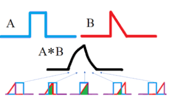
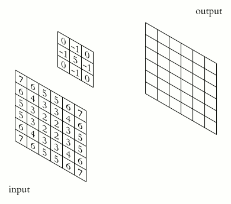
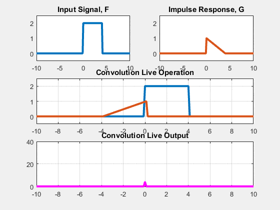
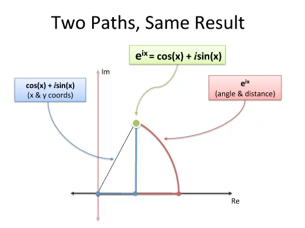
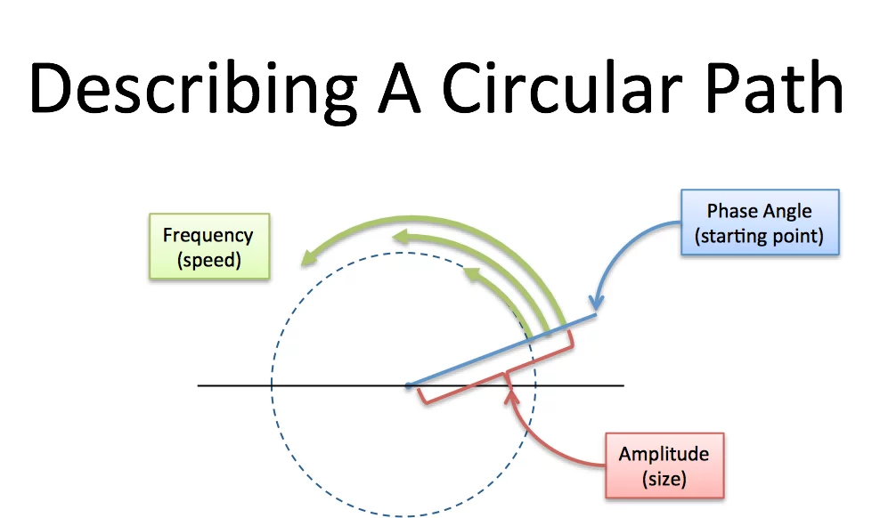
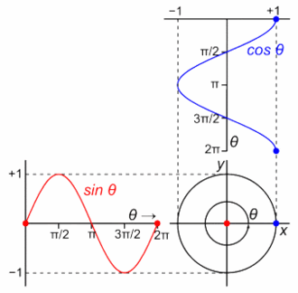
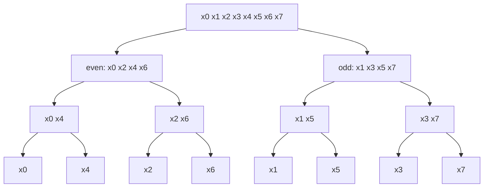

# Convolution and Fast Fourier Transform

!!! abstract "At a glance"

    - **Problem:** compute the convolution $c_k = \sum_{i+j=k} a_i b_j$ of two sequences, which is exactly the coefficient vector of the product of two polynomials.
    - **Key idea:** change representation. Evaluate both polynomials at the $N$ complex $N$-th roots of unity (the DFT), multiply pointwise, and interpolate back (the inverse DFT).
    - **Divide and conquer:** the Cooley–Tukey FFT computes a size-$N$ DFT from two size-$N/2$ DFTs (even/odd indices) plus an $O(N)$ butterfly combine, so $T(N) = 2T(N/2) + \Theta(N) = \Theta(N \log N)$.
    - **Result:** convolution / polynomial multiplication in $\Theta(N \log N)$ instead of $\Theta(nm)$.
    - **Used in:** signal and audio processing, image filtering, big-integer and polynomial multiplication, OFDM (Wi-Fi, LTE), spectral methods, string matching with wildcards.

## Motivation and Problem Context

**Informally**, convolution combines two sequences by sliding one across the other and, at every relative shift, summing the products of the terms that overlap. It describes how one signal is smeared, filtered or reshaped by another.

<figure markdown="span">
    {width="80%"}
    <figcaption>Convolution of two functions A (red) and B (blue) produces a third function describing their overlap (green).</figcaption>
    <p align='right' style="font-size:0.8em"><i>Image Source: <a href="https://www.statisticshowto.com/convolution-integral-simple-definition/"> Statistics How to</a ></i></p>
</figure>

The same operation hides inside many problems that do not look alike:

| Domain | What is being convolved |
| --- | --- |
| Polynomial multiplication | Coefficient vectors of $A(x)$ and $B(x)$ |
| Integer multiplication (Topic 4.3) | Digit vectors, followed by a carry pass |
| Audio / signal processing | A signal with a filter's impulse response (echo, reverb, noise removal) |
| Image processing | An image with a small kernel (blur, sharpen, edge detection) |
| Probability | The PMFs of two independent random variables (the PMF of their sum) |
| String matching | Indicator vectors of a text and a reversed pattern |

<figure markdown="span">
    {width="100%"}
    <figcaption>A 2-D kernel slides over an image; each output pixel is the sum of element-wise products under the kernel.</figcaption>
    <p align='right' style="font-size:0.8em"><i>Image Source: <a href="https://commons.wikimedia.org/wiki/File:2D_Convolution_Animation.gif"> Wiki Media</a ></i></p>
</figure>

<figure markdown="span">
    {width="100%"}
    <figcaption>Blurring an image is a convolution with an averaging kernel.</figcaption>
    <p align='right' style="font-size:0.8em"><i>Image Source: <a href="https://www.bitcoininsider.org/article/70964/computer-vision-busy-developers-convolutions"> Bitcoin Insider</a ></i></p>
</figure>

Computed directly, convolution of two length-$n$ sequences costs $\Theta(n^2)$. With a $3 \times 3$ image kernel that is harmless. When **both** operands are large (two million-digit integers, two long audio signals, two degree-$10^5$ polynomials) it is the bottleneck, and the FFT is the classic way past it.

## Problem Formulation

Given $a = (a_0, \dots, a_{n-1})$ and $b = (b_0, \dots, b_{m-1})$, the **linear (discrete) convolution** $c = a * b$ has length $n + m - 1$:

$$
c_k = \sum_{i+j=k} a_i\, b_j, \qquad k = 0, 1, \dots, n+m-2 .
$$

Reading $a$ and $b$ as coefficient vectors of $A(x) = \sum a_i x^i$ and $B(x) = \sum b_j x^j$, the product $C(x) = A(x)B(x)$ has coefficients exactly $c_k$. **Multiplying polynomials is convolving their coefficient vectors.**

```text
Input:   a[0..n-1], b[0..m-1]  with entries from a ring (reals, complex numbers,
         integers, or Z_p for the number-theoretic transform)
Output:  c[0..n+m-2] with c[k] = sum of a[i]*b[j] over i + j = k
Cost:    number of arithmetic operations on entries (each O(1))
Edge:    n = 0 or m = 0 -> empty output; n != m allowed;
         FFT needs a power-of-two working length -> zero-pad
```

The signal-processing form of the same definition, for infinite sequences, is

$$
(f * g)[n] = \sum_{i=-\infty}^{\infty} f[i]\, g[n-i],
$$

where $f$ is the input signal and $g$ the kernel (filter), reversed and shifted by $n$.

<figure markdown="span">
    {width="100%"}
    <figcaption>Discrete convolution of f and g: the reversed kernel slides along the signal and each output is the sum of overlapping products.</figcaption>
    <p align='right' style="font-size:0.8em"><i>Image Source: <a href="https://quincyaflint.weebly.com/academic-material/discrete-convolution"> Quincy's Website</a ></i></p>
</figure>

!!! example "Convolution by hand"

    $f = [1, 2, 3]$, $g = [0, 1, 0.5]$. The output has $3 + 3 - 1 = 5$ entries:

    | $k$ | Pairs $(i, j)$ with $i + j = k$ | $c_k$ |
    | --- | --- | --- |
    | 0 | $(0,0)$ | $1 \cdot 0 = 0$ |
    | 1 | $(0,1), (1,0)$ | $1 \cdot 1 + 2 \cdot 0 = 1$ |
    | 2 | $(0,2), (1,1), (2,0)$ | $1 \cdot 0.5 + 2 \cdot 1 + 3 \cdot 0 = 2.5$ |
    | 3 | $(1,2), (2,1)$ | $2 \cdot 0.5 + 3 \cdot 1 = 4$ |
    | 4 | $(2,2)$ | $3 \cdot 0.5 = 1.5$ |

    So $f * g = [0, 1, 2.5, 4, 1.5]$.

## Intuition

A polynomial of degree less than $N$ is uniquely determined by its values at any $N$ distinct points. That gives two representations:

| Representation | Multiply two polynomials | Convert to the other form |
| --- | --- | --- |
| Coefficients $(a_0, \dots, a_{N-1})$ | $\Theta(N^2)$ (convolution) | Evaluate at $N$ points |
| Point values $(A(x_0), \dots, A(x_{N-1}))$ | $\Theta(N)$ (pointwise) | Interpolate |

So multiplication is cheap in the value representation. The catch is conversion: evaluating at $N$ arbitrary points costs $\Theta(N^2)$ (Horner's rule $N$ times). The FFT's insight is to choose the **$N$-th roots of unity** as evaluation points. Their powers have so much symmetry (squaring the $N$-th roots gives the $N/2$-th roots) that evaluation at all of them splits into two half-size evaluations, which is a divide-and-conquer recurrence solving to $\Theta(N \log N)$. Interpolation turns out to be the same computation with conjugated roots, so it is also $\Theta(N \log N)$.

This is the same evaluate–multiply–interpolate idea behind Karatsuba (Topic 4.3), which evaluates at 3 points. The FFT takes it to the limit: all $N$ roots of unity at once.

### The DFT and why roots of unity

Let $\omega_N = e^{2\pi i/N}$, the principal $N$-th root of unity. The **Discrete Fourier Transform** of $x[0..N-1]$ is

$$
X[k] = \sum_{n=0}^{N-1} x[n]\, e^{-2\pi i kn/N} = \sum_{n=0}^{N-1} x[n]\, \omega_N^{-kn}, \qquad k = 0, \dots, N-1 .
$$

Read as polynomials: $X[k]$ is the polynomial with coefficients $x[n]$ evaluated at $\omega_N^{-k}$. In signal terms, $X[k]$ is a complex number whose magnitude and phase say how much of frequency $k$ (cycles per $N$ samples) the signal contains; the DFT moves a signal from the time domain to the frequency domain.

The Fourier viewpoint is that any signal can be decomposed into circular motions. Euler's formula $e^{i\theta} = \cos\theta + i \sin\theta$ is the tool that generates a point moving around the unit circle:

<figure markdown="span">
    {width="100%"}
    <figcaption>Euler's formula: e to the power iθ is the point at angle θ on the unit circle, with real part cos θ and imaginary part sin θ.</figcaption>
    <p align='right' style="font-size:0.8em"><i>Image Source: <a href="https://betterexplained.com/articles/an-interactive-guide-to-the-fourier-transform/"> Better Explained</a ></i></p>
</figure>

<figure markdown="span">
    {width="50%"}
    <figcaption>A circular path is described by its radius (amplitude), its speed (frequency) and its starting angle (phase).</figcaption>
    <p align='right' style="font-size:0.8em"><i>Image Source: <a href="https://betterexplained.com/articles/an-interactive-guide-to-the-fourier-transform/"> Better Explained</a ></i></p>
</figure>

<figure markdown="span">
    {width="100%"}
    <figcaption>As θ increases, the point e to the power iθ traces the unit circle while its projections trace the cosine and sine waves.</figcaption>
    <p align='right' style="font-size:0.8em"><i>Image Source: <a href="http://engredu.com/2022/12/09/euler-formula/"> Engr Edu </a ></i></p>
</figure>

The three facts about roots of unity that the FFT exploits:

| Property | Statement | Used for |
| --- | --- | --- |
| Halving | $\omega_N^{2} = \omega_{N/2}$ | Even/odd sub-sums are genuine size-$N/2$ DFTs |
| Half-period anti-symmetry | $\omega_N^{k + N/2} = -\,\omega_N^{k}$ | One twiddle multiplication serves two outputs |
| Periodicity | $\omega_N^{k+N} = \omega_N^{k}$ | Size-$N/2$ DFTs repeat, so they need only $N/2$ entries |

## Baseline Approach

**Direct convolution.** Loop over every output index and every contributing pair:

```text
ConvolutionNaive(a[0..n-1], b[0..m-1]):
    c[0..n+m-2] <- all zeros
    for k <- 0 to n+m-2:
        for i <- 0 to n-1:
            j <- k - i
            if 0 <= j < m:
                c[k] <- c[k] + a[i] * b[j]
    return c
```

Every pair $(i, j)$ is touched once (the guard rejects the rest), so there are exactly $nm$ multiplications: $\Theta(nm)$, i.e. $\Theta(N^2)$ for equal lengths.

**Direct DFT.** Writing $X = F_N x$ with $(F_N)_{k,n} = \omega_N^{-kn}$ is a dense matrix–vector product, also $\Theta(N^2)$. Going "evaluate, multiply, interpolate" with a quadratic DFT therefore buys nothing. The whole gain must come from computing the DFT faster.

## Algorithm Design

Split the DFT sum by the parity of $n$ (assume $N$ is a power of 2):

$$
X[k] = \sum_{r=0}^{N/2-1} x[2r]\, \omega_N^{-2rk} \;+\; \omega_N^{-k} \sum_{r=0}^{N/2-1} x[2r+1]\, \omega_N^{-2rk}.
$$

Because $\omega_N^{2} = \omega_{N/2}$, each inner sum is itself a size-$N/2$ DFT:

$$
E[k] = \sum_{r=0}^{N/2-1} x[2r]\, \omega_{N/2}^{-rk}, \qquad
O[k] = \sum_{r=0}^{N/2-1} x[2r+1]\, \omega_{N/2}^{-rk},
$$

which gives the **butterfly** equations, for $k = 0, \dots, N/2 - 1$:

$$
X[k] = E[k] + \omega_N^{-k} O[k], \qquad X[k + N/2] = E[k] - \omega_N^{-k} O[k].
$$

The factor $\omega_N^{-k}$ is called the **twiddle factor**. One size-$N$ DFT has become two size-$N/2$ DFTs plus $N/2$ butterflies, each costing one complex multiplication and two additions.

!!! tip "Why even/odd, and not first half / second half"

    The even/odd split is chosen precisely because squaring collapses $\omega_N$ into $\omega_{N/2}$. Splitting into $x[0..N/2-1]$ and $x[N/2..N-1]$ does not make either piece a DFT of size $N/2$, so no recursion is available. This is called **decimation in time** (radix-2 Cooley–Tukey).

**From DFT to convolution: the convolution theorem.** If $a$ and $b$ are zero-padded to a common length $N \ge n + m - 1$, then

$$
\mathrm{DFT}(a * b) = \mathrm{DFT}(a) \odot \mathrm{DFT}(b) \quad (\text{pointwise product}),
$$

because evaluating $C = AB$ at a point is the product of the evaluations. So: **FFT both, multiply pointwise, inverse FFT.**

**Inverse FFT.** The inverse DFT is $x[n] = \frac{1}{N} \sum_k X[k]\, \omega_N^{+kn}$, i.e. $F_N^{-1} = \frac{1}{N}\overline{F_N}$. This means it can reuse the forward FFT unchanged: $\mathrm{IFFT}(X) = \frac{1}{N}\,\overline{\mathrm{FFT}(\overline{X})}$.

!!! warning "Important: pad to at least $n + m - 1$"

    An FFT of length $N$ computes **circular** convolution: indices wrap around modulo $N$. It equals the **linear** convolution only when $N \ge n + m - 1$. Padding each input merely to the next power of two above $\max(n, m)$ gives wrapped-around, wrong answers.

## Pseudocode

```text
FFT(x[0..N-1]):                        // N is a power of 2
    if N = 1:
        return x
    E <- FFT([x[0], x[2], ..., x[N-2]])   // even indices
    O <- FFT([x[1], x[3], ..., x[N-1]])   // odd indices
    X <- array of size N
    for k <- 0 to N/2 - 1:
        t <- exp(-2*pi*i*k / N) * O[k]    // twiddle factor times O[k]
        X[k]       <- E[k] + t
        X[k + N/2] <- E[k] - t
    return X

IFFT(X[0..N-1]):
    y <- FFT(conjugate of each X[k])
    return [conjugate(y[k]) / N for k <- 0 to N-1]

ConvolveFFT(a[0..n-1], b[0..m-1]):
    if n = 0 or m = 0: return empty
    N <- smallest power of 2 with N >= n + m - 1
    A <- FFT(a padded with zeros to length N)
    B <- FFT(b padded with zeros to length N)
    C <- [A[k] * B[k] for k <- 0 to N-1]
    c <- IFFT(C)
    return c[0 .. n+m-2]
```

## Worked Example

**FFT of $x = [1, 2, 3, 4]$** ($N = 4$, $\omega_4^{-1} = e^{-i\pi/2} = -i$).

| Step | Computation | Result |
| --- | --- | --- |
| Split | even $= [1, 3]$, odd $= [2, 4]$ | |
| $E = \mathrm{FFT}([1,3])$ | $N=2$: $[1+3,\; 1-3]$ | $E = [4, -2]$ |
| $O = \mathrm{FFT}([2,4])$ | $N=2$: $[2+4,\; 2-4]$ | $O = [6, -2]$ |
| $k = 0$ | $t = \omega_4^{0} \cdot 6 = 6$ | $X[0] = 4 + 6 = 10$, $X[2] = 4 - 6 = -2$ |
| $k = 1$ | $t = (-i)(-2) = 2i$ | $X[1] = -2 + 2i$, $X[3] = -2 - 2i$ |

So $X = [10,\; -2+2i,\; -2,\; -2-2i]$. Check one entry against the definition: $X[2] = 1 - 2 + 3 - 4 = -2$. Also note $X[3] = \overline{X[1]}$, as expected for real input.

The recursion tree for $N = 8$ shows where each sample ends up after repeated even/odd splitting:



The leaf order $0, 4, 2, 6, 1, 5, 3, 7$ is the **bit-reversal** of $0, 1, \dots, 7$ (e.g. $1 = 001_2 \to 100_2 = 4$). Iterative FFTs permute the input into this order once and then run the butterflies bottom-up, in place.

**Convolution via FFT.** For $f = [1,2,3]$, $g = [0,1,0.5]$: $n + m - 1 = 5$, so $N = 8$. Pad both to length 8, FFT, multiply the 8 pairs pointwise, IFFT, and keep the first 5 entries: $[0, 1, 2.5, 4, 1.5]$, matching the hand computation.

## Correctness

**Lemma (butterfly).** If $E$ and $O$ are the size-$N/2$ DFTs of the even- and odd-indexed samples, then for $0 \le k < N/2$: $X[k] = E[k] + \omega_N^{-k}O[k]$ and $X[k+N/2] = E[k] - \omega_N^{-k}O[k]$.

*Proof.* The first equation was derived above using $\omega_N^2 = \omega_{N/2}$. For the second, substitute $k + N/2$ into the split sum. The sub-DFTs are periodic with period $N/2$, since $\omega_{N/2}^{-r(k+N/2)} = \omega_{N/2}^{-rk}$, so $E[k+N/2] = E[k]$ and $O[k+N/2] = O[k]$. The twiddle factor flips sign: $\omega_N^{-(k+N/2)} = \omega_N^{-k}\, e^{-i\pi} = -\omega_N^{-k}$. Hence $X[k+N/2] = E[k] - \omega_N^{-k}O[k]$. $\blacksquare$

**Theorem.** `FFT(x)` returns the DFT of $x$ for every length $N = 2^p$.

*Proof by strong induction on $N$.*

- *Base* ($N = 1$): $X[0] = x[0]\,\omega_1^0 = x[0]$, which is what the algorithm returns.
- *Step:* assume correctness for length $N/2$. The even and odd subsequences have length $N/2$ (a power of 2), so `E` and `O` are their correct DFTs. By the butterfly lemma, the loop sets every $X[k]$, $0 \le k < N$, correctly.
- *Termination:* each call halves $N$, reaching $N = 1$ after $\log_2 N$ levels. $\blacksquare$

**Convolution theorem.** Let $C(x) = A(x)B(x)$, where $\deg C \le n+m-2 < N$. For each $k$, $C(\omega_N^{-k}) = A(\omega_N^{-k})\,B(\omega_N^{-k})$, so $\mathrm{DFT}(c) = \mathrm{DFT}(a) \odot \mathrm{DFT}(b)$ when all three are computed at length $N$. Since the DFT matrix is invertible ($F_N^{-1} = \frac{1}{N}\overline{F_N}$, from $\sum_{k=0}^{N-1}\omega_N^{k(n-n')} = N$ if $n = n'$ and $0$ otherwise), the IFFT recovers $c$ exactly in exact arithmetic. If $N < n + m - 1$, coefficients of degree $\ge N$ fold onto degree $d \bmod N$ (because $\omega^{N} = 1$): this is the wrap-around of circular convolution.

## Complexity Analysis

**Recurrence.** Two half-size calls, plus $O(N)$ to split and $N/2$ constant-time butterflies:

$$
T(N) = 2\,T(N/2) + \Theta(N), \qquad T(1) = \Theta(1).
$$

**Master Theorem** ([Topic 3.5](../unit3/topic5.md)): $a = 2$, $b = 2$, $n^{\log_b a} = N$, and $f(N) = \Theta(N)$, so this is Case 2: $T(N) = \Theta(N \log N)$.

!!! warning "Important: why the FFT is fast"

    The FFT does **not** reduce the number of subproblems ($a = 2$, as in a naive split). It is fast because the combine step is only $\Theta(N)$ butterflies, with no size-$N$ multiplications. Exam answers that say "FFT, like Karatsuba, saves a recursive multiplication" lose marks.

**Recursion tree.** Level $i$ has $2^i$ subproblems of size $N/2^i$, each doing $c\,N/2^i$ work, for a total of $cN$ per level. There are $\log_2 N$ levels, so $T(N) = \Theta(N \log N)$. Every level costs the same, which is the signature of Case 2. Compare Karatsuba, $T(n) = 3T(n/2) + \Theta(n)$, where per-level work grows by a factor of $3/2$, so the leaves dominate and the total is $\Theta(n^{\log_2 3})$.

**Exact operation count.** Radix-2 FFT performs $\frac{N}{2}\log_2 N$ butterflies, i.e. $\frac{N}{2}\log_2 N$ complex multiplications and $N \log_2 N$ complex additions.

**FFT convolution.** Three FFTs of length $N < 2(n+m)$ plus $N$ pointwise products: $\Theta((n+m)\log(n+m))$.

**Space.** The recursive version with list slicing allocates $\Theta(N)$ per level along the active recursion path. Because sibling calls run sequentially, the peak is $\Theta(N + N/2 + \dots) = \Theta(N)$, but the total allocation over the whole run is $\Theta(N \log N)$. The iterative in-place FFT needs $O(1)$ extra space beyond the array (plus an optional twiddle table).

| $N$ | Naive $N^2$ | FFT $N \log_2 N$ |
| --- | --- | --- |
| $2^{10} \approx 10^3$ | $\approx 10^6$ | $\approx 10^4$ |
| $2^{20} \approx 10^6$ | $\approx 1.1 \times 10^{12}$ | $\approx 2.1 \times 10^7$ |

## Python Implementation

```python
import cmath


def fft(x):
    """Recursive radix-2 Cooley-Tukey FFT. len(x) must be a power of 2."""
    n = len(x)
    if n == 1:
        return list(x)
    if n % 2 != 0:
        raise ValueError("length of x must be a power of 2")
    even = fft(x[0::2])
    odd = fft(x[1::2])
    X = [0] * n
    for k in range(n // 2):
        t = cmath.exp(-2j * cmath.pi * k / n) * odd[k]   # twiddle * O[k]
        X[k] = even[k] + t
        X[k + n // 2] = even[k] - t
    return X


def ifft(X):
    """Inverse FFT via conjugation: ifft(X) = conj(fft(conj(X))) / n."""
    n = len(X)
    y = fft([complex(v).conjugate() for v in X])
    return [v.conjugate() / n for v in y]


def convolve_naive(a, b):
    """Direct Theta(n*m) linear convolution."""
    if not a or not b:
        return []
    n, m = len(a), len(b)
    c = [0] * (n + m - 1)
    for k in range(n + m - 1):
        for i in range(n):
            j = k - i
            if 0 <= j < m:
                c[k] += a[i] * b[j]
    return c


def convolve_fft(a, b):
    """Linear convolution in Theta(N log N) via the convolution theorem."""
    if not a or not b:
        return []
    result_size = len(a) + len(b) - 1
    size = 1
    while size < result_size:          # power of 2 and >= n + m - 1
        size *= 2
    fa = fft(list(a) + [0] * (size - len(a)))
    fb = fft(list(b) + [0] * (size - len(b)))
    c = ifft([x * y for x, y in zip(fa, fb)])
    return [v.real for v in c[:result_size]]


def multiply_integers(x, y):
    """Multiply non-negative integers by convolving their decimal digits."""
    a = [int(d) for d in reversed(str(x))]     # least significant digit first
    b = [int(d) for d in reversed(str(y))]
    coeffs = [round(v) for v in convolve_fft(a, b)]
    digits, carry = [], 0
    for c in coeffs:
        carry += c
        digits.append(carry % 10)
        carry //= 10
    while carry:
        digits.append(carry % 10)
        carry //= 10
    return int("".join(map(str, reversed(digits))))


print(convolve_fft([1, 2, 3], [0, 1, 0.5]))   # [0.0, 1.0, 2.5, 4.0, 1.5]
print(fft([1, 2, 3, 4]))                      # 10, -2+2j, -2, -2-2j (up to rounding)
print(multiply_integers(1234, 5678))          # 7006652
```

- `x[0::2]` and `x[1::2]` are the even/odd split. They copy, which is part of the $\Theta(N)$ non-recursive work.
- `t` is computed **once** per `k` and used with both signs. That is the butterfly lemma in code.
- `ifft` reuses `fft` through conjugation, so the forward and inverse transforms can never end up with mismatched exponent signs.
- `convolve_fft` pads to a power of 2 **that is at least** `n + m - 1`, then truncates. Results are floats; `multiply_integers` rounds each coefficient to the nearest integer before carrying.
- The implementation was checked against `convolve_naive` on random inputs, against a direct $\Theta(N^2)$ DFT, and with `ifft(fft(x)) == x` round trips.

## Edge Cases and Pitfalls

| Case / pitfall | What goes wrong | Fix |
| --- | --- | --- |
| Padding to a power of 2 that is $< n + m - 1$ | Circular wrap-around corrupts the leading/trailing coefficients | Pad to the smallest power of 2 that is $\ge n + m - 1$ |
| Not truncating after the IFFT | Extra trailing (near-)zeros returned | Return `c[:n+m-1]` |
| Wrong exponent sign in the inverse, or missing $1/N$ | Output time-reversed and/or scaled by $N$ | Implement IFFT via conjugation around the same FFT |
| Loop `k` over $0..N-1$ in the butterfly | Index errors or overwritten outputs | Loop $k < N/2$; write both $X[k]$ and $X[k+N/2]$ |
| Length not a power of 2 passed to radix-2 FFT | Odd-length split, wrong result or crash | Validate, pad, or use mixed-radix / Bluestein |
| Exact comparison of float results | `0.9999999` vs `1` fails equality tests | Compare with tolerance; round when the true answer is integral |
| Large integer convolution in double precision | Rounding error exceeds 0.5, giving the wrong integer | Split into smaller digit chunks, use NTT (exact, mod prime), or rely on a big-int library |
| Empty input | Negative result length | Return `[]` early |

## Common Misconceptions

- **"The FFT is a different transform from the DFT."** It is an *algorithm* for computing exactly the same DFT. Any correct FFT must agree with the $\Theta(N^2)$ definition, up to floating-point error.
- **"The FFT computes the convolution."** The FFT only evaluates at roots of unity. Convolution needs FFT, FFT, pointwise product **and** IFFT.
- **"The FFT is fast because it reduces the number of recursive calls, like Karatsuba."** It keeps $a = 2$, $b = 2$; it is fast because the combine step is only $\Theta(N)$. Karatsuba is fast because it reduces $a$ from 4 to 3.
- **"Any halving split works."** Only the even/odd split makes the halves smaller DFTs, because only it turns $\omega_N^2$ into $\omega_{N/2}$.
- **"FFT is always faster than direct convolution."** For a small kernel (say $3 \times 3$ or a few dozen taps), the direct method wins on constants and memory traffic.

## Alternatives and Trade-offs

| Approach | Time | Exact? | Notes |
| --- | --- | --- | --- |
| Direct convolution | $\Theta(nm)$ | Yes | Best for small or very unbalanced sizes ($m \ll n$) |
| Karatsuba / Toom–Cook (Topic 4.3) | $\Theta(n^{1.585})$ / $\Theta(n^{1.465})$ (Toom-3) | Yes | Good mid-size range for big integers and polynomials |
| Recursive radix-2 FFT (this page) | $\Theta(N \log N)$ | Floating point | Easiest to prove; copying adds overhead |
| Iterative in-place FFT (bit reversal) | $\Theta(N \log N)$ | Floating point | What libraries build on; $O(1)$ extra space |
| Mixed-radix / Bluestein | $\Theta(N \log N)$ for any $N$ | Floating point | Avoids padding to a power of 2 |
| Number-Theoretic Transform (NTT) | $\Theta(N \log N)$ | Yes (mod prime $p$) | Roots of unity in $\mathbb{Z}_p$, e.g. $p = 998244353 = 119 \cdot 2^{23} + 1$ |
| Overlap–add / overlap–save | $\Theta(n \log m)$ for long signal, length-$m$ filter | Floating point | Streaming filters: FFT in blocks |

**Use FFT convolution when** both operands are large, the whole output is needed, and floating-point accuracy is acceptable (or an NTT is used).
**Avoid it when** one operand is tiny, exact integers are required and an NTT is unavailable, or only a few output values are needed.

## In Practice

- **Libraries.** FFTW (C), Intel MKL, cuFFT (NVIDIA GPUs) and `numpy.fft` / `scipy.fft` (Python) all provide FFTs. They use iterative mixed-radix algorithms, special real-input transforms (`numpy.fft.rfft` exploits $X[N-k] = \overline{X[k]}$ to roughly halve the work) and, in FFTW's case, a planner that times candidate strategies on the actual machine.
- **Choosing a method in Python.** `numpy.convolve` computes convolution directly. `scipy.signal.fftconvolve` uses the FFT, and `scipy.signal.convolve(..., method="auto")` picks between direct and FFT based on an estimate of which is faster.
- **Signal processing.** Spectral analysis, equalisers, reverb (convolving audio with a long impulse response is a standard FFT use case), radar/sonar pulse compression.
- **Communications.** OFDM, used in Wi-Fi, LTE/5G and DSL, modulates data onto many subcarriers with an inverse FFT and demodulates with an FFT.
- **Compression.** JPEG and MP3 use cosine-type transforms (DCT/MDCT), close relatives of the DFT with fast algorithms of the same family.
- **Big integers.** GMP switches from schoolbook to Karatsuba to Toom–Cook to FFT-based (Schönhage–Strassen-style) multiplication as operand size grows. Schönhage–Strassen runs in $O(n \log n \log\log n)$. Harvey and van der Hoeven (2019) proved an $O(n \log n)$ integer multiplication algorithm, which is of theoretical interest only, with no practical speed-up at realistic sizes.
- **Deep learning.** Convolution layers in CNNs mostly use small kernels ($3 \times 3$), for which libraries rely on direct, im2col + GEMM, or Winograd algorithms. cuDNN also offers FFT-based algorithms, which can pay off for larger kernels.
- **Performance realities.** The stride-2 access pattern of the even/odd split is cache-unfriendly, twiddle factors are precomputed rather than recomputed with `exp` in the inner loop, and padding to a power of 2 can almost double $N$. That is why production code uses mixed radices.

## Interview and Competitive Programming

**Recognition cues**

- "Multiply two polynomials / big numbers with up to $10^5$–$10^6$ terms or digits": FFT or NTT.
- "For every $k$, count pairs $(i, j)$ with $i + j = k$" (or with a difference of $k$, by reversing one array): convolve the frequency or indicator arrays.
- "Number of ways to get sum $s$ choosing one element from $A$ and one from $B$" with values up to $10^5$: convolve the value-count arrays.
- "Pattern matching with wildcards / count mismatches at every alignment": convolution of encoded strings.
- An answer "modulo 998244353" is a strong hint that the intended solution uses an NTT.

**Constraint mapping.** $n \le 5000$: $O(n^2)$ direct convolution is fine. $n \sim 10^5$–$10^6$: you need $O(n \log n)$.

**Template idea (counting pair sums).** Build `cntA[v]` and `cntB[v]` (value frequencies), compute `conv = convolve(cntA, cntB)`, and then `conv[s]` is the number of pairs with sum `s`.

**Traps:** floating-point precision when counts or values are large (round, and keep coefficients small or use an NTT); forgetting to reverse one array for "difference" problems; padding below $n + m - 1$.

## Using AI Assistants Critically

- LLM-generated FFTs often pad to `next_pow2(max(n, m))` instead of `next_pow2(n + m - 1)`. Test unequal lengths and check the last coefficient.
- Watch for the inverse transform missing the $1/N$ factor or using the same exponent sign as the forward transform. A round-trip test `ifft(fft(x)) ≈ x` catches both.
- Generated "in-place iterative FFT" code frequently gets the bit-reversal permutation subtly wrong. Compare against the recursive version or `numpy.fft.fft` on random inputs.
- Assistants may claim that "FFT multiplication is exact". It is not in floating point. Ask for, or add, rounding plus an error bound, or use an NTT with a known prime such as $998244353$.
- Cross-check every claimed complexity: a version that rebuilds the twiddle table per call, or does an $O(N)$ list operation inside the butterfly loop, is quadratic. A timing doubling experiment should show a ratio of about $2$, not $4$.
- Property-based tests (e.g. `hypothesis`): `convolve_fft(a, b) ≈ convolve_naive(a, b)` for random lists, linearity $\mathrm{DFT}(\alpha x + \beta y) = \alpha X + \beta Y$, and commutativity $a * b = b * a$.

## Practice

**Beginner**

1. Convolve $a = [1, 2]$ and $b = [3, 4]$ by hand, and state the output length before computing. *Input:* two sequences. *Output:* $c$. *Difficulty:* Beginner.
2. List the 8th roots of unity $\omega_8^k$, $k = 0..7$, as $e^{i\theta}$ and as $x + iy$, and verify $\omega_8^{k+4} = -\omega_8^k$. *Difficulty:* Beginner.
3. Compute the DFT of $x = [1, 0, 0, 0]$ and of $x = [1, 1, 1, 1]$ directly from the definition. *Difficulty:* Beginner.

**Intermediate**

1. Run the butterfly by hand on $x = [1, 2, 3, 4, 5, 6, 7, 8]$ and verify $X[0]$ and $X[4]$ directly. *Difficulty:* Intermediate.
2. Instrument `fft` to count complex multiplications. Verify the count equals $\frac{N}{2}\log_2 N$ for $N = 2^4, \dots, 2^{12}$. *Difficulty:* Intermediate.
3. Show by example that FFT convolution with $N = 4$ of $a = [1,1,1]$ and $b = [1,1,1]$ returns a wrapped (circular) result, and compute the correct linear result. *Difficulty:* Intermediate.

**Advanced**

1. Implement an iterative in-place FFT using the bit-reversal permutation, and prove that bit-reversal places each sample where the recursive leaves would. *Difficulty:* Advanced.
2. Prove $F_N^{-1} = \frac{1}{N}\overline{F_N}$ using the geometric-series identity for roots of unity. *Difficulty:* Advanced.
3. Implement an NTT modulo $998244353$ (primitive root $3$) and use it for exact polynomial multiplication with coefficients below $p$. *Difficulty:* Advanced.

**Interview / Competitive Programming**

1. *Big multiplication:* multiply two non-negative integers given as decimal strings of up to $10^5$ digits each. *Output:* the product as a string. *Constraints:* 1 s time limit, so $O(n \log n)$ is required. *Difficulty:* CP medium.
2. *Pair sums:* given arrays $A$, $B$ of length up to $2 \cdot 10^5$ with values in $[0, 10^5]$, output for every $s \in [0, 2 \cdot 10^5]$ the number of pairs $(i, j)$ with $A_i + B_j = s$. *Difficulty:* CP medium.
3. *Wildcard matching:* given text $T$ and pattern $P$ over lowercase letters, where `?` in either matches anything, output all positions where $P$ matches $T$. $|T|, |P| \le 2 \cdot 10^5$. *Difficulty:* CP hard.

## Self-Check Questions

??? question "Q1. Why is the output of convolving lengths n and m exactly n + m - 1?"

    Index $k = i + j$ ranges from $0 + 0 = 0$ to $(n-1) + (m-1) = n + m - 2$, giving $n + m - 1$ values. Equivalently, the product of polynomials of degree $n-1$ and $m-1$ has degree $n + m - 2$.

??? question "Q2. Derive the FFT recurrence and solve it without quoting the Master Theorem."

    $T(N) = 2T(N/2) + cN$. Expanding gives $T(N) = 2^i T(N/2^i) + i\,cN$. At $i = \log_2 N$, this is $T(N) = N\,T(1) + cN\log_2 N = \Theta(N \log N)$.

??? question "Q3. Where in the correctness proof is 'N is a power of 2' used?"

    In the inductive step: the even/odd halves must have equal length $N/2$, and that length must again be even at every level down to 1. For odd $N$, the split is unequal and $\omega_N^2$ is not an $(N/2)$-th root of unity, so the butterfly lemma does not apply.

??? question "Q4. A colleague's FFT convolution gives correct middle values but wrong first entries. Diagnose."

    Insufficient padding. With $N < n + m - 1$, high-degree coefficients wrap around onto low indices (circular convolution). Pad to a power of 2 that is $\ge n + m - 1$.

??? question "Q5. Karatsuba and FFT both use divide and conquer on multiplication. What does each reduce?"

    Karatsuba reduces the **number of subproblems** (4 to 3) while the combine step stays linear: $\Theta(n^{\log_2 3})$. The FFT keeps 2 subproblems of half size but has a **linear combine**, with no further multiplications of size $N$: $\Theta(N \log N)$. The FFT also changes representation (coefficients to values) to make the multiplication itself linear.

??? question "Q6. You must convolve a length-10 filter with a 10^7-sample audio stream in real time. What do you use?"

    Neither one giant FFT nor naive per-sample convolution is ideal. For a 10-tap filter, direct convolution ($10$ multiply-adds per sample) is already cheap and streams naturally. For long filters (thousands of taps), use block FFT convolution (overlap–add / overlap–save) so latency and memory stay bounded.

??? question "Q7. Why might FFT-based integer multiplication give a wrong digit for huge inputs, and how is that fixed?"

    Double precision has a 53-bit mantissa. Coefficients of the digit convolution grow to about $81 \cdot n$, and accumulated rounding error grows with $N$, so the error can exceed $0.5$ and round to the wrong integer. Fixes: use smaller digit chunks, higher precision, or an exact NTT (possibly several primes combined with CRT).

## Complexity Summary

| Method | Time | Extra space |
| --- | --- | --- |
| Direct convolution | $\Theta(nm)$ | $O(n + m)$ |
| Direct DFT | $\Theta(N^2)$ | $O(N)$ |
| Recursive radix-2 FFT | $\Theta(N \log N)$ | $\Theta(N)$ peak ($\Theta(N\log N)$ total allocation) |
| Iterative in-place FFT | $\Theta(N \log N)$ | $O(1)$ beyond the array |
| FFT convolution | $\Theta(N \log N)$, $N = $ next power of 2 $\ge n+m-1$ | $O(N)$ |
| NTT convolution | $\Theta(N \log N)$, exact mod $p$ | $O(N)$ |

## Key Takeaways

- Convolution = polynomial multiplication = (after carrying) integer multiplication. A speed-up for one is a speed-up for all.
- The FFT changes representation: coefficients to values at roots of unity, where multiplication is pointwise and $\Theta(N)$.
- Cooley–Tukey splits by index parity because $\omega_N^2 = \omega_{N/2}$. The butterfly reuses one twiddle product because $\omega_N^{k+N/2} = -\omega_N^k$.
- $T(N) = 2T(N/2) + \Theta(N) = \Theta(N \log N)$: Master Theorem Case 2, equal work on every level.
- FFT convolution is FFT, FFT, pointwise product, IFFT, with zero-padding to **at least $n + m - 1$** to avoid circular wrap-around.
- Floating-point FFTs are approximate. Use rounding with care, or an NTT when exactness matters.
- For small kernels, direct convolution wins in practice. Libraries pick the method by size.

## Additional Resources

{{ youtube_embed("https://www.youtube.com/watch?v=nmgFG7PUHfo", title="The Most Important Algorithm Of All Time - Veritasium", width="700px") }}
{{ youtube_embed("https://www.youtube.com/watch?v=spUNpyF58BY", title="But what is the Fourier Transform? A visual introduction.- 3blue1brown", width="700px") }}
