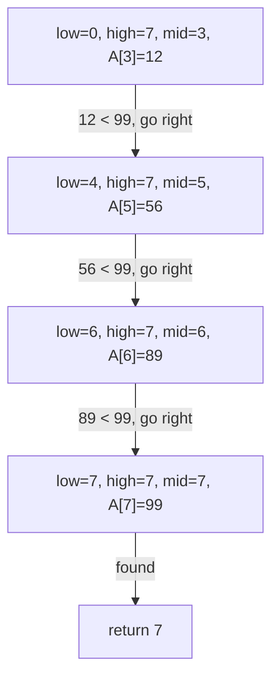

# Binary Search and Ternary Search

!!! abstract "At a glance"

    - **Problem:** find a target in sorted data, find a boundary where a monotone predicate flips from false to true, or find the peak of a unimodal function.
    - **Key idea:** one $O(1)$ test tells you which part of the range cannot contain the answer, so you discard it. Only **one** subproblem survives, which makes this *decrease and conquer*.
    - **Complexity:** binary search $T(n) = T(n/2) + O(1) = \Theta(\log n)$; ternary search $\Theta(\log n)$ iterations with a worse constant.
    - **Used in:** `bisect`, `std::lower_bound`, database indexes, `git bisect`, "binary search on the answer" in optimisation problems, and tuning unimodal cost functions.

## Motivation and Problem Context

Linear search on $10^9$ elements may need $10^9$ comparisons. If the array is **sorted**, a single comparison with any element tells you on which side the target must lie, so everything on the other side can be eliminated without being inspected. Halving the candidates each time takes $10^9$ elements down to 1 in about 30 steps.

The same idea reaches much further than arrays:

- **Boundaries.** "First index with `arr[i] >= x`" (`lower_bound`) answers insert-position, count-in-range and predecessor/successor queries.
- **Binary search on the answer.** "What is the minimum capacity such that all packages ship in $D$ days?" If capacity $c$ works, every $c' > c$ also works. Feasibility is a **monotone predicate** of the answer, so you can binary search the answer space without any array.
- **Debugging.** `git bisect` binary searches the commit history for the first bad commit, a monotone good-then-bad predicate.
- **Unimodal optimisation.** Ternary search finds the maximum of a function that increases and then decreases, such as profit as a function of price, without derivatives.

## Problem Formulation

**Exact search.** Input: array $A[0..n-1]$ sorted ascending, and target $x$. Output: some index $i$ with $A[i] = x$, or $-1$.

**Boundary search (the general form).** Input: integers $lo \le hi$ and a predicate $P$ that is **monotone** on $[lo, hi]$: false, false, …, false, true, …, true. Output: the smallest $t \in [lo, hi]$ with $P(t)$ true, or $hi + 1$ if none exists.

| Instance | Predicate $P(i)$ | Result |
| --- | --- | --- |
| `lower_bound(A, x)` | $A[i] \ge x$ | First index not less than $x$ |
| `upper_bound(A, x)` | $A[i] > x$ | First index greater than $x$ |
| Occurrences of $x$ | | `upper_bound - lower_bound` |
| Binary search on the answer | `feasible(t)` | Minimum feasible value |

**Unimodal optimisation.** Input: $f$ on $[lo, hi]$ that is **strictly increasing then strictly decreasing** (for a maximum). Output: $\arg\max f$, either exactly (integers) or within tolerance $\varepsilon$ (reals).

!!! warning "Important: the precondition is everything"

    Binary search needs sortedness (more generally, a monotone predicate). Ternary search needs **strict** unimodality. Neither algorithm checks its precondition. On data that violates it, they return wrong answers silently.

## Intuition

**Guess the number.** A secret number lies in $1..1000$ and each guess is answered with "higher" or "lower". Guessing the midpoint every time removes half of the remaining possibilities, so $\lceil \log_2 1001 \rceil = 10$ guesses always suffice. Binary search is this game, with the comparison `A[mid]` vs `x` as the feedback.

**Climbing a hill in fog.** For a unimodal $f$, sample two interior points $m_1 < m_2$. If $f(m_1) < f(m_2)$, you are still climbing at $m_1$, so the peak cannot be left of $m_1$. Otherwise the peak cannot be right of $m_2$. Each step discards one third of the range.

## Baseline Approach

Linear scan: check $A[0], A[1], \dots$ until the target is found. It costs $\Theta(n)$ in the worst case and needs no sortedness, which makes it the right choice for unsorted data or tiny arrays. Its bottleneck is that it never uses order. Each comparison eliminates one candidate when it could eliminate half.

For unimodal maximisation, the baseline is to evaluate $f$ at every integer point in $[lo, hi]$, which is $\Theta(hi - lo)$ evaluations.

## Algorithm Design

**From bottleneck to algorithm.** Compare $x$ with the middle element $A[mid]$:

- If $A[mid] = x$: done.
- If $A[mid] < x$: by sortedness, all of $A[lo..mid]$ is $< x$. Discard it with $lo \leftarrow mid + 1$.
- If $A[mid] > x$: discard $A[mid..hi]$ with $hi \leftarrow mid - 1$.

The range always shrinks by at least one element plus half of the rest. That guarantees progress, so the loop terminates.

**Boundary version (half-open interval).** Keep the answer inside $[lo, hi)$, where $hi$ is a valid "not found" sentinel. If $P(mid)$ holds, the answer is $\le mid$, so set $hi \leftarrow mid$ (keep $mid$, it may be the answer). Otherwise set $lo \leftarrow mid + 1$. The loop stops when $lo = hi$. This one template covers `lower_bound`, `upper_bound` and binary search on the answer.

**Ternary search (unimodal).** With $m_1 = lo + \lfloor (hi - lo)/3 \rfloor$ and $m_2 = hi - \lfloor (hi - lo)/3 \rfloor$:

- If $f(m_1) < f(m_2)$, the peak is in $(m_1, hi]$.
- If $f(m_1) \ge f(m_2)$, the peak is in $[lo, m_2)$. Under strict unimodality, equality means the peak lies strictly between $m_1$ and $m_2$.

**Ternary search on a sorted array** (two probes, three regions) is also correct, but as the complexity section shows it does **more** comparisons than binary search. It is included here only to make that point.

!!! warning "Important: overflow in the midpoint"

    In C, C++ and Java, `mid = (low + high) / 2` overflows when `low + high` exceeds the integer range. This was a real, long-unnoticed bug in widely used library binary searches, including Java's `Arrays.binarySearch`; it was publicised in 2006. Write `mid = low + (high - low) / 2`. Python integers do not overflow, but the safe form is portable and costs nothing.

## Pseudocode

```text
BINARY-SEARCH(A, x):                     // A sorted ascending
    low <- 0; high <- n - 1              // closed interval [low, high]
    while low <= high:
        mid <- low + floor((high - low) / 2)
        if A[mid] = x: return mid
        else if A[mid] < x: low <- mid + 1
        else: high <- mid - 1
    return -1

FIRST-TRUE(lo, hi, P):                   // P monotone: F..F T..T on [lo, hi]
    high <- hi + 1                       // half-open [lo, high); hi+1 = "none"
    while lo < high:
        mid <- lo + floor((high - lo) / 2)
        if P(mid): high <- mid
        else: lo <- mid + 1
    return lo

LOWER-BOUND(A, x) = FIRST-TRUE(0, n-1, i -> A[i] >= x)
UPPER-BOUND(A, x) = FIRST-TRUE(0, n-1, i -> A[i] >  x)

TERNARY-MAX(f, lo, hi):                  // f strictly unimodal on integers
    while hi - lo > 2:
        m1 <- lo + floor((hi - lo) / 3)
        m2 <- hi - floor((hi - lo) / 3)
        if f(m1) < f(m2): lo <- m1 + 1
        else: hi <- m2 - 1
    return the x in [lo, hi] with largest f(x)     // at most 3 candidates
```

## Worked Example

**Exact search** for $x = 99$ in $A = [2, 6, 8, 12, 25, 56, 89, 99]$ (indices $0..7$):

| Iteration | low | high | mid | $A[mid]$ | Decision |
| --- | --- | --- | --- | --- | --- |
| 1 | 0 | 7 | 3 | 12 | $12 < 99$, low $\leftarrow 4$ |
| 2 | 4 | 7 | 5 | 56 | $56 < 99$, low $\leftarrow 6$ |
| 3 | 6 | 7 | 6 | 89 | $89 < 99$, low $\leftarrow 7$ |
| 4 | 7 | 7 | 7 | 99 | found, return 7 |

That is 4 probes, matching the worst case $\lfloor \log_2 8 \rfloor + 1 = 4$.



**`lower_bound`** for $x = 2$ in $A = [1, 2, 2, 2, 3]$, with $P(i) = (A[i] \ge 2)$ and $[lo, high) = [0, 5)$:

| lo | high | mid | $A[mid]$ | $P(mid)$ | Update |
| --- | --- | --- | --- | --- | --- |
| 0 | 5 | 2 | 2 | T | high $\leftarrow 2$ |
| 0 | 2 | 1 | 2 | T | high $\leftarrow 1$ |
| 0 | 1 | 0 | 1 | F | lo $\leftarrow 1$ |
| 1 | 1 | | | | return 1 |

`upper_bound` returns 4, so $x = 2$ occurs $4 - 1 = 3$ times.

**Ternary search on a sorted array** for $x = 11$ in $A = [1, 3, 5, 7, 9, 11, 13, 15, 17]$: with low $= 0$ and high $= 8$, we get $m_1 = 2$ ($A = 5$) and $m_2 = 6$ ($A = 13$). Since $5 < 11 < 13$, the range becomes low $= 3$, high $= 5$. Then $m_1 = 3$ ($A = 7$) and $m_2 = 5$ ($A = 11$), which is found.

## Correctness

**Binary search: loop invariant.** *If $x$ occurs in $A$, it occurs in $A[low..high]$.*

- **Initialization.** $[low, high] = [0, n-1]$ is the whole array.
- **Maintenance.** If $A[mid] < x$, then by sortedness every $A[i]$ with $i \le mid$ satisfies $A[i] \le A[mid] < x$. So $x$, if present, is in $A[mid+1..high]$, and setting $low \leftarrow mid+1$ keeps the invariant. The case $A[mid] > x$ is symmetric. If $A[mid] = x$, returning $mid$ is correct.
- **Termination.** $high - low$ strictly decreases every iteration, because $mid \in [low, high]$ is always excluded. When $low > high$ the range is empty, so by the invariant $x$ is absent and $-1$ is correct.

**FIRST-TRUE: loop invariant.** *All $i < lo$ have $P(i)$ false, and either $high = hi + 1$ or $P(high)$ is true.*

- **Initialization.** No $i < lo$ exists, and $high = hi + 1$.
- **Maintenance.** If $P(mid)$ is true, setting $high \leftarrow mid$ preserves "$P(high)$ true". If $P(mid)$ is false, monotonicity makes every $i \le mid$ false, so $lo \leftarrow mid + 1$ preserves the first part.
- **Termination.** $mid \in [lo, high)$, so the interval shrinks every step. When $lo = high$, every index below $lo$ is false and $lo$ is either true or the sentinel, so $lo$ is the first true index.

**Ternary search (unimodal).** *Invariant: the maximiser $p$ lies in $[lo, hi]$.* Suppose $f(m_1) < f(m_2)$ and $p \le m_1$. Then $m_1 < m_2$ both lie on the strictly decreasing side, so $f(m_1) > f(m_2)$, a contradiction. Hence $p > m_1$. If $f(m_1) > f(m_2)$, symmetrically $p < m_2$. If $f(m_1) = f(m_2)$, the two points cannot both lie on one strictly monotone side, so $m_1 < p < m_2$. In every case the update keeps $p$ inside, and each step removes at least $\lfloor (hi-lo)/3 \rfloor \ge 1$ elements from each end it trims.

!!! note "Why strictness matters"

    With plateaus (e.g. $f = [1, 5, 5, 5, 5, 9, 2]$), $f(m_1) = f(m_2)$ can occur on the *rising* side, and discarding $[m_2, hi]$ then loses the peak. Ternary search is only guaranteed on strictly unimodal functions, or on functions whose plateaus occur only at the maximum.

## Complexity Analysis

**Binary search.** $T(n) = T(\lfloor n/2 \rfloor) + O(1)$ and $T(0) = O(1)$. By the Master Theorem ([Topic 3.5](../unit3/topic5.md)), with $a = 1$, $b = 2$ and $f(n) = \Theta(1) = \Theta(n^{\log_2 1})$, this is Case 2: $T(n) = \Theta(\log n)$. Directly: after $k$ iterations at most $n/2^k$ candidates remain, so there are at most $\lfloor \log_2 n \rfloor + 1$ probes.

| Case | Exact search | `lower_bound` |
| --- | --- | --- |
| Best | $O(1)$, first probe hits | $\Theta(\log n)$, always runs to the end |
| Worst / average | $\Theta(\log n)$ | $\Theta(\log n)$ |
| Space | $O(1)$ iterative; $O(\log n)$ recursive | $O(1)$ |

**Binary search on the answer.** $O(\log(\text{range}) \cdot C)$, where $C$ is the cost of one feasibility check. For example, $O(n \log(\max))$ for "minimum ship capacity".

**Ternary search on an array: fewer iterations, more comparisons.** $T(n) = T(n/3) + O(1)$ gives $\log_3 n \approx 0.631 \log_2 n$ iterations, but each iteration makes 2 probes against 1 for binary search:

$$
2 \log_3 n = \frac{2}{\log_2 3}\log_2 n \approx 1.26 \log_2 n \;>\; \log_2 n .
$$

Ternary search is in the same $\Theta(\log n)$ class, but it does about 26% more probes. More branches does not mean less work.

**Ternary search on a unimodal function.** Each iteration costs 2 evaluations and keeps $2/3$ of the interval. To reach width $\varepsilon$ on an interval of length $L$, it needs $\log_{3/2}(L/\varepsilon)$ iterations, which is $\approx 3.42\log_2(L/\varepsilon)$ evaluations. Golden-section search reuses one probe per iteration and keeps a fraction $1/\varphi \approx 0.618$ per evaluation, about $1.44 \log_2(L/\varepsilon)$ evaluations.

!!! warning "Important: decrease and conquer, not divide and conquer"

    Binary and ternary search solve **one** subproblem and discard the rest, with no combine step: $T(n) = T(n/b) + O(1)$. Merge sort solves **all** subproblems and combines them: $T(n) = 2T(n/2) + O(n)$. Exams often ask you to classify these two recurrences.

## Python Implementation

```python
def binary_search(arr, target):
    """Index of target in sorted arr, or -1."""
    low, high = 0, len(arr) - 1
    while low <= high:
        mid = low + (high - low) // 2
        if arr[mid] == target:
            return mid
        elif arr[mid] < target:
            low = mid + 1
        else:
            high = mid - 1
    return -1


def first_true(low, high, predicate):
    """Smallest x in [low, high] with predicate(x) True, for a monotone
    predicate (False...False True...True). Returns high + 1 if none."""
    hi = high + 1
    while low < hi:
        mid = low + (hi - low) // 2
        if predicate(mid):
            hi = mid
        else:
            low = mid + 1
    return low


def lower_bound(arr, target):
    return first_true(0, len(arr) - 1, lambda i: arr[i] >= target)


def upper_bound(arr, target):
    return first_true(0, len(arr) - 1, lambda i: arr[i] > target)


def ternary_search_max_int(f, low, high):
    """argmax of a strictly unimodal f on the integers [low, high]."""
    while high - low > 2:
        m1 = low + (high - low) // 3
        m2 = high - (high - low) // 3
        if f(m1) < f(m2):
            low = m1 + 1
        else:
            high = m2 - 1
    return max(range(low, high + 1), key=f)


def ternary_search_max(f, low, high, iterations=100):
    """Approximate argmax of a strictly unimodal f on the reals [low, high]."""
    for _ in range(iterations):
        m1 = low + (high - low) / 3
        m2 = high - (high - low) / 3
        if f(m1) < f(m2):
            low = m1
        else:
            high = m2
    return (low + high) / 2


def min_eating_speed(piles, hours):
    """Binary search on the answer: smallest speed finishing within `hours`."""
    def feasible(speed):
        return sum(-(-p // speed) for p in piles) <= hours   # ceil division
    return first_true(1, max(piles), feasible)


print(binary_search([2, 6, 8, 12, 25, 56, 89, 99], 99))   # 7
print(lower_bound([1, 2, 2, 2, 3], 2), upper_bound([1, 2, 2, 2, 3], 2))   # 1 4
print(min_eating_speed([3, 6, 7, 11], 8))                   # 4
```

- `first_true` is the single template to memorise. `lower_bound`, `upper_bound` and binary search on the answer are all calls to it with different predicates.
- In `first_true`, `hi = mid` (not `mid - 1`) keeps a candidate that may be the answer. `low = mid + 1` is safe because `mid` was proven false. Since `mid < hi` always holds, the loop cannot stall.
- The integer ternary search stops when at most 3 candidates remain and checks them directly. This avoids the case $m_1 = m_2$ on tiny ranges.
- The continuous version uses a fixed iteration count rather than `while high - low > eps`. With floats, a too-small `eps` can loop forever once the interval stops shrinking. 100 iterations shrink the interval by a factor of $(2/3)^{100} \approx 2.5 \times 10^{-18}$.
- Tested: `lower_bound` and `upper_bound` against `bisect.bisect_left` and `bisect.bisect_right` on thousands of random arrays (including empty arrays and duplicates), ternary search on random strictly unimodal arrays, and `min_eating_speed` on known cases.

## Edge Cases and Pitfalls

| Case / pitfall | What goes wrong | Fix |
| --- | --- | --- |
| `mid = (low + high) / 2` with fixed-width ints | Overflow gives a negative index | `low + (high - low) / 2` |
| Mixing interval conventions (`low <= high` with `high = mid`) | Infinite loop when `low == high` | Closed $[l, h]$: `while l <= h`, `h = mid - 1`. Half-open $[l, h)$: `while l < h`, `h = mid` |
| `low = mid` in the boundary loop | Stalls when `high = low + 1` (mid rounds down to low) | Use `low = mid + 1`, or round mid up when using `low = mid` |
| Duplicates, exact search | Returns *some* occurrence, not the first | Use `lower_bound` |
| Target outside all values | `lower_bound` returns `n`, and code reads `arr[n]` | Check `i < n and arr[i] == x` |
| Empty array | `high = -1`, loop skipped | Fine, but test it |
| Unsorted input or non-monotone predicate | Silent wrong answer | Sort first, or prove monotonicity of `feasible` |
| Ternary search on a non-strict / multimodal $f$ | Converges to the wrong point | Only use on strictly unimodal (e.g. strictly convex/concave) $f$ |
| Float loop `while hi - lo > 1e-12` | May never terminate due to precision | Fixed iteration count |
| Binary search on a linked list | Each "probe" is $O(n)$, total $O(n)$ or worse | Use an array, or a skip list / balanced BST |

## Common Misconceptions

- **"Ternary search is faster because 3 > 2."** It needs fewer iterations but more total comparisons ($\approx 1.26 \log_2 n$ vs $\log_2 n$). Iterations are not work.
- **"Binary search only finds elements in arrays."** Its real power is finding the boundary of **any** monotone predicate, including over an answer space that is never stored.
- **"Binary search is divide and conquer like merge sort."** It is decrease and conquer: one subproblem, no combine.
- **"Ternary search can find a maximum of any function."** Only of a unimodal one. On a function with two local maxima it can converge to either one.
- **"Binary search on a sorted array is always faster than a linear scan."** For very small arrays (a few dozen elements), a linear scan is often faster in wall-clock time, because it is sequential, cache-friendly and branch-predictable.

## Alternatives and Trade-offs

| Technique | Time | Requires | When to use |
| --- | --- | --- | --- |
| Linear search | $O(n)$ | Nothing | Unsorted or tiny data; one-off query |
| Binary search | $O(\log n)$ | Sorted, random access | Default for sorted arrays |
| `lower_bound` / `upper_bound` | $O(\log n)$ | Sorted | First/last occurrence, counts, insert position |
| Exponential (galloping) search | $O(\log i)$, $i$ = answer position | Sorted, size may be unknown | Unbounded streams; answer near the front; Timsort's galloping merge |
| Interpolation search | $O(\log\log n)$ average on uniform keys, $O(n)$ worst | Sorted numeric, roughly uniform | Large uniformly distributed numeric keys |
| Hash table | $O(1)$ expected | Hashable keys | Pure membership/lookup with no order queries |
| Ternary search | $O(\log(L/\varepsilon))$ evaluations | Strictly unimodal $f$ | Cheap $f$, simple code |
| Golden-section search | Fewer evaluations than ternary | Unimodal $f$ | Expensive $f$ evaluations |
| Binary search on $f'$ (derivative sign) | $O(\log(L/\varepsilon))$ | Differentiable unimodal $f$ | When $f'$ is available: it is monotone |

**Use** binary search whenever you can phrase the question as "where does a monotone yes/no flip?". **Avoid** it when the data changes constantly (keeping it sorted costs $O(n)$ per insert in an array; use a balanced BST or B-tree instead), when there is no random access, or when you only need membership (use hashing).

## In Practice

- **Python:** `bisect.bisect_left` (= lower_bound), `bisect.bisect_right` (= upper_bound), `bisect.insort`. Since Python 3.10 they accept a `key=` argument. C++ has `std::lower_bound`, `std::upper_bound`, `std::equal_range` and `std::binary_search`. Java has `Arrays.binarySearch` and `Collections.binarySearch`, which return `-(insertionPoint) - 1` when the key is absent.
- **Databases and file systems.** B-tree / B+-tree indexes search *within* each node by binary search (or a linear scan for small nodes), and the tree's high fan-out keeps the number of disk pages read to $O(\log_B n)$.
- **Version control.** `git bisect` finds the commit that introduced a bug in $O(\log(\text{commits}))$ test runs.
- **Systems.** Searching sorted log files or time-series data by timestamp, routing tables, and rate-limit or threshold tuning ("largest batch size that fits in GPU memory" is binary search on the answer).
- **Performance realities.** Binary search jumps around memory, so on large arrays each probe can be a cache miss. Branchless variants and cache-friendly layouts (e.g. the Eytzinger/BFS layout) are used in high-performance code. For small ranges, libraries often fall back to a linear scan.
- **Numerical methods.** The bisection method finds a root of a continuous $f$ with a sign change, which is binary search on the reals. Golden-section search is the evaluation-efficient form of ternary search.

## Interview and Competitive Programming

**Recognition cues**

- "Sorted" or "rotated sorted" in the statement, with $n$ up to $10^5$–$10^6$ and many queries: binary search, $O(\log n)$ per query.
- "Minimise the maximum…" or "maximise the minimum…" (split array, ship capacity, aggressive cows, Koko eating bananas): **binary search on the answer** plus a greedy feasibility check.
- "Find the smallest $x$ such that …" where larger $x$ makes the condition easier: `first_true`.
- "Peak element" or "mountain array": binary search on the slope (compare `A[mid]` with `A[mid+1]`).
- "Minimise a convex cost over one real parameter": ternary search (or binary search on the derivative).

**Reusable template (binary search on the answer)**

```python
def solve(...):
    def feasible(t):          # must be monotone in t
        ...
    return first_true(LOW, HIGH, feasible)
```

**Constraint mapping:** answer range up to $10^{18}$ means about 60 iterations. If `feasible` is $O(n)$ with $n = 10^5$, the total is about $6 \times 10^6$ operations, which is fine.

**Traps:** proving monotonicity of `feasible` (state it explicitly in an interview); the off-by-one in what you return (first true vs last false); `HIGH` too small to contain the answer; integer overflow in other languages when computing `feasible` (e.g. summing $10^5$ values of $10^9$).

## Using AI Assistants Critically

- LLM-written binary searches frequently mix closed and half-open conventions (`while lo <= hi` with `hi = mid`), which hangs on two-element ranges. Test sizes 0, 1 and 2 explicitly.
- Generated "first occurrence" code often returns as soon as it finds a match. Check it on `[2, 2, 2]`.
- Assistants commonly propose ternary search for problems whose function is **not** unimodal (for example, with plateaus or several local optima). Ask for, or check, the unimodality argument yourself.
- For binary search on the answer, the model may not justify why `feasible` is monotone. Ask for that proof, and test with a brute-force linear scan over all candidate answers on small inputs.
- Verify with an oracle: compare against `bisect` on random sorted arrays with duplicates, or use property-based testing (`hypothesis`) asserting `all(a[j] < x for j < i)` and `all(a[j] >= x for j >= i)`.
- Watch for claims like "ternary search is $O(\log_3 n)$, so it is faster than binary search". This is the same class, with more comparisons.

## Practice

**Beginner**

1. Given a sorted array of $n \le 10^5$ integers and $q \le 10^5$ queries, report for each query $x$ whether it is present. *Output:* YES/NO per query. *Difficulty:* Beginner.
2. Given a sorted array with duplicates, return the first and last index of $x$, or $(-1, -1)$. *Constraints:* $n \le 10^5$. *Difficulty:* Beginner.
3. Trace `first_true` for `lower_bound([1, 3, 3, 5, 7], 4)` and give $(lo, high, mid)$ at each step. *Difficulty:* Beginner.

**Intermediate**

1. Search for $x$ in a sorted array of distinct integers that has been rotated at an unknown pivot, in $O(\log n)$. *Constraints:* $n \le 10^5$. *Difficulty:* Intermediate.
2. Given a mountain array (strictly increasing, then strictly decreasing), find the peak index in $O(\log n)$ using binary search on the slope. *Difficulty:* Intermediate.
3. Compute $\lfloor \sqrt{N} \rfloor$ for $N \le 10^{18}$ without floating point, using `first_true`. *Difficulty:* Intermediate.

**Advanced**

1. Given $n \le 10^5$ package weights and $D$ days, find the minimum ship capacity that ships them in order within $D$ days, and prove that feasibility is monotone. *Difficulty:* Advanced.
2. Find the median of two sorted arrays of sizes $m$ and $n$ in $O(\log \min(m, n))$. *Difficulty:* Advanced.
3. Points $(x_i, y_i)$ with $n \le 10^5$ are given. Find the point $(t, 0)$ on the x-axis minimising the maximum Euclidean distance to all points, to $10^{-6}$ precision. Justify why the objective is unimodal in $t$. *Difficulty:* Advanced.

**Interview / Competitive Programming**

1. LeetCode 875 "Koko Eating Bananas": minimum integer speed so that all piles are eaten within $h$ hours. *Constraints:* $n \le 10^4$, piles $\le 10^9$. *Difficulty:* Medium.
2. LeetCode 410 "Split Array Largest Sum": split the array into $k$ contiguous parts minimising the largest part sum. *Constraints:* $n \le 1000$. *Difficulty:* Hard.
3. Aggressive cows: place $c$ cows in $n \le 10^5$ stalls (positions up to $10^9$) maximising the minimum pairwise distance. *Difficulty:* CP medium.

## Self-Check Questions

??? question "Q1. Why is binary search decrease-and-conquer rather than divide-and-conquer?"

    Each step keeps exactly one subproblem and discards the other without solving it, and there is no combine step. Its recurrence is $T(n) = T(n/2) + O(1)$, not $aT(n/b) + f(n)$ with $a \ge 2$.

??? question "Q2. What is the exact worst-case number of probes of binary search on n elements?"

    $\lfloor \log_2 n \rfloor + 1$. Each unsuccessful probe leaves at most $\lfloor (\text{size})/2 \rfloor$ candidates, and the search ends when 0 remain. For $n = 8$ that is 4 probes, as in the worked example.

??? question "Q3. Why does ternary search on a sorted array do more comparisons than binary search?"

    It uses $\log_3 n$ iterations with 2 probes each, which is $2\log_3 n \approx 1.26\log_2 n$, compared with $\log_2 n$ for binary search. Reducing the range by a factor of 3 per iteration does not pay for the second probe; you would need a reduction factor of 4 to break even.

??? question "Q4. A Java binary search fails only for arrays with more than 2^30 elements. Diagnose."

    `(low + high) / 2` overflows a 32-bit int when `low + high` exceeds $2^{31} - 1$, giving a negative `mid`. Use `low + (high - low) / 2`, or `(low + high) >>> 1` in Java.

??? question "Q5. When is 'binary search on the answer' valid? Give the condition and an example."

    It is valid when the feasibility predicate is monotone in the candidate answer: if $t$ is feasible, then so is every $t' > t$ (for a minimisation). Example: if all packages ship in $D$ days with capacity $c$, they also do with any $c' > c$. So the minimum capacity is `first_true(max(w), sum(w), feasible)`.

??? question "Q6. f has two local minima on [a, b]. What does ternary search do, and what would you do instead?"

    Ternary search may discard the region containing the global minimum, because its correctness relies on unimodality. Instead, split $[a, b]$ into intervals on which $f$ is unimodal (if known) and search each, or use a grid scan followed by local refinement.

??? question "Q7. Write the loop invariant for lower_bound and use it to argue the result."

    Invariant: every index below `lo` has $A[i] < x$, and either `high` is $n$ or $A[\text{high}] \ge x$. When `lo == high`, every index below `lo` is $< x$ and index `lo` is $\ge x$ (or is $n$). So `lo` is the first index with $A[i] \ge x$.

## Complexity Summary

| Algorithm | Best | Worst | Space |
| --- | --- | --- | --- |
| Linear search | $O(1)$ | $O(n)$ | $O(1)$ |
| Binary search (exact) | $O(1)$ | $\Theta(\log n)$ | $O(1)$ iterative / $O(\log n)$ recursive |
| `lower_bound` / `upper_bound` | $\Theta(\log n)$ | $\Theta(\log n)$ | $O(1)$ |
| Binary search on answer | $O(C \log R)$ | $O(C \log R)$ | $O(1)$ + check |
| Ternary search (array) | $O(1)$ | $\Theta(\log n)$, about $1.26\log_2 n$ probes | $O(1)$ |
| Ternary search (unimodal, reals) | | $O(\log(L/\varepsilon))$ evaluations | $O(1)$ |
| Exponential search | $O(1)$ | $O(\log i)$ | $O(1)$ |
| Interpolation search | $O(1)$ | $O(n)$ (average $O(\log\log n)$ on uniform data) | $O(1)$ |

$C$ = cost of one feasibility check, $R$ = size of the answer range.

## Key Takeaways

- Binary search turns a monotone yes/no question into $\Theta(\log n)$ probes. Sortedness is just one source of monotonicity.
- Learn one template, `first_true` on a half-open interval. `lower_bound`, `upper_bound` and binary search on the answer are all instances of it.
- Correctness comes from a loop invariant ("the answer stays in the window"). Termination comes from the window strictly shrinking.
- Compute `mid = low + (high - low) / 2` to avoid overflow, and never mix interval conventions.
- Ternary search is for **strictly unimodal functions**. On sorted arrays it is correct but does more comparisons than binary search.
- Both are decrease-and-conquer: $T(n) = T(n/b) + O(1) = \Theta(\log n)$.
- In practice, use the library (`bisect`, `std::lower_bound`) and write your own only for predicate or answer-space searches.
