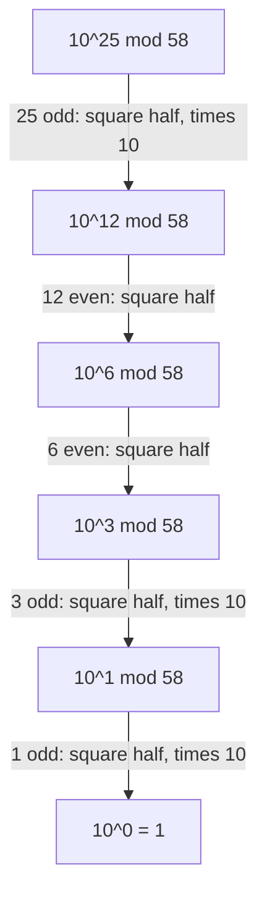

# Efficient Modular Exponentiation

!!! abstract "At a glance"

    - **Problem:** compute $a^b \bmod m$ when $b$ (and $m$) may have hundreds or thousands of bits.
    - **Key idea:** square-and-multiply. Since $a^{b} = (a^{\lfloor b/2 \rfloor})^2 \cdot a^{\,b \bmod 2}$, process one **bit** of $b$ per step instead of one **unit**, and reduce mod $m$ after every multiplication.
    - **Complexity:** $\Theta(\log b)$ modular multiplications, against $\Theta(b)$ naively. Space is $O(1)$ extra.
    - **Used in:** RSA, Diffie–Hellman, DSA and other signature schemes, Miller–Rabin primality testing, modular inverses via Fermat, hashing, and competitive programming (Python: `pow(a, b, m)`).

## Motivation and Problem Context

RSA decryption computes $c^d \bmod n$, where $d$ and $n$ are typically 2048-bit numbers (about 617 decimal digits). Two obstacles appear:

1. **Size of the intermediate.** $c^d$ has around $2^{2048} \cdot 2048$ bits. No computer could ever store it, so "compute the power, then reduce" is impossible.
2. **Number of steps.** Multiplying by $c$ one factor at a time needs $d - 1 \approx 2^{2048}$ multiplications. Even with reduction after each step, that would outlast the universe.

Square-and-multiply fixes both. Intermediates stay below $m^2$, and the step count drops to about $2 \times 2048$ modular multiplications. This is why public-key cryptography is practical at all.

## Problem Formulation

- **Input:** integers $a$ (base), $b \ge 0$ (exponent) and $m \ge 1$ (modulus), with arbitrary precision.
- **Output:** the unique $r$ with $0 \le r < m$ and $r \equiv a^b \pmod m$.
- **Cost model:** count **modular multiplications** (multiply two residues $< m$, then reduce). For $k$-bit $m$, each one costs $M(k)$ bit operations, e.g. $O(k^2)$ schoolbook.
- **Conventions:** $a^0 = 1$, so the answer for $b = 0$ is $1 \bmod m$, which is $0$ when $m = 1$. A negative base is first reduced into $[0, m)$. Negative exponents mean modular inverses (see Alternatives).

## Intuition

The key fact is that reduction commutes with multiplication:

$$
(x \cdot y) \bmod m = \big((x \bmod m)(y \bmod m)\big) \bmod m .
$$

So we may reduce after every multiplication without changing the final residue. Every intermediate then stays below $m^2$.

To cut the number of steps, look at $b$ in binary. For example, $25 = 11001_2 = 16 + 8 + 1$, so

$$
a^{25} = a^{16} \cdot a^{8} \cdot a^{1}, \qquad a^{16} = \big(\big((a^2)^2\big)^2\big)^2 .
$$

Repeated squaring produces $a, a^2, a^4, a^8, a^{16}, \dots$ at one multiplication each. Multiplying together the powers that match the 1-bits of $b$ gives $a^b$. A $k$-bit exponent needs at most $k$ squarings and $k$ multiplications. It is the same "halve the problem each step" idea as binary search, applied to the exponent.

## Baseline Approach

```text
NAIVE-MOD-POW(a, b, m):
    result <- 1
    repeat b times:
        result <- (result * a) mod m
    return result
```

Reducing every step solves the size problem, but this still needs $b$ multiplications, so it is $\Theta(b)$, which is exponential in the **input size** $\log b$. For $b = 10^{18}$ (a typical competitive-programming bound) that is already about 30 years at $10^9$ operations per second. Without the per-step `mod`, it is worse still: the integer $a^b$ has $\Theta(b \log a)$ bits.

!!! warning "Important: polynomial in what?"

    The input size of $b$ is its bit-length $\log_2 b$. An $O(b)$ algorithm is therefore **exponential** in the input size (it is pseudo-polynomial), while $O(\log b)$ is linear in it. The same distinction reappears with pseudo-polynomial dynamic programming algorithms such as 0/1 knapsack.

## Algorithm Design

**Recursive view (decrease and conquer).**

$$
a^b \bmod m =
\begin{cases}
1 \bmod m & b = 0 \\
\left(a^{\lfloor b/2 \rfloor} \bmod m\right)^2 \bmod m & b \text{ even} \\
\left(a^{\lfloor b/2 \rfloor} \bmod m\right)^2 \cdot a \bmod m & b \text{ odd}
\end{cases}
$$

There is one subproblem of half the exponent and $O(1)$ extra multiplications, the same shape as binary search.

**Iterative right-to-left (LSB-first).** Keep `base` $= a^{2^i} \bmod m$ while scanning bit $i$ of $b$ from the least significant end. Whenever bit $i$ is 1, fold `base` into `result`. This is the version libraries and contest code usually write.

**Iterative left-to-right (MSB-first).** Scan bits from the most significant end. Square `result` at every bit (which shifts the exponent built so far left by one), and multiply by $a$ when the bit is 1 (which sets the new low bit to 1). This matches the hand-calculation table below, and it is the form that windowed and ladder variants build on.

Both orders use the same number of squarings and multiplications, up to $\pm 1$.

## Pseudocode

```text
MOD-POW(base, exponent, modulus):          // right-to-left, LSB first
    if modulus = 1: return 0
    result <- 1
    base <- base mod modulus
    while exponent > 0:
        if exponent is odd:
            result <- (result * base) mod modulus
        base <- (base * base) mod modulus
        exponent <- floor(exponent / 2)    // right shift
    return result

MOD-POW-MSB(base, exponent, modulus):      // left-to-right, MSB first
    if modulus = 1: return 0
    base <- base mod modulus
    result <- 1
    for each bit of exponent from most to least significant:
        result <- (result * result) mod modulus
        if bit = 1:
            result <- (result * base) mod modulus
    return result
```

## Worked Example

**Compute $10^{25} \bmod 58$.** Here $25 = 11001_2$.

*Left-to-right (MSB first).* At each bit, square `result`, then multiply by 10 if the bit is 1. The exponent built so far is shown in the last column.

| Bit | Square | Multiply by $a$? | result | Exponent so far |
| --- | --- | --- | --- | --- |
| 1 | $1^2 = 1$ | yes: $1 \cdot 10 = 10$ | 10 | $1_2 = 1$ |
| 1 | $10^2 = 100 \equiv 42$ | yes: $42 \cdot 10 = 420 \equiv 14$ | 14 | $11_2 = 3$ |
| 0 | $14^2 = 196 \equiv 22$ | no | 22 | $110_2 = 6$ |
| 0 | $22^2 = 484 \equiv 20$ | no | 20 | $1100_2 = 12$ |
| 1 | $20^2 = 400 \equiv 52$ | yes: $52 \cdot 10 = 520 \equiv 56$ | **56** | $11001_2 = 25$ |

*Right-to-left (LSB first), as in `MOD-POW`.* `base` runs through $10^{1}, 10^{2}, 10^{4}, \dots \bmod 58$.

| exponent | bit | base (before) | result (after) | base (after squaring) |
| --- | --- | --- | --- | --- |
| 25 | 1 | 10 | $1 \cdot 10 = 10$ | $100 \equiv 42$ |
| 12 | 0 | 42 | 10 | $42^2 = 1764 \equiv 24$ |
| 6 | 0 | 24 | 10 | $24^2 = 576 \equiv 54$ |
| 3 | 1 | 54 | $10 \cdot 54 = 540 \equiv 18$ | $54^2 = 2916 \equiv 16$ |
| 1 | 1 | 16 | $18 \cdot 16 = 288 \equiv 56$ | $16^2 = 256 \equiv 24$ |

Both give $10^{25} \bmod 58 = 56$, using 5 squarings and 3 multiplications instead of 24 multiplications.



## Correctness

**Lemma.** $(xy) \bmod m = ((x \bmod m)(y \bmod m)) \bmod m$.

*Proof.* Write $x = q_1 m + r_1$ and $y = q_2 m + r_2$. Then $xy = m(q_1 q_2 m + q_1 r_2 + q_2 r_1) + r_1 r_2$, so $xy \equiv r_1 r_2 \pmod m$. $\blacksquare$

Consequently, replacing any factor by its residue never changes the result mod $m$.

**Theorem.** `MOD-POW` returns $a^b \bmod m$.

*Loop invariant:* at the start of every iteration, $\text{result} \cdot \text{base}^{\text{exponent}} \equiv a^b \pmod m$.

- **Initialization.** $\text{result} = 1$, $\text{base} = a \bmod m$ and $\text{exponent} = b$. By the lemma, $1 \cdot (a \bmod m)^b \equiv a^b$.
- **Maintenance.** Let $e = $ exponent and $B = $ base.
    - If $e$ is odd, the new values are $\text{result}\cdot B$, $B^2$ and $(e-1)/2$. Then $(\text{result}\cdot B)(B^2)^{(e-1)/2} = \text{result}\cdot B^{e}$.
    - If $e$ is even, the new values are $\text{result}$, $B^2$ and $e/2$. Then $\text{result}\,(B^2)^{e/2} = \text{result}\cdot B^{e}$.
    - The reductions mod $m$ do not change congruence, by the lemma.
- **Termination.** The exponent is a non-negative integer that is halved each iteration, so it reaches 0 after $\lfloor \log_2 b \rfloor + 1$ iterations (0 if $b = 0$). Then the invariant gives $\text{result} \cdot \text{base}^0 = \text{result} \equiv a^b$. Every assignment to `result` is reduced, and `result` starts at $1$ (with the $m = 1$ case handled separately), so $0 \le \text{result} < m$. $\blacksquare$

**MSB-first invariant.** After processing the first $t$ bits, $\text{result} \equiv a^{b_t}$, where $b_t$ is the number formed by those bits. Squaring gives $a^{2b_t}$, and multiplying by $a$ when the next bit is 1 gives $a^{2b_t + 1}$, which is exactly $b_{t+1}$.

## Complexity Analysis

Let $k = \lfloor \log_2 b \rfloor + 1$ be the bit-length of $b \ge 1$.

| Variant | Squarings | Multiplications | Total |
| --- | --- | --- | --- |
| MSB-first (skipping the useless first $1^2$) | $k - 1$ | $\nu(b) - 1$ | $\le 2(k-1)$ |
| LSB-first (as coded) | $k$ | $\nu(b)$ | $\le 2k$ |

Here $\nu(b)$ is the number of 1-bits (the Hamming weight). On average $\nu(b) \approx k/2$, so about $1.5\log_2 b$ modular multiplications.

**Recurrence.** $T(b) = T(\lfloor b/2 \rfloor) + O(1)$ and $T(0) = O(1)$. By the Master Theorem ([Topic 3.5](../unit3/topic5.md)) Case 2 with $a = 1$, $b = 2$, or by unrolling: $T(b) = \Theta(\log b)$ multiplications.

**Bit complexity.** With $k_m$-bit modulus and schoolbook multiplication, each step costs $O(k_m^2)$, so the total is $O(\log b \cdot k_m^2)$. For RSA with $b, m$ of $k$ bits each, that is $O(k^3)$ bit operations, and Karatsuba multiplication (Topic 4.3) reduces it to $O(k^{2.585})$.

**Space.** The iterative versions keep 3 numbers of $O(\log m)$ bits each, i.e. $O(1)$ words of extra space. The recursive version uses $O(\log b)$ stack frames.

## Python Implementation

```python
def mod_pow(base, exponent, modulus):
    """Right-to-left square-and-multiply: (base ** exponent) % modulus."""
    if exponent < 0:
        raise ValueError("exponent must be non-negative")
    if modulus == 1:
        return 0
    result = 1
    base %= modulus                      # also maps a negative base into [0, m)
    while exponent > 0:
        if exponent & 1:                 # current lowest bit is 1
            result = (result * base) % modulus
        base = (base * base) % modulus   # base becomes a^(2^(i+1))
        exponent >>= 1
    return result


def mod_pow_msb_first(base, exponent, modulus):
    """Left-to-right variant; mirrors the hand-calculation table."""
    if modulus == 1:
        return 0
    base %= modulus
    result = 1
    for bit in bin(exponent)[2:]:        # binary digits, most significant first
        result = (result * result) % modulus
        if bit == "1":
            result = (result * base) % modulus
    return result


def mod_inverse_prime(a, p):
    """Inverse of a modulo a prime p via Fermat: a^(p-2)."""
    if a % p == 0:
        raise ValueError("a has no inverse modulo p")
    return mod_pow(a, p - 2, p)


print(mod_pow(10, 25, 58), mod_pow_msb_first(10, 25, 58))   # 56 56
print(pow(10, 25, 58))                                       # 56, built-in
print(pow(7, -1, 15))                                        # 13, built-in inverse (Python 3.8+)
```

- `exponent & 1` and `exponent >>= 1` read and drop the lowest bit. They are the bit-level forms of "is odd" and "halve".
- `base %= modulus` runs once before the loop. It satisfies the invariant's initialization and handles negative bases, because Python's `%` returns a non-negative result for a positive modulus.
- `modulus == 1` is handled up front, because otherwise $b = 0$ would return `1` instead of $1 \bmod 1 = 0$.
- `mod_inverse_prime` is correct only for prime $p$. For a general modulus, use `pow(a, -1, m)`, which raises `ValueError` when $\gcd(a, m) \ne 1$.
- Tested against Python's built-in `pow(a, b, m)` and against `(a ** b) % m` on 5000 random triples (with negative bases, $m = 1$ and $b = 0$), and on 2048-bit random inputs.

## Edge Cases and Pitfalls

| Case / pitfall | What goes wrong | Fix |
| --- | --- | --- |
| $b = 0$ | Some implementations return `base` or skip the `% m` | Return $1 \bmod m$ |
| $m = 1$ | Returns 1 for $b = 0$ | Special-case: always 0 |
| Negative base | In C/C++/Java, `%` can return a negative value | Reduce as `((a % m) + m) % m` |
| Reducing only at the end | Numbers grow to $\Theta(b)$ bits (slow); overflow in fixed-width languages | Reduce after **every** multiplication |
| `result * base` overflows 64-bit when $m > 2^{32}$ | Wrong residue in C++/Java | Use `__int128`, `Math.multiplyHigh`, or Montgomery/mulmod |
| Loop stops at `exponent == 1` | Misses the last bit | Loop while `exponent > 0` |
| Mixing LSB and MSB styles (e.g. squaring `base` while scanning from the MSB) | Computes the wrong power | Pick one variant and keep its invariant |
| Fermat inverse with composite $m$ or $\gcd(a, m) > 1$ | Returns a non-inverse | Use `pow(a, -1, m)` or extended Euclid |
| Reducing the **exponent** mod $m$ | Wrong: exponents live mod the group order, not mod $m$ | Reduce $b$ mod $p-1$ (prime $p$, $\gcd(a,p) = 1$) or mod $\varphi(m)$ |

!!! warning "Important: exponents are not reduced mod m"

    $a^{b} \bmod m \ne a^{\,b \bmod m} \bmod m$ in general. Example: $2^{5} \bmod 3 = 2$, but $2^{5 \bmod 3} = 2^2 = 4 \equiv 1$. By Fermat/Euler, a valid reduction is $b \bmod \varphi(m)$, and only when $\gcd(a, m) = 1$.

## Common Misconceptions

- **"Modular exponentiation means computing $a^b$ and then taking mod."** That is the definition, not the algorithm. For cryptographic sizes, $a^b$ cannot even be stored.
- **"Reducing in the middle changes the answer."** It does not. The lemma $(xy) \bmod m = ((x \bmod m)(y \bmod m)) \bmod m$ guarantees it.
- **"$O(\log b)$ means only some bits of $b$ are examined."** Every bit is examined once. The saving is that work is proportional to the number of bits, not to the value of $b$.
- **"Fast is good enough for crypto."** The textbook loop branches on secret exponent bits, which leaks them through timing. Production code uses constant-time variants.
- **"pow with three arguments is just `(a ** b) % m`."** Built-in `pow(a, b, m)` uses fast modular exponentiation. `a ** b % m` computes the full power first and is hopeless for large $b$.

## Alternatives and Trade-offs

| Approach | Modular multiplications | Notes |
| --- | --- | --- |
| Naive repeated multiplication | $b - 1$ | Only for tiny $b$ |
| Square-and-multiply (binary) | $\le 2\log_2 b$ | Standard; simple |
| Recursive version | $\le 2\log_2 b$ | Easiest to prove; $O(\log b)$ stack |
| $k$-ary / sliding-window exponentiation | $\approx \log_2 b + \log_2 b / (w+1)$ + table | Precompute small odd powers and process $w$ bits at a time; used by crypto libraries |
| Montgomery ladder | Exactly 2 per bit | Same operation sequence for every bit, which makes constant time easier |
| Montgomery multiplication (inside any of the above) | Same count, cheaper each | Replaces division by $m$ with shifts and multiplications |
| Fixed-base precomputation (comb methods) | Fewer, at the cost of memory | When the base is reused, e.g. a Diffie–Hellman generator $g$ |

**Modular inverses.** Use $a^{-1} \equiv a^{p-2} \pmod p$ (Fermat, prime $p$), $a^{\varphi(m)-1}$ (Euler, $\gcd(a, m) = 1$), or the extended Euclidean algorithm, which works for any $m$ with $\gcd(a, m) = 1$ and needs no factorisation. Python 3.8+ provides `pow(a, -1, m)`.

**Use** square-and-multiply whenever $b$ exceeds a few dozen. **Avoid** the plain branching version on secret exponents, and do not bother for tiny constant exponents ($x^2$, $x^3$).

## In Practice

- **Python.** `pow(a, b, m)` is built in and handles arbitrary-precision integers. Since Python 3.8, `pow(a, -1, m)` returns the modular inverse (and negative exponents generally, when the inverse exists).
- **RSA.** Key generation picks primes $p, q$, sets $n = pq$ and chooses $e$ (commonly $65537 = 2^{16} + 1$, which has only two 1-bits, making encryption and verification cheap). Then $d = e^{-1} \bmod \varphi(n)$. Encryption is $c = M^e \bmod n$ and decryption is $M = c^d \bmod n$. Implementations speed up decryption with the CRT (two half-size exponentiations mod $p$ and mod $q$).
- **Diffie–Hellman.** Alice sends $g^x \bmod p$ and Bob sends $g^y \bmod p$. Both compute $g^{xy} \bmod p$. Security rests on the hardness of the discrete logarithm. Elliptic-curve versions (ECDH, ECDSA) replace "multiply" with "add points", and the same algorithm becomes double-and-add.
- **Primality testing.** Miller–Rabin computes $a^{d} \bmod n$ for several bases. It is how libraries generate large random primes for RSA.
- **Side channels.** Timing and power attacks on square-and-multiply have recovered real private keys. Libraries such as OpenSSL use constant-time, windowed exponentiation with Montgomery multiplication.
- **Competitive programming.** $\binom{n}{k} \bmod p$ via factorials and inverse factorials, modular division, hashing with powers of a base, and counting problems "modulo $10^9 + 7$" all use fast powering.

!!! example "Toy RSA (insecure sizes, for intuition)"

    With $p = 61$ and $q = 53$: $n = 3233$ and $\varphi(n) = 3120$. Take $e = 17$, so $d = 17^{-1} \bmod 3120 = 2753$ (`pow(17, -1, 3120)`). Encrypting $M = 65$ gives $c = 65^{17} \bmod 3233 = 2790$. Decrypting gives $2790^{2753} \bmod 3233 = 65$. Since $2753 = 101011000001_2$ (12 bits, five 1-bits), MSB-first decryption needs only 11 squarings and 4 multiplications, not 2752 multiplications.

## Interview and Competitive Programming

**Recognition cues**

- "Answer modulo $10^9 + 7$" with an exponent up to $10^{18}$: `pow(a, b, MOD)`.
- "Divide modulo a prime": multiply by `pow(x, MOD - 2, MOD)`.
- "Exponent given as a huge decimal string": process the digits with $a^{10q + d} = (a^q)^{10}\cdot a^d$, or reduce the exponent mod $p - 1$ when $p$ is prime and $\gcd(a, p) = 1$.
- "Repeated application of the same linear map $n$ times": matrix exponentiation ([Topic 4.7](topic7.md)).
- "Implement pow(x, n)" (LeetCode 50) with negative $n$: compute $x^{|n|}$ and take the reciprocal. Watch out for $n = -2^{31}$ overflowing when negated in fixed-width languages.

**Template (contest form)**

```python
MOD = 10**9 + 7

def binom_table(n_max):
    fact = [1] * (n_max + 1)
    for i in range(1, n_max + 1):
        fact[i] = fact[i - 1] * i % MOD
    inv_fact = [1] * (n_max + 1)
    inv_fact[n_max] = pow(fact[n_max], MOD - 2, MOD)     # one inverse via Fermat
    for i in range(n_max, 0, -1):
        inv_fact[i - 1] = inv_fact[i] * i % MOD
    return fact, inv_fact
```

**Constraint mapping:** $b \le 10^{18}$ means about 60 loop iterations, which is trivially fast even for $10^5$ queries.

## Using AI Assistants Critically

- Assistants often write `return 1` for $b = 0$ without reducing, so the result is wrong when $m = 1$. Test `mod_pow(5, 0, 1) == 0`.
- Watch for generated C++/Java code that multiplies two `long long` residues near $10^{18}$ without `__int128`. The result overflows silently. Ask what the largest intermediate value is.
- LLMs sometimes "optimise" by reducing the exponent mod $m$, or mod $m - 1$ for a composite $m$. Check the Fermat/Euler preconditions.
- Generated crypto code that uses textbook square-and-multiply on secret keys is a security bug, not just a style issue. In real systems, use a vetted library and never hand-rolled RSA.
- Verify against an oracle: Python's built-in `pow(a, b, m)` on random triples including negative $a$, $b = 0$, $m = 1$ and 2048-bit sizes. For complexity, count loop iterations and check they equal $\lfloor \log_2 b \rfloor + 1$.
- Be suspicious of claims that the algorithm is "$O(1)$" or "$O(\log m)$". The step count depends on $b$, and each step costs a big-integer multiplication of size $\log m$.

## Practice

**Beginner**

1. Compute $3^{13} \bmod 7$ by hand with the MSB-first table. *Output:* one integer. *Difficulty:* Beginner.
2. Trace `mod_pow(5, 6, 11)`, giving `(exponent, base, result)` at the top of each iteration. *Difficulty:* Beginner.
3. For $b = 18$, write the binary form and count the squarings and multiplications for each variant. *Difficulty:* Beginner.

**Intermediate**

1. Prove the MSB-first variant correct by induction on the number of bits processed. *Difficulty:* Intermediate.
2. Compute $7^{-1} \bmod 15$ using Euler's theorem ($\varphi(15) = 8$), and verify the result with `pow(7, -1, 15)`. *Difficulty:* Intermediate.
3. Given $q \le 10^5$ queries $(n, k)$ with $n \le 10^6$, answer $\binom{n}{k} \bmod (10^9 + 7)$, each in $O(1)$ after $O(n)$ preprocessing. *Difficulty:* Intermediate.

**Advanced**

1. Implement the Montgomery ladder ($R_0 \leftarrow R_0 R_1$, $R_1 \leftarrow R_1^2$ or the reverse, depending on the bit) and prove its invariant $R_1 = R_0 \cdot a$. *Difficulty:* Advanced.
2. Implement a fixed-window ($w = 4$) exponentiation. Count the multiplications for random 2048-bit exponents and compare with binary square-and-multiply. *Difficulty:* Advanced.
3. Implement deterministic Miller–Rabin for 64-bit integers using `pow(a, d, n)`, and test it against a sieve up to $10^6$. *Difficulty:* Advanced.

**Interview / Competitive Programming**

1. LeetCode 50 "Pow(x, n)": compute $x^n$ for real $x$ and 32-bit signed $n$ in $O(\log |n|)$. *Difficulty:* Medium.
2. LeetCode 372 "Super Pow": compute $a^b \bmod 1337$, where $b$ is given as an array of up to 2000 digits. *Difficulty:* Medium.
3. Given $a, b, c \le 10^{18}$ and a prime $p = 10^9 + 7$, compute $a^{b^{c}} \bmod p$. State when the exponent can be reduced mod $p - 1$. *Difficulty:* CP medium.

## Self-Check Questions

??? question "Q1. Why can't we compute a^b and take the modulus once at the end?"

    For large $b$, $a^b$ has $\Theta(b \log a)$ bits. For a 2048-bit $b$ that is astronomically more than any memory. Even for $b = 10^{18}$ it is far too large. Reducing after every multiplication keeps every intermediate below $m^2$.

??? question "Q2. How many loop iterations does MOD-POW perform, and why does that not depend on the number of 1-bits?"

    Exactly $\lfloor \log_2 b \rfloor + 1$ for $b \ge 1$: one per bit, since the loop halves the exponent until it reaches 0. The number of 1-bits only decides how many *extra* multiplications happen inside those iterations.

??? question "Q3. Where would the invariant proof break if the loop squared base before the conditional multiply?"

    In the odd case. The new state would be $\text{result}\cdot B^2$, $B^2$ and $(e-1)/2$, giving $\text{result}\cdot B^2 \cdot B^{e-1} = \text{result}\cdot B^{e+1}$, which is one factor of $B$ too many. The invariant is not maintained.

??? question "Q4. Compute 2^100 mod 13 using Fermat's little theorem, then confirm with square-and-multiply logic."

    $13$ is prime and $\gcd(2, 13) = 1$, so $2^{12} \equiv 1$. Since $100 = 8 \cdot 12 + 4$, $2^{100} \equiv 2^4 = 16 \equiv 3$. `pow(2, 100, 13)` returns 3.

??? question "Q5. Why is e = 65537 a popular RSA public exponent?"

    It is prime (so $\gcd(e, \varphi(n)) = 1$ is easy to satisfy), large enough to avoid known small-exponent attacks, and $65537 = 2^{16} + 1$ has only two 1-bits. Encryption and verification therefore cost 16 squarings plus 1 multiplication.

??? question "Q6. Your RSA decryption is correct but a security review flags it. Why?"

    Square-and-multiply executes an extra multiplication exactly when a bit of the secret $d$ is 1. Timing or power measurements can reveal those bits. Use a constant-time implementation (Montgomery ladder or fixed windows with constant-time table lookups), as in vetted libraries.

??? question "Q7. Compare Fermat inversion and extended Euclid for computing a^{-1} mod m."

    Fermat needs $m$ prime and costs $O(\log m)$ modular multiplications. Extended Euclid works for any $m$ with $\gcd(a, m) = 1$, needs $O(\log m)$ division steps, and reports when no inverse exists. Python's `pow(a, -1, m)` covers the general case.

## Complexity Summary

| Method | Modular multiplications | Extra space |
| --- | --- | --- |
| Naive | $\Theta(b)$ | $O(1)$ |
| Square-and-multiply (iterative) | $\Theta(\log b)$, $\le 2\lfloor\log_2 b\rfloor + 2$ | $O(1)$ |
| Square-and-multiply (recursive) | $\Theta(\log b)$ | $O(\log b)$ stack |
| Sliding window, width $w$ | $\approx \log_2 b\,(1 + \tfrac{1}{w+1}) + 2^{w-1}$ | $O(2^{w})$ residues |
| Bit cost with $k$-bit modulus, schoolbook | $O(\log b \cdot k^2)$ | $O(k)$ bits |

## Key Takeaways

- $a^b \bmod m$ is computed in $\Theta(\log b)$ modular multiplications by squaring once per bit and multiplying on the 1-bits.
- Reducing after every multiplication is valid because reduction commutes with multiplication, and it keeps every number below $m^2$.
- The loop invariant $\text{result}\cdot\text{base}^{\text{exponent}} \equiv a^b$ proves correctness.
- $O(b)$ is exponential in the input size; $O(\log b)$ is linear in it.
- Exponents may be reduced mod $\varphi(m)$ (when $\gcd(a, m) = 1$), never mod $m$.
- In Python, use `pow(a, b, m)` and `pow(a, -1, m)`. In cryptography, use constant-time library code.
- The same algorithm works in any associative structure: matrices ([Topic 4.7](topic7.md)), polynomials, and elliptic-curve points.
