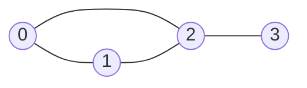

# Matrix Modular Exponentiation

!!! abstract "At a glance"

    - **Problem:** compute $A^n \bmod m$ (entrywise) for a $D \times D$ matrix $A$ and huge $n$ (up to $10^{18}$).
    - **Key idea:** the square-and-multiply algorithm of [Topic 4.6](topic6.md) works in any associative setting. Replace scalar multiplication by matrix multiplication and $1$ by the identity matrix $I$.
    - **Complexity:** $\Theta(\log n)$ matrix multiplications, i.e. $O(D^3 \log n)$ with schoolbook multiplication (or $O(D^{\log_2 7}\log n)$ with Strassen, Topic 4.2).
    - **Used for:** the $n$-th Fibonacci number or any constant-coefficient linear recurrence, counting walks of length $n$ in a graph, $n$-step Markov chain transitions, and repeated affine transformations.

## Motivation and Problem Context

Many processes apply the **same linear update** over and over:

- Fibonacci: $(F_{k+1}, F_k) \mapsto (F_{k+1} + F_k,\ F_{k+1})$.
- A population model, or a dynamic programming that advances a fixed-size state vector by one step.
- The number of ways to reach each vertex of a graph after one more step.

If the update is $v_{k+1} = M v_k$, then $v_n = M^n v_0$. Iterating costs $\Theta(n)$ steps, which is fine for $n = 10^6$ and hopeless for $n = 10^{18}$, a typical bound in contests and in some combinatorics and cryptography settings. Matrix exponentiation computes $M^n$ in about $2\log_2 n$ matrix products, which is around 120 products for $n = 10^{18}$.

**Fibonacci via the Q-matrix.** With $F_0 = 0$ and $F_1 = 1$,

$$
Q = \begin{bmatrix} 1 & 1 \\ 1 & 0 \end{bmatrix}, \qquad
Q^{n} = \begin{bmatrix} F_{n+1} & F_n \\ F_n & F_{n-1} \end{bmatrix} \quad (n \ge 1).
$$

**Counting walks.** If $A$ is the adjacency matrix of a graph, then $(A^n)_{ij}$ is the number of walks of length exactly $n$ from $i$ to $j$.

**General linear recurrences.** $a_k = c_1 a_{k-1} + c_2 a_{k-2} + \dots + c_D a_{k-D}$ becomes a $D \times D$ **companion matrix** acting on the state $(a_{k-1}, \dots, a_{k-D})^\top$.

## Problem Formulation

- **Input:** a square $D \times D$ integer matrix $A$, an integer $n \ge 0$, and a modulus $m \ge 1$.
- **Output:** $A^n \bmod m$, the $D \times D$ matrix whose entries are those of $A^n$ reduced into $[0, m)$.
- **Conventions:** $A^0 = I$ (reduced mod $m$, so the all-zero matrix when $m = 1$). $A$ must be square for $A \cdot A$ to be defined. Negative $n$ would need a modular matrix inverse and is out of scope.
- **Cost model:** a $D \times D$ matrix product costs $D^3$ scalar multiplications and additions (schoolbook), each followed by reduction mod $m$.

## Intuition

Nothing in the scalar algorithm used anything special about numbers except:

1. **Associativity:** $(XY)Z = X(YZ)$, so $A^{i}A^{j} = A^{i+j}$ however the product is grouped. Squaring $A^{k}$ therefore gives $A^{2k}$.
2. **An identity element:** $I$ plays the role of $1$.
3. **Reduction compatible with the operations:** each entry of $XY$ is a sum of products, and both $+$ and $\times$ commute with $\bmod\ m$.

Matrices have all three. So $A^{n} = \prod_{i\,:\,b_i = 1} A^{2^i}$, exactly as for scalars.

**What about commutativity?** Matrix multiplication is *not* commutative in general. That does not matter here, because every factor that appears is a power of the **same** matrix $A$, and powers of one matrix always commute: $A^iA^j = A^{i+j} = A^jA^i$. So `result * A` versus `A * result`, and MSB-first versus LSB-first, all give the same answer.

!!! warning "Important: the commutativity escape is narrow"

    As soon as a **different** matrix $B$ enters the computation (for example, when applying the power to an initial-state vector, or composing two different transitions), order matters again. $A^n v$ is not $v^\top A^n$, and $A^nB \ne BA^n$ in general. Getting the order wrong produces a valid-looking, wrong matrix, with no error.

## Baseline Approach

| Method | Time | Problem |
| --- | --- | --- |
| Recursive Fibonacci, no memo | $\Theta(\varphi^n)$ | Exponential |
| Iterate the recurrence $n$ times | $\Theta(nD)$ (or $\Theta(nD^2)$ as matrix–vector steps) | Linear in $n$: about 30 years at $10^9$/s for $n = 10^{18}$ |
| Multiply $A$ by itself $n - 1$ times | $\Theta(nD^3)$ | Worse still |
| Binet's formula $F_n = (\varphi^n - \psi^n)/\sqrt5$ in floating point | $O(1)$ operations | A double has 53 bits, so results become wrong from about $n \approx 71$, and there is no direct mod-$m$ form |

The bottleneck is that every step applies $A$ **once**. Squaring applies it $2^i$ times per step.

## Algorithm Design

Reuse square-and-multiply:

- `result` starts at $I$ (the matrix analogue of $1$).
- Scan the bits of $n$ from most to least significant. Square `result` at every bit, and multiply by $A$ when the bit is 1.
- Reduce every entry mod $m$ after every product, so entries stay below $m$ and products stay below $D m^2$.

**Modelling a linear recurrence (the real skill).** For $a_k = \sum_{j=1}^{D} c_j a_{k-j}$ with initial values $a_0, \dots, a_{D-1}$, define the state $s_k = (a_k, a_{k-1}, \dots, a_{k-D+1})^\top$. Then

$$
s_{k+1} =
\underbrace{\begin{bmatrix}
c_1 & c_2 & \cdots & c_{D-1} & c_D \\
1 & 0 & \cdots & 0 & 0 \\
0 & 1 & \cdots & 0 & 0 \\
\vdots & & \ddots & & \vdots \\
0 & 0 & \cdots & 1 & 0
\end{bmatrix}}_{C\ (\text{companion matrix})}
s_k ,
\qquad s_{n} = C^{\,n-D+1}\, s_{D-1}.
$$

The first row computes the new term, and the identity sub-diagonal shifts the older terms down. For example, Tribonacci $T_k = T_{k-1} + T_{k-2} + T_{k-3}$ uses $C = \begin{bmatrix}1&1&1\\1&0&0\\0&1&0\end{bmatrix}$.

**Affine terms.** For $a_k = a_{k-1} + a_{k-2} + c$, append a constant 1 to the state: $(a_k, a_{k-1}, 1)^\top$, with matrix $\begin{bmatrix}1&1&c\\1&0&0\\0&0&1\end{bmatrix}$. The same augmentation handles sums of terms, polynomial terms in $k$, and so on.

## Pseudocode

```text
MAT-MULT-MOD(X, Y, m):                  // X: r x q, Y: q x c
    Z <- r x c zero matrix
    for i <- 0 to r-1:
        for k <- 0 to q-1:
            for j <- 0 to c-1:
                Z[i][j] <- (Z[i][j] + X[i][k] * Y[k][j]) mod m
    return Z

MAT-POW-MOD(A, n, m):                   // A is D x D, n >= 0
    result <- I_D mod m
    for each bit of n from most to least significant:
        result <- MAT-MULT-MOD(result, result, m)     // square
        if bit = 1:
            result <- MAT-MULT-MOD(result, A, m)      // multiply by base
    return result
```

## Worked Example

**Compute $Q^{10} \bmod 1000$** for $Q = \begin{bmatrix}1&1\\1&0\end{bmatrix}$. Here $10 = 1010_2$.

| Bit | Square | Multiply by $Q$? | result | Power |
| --- | --- | --- | --- | --- |
| 1 | $I^2 = I$ | yes | $\begin{bmatrix}1&1\\1&0\end{bmatrix}$ | $Q^1$ |
| 0 | $\begin{bmatrix}1&1\\1&0\end{bmatrix}^2 = \begin{bmatrix}2&1\\1&1\end{bmatrix}$ | no | $\begin{bmatrix}2&1\\1&1\end{bmatrix}$ | $Q^2$ |
| 1 | $\begin{bmatrix}2&1\\1&1\end{bmatrix}^2 = \begin{bmatrix}5&3\\3&2\end{bmatrix}$ | yes: $\begin{bmatrix}5&3\\3&2\end{bmatrix}Q = \begin{bmatrix}8&5\\5&3\end{bmatrix}$ | $\begin{bmatrix}8&5\\5&3\end{bmatrix}$ | $Q^5$ |
| 0 | $\begin{bmatrix}8&5\\5&3\end{bmatrix}^2 = \begin{bmatrix}89&55\\55&34\end{bmatrix}$ | no | $\begin{bmatrix}89&55\\55&34\end{bmatrix}$ | $Q^{10}$ |

All entries are below 1000, so the reduction changes nothing. Reading off the result, $F_{11} = 89$, $F_{10} = 55$ and $F_9 = 34$. That took 4 squarings and 2 multiplications, against 9 multiplications naively. The gap becomes enormous for large $n$: $n = 10^{18}$ needs about 60 squarings and at most 60 multiplications.

**Counting walks.** For the graph below, with adjacency matrix $A$ (vertices $0..3$):



$$
A = \begin{bmatrix}0&1&1&0\\1&0&1&0\\1&1&0&1\\0&0&1&0\end{bmatrix}, \qquad
A^3 = \begin{bmatrix}2&3&4&1\\3&2&4&1\\4&4&2&3\\1&1&3&0\end{bmatrix}.
$$

$(A^3)_{0,0} = 2$: the closed walks of length 3 from vertex 0 are $0\to1\to2\to0$ and $0\to2\to1\to0$, the triangle in each direction. $(A^3)_{3,3} = 0$, because vertex 3 lies on no triangle and a closed walk of odd length needs an odd cycle.

## Correctness

**Lemma 1 (powers commute).** For any square $A$ and $i, j \ge 0$, $A^iA^j = A^{i+j} = A^jA^i$.
*Proof.* By associativity, both sides are the product of $i + j$ copies of $A$. $\blacksquare$

**Lemma 2 (reduction is compatible).** $(XY) \bmod m = ((X \bmod m)(Y \bmod m)) \bmod m$, entrywise.
*Proof.* $(XY)_{ij} = \sum_k X_{ik}Y_{kj}$. Reduction mod $m$ commutes with $+$ and $\times$ ([Topic 4.6](topic6.md)). $\blacksquare$

**Theorem.** `MAT-POW-MOD` returns $A^n \bmod m$.

Let $n = (b_{k-1} \dots b_0)_2$, and let $n_t$ be the integer formed by the first $t$ bits read from the MSB. So $n_0 = 0$, $n_{t+1} = 2n_t + b_{k-1-t}$ and $n_k = n$.

*Invariant:* after processing $t$ bits, $\text{result} \equiv A^{n_t} \pmod m$.

- **Initialization** ($t = 0$): $\text{result} = I = A^0$.
- **Maintenance.** Squaring gives $A^{n_t}A^{n_t} = A^{2n_t}$, by Lemma 1. If the bit is 1, multiplying by $A$ gives $A^{2n_t+1}$. Either way the result is $A^{n_{t+1}}$, and Lemma 2 makes the intermediate reductions harmless.
- **Termination.** After $k$ bits, $n_k = n$. For $n = 0$ the loop body runs once with bit $0$ (`bin(0)` is `"0"`): $I \cdot I = I$, which is correct.

**Walk counting.** By induction on $n$: $(A^{n})_{ij} = \sum_k (A^{n-1})_{ik} A_{kj}$. Every walk of length $n$ from $i$ to $j$ is a walk of length $n-1$ from $i$ to some $k$, followed by an edge from $k$ to $j$. These cases are disjoint over $k$, so the counts add.

**Companion matrix.** The first row of $C s_k$ equals $\sum_j c_j a_{k+1-j} = a_{k+1}$, and the remaining rows copy $a_k, \dots, a_{k-D+2}$ down by one position. So $C s_k = s_{k+1}$, and by induction $s_n = C^{\,n-D+1}s_{D-1}$.

## Complexity Analysis

- **Number of products:** $\lfloor\log_2 n\rfloor + 1$ squarings and at most that many multiplications, so $\Theta(\log n)$.
- **Cost per product:** $D^3$ multiply-adds (schoolbook).
- **Total:** $O(D^3\log n)$ time and $O(D^2)$ space (a constant number of matrices).

**Recurrence.** $T(n) = T(\lfloor n/2\rfloor) + \Theta(D^3)$ unrolls to $\Theta(D^3\log n)$. This is the Master Theorem Case 2 shape with $a = 1$, $b = 2$, with the $D^3$ factor treated as a constant per level.

**Recurrence evaluation.** $O(D^3\log n)$ for the matrix power, plus $O(D^2)$ to apply it to the initial state vector.

**When is it worth it?** Plain iteration costs $\Theta(nD)$. Matrix power wins when $D^3\log n \ll nD$, i.e. $D^2\log n \ll n$. For $D = 2$ it wins almost immediately. For $D = 100$ and $n = 10^5$, iteration ($10^7$) beats the matrix power ($10^6 \cdot 17 \approx 1.7 \times 10^7$).

**Faster multiplication.** Strassen (Topic 4.2) gives $O(D^{\log_2 7}\log n) \approx O(D^{2.807}\log n)$, but only pays off for large $D$, because of its constants and the extra subtractions mod $m$. For linear recurrences of order $D$, there are $O(D^2\log n)$ methods (polynomial arithmetic modulo the characteristic polynomial, the Kitamasa method), and $O(D\log D\log n)$ with FFT-based polynomial multiplication (Topic 4.4).

## Python Implementation

```python
def identity_matrix(d):
    return [[1 if i == j else 0 for j in range(d)] for i in range(d)]


def mat_mult_mod(X, Y, m):
    """(X @ Y) mod m for an r x q matrix X and a q x c matrix Y."""
    rows, inner, cols = len(X), len(Y), len(Y[0])
    result = [[0] * cols for _ in range(rows)]
    for i in range(rows):
        for k in range(inner):
            xik = X[i][k]
            if xik == 0:
                continue                    # skip zero entries (common in companion/adjacency matrices)
            for j in range(cols):
                result[i][j] = (result[i][j] + xik * Y[k][j]) % m
    return result


def matrix_mod_pow(A, n, m):
    """A^n mod m by left-to-right binary exponentiation."""
    d = len(A)
    if any(len(row) != d for row in A):
        raise ValueError("matrix must be square")
    if n < 0:
        raise ValueError("exponent must be non-negative")
    result = [[x % m for x in row] for row in identity_matrix(d)]   # handles m = 1
    for bit in bin(n)[2:]:
        result = mat_mult_mod(result, result, m)
        if bit == "1":
            result = mat_mult_mod(result, A, m)
    return result


def fibonacci_mod(n, m):
    """F(n) mod m, using Q^n = [[F(n+1), F(n)], [F(n), F(n-1)]]."""
    return matrix_mod_pow([[1, 1], [1, 0]], n, m)[0][1]


def linear_recurrence_mod(coeffs, initial, n, m):
    """a(n) mod m for a(k) = c1*a(k-1) + ... + cD*a(k-D);
    coeffs = [c1, ..., cD], initial = [a(0), ..., a(D-1)]."""
    d = len(coeffs)
    if n < d:
        return initial[n] % m
    companion = [list(coeffs)] + [[1 if j == i else 0 for j in range(d)]
                                  for i in range(d - 1)]
    power = matrix_mod_pow(companion, n - d + 1, m)
    state = [[initial[d - 1 - i]] for i in range(d)]      # column [a(D-1), ..., a(0)]
    return mat_mult_mod(power, state, m)[0][0]


print(matrix_mod_pow([[1, 1], [1, 0]], 10, 1000))    # [[89, 55], [55, 34]]
print(fibonacci_mod(10**18, 10**9 + 7))              # 209783453
print(linear_recurrence_mod([1, 1, 1], [0, 0, 1], 10, 10**9))   # Tribonacci T(10) = 81
```

- `mat_mult_mod` uses the $i$-$k$-$j$ loop order. Hoisting `X[i][k]` out of the inner loop is cleaner and more cache-friendly than $i$-$j$-$k$. It also accepts rectangular operands, which `linear_recurrence_mod` needs for the matrix–vector product.
- `result` starts at $I \bmod m$, not $A$. Starting at $A$, that initial value is squared once per bit, so the loop returns $A^{2^k + n}$ ($k$ = bit-length of $n$), which is wrong even for $n = 0$.
- The power is multiplied **on the left** of the state column vector (`power @ state`). That order matters, because `state` is not a power of the companion matrix.
- Tested against: a naive Fibonacci loop for $n < 500$, brute-force iteration of random recurrences of order 1–4 (with negative coefficients) for random moduli, brute-force walk enumeration for lengths 1–6, $n = 0$ with $m = 1$, and non-square input.

## Edge Cases and Pitfalls

| Case / pitfall | What goes wrong | Fix |
| --- | --- | --- |
| `result = A` initially | Returns $A^{2^k + n}$ instead of $A^n$ | Start from $I$ |
| $n = 0$ | Must return $I$ | Handled by starting at $I$ |
| $m = 1$ | $I$ is not reduced, so a nonzero diagonal is returned | Reduce $I$ mod $m$ (all zeros) |
| Reducing only at the end | Entries grow to $\Theta(n)$ bits; slow, or overflow in C++/Java | Reduce after every product |
| `X[i][k] * Y[k][j]` near $10^{18}$ in C++/Java | 64-bit overflow when $m \approx 10^{18}$ | `__int128`, or keep $m < 2^{31}$ so products fit |
| Accumulating $D$ products before reducing | Sum of $D$ terms of size $m^2$ overflows | Reduce inside the inner loop, or bound $D m^2$ |
| Transposed companion matrix or reversed state order | Plausible but wrong sequence | Check $C s_k = s_{k+1}$ on the first few terms by hand |
| Wrong exponent ($n$ vs $n - D + 1$) | Off-by-one term index | Test small $n$ against brute force |
| Non-square $A$ | Index error deep inside multiplication | Validate up front |
| Using `numpy.linalg.matrix_power` with large entries | int64 overflow or float rounding; no modulus | Use exact Python ints with reduction, or `dtype=object` |

!!! warning "Important: the three lines examiners check"

    `result` starts at $I$ (reduced mod $m$), every product is reduced entrywise, and the loop squares at **every** bit but multiplies by $A$ only on 1-bits. Getting any one of these wrong gives a plausible but incorrect matrix.

## Common Misconceptions

- **"Matrix multiplication is not commutative, so square-and-multiply might fail for matrices."** It cannot fail: only associativity is used, and powers of the same matrix commute.
- **"$(A^n)_{ij}$ counts paths."** It counts **walks**, which may repeat vertices and edges. Counting simple paths is #P-hard in general and not a matrix power.
- **"Mod applies to the matrix as a whole."** It is applied to every entry independently.
- **"Matrix exponentiation is always better than iterating."** Only when $n$ is large relative to $D^2$. For a big $D$ and a modest $n$, plain iteration is faster.
- **"Binet's formula makes Fibonacci $O(1)$."** Only with exact real arithmetic. With 64-bit floats, it is wrong from about $F_{71}$ on, and $F_n$ itself has $\Theta(n)$ bits.

## Alternatives and Trade-offs

| Approach | Time | Exact mod $m$? | Notes |
| --- | --- | --- | --- |
| Iterate recurrence | $\Theta(nD)$ | Yes | Simplest; best for small $n$ |
| Matrix power (this page) | $\Theta(D^3\log n)$ | Yes | General; easy to model |
| Matrix power + Strassen | $\Theta(D^{2.807}\log n)$ | Yes | Only for large $D$ |
| Fast doubling (Fibonacci only) | $\Theta(\log n)$ | Yes | $F_{2k} = F_k(2F_{k+1} - F_k)$, $F_{2k+1} = F_k^2 + F_{k+1}^2$; fewer multiplications than $2\times2$ matrices |
| Kitamasa / polynomial mod char. poly | $O(D^2\log n)$, or $O(D\log D\log n)$ with FFT | Yes | For high-order linear recurrences |
| Binet / closed form | $O(1)$ floating point | No | Small $n$, approximate only |
| Pisano period ($F_n \bmod m$ is periodic) | Find the period, then index | Yes | Small $m$; the period is at most $6m$ |

**Use** matrix exponentiation when the process is a fixed linear (or affine) map applied $n$ times with large $n$ and small $D$, and the answer is needed exactly mod $m$. **Avoid it** for nonlinear recurrences ($a_k = a_{k-1}^2 + 1$), for time-varying transitions (unless they repeat with a fixed period, in which case you exponentiate the product of one period), and when $D$ is large relative to $\log n$.

## In Practice

- **Competitive programming.** This is the standard tool for "$n \le 10^{18}$, answer mod $10^9 + 7$" with linear recurrences: tiling counts, DP with a small state that repeats identically each step, and walk counts in small graphs.
- **Markov chains.** The $n$-step transition matrix is $P^n$. In floating point, it is computed by repeated squaring or by eigendecomposition (e.g. PageRank-style or queueing analyses), with no modulus.
- **Graph algorithms.** Over the $(\min, +)$ semiring, "matrix power" computes shortest paths that use at most $n$ edges. Repeated squaring gives all-pairs shortest paths in $O(V^3\log V)$, an associativity-based generalisation of this page.
- **Graphics and robotics.** Repeated application of the same affine transform (rotation plus translation in homogeneous coordinates) is a matrix power. It uses floats rather than mod $m$.
- **Libraries.** NumPy's `numpy.linalg.matrix_power` uses repeated squaring but works in fixed-width or floating types, with no modulus. For exact modular results, write the loop yourself with Python integers (or `dtype=object` arrays), or use a computer algebra system (SymPy, SageMath) for exact big-integer matrices.

## Interview and Competitive Programming

**Recognition cues**

- "$n$ up to $10^{18}$", "answer mod $10^9 + 7$", and a recurrence whose next term is a fixed linear combination of the last $D$ terms ($D \le 100$ or so).
- "Number of ways to tile a $2 \times n$ / $3 \times n$ board" or "number of strings of length $n$ avoiding a pattern": a DP whose transitions do not depend on position, so the DP step is a matrix.
- "Number of walks of length $k$" in a graph with $V \le 100$ vertices: the adjacency matrix power.
- "Apply this operation $k$ times" where the operation is linear in the state.

**Recipe**

1. Write the one-step DP or recurrence on a state vector $s$.
2. Build $M$ with $s_{k+1} = M s_k$, adding a constant-1 coordinate for affine terms.
3. Verify $M$ on the first few steps against brute force.
4. Compute $M^{n} s_0$ (or the shifted exponent), reducing mod $m$ throughout.

**Constraint mapping.** $D^3 \log n$ should be at most about $10^8$. For $n = 10^{18}$ ($\log n \approx 60$), that allows $D \lesssim 100$ in C++. In Python, keep $D \lesssim 20$–$30$ or use NumPy with `dtype=object`.

**Trap:** with many queries on the same matrix, precompute $M^{2^i}$ for $i \le 60$ once. Each query then multiplies a **vector** by $O(\log n)$ precomputed matrices, costing $O(D^2\log n)$ instead of $O(D^3\log n)$.

## Using AI Assistants Critically

- LLM-generated companion matrices are often transposed, or use a reversed state order. Always check the first $D + 3$ terms against a brute-force loop.
- Watch for `result = A` initialisation, or an exponent off by one ($n$ vs $n - 1$ vs $n - D + 1$). Test $n = 0, 1, 2$ explicitly.
- Generated code commonly uses `numpy.linalg.matrix_power` "with mod at the end". That silently overflows int64 (or loses precision in float) for large $n$. Ask how the intermediate values stay bounded.
- In C++ answers, check that `a[i][k] * b[k][j]` is computed in 64-bit (or 128-bit) arithmetic before the `%`.
- When asked to "count paths", assistants may present $A^n$ without noting that it counts **walks**. Check the problem's definition.
- Sanity-check the claimed complexity: if the reported time grows linearly when you double $n$, the code is iterating, not squaring.

## Practice

**Beginner**

1. By hand, compute $Q^{6} \bmod 10$ for the Fibonacci Q-matrix using the MSB-first method, and read off $F_6 \bmod 10$. *Difficulty:* Beginner.
2. Trace `matrix_mod_pow` for $A = \begin{bmatrix}2&0\\0&3\end{bmatrix}$, $n = 5$, $m = 1000$, and confirm $\begin{bmatrix}32&0\\0&243\end{bmatrix}$. *Difficulty:* Beginner.
3. Explain why a $1 \times 1$ matrix power is exactly scalar modular exponentiation. *Difficulty:* Beginner.

**Intermediate**

1. Build the matrix for $a_k = 2a_{k-1} + a_{k-2}$ with $a_0 = 0$, $a_1 = 1$ (Pell numbers), compute $a_{50}$ exactly, and verify it by iteration. *Difficulty:* Intermediate.
2. For $a_k = a_{k-1} + a_{k-2} + 3$, design a $3 \times 3$ matrix with a constant coordinate and verify the first 10 terms. *Difficulty:* Intermediate.
3. Prove $\det(Q^n) = (-1)^n$ and deduce Cassini's identity $F_{n+1}F_{n-1} - F_n^2 = (-1)^n$. *Difficulty:* Intermediate.

**Advanced**

1. Count binary strings of length $n \le 10^{18}$ with no two consecutive 1s, mod $10^9 + 7$. Derive the $2 \times 2$ transition matrix from the DP. *Difficulty:* Advanced.
2. Replace $(+, \times)$ by $(\min, +)$ and show that "squaring" the weight matrix $\lceil\log_2 (V-1)\rceil$ times gives all-pairs shortest paths. Identify which algebraic properties the correctness proof needs. *Difficulty:* Advanced.
3. Implement fast doubling for $F_n \bmod m$, and compare the number of big-integer multiplications with the $2 \times 2$ matrix method. *Difficulty:* Advanced.

**Interview / Competitive Programming**

1. Given $n \le 10^{18}$, output $F_n \bmod (10^9 + 7)$. *Constraints:* 1 s. *Difficulty:* CP easy.
2. Given a directed graph with $V \le 50$ vertices, vertices $s$ and $t$, and $k \le 10^{9}$, output the number of walks of length exactly $k$ from $s$ to $t$, mod $10^9 + 7$. *Difficulty:* CP medium.
3. Count the ways to tile a $3 \times n$ board with $2 \times 1$ dominoes for $n \le 10^{18}$, mod $10^9 + 7$. Derive a linear recurrence first. *Difficulty:* CP hard.

## Self-Check Questions

??? question "Q1. Which algebraic property does the correctness proof actually need, and which does it not?"

    It needs associativity (so that $A^iA^j = A^{i+j}$), an identity element $I$, and compatibility of mod with $+$ and $\times$. It does not need general commutativity, because only powers of the same $A$ are multiplied, and those commute.

??? question "Q2. What is the cost of computing F(10^18) mod p by matrix power vs iteration?"

    The matrix power needs about $60$ squarings plus at most $60$ multiplications of $2 \times 2$ matrices, roughly 1000 scalar multiplications. Iteration needs $10^{18}$ additions, which is infeasible.

??? question "Q3. A colleague initialises result = A. For which n is the output still correct?"

    The initial $A$ is squared once per bit, so with $k$ = bit-length of $n$ the loop returns $A^{2^k + n}$. For example, $n = 1$ gives $A^3$ and $n = 0$ gives $A^2$. It is correct only for special matrices where $A^{2^k+n} = A^n$, such as $A = I$, or idempotent $A$ ($A^2 = A$) with $n \ge 1$. For the Fibonacci matrix it is wrong for every $n$.

??? question "Q4. Why is (A^n)_{ij} the number of walks and not the number of simple paths?"

    The inductive step extends every length-$(n-1)$ walk ending at $k$ by an edge $k \to j$, with no check for revisiting vertices. So repeated vertices are counted. Simple-path counting has no such product structure.

??? question "Q5. When should you prefer plain iteration over matrix exponentiation?"

    When $n$ is small relative to $D^2$, i.e. $nD \lesssim D^3\log n$. Examples: $n \le 10^6$ with any reasonable $D$, or very large $D$ (hundreds) with moderate $n$.

??? question "Q6. How do you handle a recurrence a_k = a_{k-1} + k?"

    Augment the state to $(a_k, k, 1)$. Then $a_{k+1} = a_k + (k+1) = a_k + k + 1$, $k + 1 = k + 1$, and $1 = 1$, giving $M = \begin{bmatrix}1&1&1\\0&1&1\\0&0&1\end{bmatrix}$ acting on $(a_k, k, 1)^\top$.

??? question "Q7. Your code is right for small n but wrong for large n only in C++. Likely bug?"

    The products `x * y` of residues near $m \approx 10^9$ fit in 64 bits, but summing $D$ such products before reducing, or using 32-bit `int`, overflows. Reduce after each multiply-add, and use `long long` (or `__int128` for moduli near $10^{18}$).

## Complexity Summary

| Approach | Time | Space |
| --- | --- | --- |
| Naive $A \cdot A \cdots A$ | $\Theta(nD^3)$ | $O(D^2)$ |
| Iterating the recurrence | $\Theta(nD)$ | $O(D)$ |
| Binary matrix exponentiation | $\Theta(D^3\log n)$ | $O(D^2)$ |
| + Strassen per product | $\Theta(D^{\log_2 7}\log n)$ | $O(D^2)$ |
| Many queries, precomputed $M^{2^i}$ | $O(D^3\log n)$ once, then $O(D^2\log n)$ per query | $O(D^2\log n)$ |
| $D = 1$ (scalar, [Topic 4.6](topic6.md)) | $\Theta(\log n)$ | $O(1)$ |

## Key Takeaways

- Square-and-multiply works in any associative structure with an identity. For matrices that means $\Theta(\log n)$ products.
- Correctness uses associativity only. Powers of one matrix commute, so general non-commutativity is harmless here, but not once a different matrix or vector is involved.
- Start from $I$ (reduced mod $m$), reduce every entry after every product, and validate that $A$ is square.
- The real skill is **modelling**: turn a recurrence or DP into $s_{k+1} = Ms_k$ (companion matrix, plus a constant coordinate for affine terms).
- $(A^n)_{ij}$ counts walks of length $n$, not simple paths.
- The cost is $O(D^3\log n)$, worthwhile when $n \gg D^2$. Strassen helps only for large $D$.
