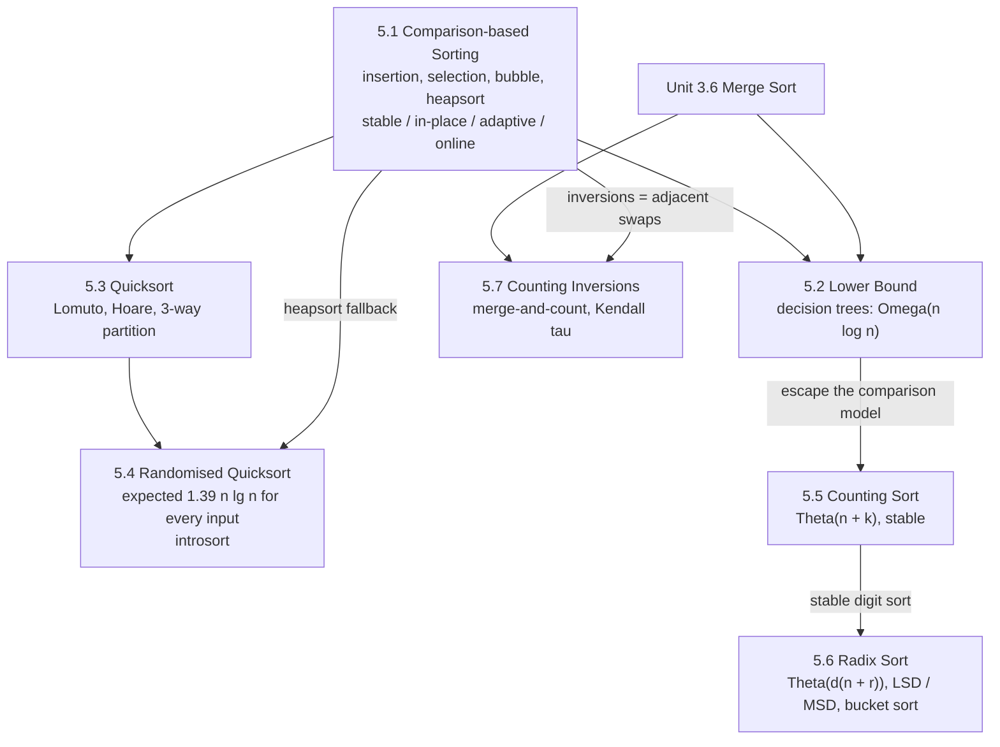

# Sorting Algorithms and Analysis

!!! success "Learning Outcome"

     
     - {{ lo }}
     

## Why This Unit Matters

Sorting is the most heavily used algorithmic primitive in software. Databases sort to answer `ORDER BY`, build indexes and run sort-merge joins; search engines and recommender systems rank results; compilers, build tools, version control and data pipelines sort constantly; and a large share of algorithms in later units (greedy scheduling, Kruskal's MST, sweep-line geometry, binary search) begin with "sort the input". Every mainstream language library ships a carefully engineered hybrid sort: Timsort with the Powersort merge policy in CPython, introsort in libstdc++'s `std::sort`, pdqsort descendants in Rust and Go, dual-pivot quicksort and TimSort in Java.

This unit is about **choosing and justifying** a sort, not memorising one. You will learn why no comparison sort can beat $\Omega(n \log n)$, why quicksort is fast despite a quadratic worst case, how randomisation and introsort remove that worst case, how counting and radix sort beat $n \log n$ by leaving the comparison model, and how a small change to merge sort counts inversions to compare rankings. In interviews, sorting questions test exactly these skills: recognising when stability matters, when a linear-time sort applies, and how partitioning and merging generalise to selection, top-$k$ and pair-counting problems.

## Prerequisites

- Asymptotic notation and growth rates: [Unit 2.1](../unit2/topic1.md).
- The model of computation (comparison model vs word-RAM): [Unit 2.2](../unit2/topic2.md).
- Recurrences and their solution: [Recursion Trees](../unit3/topic3.md), [Substitution](../unit3/topic4.md), [Master Method](../unit3/topic5.md).
- [Merge Sort Analysis](../unit3/topic6.md): this unit assumes merge sort and builds on it rather than re-teaching it.
- Probability, expectation, indicator random variables and harmonic numbers: [Mathematical Foundations](../unit1/topic3.md).
- Divide and conquer design: [Unit 4.1](../unit4/topic1.md).

## Topic Map

| Topic | Core question | Key result |
| --- | --- | --- |
| [5.1 Comparison-based Sorting Analysis](topic1.md) | How do the classical comparison sorts work, and which properties (stable, in-place, adaptive, online) does each have? | Insertion sort $\Theta(n + I)$; selection sort $\Theta(n^2)$ with $\le n-1$ swaps; heapsort $\Theta(n \log n)$ in place with $O(n)$ build-heap |
| [5.2 Lower Bound for Sorting](topic2.md) | How fast can any comparison sort possibly be? | Decision tree with $\ge n!$ leaves has height $\ge \lg n! = \Theta(n \log n)$; also for average and randomised cases |
| [5.3 Quicksort Analysis and Performance](topic3.md) | Why is quicksort fast, and when does it fail? | Best/average $\Theta(n \log n)$ ($2(n+1)H_n - 4n$ comparisons on random input), worst $\Theta(n^2)$; 3-way partition for duplicates; $O(\log n)$ stack via smaller-side recursion |
| [5.4 Randomised Quicksort and Analysis](topic4.md) | Can we remove dependence on the input order? | Expected $2(n+1)H_n - 4n$ comparisons for **every** input (indicator variables); Las Vegas; introsort guarantees $O(n \log n)$ |
| [5.5 Counting Sort](topic5.md) | Can small integer keys be sorted without comparisons? | $\Theta(n + k)$ time and space, stable via prefix sums and right-to-left placement |
| [5.6 Radix Sort](topic6.md) | How do we sort keys with a large range in linear time? | LSD with stable digit sort: $\Theta(d(n + r))$; $\Theta(n)$ for $O(\log n)$-bit keys with $r \approx n$; correctness by induction on digits |
| [5.7 Counting Inversions](topic7.md) | How unsorted is an array, and how similar are two rankings? | Merge-and-count in $\Theta(n \log n)$; BIT alternative; Kendall tau distance |

## How to Study This Unit

1. Start with **5.1** and fix the vocabulary: stable, in-place, adaptive, online, inversion. Every later comparison table uses these terms.
2. Read **5.2** next: it explains why the "efficient" sorts all stop at $n \log n$ and motivates **5.5** and **5.6**.
3. Study **5.3** and **5.4** together. Be able to state the partition invariant, solve the worst/best/average recurrences, and reproduce the indicator-variable proof step by step.
4. Treat **5.5** and **5.6** as one story: counting sort is the stable digit sort that makes radix sort correct.
5. **5.7** reuses merge sort from Unit 3: focus on the single changed line and its proof.
6. For each algorithm, hand-trace the worked example, run the Python code, then break it on purpose (`<` vs `<=`, wrong loop direction, wrong recursion bounds) and watch which tests catch the bug.
7. Finish with the [Unit 5 Summary](summary.md): the master comparison table and the "which sort when" guide are the most exam-relevant page in the unit.
