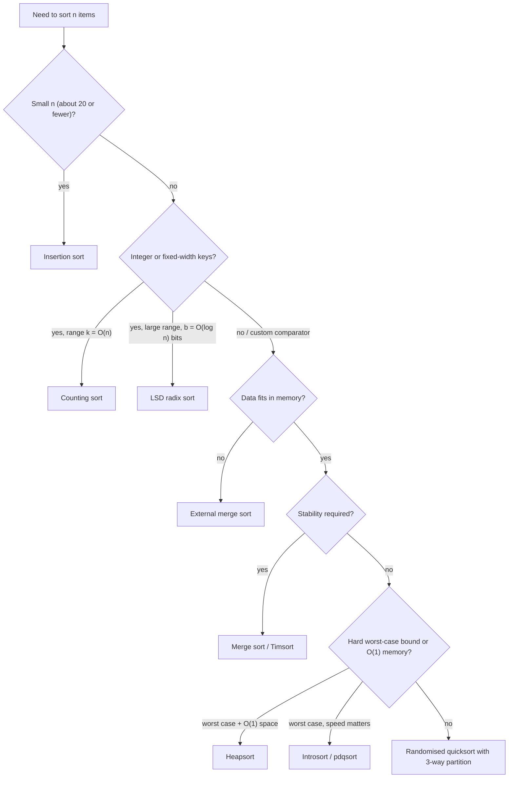

# Unit 5 Summary

## Key Results

### Master comparison table

All times count key comparisons or basic steps; $n$ = number of keys, $I$ = number of inversions, $k$ = key range, $d$ = digits, $r$ = radix.

| Algorithm | Best | Average | Worst | Extra space | Stable | In-place | Adaptive |
| --- | --- | --- | --- | --- | --- | --- | --- |
| [Insertion sort](topic1.md) | $\Theta(n)$ | $\Theta(n^2)$ | $\Theta(n^2)$ | $O(1)$ | Yes | Yes | Yes, $\Theta(n + I)$ |
| [Selection sort](topic1.md) | $\Theta(n^2)$ | $\Theta(n^2)$ | $\Theta(n^2)$ | $O(1)$ | No | Yes | No |
| [Bubble sort](topic1.md) (early exit) | $\Theta(n)$ | $\Theta(n^2)$ | $\Theta(n^2)$ | $O(1)$ | Yes | Yes | Partly |
| [Heapsort](topic1.md) | $\Theta(n \log n)$ | $\Theta(n \log n)$ | $\Theta(n \log n)$ | $O(1)$ | No | Yes | No |
| [Merge sort](../unit3/topic6.md) | $\Theta(n \log n)$ | $\Theta(n \log n)$ | $\Theta(n \log n)$ | $\Theta(n)$ | Yes | No | No (natural/Timsort variants: yes) |
| [Quicksort](topic3.md) (deterministic pivot) | $\Theta(n \log n)$ | $\Theta(n \log n)$ | $\Theta(n^2)$ | $O(\log n)$ stack* | No | Yes | No |
| [Randomised quicksort](topic4.md) | $\Theta(n \log n)$ | $\Theta(n \log n)$ expected, every input | $\Theta(n^2)$, probability $2^{n-1}/n!$ | $O(\log n)$ stack* | No | Yes | No |
| [Introsort](topic4.md) | $\Theta(n \log n)$ | $\Theta(n \log n)$ | $\Theta(n \log n)$ | $O(\log n)$ | No | Yes | No |
| Timsort / Powersort | $\Theta(n)$ | $\Theta(n \log n)$ | $\Theta(n \log n)$ | $O(n)$ | Yes | No | Yes (runs) |
| [Counting sort](topic5.md) | $\Theta(n + k)$ | $\Theta(n + k)$ | $\Theta(n + k)$ | $\Theta(n + k)$ | Yes | No | No |
| [LSD radix sort](topic6.md) | $\Theta(d(n + r))$ | $\Theta(d(n + r))$ | $\Theta(d(n + r))$ | $\Theta(n + r)$ | Yes | No | No |
| [Bucket sort](topic6.md) (uniform input) | $\Theta(n)$ | $\Theta(n)$ expected | $\Theta(n^2)$ | $\Theta(n)$ | Yes | No | No |

\* With recursion on the smaller side; naive recursion uses $\Theta(n)$ stack in the worst case.

### Key formulas

| Result | Formula | Where |
| --- | --- | --- |
| Inversions vs adjacent-swap sorts | swaps/shifts $= I$; $E[I] = n(n-1)/4$ for a random permutation | [5.1](topic1.md) |
| Build-max-heap | $\sum_h \lceil n/2^{h+1} \rceil O(h) = O(n)$ | [5.1](topic1.md) |
| Comparison lower bound | $h \ge \lceil \lg n! \rceil = n\lg n - 1.443n + O(\log n) = \Omega(n \log n)$ | [5.2](topic2.md) |
| Elementary bound on $\lg n!$ | $\frac{n}{2}\lg\frac{n}{2} \le \lg n! \le n\lg n$ | [5.2](topic2.md) |
| Quicksort worst case | $T(n) = T(n-1) + \Theta(n) = \Theta(n^2)$; $n(n-1)/2$ comparisons | [5.3](topic3.md) |
| Quicksort best case | $T(n) = 2T(n/2) + \Theta(n) = \Theta(n \log n)$ | [5.3](topic3.md) |
| Any constant split $\alpha : 1-\alpha$ | $\Theta(n \log n)$, depth $\log_{1/\max(\alpha, 1-\alpha)} n$ | [5.3](topic3.md) |
| Quicksort average (random input) / randomised expected (any input) | $2(n+1)H_n - 4n \approx 1.39\, n \lg n$ | [5.3](topic3.md), [5.4](topic4.md) |
| Pair comparison probability (randomised) | $\Pr[z_i, z_j \text{ compared}] = \frac{2}{j - i + 1}$ | [5.4](topic4.md) |
| Counting sort | $\Theta(n + k)$ | [5.5](topic5.md) |
| Radix sort | $\Theta(d(n + r))$; $b$-bit keys with $r = 2^{\lfloor \lg n \rfloor}$: $\Theta(bn / \log n)$ | [5.6](topic6.md) |
| Bucket sort | $E[n_i^2] = 2 - 1/n \Rightarrow \Theta(n)$ expected | [5.6](topic6.md) |
| Inversion counting | $T(n) = 2T(n/2) + \Theta(n) = \Theta(n \log n)$; add $\lvert L \rvert - i$ when taking from the right | [5.7](topic7.md) |
| Kendall tau | distance $= I$; $\tau = 1 - \frac{4I}{n(n-1)}$ (no ties) | [5.7](topic7.md) |

### Standard library sorts (In Practice)

| Language / system | Algorithm | Stable | Worst case |
| --- | --- | --- | --- |
| Python `list.sort`, `sorted` | Timsort; Powersort merge policy since CPython 3.11 | Yes | $O(n \log n)$ |
| C++ `std::sort` | Introsort in libstdc++ (quicksort + heapsort fallback + insertion sort) | No | $O(n \log n)$ (required since C++11) |
| C++ `std::stable_sort` | Merge sort | Yes | $O(n \log n)$ with a buffer, $O(n \log^2 n)$ without |
| Java `Arrays.sort` (primitives) | Dual-pivot quicksort | Not applicable (unobservable for primitives) | Implementation-specific; $O(n \log n)$ on typical inputs |
| Java `Arrays.sort` (objects), `Collections.sort` | TimSort | Yes | $O(n \log n)$ |
| Rust `sort` / `sort_unstable` | driftsort / ipnsort (a pdqsort descendant) since Rust 1.81 | Yes / No | $O(n \log n)$ |
| Go `sort` package | pdqsort (since Go 1.19) | No (`sort.Stable` is stable) | $O(n \log n)$ |
| Databases (data larger than memory) | External merge sort: sort memory-sized runs, then multiway merge | Implementation-dependent | $O(n \log n)$ comparisons with few sequential passes over disk |

## Important for Exams

- **State the model.** "$\Omega(n \log n)$ for **comparison-based** sorting." Counting and radix sort do not contradict it because they use keys as indices.
- **Lower bound proof in three steps:** $\ge n!$ leaves (distinct permutations need distinct leaves), $\le 2^h$ leaves, $h \ge \lg n! = \Omega(n \log n)$ via $n! \ge (n/2)^{n/2}$ or Stirling.
- **Build-heap is $O(n)$**, not just $O(n \log n)$: sum the work over node heights. Heapsort's $n \log n$ comes from the extraction phase.
- **Quicksort's worst case is $\Theta(n^2)$** and occurs on sorted, reverse-sorted or all-equal input with naive pivots; do not write "quicksort is $O(n \log n)$" without saying "average" or "expected".
- **Average vs expected:** average-case is over random inputs for a deterministic algorithm; expected time is over the algorithm's coin flips for a worst-case input.
- **Randomised quicksort proof:** indicators $X_{ij}$, linearity of expectation (no independence needed), $z_i, z_j$ compared iff the first pivot from $Z_{ij}$ is an endpoint, probability $\frac{2}{j-i+1}$, harmonic sum.
- **Hoare vs Lomuto:** Hoare does not place the pivot at the returned index; recurse on $[lo, j]$ and $[j+1, hi]$.
- **Counting sort is $\Theta(n + k)$**, linear only if $k = O(n)$; place right to left for stability.
- **Radix sort correctness depends on stability**; LSD processes the least significant digit first. State $\Theta(d(n + r))$ and the conditions for linearity.
- **Stability classification:** stable: insertion, bubble, merge, counting, LSD radix, Timsort. Unstable: selection, heapsort, quicksort (all standard variants), introsort.
- **Inversion counting:** add $|L| - i$ when taking from the **right** half; use $\le$ so equal elements are not counted; 64-bit counters.

!!! warning "Classic mistakes"

    Writing "radix sort is $O(n)$" without conditions; claiming heapsort or quicksort is stable; using a $1/(j-i)$ or $2/n$ probability in the randomised quicksort proof; confusing the number of inversions with the minimum number of arbitrary swaps; forgetting that the lower bound covers average and randomised cases too.

## Choosing the Right Technique

### Which sort when

| Situation | Choose | Why |
| --- | --- | --- |
| General-purpose, any language | The standard library sort | Tuned hybrids (Timsort, introsort, pdqsort) beat hand-written code |
| Nearly sorted data | Insertion sort (small $n$) or Timsort | $\Theta(n + I)$; Timsort exploits existing runs |
| Stability needed (multi-key, records) | Merge sort / Timsort, or counting/radix for integer keys | Stable by construction |
| Strict memory limit, guaranteed bound | Heapsort | $O(1)$ extra space, $\Theta(n \log n)$ worst case |
| Fast in-memory, stability irrelevant | Introsort / pdqsort / randomised quicksort | Cache-friendly, low constants |
| Many duplicate keys | 3-way quicksort, or counting sort if the range is small | Equal keys finished in one pass |
| Small integer range | Counting sort | $\Theta(n + k)$ |
| 32/64-bit integers, large $n$, GPUs | LSD radix sort | $\Theta(d(n + r))$, highly parallel |
| Variable-length strings | MSD radix sort / multikey quicksort | Examines only distinguishing prefixes |
| Uniform reals in a known range | Bucket sort | $\Theta(n)$ expected |
| Data larger than RAM | External merge sort | Sequential I/O, few passes |
| Linked list | Merge sort | No random access needed; merging relinks nodes |
| Only top-$k$ or $k$-th element | Heap of size $k$ ($O(n \log k)$) or quickselect ($O(n)$ expected) | Full sort is unnecessary |
| Measure disorder / compare rankings | Merge-and-count or BIT | $\Theta(n \log n)$ inversion count |

### Partition vs merge: families of ideas

| Idea | Algorithms | Work done in | Spin-offs |
| --- | --- | --- | --- |
| Partition around a pivot | Quicksort, 3-way quicksort, introsort | Divide step | Quickselect, Dutch national flag, top-$k$ |
| Merge sorted halves | Merge sort, Timsort, external sort | Combine step | Inversion counting, merging $k$ lists, external sorting |
| Heap order | Heapsort | Repeated extraction | Priority queues, top-$k$, $k$-way merge |
| Key decomposition | Counting, radix, bucket sort | Key values as indices | Histograms, suffix arrays, GPU sorting |

## Mixed Practice

??? question "Q1. An input of $10^6$ records must be sorted by score (integer 0 to 100), keeping the original order among equal scores. Which algorithm and what cost?"

    Counting sort with $k = 101$: $\Theta(n + k) = \Theta(n)$ time, $\Theta(n + k)$ space, stable because placement is done right to left.

??? question "Q2. Why can heapsort not be made stable simply by changing a comparison, unlike insertion sort?"

    Heapsort moves elements over long distances (root to the end of the array, sift-down across levels) for reasons unrelated to equal keys, so the relative order of equal keys is lost structurally. Making it stable requires augmenting keys with original indices, which costs extra space.

??? question "Q3. Give the recurrence for quicksort when every split is 1-to-3 and solve it."

    $T(n) = T(n/4) + T(3n/4) + cn$. Each recursion-tree level costs at most $cn$ and the depth is $\log_{4/3} n$, so $T(n) = \Theta(n \log n)$.

??? question "Q4. A colleague claims a new comparison sort uses at most $3n$ comparisons on every input of size $n$. Refute it."

    For $n = 32$, $\lceil \lg 32! \rceil = 118 > 96 = 3n$, so some input of size 32 needs more than $3n$ comparisons. In general $\lg n! = \Theta(n \log n)$ eventually exceeds any $cn$.

??? question "Q5. Randomised quicksort and quicksort with a median-of-three pivot both run fast on sorted input. Which one has a guarantee for every input, and of what kind?"

    Randomised quicksort: expected $O(n \log n)$ for every input. Median-of-three is deterministic, so adversarial inputs forcing $\Theta(n^2)$ exist.

??? question "Q6. Sort $n$ integers in the range $[0, n^3 - 1]$ in linear time."

    LSD radix sort with base $n$: each key has 3 digits, each pass is a stable counting sort costing $\Theta(n + n)$; total $\Theta(n)$.

??? question "Q7. Which of these is stable as usually implemented: insertion sort, selection sort, heapsort, merge sort, Lomuto quicksort, counting sort, LSD radix sort?"

    Stable: insertion sort, merge sort, counting sort, LSD radix sort. Not stable: selection sort, heapsort, Lomuto quicksort.

??? question "Q8. Roughly how many comparisons does insertion sort make on an array with $n = 1000$ and exactly 5 inversions?"

    At most $I + (n - 1) = 1004$ and at least $n - 1 = 999$: one comparison per shift plus at most one stopping comparison per outer iteration. It is linear, $\Theta(n + I)$.

??? question "Q9. Two rankings of 6 items are $\langle a, b, c, d, e, f \rangle$ and $\langle b, a, d, c, f, e \rangle$. What are the Kendall tau distance and coefficient?"

    Positions in the second ranking, listed in the first ranking's order: $\langle 1, 0, 3, 2, 5, 4 \rangle$, which has 3 inversions. Distance $= 3$; $\tau = 1 - \frac{4 \cdot 3}{6 \cdot 5} = 0.6$.

??? question "Q10. Your Lomuto quicksort crashes with `RecursionError` on an array of $10^5$ equal values, even with random pivots. Explain and fix."

    Every element is $\le$ the pivot, so each partition splits $n - 1$ / $0$: $\Theta(n^2)$ time and $\Theta(n)$ recursion depth. Use 3-way (Dutch national flag) partition so equal keys are finished in one pass, and recurse on the smaller side.

??? question "Q11. Why is build-max-heap $O(n)$ while inserting $n$ elements one at a time into a heap is $\Theta(n \log n)$ in the worst case?"

    Bottom-up build does sift-down, whose cost is the node's **height**; most nodes are near the leaves, so $\sum_h \frac{n}{2^{h+1}} h = O(n)$. Repeated insertion does sift-up, whose cost is the node's **depth**; most nodes are deep, so the total can reach $\Theta(n \log n)$ (for example, inserting keys in increasing order into a max-heap).

??? question "Q12. A service sorts user-supplied JSON arrays using a quicksort that always picks the middle element. Is this a security concern? What would you recommend?"

    Yes: deterministic pivot rules have constructible quadratic inputs, enabling algorithmic-complexity denial-of-service. Use a worst-case $O(n \log n)$ sort (the language's standard sort, introsort, pdqsort or merge sort), or at least random pivots with an unpredictable seed, and cap the input size.
