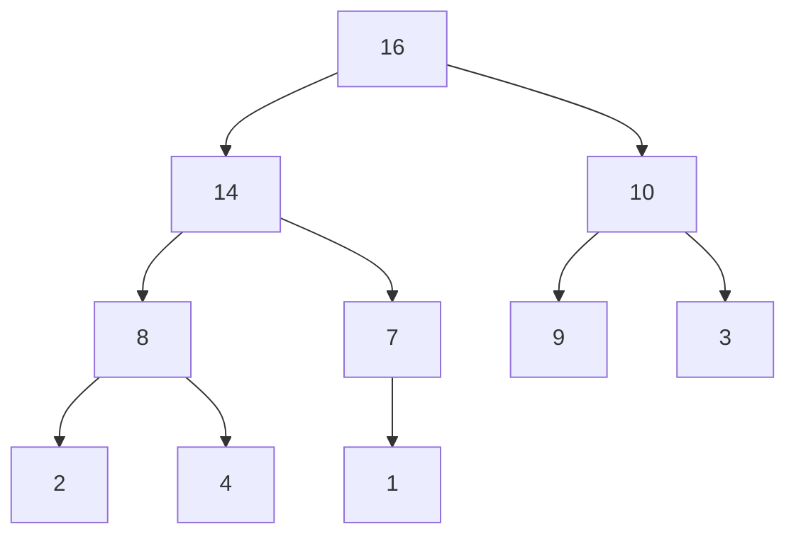

# Comparison-based Sorting Analysis

!!! abstract "At a glance"

    - **Problem:** rearrange $n$ keys into non-decreasing order using only pairwise comparisons ($a \le b$?) to learn about the input.
    - **Key idea:** each algorithm maintains a different invariant: insertion sort keeps a sorted prefix, selection sort grows a prefix of final minima, bubble sort floats the maximum to the end, heapsort keeps a max-heap and peels off the maximum.
    - **Complexity:** insertion, selection and bubble sort are $\Theta(n^2)$ in the worst case; heapsort is $\Theta(n \log n)$ in the worst case with $O(1)$ extra space.
    - **Properties that decide real choices:** stable, in-place, adaptive, online. No single algorithm has all four plus $O(n \log n)$ worst case.
    - **Used in:** insertion sort inside every production hybrid sort (Timsort, introsort, pdqsort) for small ranges; heapsort as the worst-case fallback of introsort and as the Linux kernel's `sort()`.

## Motivation and Problem Context

Sorting is the most frequently executed non-trivial algorithm in software. Databases sort to answer `ORDER BY`, to build B-tree indexes and to perform sort-merge joins; search engines sort candidate documents by score; compilers sort symbol tables; spreadsheets sort rows by one column and then another. Many algorithms in later units (greedy scheduling, Kruskal's MST, sweep-line geometry, binary search) begin with "first sort the input".

Choosing a sort is rarely about asymptotic time alone. Consider a registrar's office that keeps student records already sorted by name and wants them grouped by department while keeping names alphabetical within a department. That is a **stability** requirement. An embedded controller with 4 KB of RAM cannot allocate an $O(n)$ buffer: that is an **in-place** requirement. A trading system receiving price ticks that are almost in order needs an algorithm that exploits **presortedness**. This page builds the vocabulary and the four classical comparison sorts you need to make those choices. Merge sort is analysed in [Merge Sort Analysis](../unit3/topic6.md); quicksort has its own pages ([Quicksort](topic3.md), [Randomised Quicksort](topic4.md)).

## Problem Formulation

- **Input:** a sequence $A = \langle a_1, a_2, \dots, a_n \rangle$ of records, each carrying a key drawn from a totally ordered set.
- **Output:** a permutation $\langle a_{\pi(1)}, \dots, a_{\pi(n)} \rangle$ of the input such that $\text{key}(a_{\pi(1)}) \le \text{key}(a_{\pi(2)}) \le \dots \le \text{key}(a_{\pi(n)})$.
- **Model (comparison model):** the algorithm may inspect keys only through comparisons $\le, <, =$. It may move records freely. Cost is measured in comparisons and in element moves (swaps or assignments).
- **Assumptions:** a comparison costs $O(1)$; keys may repeat unless stated otherwise.

### The four properties

| Property | Definition | Why it matters |
| --- | --- | --- |
| **Stable** | Records with equal keys appear in the output in the same relative order as in the input. | Multi-key sorting by successive passes; preserving a previous ordering (e.g. by timestamp). |
| **In-place** | Uses $O(1)$ extra memory beyond the input (some texts allow $O(\log n)$ for a recursion stack). | Memory-constrained systems; cache behaviour. |
| **Adaptive** | Runs faster when the input is already partly sorted; cost depends on a disorder measure such as the number of inversions $I$. | Real data is often nearly sorted (appending to a sorted log, re-sorting after small edits). |
| **Online** | Can process items as they arrive and keep a sorted result at every step, without seeing the whole input first. | Streaming input, incremental leaderboards. |

!!! warning "Important"

    Stability is a property of the **algorithm as implemented**, not of the abstract idea. Insertion sort written with `a[j] >= key` in the shifting loop is no longer stable. When an exam asks "is X stable?", justify with the exact comparison that decides whether equal keys can cross each other.

### Why stability matters: multi-key sorting

Suppose we must sort employees by department, and alphabetically by name inside each department. With a stable sort we can do two passes, **least significant key first**:

1. Sort by name.
2. Stable-sort by department.

After step 2, employees in the same department keep the name order produced by step 1. This is exactly the idea that makes [LSD radix sort](topic6.md) correct.

| Input (sorted by name) | After stable sort by dept | After unstable sort by dept (possible) |
| --- | --- | --- |
| (Dorji, CS) | (Dorji, CS) | (Tashi, CS) |
| (Karma, EE) | (Tashi, CS) | (Dorji, CS) |
| (Pema, EE) | (Karma, EE) | (Pema, EE) |
| (Tashi, CS) | (Pema, EE) | (Karma, EE) |

The alternative is a single sort with a composite key `(dept, name)`, which works with any algorithm but needs both keys at once.

## Intuition

Every comparison sort answers the same question: **which element goes where?** The algorithms differ in which partial answer they keep correct as they run.

- **Insertion sort:** "the first $i$ elements are sorted among themselves". Take the next card and slide it left into place, like sorting a hand of cards.
- **Selection sort:** "the first $i$ positions hold the $i$ smallest elements, in final position". Find the minimum of the rest and append it.
- **Bubble sort:** "the last $i$ positions hold the $i$ largest elements, in final position". Adjacent swaps carry the largest remaining element to the end.
- **Heapsort:** selection sort with a better data structure. Instead of scanning $n - i$ elements to find the maximum, keep them in a max-heap where the maximum is at the root and can be removed in $O(\log n)$.

An **inversion** is a pair $(i, j)$ with $i < j$ and $A[i] > A[j]$. A sorted array has $0$ inversions; a reversed array has $\binom{n}{2}$. Any algorithm that only swaps **adjacent** elements removes exactly one inversion per swap, so it needs $I$ swaps; on average $I = n(n-1)/4$, hence $\Theta(n^2)$. This single observation explains why insertion and bubble sort are quadratic and why breaking the $n^2$ barrier requires moving elements over long distances.

## Baseline Approach

The most naïve correct sort is to try permutations until one is sorted, which costs $\Theta(n \cdot n!)$. A more sensible baseline is **selection sort**: it is simple to state and prove, performs at most $n - 1$ swaps, and its $\Theta(n^2)$ comparison count does not depend on the input.

Its bottleneck is clear: to find the minimum of the unsorted part it re-scans every remaining element, throwing away everything learned in the previous scan. Over all iterations that is

$$\sum_{i=1}^{n-1} (n - i) = \frac{n(n-1)}{2}$$

comparisons. Two ways forward:

1. **Exploit existing order** (insertion sort): if the input is nearly sorted, little work is needed.
2. **Remember comparison results** (heapsort): a heap stores the outcome of earlier comparisons so that the next maximum is found in $O(\log n)$ rather than $O(n)$.

## Algorithm Design

### Insertion sort

Maintain the invariant that $A[0..i-1]$ is sorted. To extend it to $A[0..i]$, save $key = A[i]$ and shift every element greater than $key$ one place right, then drop $key$ into the gap. Each shift fixes exactly one inversion involving $key$, so the total number of shifts is exactly $I$, the number of inversions. Running time is $\Theta(n + I)$: this is the precise sense in which insertion sort is adaptive.

### Selection sort

Maintain the invariant that $A[0..i-1]$ contains the $i$ smallest elements in sorted order. Scan $A[i..n-1]$ for the minimum and swap it into position $i$. Only $n-1$ swaps occur in total, which is attractive when writes are very expensive (for example, flash memory with limited write cycles), but the long-distance swap can jump an element over an equal one, so it is **not stable**.

### Bubble sort

Make passes over the array, swapping adjacent out-of-order pairs. After pass $p$ the $p$ largest elements are in their final positions at the end. Adding a `swapped` flag lets the algorithm stop after a pass with no swaps, giving $O(n)$ on sorted input. Bubble sort is mainly of teaching value: it performs the same number of swaps as insertion sort ($I$) but uses more comparisons and three writes per swap instead of one write per shift.

### Heapsort

A **binary max-heap** stored in an array $A[0..m-1]$ is an almost-complete binary tree in which node $i$ has children $2i+1$ and $2i+2$ and parent $\lfloor (i-1)/2 \rfloor$, and every node satisfies the **heap property** $A[\text{parent}(i)] \ge A[i]$. Consequently the maximum sits at $A[0]$.

Heapsort has two phases:

1. **Build-max-heap:** turn the arbitrary array into a heap.
2. **Sort-down:** repeat $n - 1$ times: swap the root (current maximum) with the last heap element, shrink the heap by one, and restore the heap property at the root.

The repair operation is **sift-down** (also called max-heapify): if node $i$ is smaller than one of its children, swap it with the larger child and continue from that child. It assumes both subtrees of $i$ are already heaps and costs $O(h)$ where $h$ is the height of $i$.

**Why build bottom-up?** Leaves (indices $\lfloor n/2 \rfloor .. n-1$) are already one-element heaps. Calling sift-down on $\lfloor n/2 \rfloor - 1$ down to $0$ guarantees that when we process node $i$, both its subtrees are heaps, exactly the precondition sift-down needs.

## Pseudocode

```text
INSERTION-SORT(A, n)
    for i = 1 to n - 1
        key = A[i]
        j = i - 1
        while j >= 0 and A[j] > key          // strict >: equal keys never cross
            A[j + 1] = A[j]
            j = j - 1
        A[j + 1] = key

SELECTION-SORT(A, n)
    for i = 0 to n - 2
        m = i
        for j = i + 1 to n - 1
            if A[j] < A[m]
                m = j
        swap A[i], A[m]

BUBBLE-SORT(A, n)
    for i = 0 to n - 2
        swapped = false
        for j = 0 to n - 2 - i
            if A[j] > A[j + 1]
                swap A[j], A[j + 1]
                swapped = true
        if not swapped
            return

SIFT-DOWN(A, i, size)
    loop
        left = 2i + 1 ; right = 2i + 2 ; largest = i
        if left < size and A[left] > A[largest]
            largest = left
        if right < size and A[right] > A[largest]
            largest = right
        if largest == i
            return
        swap A[i], A[largest]
        i = largest

BUILD-MAX-HEAP(A, n)
    for i = floor(n / 2) - 1 downto 0
        SIFT-DOWN(A, i, n)

HEAPSORT(A, n)
    BUILD-MAX-HEAP(A, n)
    for end = n - 1 downto 1
        swap A[0], A[end]                     // max goes to its final slot
        SIFT-DOWN(A, 0, end)                  // heap is now A[0..end-1]
```

## Worked Example

### Insertion sort on $\langle 5, 2, 4, 6, 1, 3 \rangle$

This input has $9$ inversions: $(5,2), (5,4), (5,1), (5,3), (2,1), (4,1), (4,3), (6,1), (6,3)$. Insertion sort therefore performs exactly $9$ shifts.

| $i$ | key | shifts | array after inserting key (sorted prefix in bold) |
| --- | --- | --- | --- |
| 1 | 2 | 1 | **2 5** 4 6 1 3 |
| 2 | 4 | 1 | **2 4 5** 6 1 3 |
| 3 | 6 | 0 | **2 4 5 6** 1 3 |
| 4 | 1 | 4 | **1 2 4 5 6** 3 |
| 5 | 3 | 3 | **1 2 3 4 5 6** |

Total shifts $= 1 + 1 + 0 + 4 + 3 = 9$, matching the inversion count. Because shifts always equal inversions, this is a quick self-check for any hand trace.

### Stability failure of selection sort

Input $\langle 2_a, 2_b, 1_c \rangle$ (subscripts mark identity). Iteration $i = 0$ finds the minimum $1_c$ at index 2 and swaps it with $2_a$: $\langle 1_c, 2_b, 2_a \rangle$. The two 2s have swapped order, so selection sort is unstable.

### Heapsort on $\langle 4, 1, 3, 2, 16, 9, 10, 14, 8, 7 \rangle$

**Build-max-heap** ($n = 10$, so sift-down from $i = 4$ down to $0$):

| sift-down at $i$ | array after the call |
| --- | --- |
| 4 (value 16) | 4 1 3 2 16 9 10 14 8 7 (16 > 7, no change) |
| 3 (value 2) | 4 1 3 **14** 16 9 10 **2** 8 7 |
| 2 (value 3) | 4 1 **10** 14 16 9 **3** 2 8 7 |
| 1 (value 1) | 4 **16** 10 14 **7** 9 3 2 8 **1** |
| 0 (value 4) | **16 14** 10 **8** 7 9 3 2 **4** 1 |

The resulting heap as a tree:



**Sort-down** (heap part before the bar, sorted suffix after it):

| end | swap root with A[end], then sift-down |
| --- | --- |
| 9 | 14 8 10 4 7 9 3 2 1 \| 16 |
| 8 | 10 8 9 4 7 1 3 2 \| 14 16 |
| 7 | 9 8 3 4 7 1 2 \| 10 14 16 |
| 6 | 8 7 3 4 2 1 \| 9 10 14 16 |
| 5 | 7 4 3 1 2 \| 8 9 10 14 16 |
| 4 | 4 2 3 1 \| 7 8 9 10 14 16 |
| 3 | 3 2 1 \| 4 7 8 9 10 14 16 |
| 2 | 2 1 \| 3 4 7 8 9 10 14 16 |
| 1 | 1 \| 2 3 4 7 8 9 10 14 16 |

## Correctness

### Insertion sort (loop invariant)

**Invariant:** at the start of iteration $i$, $A[0..i-1]$ consists of the elements originally in $A[0..i-1]$, in sorted order.

- **Initialization:** for $i = 1$, $A[0..0]$ is a single element, trivially sorted.
- **Maintenance:** the inner loop shifts every element of $A[0..i-1]$ that is greater than $key$ one position right, preserving their order, and stops at the first $A[j] \le key$ (or $j = -1$). Placing $key$ at $j + 1$ puts it after all elements $\le key$ and before all elements $> key$, so $A[0..i]$ is sorted. Because equal elements are not shifted, $key$ lands after them: stability.
- **Termination:** the loop ends with $i = n$, so $A[0..n-1]$ is sorted.

### Selection sort (loop invariant)

**Invariant:** before iteration $i$, $A[0..i-1]$ holds the $i$ smallest elements in sorted order, and every element of $A[i..n-1]$ is $\ge A[i-1]$. The inner scan finds the minimum of $A[i..n-1]$, which is therefore the $(i+1)$-th smallest overall; swapping it into position $i$ extends the invariant. At termination ($i = n-1$) the last element is the largest, so the whole array is sorted.

### Heapsort

**Sift-down lemma:** if the subtrees rooted at the children of $i$ are max-heaps, then after `SIFT-DOWN(A, i, size)` the subtree rooted at $i$ is a max-heap. *Proof by induction on the height of $i$:* if $A[i]$ is at least both children, done. Otherwise the larger child $c$ moves up; it is at least the other child and at least the old $A[i]$, so the heap property holds at $i$. Only the subtree of $c$ may now be violated, and only at its root, with both of $c$'s subtrees still heaps; by the inductive hypothesis (smaller height) the recursive sift-down repairs it.

**Build-max-heap invariant:** at the start of each iteration with index $i$, every node $i+1, \dots, n-1$ is the root of a max-heap.

- **Initialization:** $i = \lfloor n/2 \rfloor - 1$; nodes $\lfloor n/2 \rfloor .. n-1$ are leaves, which are trivial heaps.
- **Maintenance:** the children of $i$ have larger indices, so they are heap roots; by the lemma, sift-down makes $i$ a heap root. Nodes with larger indices are untouched or remain heaps.
- **Termination:** at $i = -1$, node $0$ is a heap root: the whole array is a max-heap.

**Sort-down invariant:** before the iteration with index $end$, $A[0..end]$ is a max-heap containing the $end + 1$ smallest elements, and $A[end+1..n-1]$ contains the $n - end - 1$ largest elements in sorted order. Swapping $A[0]$ (the maximum of the heap) into position $end$ extends the sorted suffix; the swap breaks the heap property only at the root, with both subtrees still heaps, so sift-down on $A[0..end-1]$ restores it. When $end = 0$ the array is sorted.

## Complexity Analysis

### Insertion, selection, bubble sort

Let $I$ be the number of inversions, $0 \le I \le \binom{n}{2}$.

| Algorithm | Comparisons | Moves | Best | Worst | Average (random permutation) |
| --- | --- | --- | --- | --- | --- |
| Insertion | between $I$ and $I + n - 1$ | $I$ shifts | $\Theta(n)$ (sorted) | $\Theta(n^2)$ (reversed) | $\Theta(n^2)$, about $n^2/4$ comparisons |
| Selection | exactly $n(n-1)/2$ | $\le n - 1$ swaps | $\Theta(n^2)$ | $\Theta(n^2)$ | $\Theta(n^2)$ |
| Bubble (with flag) | up to $n(n-1)/2$ | $I$ swaps | $\Theta(n)$ (sorted) | $\Theta(n^2)$ | $\Theta(n^2)$ |

**Average case for insertion sort.** For a uniformly random permutation, each pair $(i, j)$ is inverted with probability $1/2$, so by linearity of expectation (see [Probability and Expectation](../unit1/topic3.md)) $E[I] = \frac{1}{2}\binom{n}{2} = \frac{n(n-1)}{4}$. The running time $\Theta(n + I)$ is therefore $\Theta(n^2)$ on average. The same argument gives a lower bound of $n(n-1)/4$ average swaps for **every** algorithm that exchanges only adjacent elements.

### Heapsort

**Sift-down** at a node of height $h$ costs $O(h)$, and $h \le \lfloor \lg n \rfloor$.

**Build-max-heap is $O(n)$, not $O(n \log n)$.** The naïve bound "$n/2$ calls times $O(\log n)$" is correct but loose. In a heap of $n$ nodes there are at most $\lceil n / 2^{h+1} \rceil$ nodes of height $h$, and sift-down at such a node costs $O(h)$. So

$$
T_{\text{build}}(n) \le \sum_{h=0}^{\lfloor \lg n \rfloor} \left\lceil \frac{n}{2^{h+1}} \right\rceil c\,h
= O\!\left( n \sum_{h=0}^{\infty} \frac{h}{2^{h}} \right) = O(2n) = O(n),
$$

using $\sum_{h \ge 0} h x^h = \frac{x}{(1-x)^2}$ with $x = 1/2$, which equals $2$. Intuition: half the nodes are leaves and cost nothing; a quarter have height 1; only one node (the root) has height $\lg n$. Most nodes are near the bottom where sift-down is cheap.

**Sort-down** performs $n - 1$ sift-downs from the root, each $O(\log n)$, and for most of them the heap still has $\Omega(n)$ elements, so this phase is $\Theta(n \log n)$ in the worst case. Total heapsort: $O(n) + O(n \log n) = O(n \log n)$ in all cases (for inputs with distinct keys it is also $\Omega(n \log n)$ in the best case).

**Space:** $O(1)$ extra with the iterative sift-down shown here.

!!! warning "Important"

    "Build-heap is $O(n)$" is a classic exam question. Show the sum over heights, $\sum_h \frac{n}{2^{h+1}} \cdot h = O(n)$. Saying "$n/2$ calls of $O(\log n)$" proves only $O(n \log n)$, which is true but not tight. Building a heap by $n$ successive **inserts** (sift-up) really is $\Theta(n \log n)$ in the worst case.

## Python Implementation

=== "Simple sorts"

    ```python
    def insertion_sort(a):
        for i in range(1, len(a)):
            key = a[i]
            j = i - 1
            while j >= 0 and a[j] > key:      # strict > keeps equal keys in order (stable)
                a[j + 1] = a[j]
                j -= 1
            a[j + 1] = key
        return a


    def selection_sort(a):
        n = len(a)
        for i in range(n - 1):
            m = i
            for j in range(i + 1, n):
                if a[j] < a[m]:
                    m = j
            a[i], a[m] = a[m], a[i]           # long-distance swap breaks stability
        return a


    def bubble_sort(a):
        n = len(a)
        for i in range(n - 1):
            swapped = False
            for j in range(n - 1 - i):
                if a[j] > a[j + 1]:
                    a[j], a[j + 1] = a[j + 1], a[j]
                    swapped = True
            if not swapped:                   # no swaps: already sorted
                break
        return a
    ```

=== "Heapsort"

    ```python
    def sift_down(a, i, size):
        """Restore the max-heap property for the subtree rooted at i within a[0:size]."""
        while True:
            left, right = 2 * i + 1, 2 * i + 2
            largest = i
            if left < size and a[left] > a[largest]:
                largest = left
            if right < size and a[right] > a[largest]:
                largest = right
            if largest == i:
                return
            a[i], a[largest] = a[largest], a[i]
            i = largest


    def build_max_heap(a):
        for i in range(len(a) // 2 - 1, -1, -1):
            sift_down(a, i, len(a))


    def heapsort(a):
        build_max_heap(a)
        for end in range(len(a) - 1, 0, -1):
            a[0], a[end] = a[end], a[0]       # move current max to its final slot
            sift_down(a, 0, end)
        return a
    ```

**Walkthrough of the non-obvious lines**

- `a[j] > key` (not `>=`) is the entire reason insertion sort is stable.
- `range(n - 1 - i)` in bubble sort skips the suffix that already holds the $i$ largest elements.
- `sift_down` takes `size` explicitly so that the sorted suffix $a[size..]$ is never treated as part of the heap.
- `range(len(a) // 2 - 1, -1, -1)` starts at the last internal node; leaves need no work.
- All functions sort in place and also return the list for convenience; Python's own `list.sort()` returns `None` to signal in-place mutation, which is a better API habit for library code.

## Edge Cases and Pitfalls

| Case / pitfall | What goes wrong | Fix |
| --- | --- | --- |
| Empty list or one element | Index errors if code assumes `a[0]` exists or `n - 1 >= 1` | Loops with `range` bounds above handle $n \le 1$ naturally; test them explicitly |
| `>=` instead of `>` in insertion sort | Still sorts, but equal keys cross: no longer stable | Use strict comparison when shifting |
| Heap index formulas for 1-based arrays used on 0-based arrays | Children computed as `2i, 2i+1` give wrong tree; root 0 has child 0 | 0-based: children `2i+1, 2i+2`; 1-based: `2i, 2i+1` |
| Sift-down that compares only with the left child | Heap property silently violated; output unsorted | Pick the **larger** of the two children |
| Forgetting to shrink heap size in sort-down | Sorted suffix gets pulled back into the heap | Pass `end` as the heap size |
| Bubble sort without the `swapped` flag | Best case becomes $\Theta(n^2)$ | Add early exit |
| Comparator that is not a strict weak ordering (e.g. `a <= b` used as "less than", or inconsistent with NaN) | Unpredictable output; some libraries crash or loop | Comparators must be irreflexive and transitive; handle NaN explicitly |

## Common Misconceptions

- **"Heapsort is stable because it uses a tree."** Wrong. The swap of root with the last element moves elements over long distances. Example: $\langle 1_a, 1_b \rangle$ heapsorts to $\langle 1_b, 1_a \rangle$. Heapsort is not stable.
- **"Selection sort is adaptive since it does few swaps."** It performs exactly $n(n-1)/2$ comparisons on every input; few swaps does not mean less time.
- **"$O(n^2)$ algorithms are useless."** For $n \lesssim 16$ to $32$, insertion sort beats $O(n \log n)$ sorts because of tiny constants, no recursion and sequential memory access. That is why every production sort uses it for small subarrays.
- **"Build-heap is $O(n \log n)$ so heapsort's first phase dominates."** Build-heap is $O(n)$; the sort-down phase is the $\Theta(n \log n)$ part.
- **"Heapsort is the best $O(n \log n)$ sort because it is in place and worst-case optimal."** In practice it is usually slower than quicksort and merge sort because sift-down jumps between index $i$ and $2i+1$, causing poor cache locality and unpredictable branches.

## Alternatives and Trade-offs

| Algorithm | Best | Average | Worst | Extra space | Stable | In-place | Adaptive | Online |
| --- | --- | --- | --- | --- | --- | --- | --- | --- |
| Insertion | $n$ | $n^2$ | $n^2$ | $O(1)$ | Yes | Yes | Yes ($n + I$) | Yes |
| Selection | $n^2$ | $n^2$ | $n^2$ | $O(1)$ | No | Yes | No | No |
| Bubble (flag) | $n$ | $n^2$ | $n^2$ | $O(1)$ | Yes | Yes | Partly | No |
| Heapsort | $n \log n$ | $n \log n$ | $n \log n$ | $O(1)$ | No | Yes | No | No |
| [Merge sort](../unit3/topic6.md) | $n \log n$ | $n \log n$ | $n \log n$ | $O(n)$ | Yes | No | No (natural variants yes) | No |
| [Quicksort](topic3.md) | $n \log n$ | $n \log n$ | $n^2$ | $O(\log n)$ stack | No | Yes | No | No |

(All time entries are $\Theta(\cdot)$ and denote comparisons.)

**When to use**

- Insertion sort: $n$ small, data nearly sorted, or as the base case inside a hybrid sort.
- Selection sort: writes are far more expensive than reads, and $n$ is small.
- Heapsort: a hard $O(n \log n)$ worst-case bound with $O(1)$ extra memory (embedded, kernel, real-time code); as introsort's fallback; partial sorting (top-$k$ via a heap).

**When NOT to use**

- Any $\Theta(n^2)$ sort for large random data.
- Heapsort when stability is required or when average-case speed on large arrays matters most (quicksort/pdqsort is faster in practice).
- Bubble sort in production code: insertion sort dominates it on every input.

## In Practice

- **Insertion sort inside hybrids.** CPython's Timsort uses binary insertion sort to extend short runs to a minimum run length; libstdc++'s `std::sort` finishes with insertion sort over small partitions; pdqsort-based sorts (Rust `sort_unstable`, Go's `sort` package since Go 1.19) also switch to insertion sort for short slices.
- **Heapsort as a safety net.** Introsort (C++ `std::sort` in libstdc++) switches from quicksort to heapsort when recursion depth exceeds about $2 \lg n$, guaranteeing $O(n \log n)$. The Linux kernel's generic `sort()` in `lib/sort.c` is a heapsort, chosen for its bounded time and no recursion.
- **Heaps for partial sorting.** C++ `std::partial_sort` is heap-based; Python's `heapq.nsmallest`/`nlargest` keep a heap of size $k$ for $O(n \log k)$ top-$k$ queries. PostgreSQL reports "top-N heapsort" in `EXPLAIN ANALYZE` when a query has `ORDER BY ... LIMIT`.
- **Stability in standard libraries.** Python's `list.sort`, Java's `Collections.sort` and `Arrays.sort` for objects, and C++ `std::stable_sort` are stable; C++ `std::sort`, Rust `sort_unstable` and Java `Arrays.sort` for primitives are not (for primitives, stability is unobservable anyway).
- **Cache effects.** Insertion sort touches memory sequentially. Heapsort's parent-child jumps defeat hardware prefetching on large arrays, which is the main reason it loses to quicksort in benchmarks despite a better worst case.

## Interview and Competitive Programming

**Recognition cues**

- "Nearly sorted", "each element at most $k$ positions away" → insertion sort is $O(nk)$; a min-heap of size $k+1$ gives $O(n \log k)$.
- "Top $k$", "$k$-th largest", "merge $k$ sorted lists", "running median" → heap.
- "Sort by A, ties broken by original order" → stable sort, or sort by tuple `(A, original_index)`.
- "Minimum number of adjacent swaps to sort" → count inversions ([Counting Inversions](topic7.md)).
- "Minimum number of arbitrary swaps to sort a permutation" → $n - (\text{number of cycles})$, not inversions.

**Constraints to complexity**

| $n$ | Acceptable sort cost |
| --- | --- |
| $\le 10^3$ to $5 \cdot 10^3$ | $O(n^2)$ is fine |
| $\le 10^5$ to $10^6$ | $O(n \log n)$ required; use the library sort |
| $\ge 10^7$ with small integer keys | consider [counting](topic5.md) or [radix sort](topic6.md) |

**Traps**

- Writing your own sort in a contest when the library sort with a key function would do.
- Python `sort(key=...)` is stable, so multi-key sorting can be done in passes, least significant key first, or in one pass with a tuple key.
- A custom comparator must define a strict weak ordering; using `<=` as "less than" in C++ `std::sort` is undefined behaviour.

## Using AI Assistants Critically

- LLM-generated heapsort code often mixes 1-based child formulas (`2*i`, `2*i+1`) with 0-based Python lists; check the index arithmetic against a three-element example.
- Generated build-heap loops sometimes start at `n // 2` or iterate upward from 0; both break the "children are already heaps" precondition. Verify the loop runs from `n // 2 - 1` down to `0`.
- Assistants frequently claim heapsort or selection sort is stable, or that build-heap is $O(n \log n)$ "tight". Ask for the proof and check it against this page.
- Verify any generated sort with a brute-force oracle: `assert my_sort(xs[:]) == sorted(xs)` on thousands of random lists including empty, single-element, all-equal and reversed inputs.
- Test stability separately: sort `(key, original_index)` pairs by key only and assert that indices are increasing within each key.
- With `hypothesis`, a property such as `@given(lists(integers()))` checking sortedness and permutation equality (`Counter(out) == Counter(xs)`) finds edge cases you will not think of.
- Sanity-check complexity claims with a doubling experiment: if doubling $n$ multiplies runtime by about 4, it is quadratic; by just over 2, it is $n \log n$.

## Practice

**Beginner**

1. *Trace insertion sort.* Input: $\langle 31, 41, 59, 26, 41, 58 \rangle$. Output: the array after each outer iteration and the total number of shifts. Constraint: verify that shifts equal inversions. Difficulty: easy.
2. *Selection sort swaps.* Input: an array of $n$ distinct integers. Output: the number of swaps selection sort performs where `i != m`. Constraints: $n \le 10^3$. Difficulty: easy.
3. *Stability check.* Input: list of `(name, grade)` records. Output: records sorted by grade using a stable algorithm you implement; explain why names with equal grades keep input order. Constraints: $n \le 100$. Difficulty: easy.

**Intermediate**

1. *Build a heap by hand.* Input: $\langle 5, 13, 2, 25, 7, 17, 20, 8, 4 \rangle$. Output: the array after build-max-heap and after each of the first three sort-down steps. Difficulty: medium.
2. *k-sorted array.* Input: an array where each element is at most $k$ positions from its sorted position. Output: the sorted array in $O(n \log k)$ time. Constraints: $n \le 10^6$, $k \le 100$. Difficulty: medium.
3. *Multi-key report.* Input: transactions `(branch, date, amount)`. Output: sorted by branch, then date descending, then amount. Use only stable single-key sorts. Constraints: $n \le 10^5$. Difficulty: medium.

**Advanced**

1. *Bottom-up heapsort.* Modify sift-down so that it first descends to a leaf along larger children and then sifts the element up; measure comparisons against standard heapsort on random inputs of size $10^5$. Difficulty: hard.
2. *d-ary heapsort.* Generalise heapsort to a $d$-ary heap. Output: comparisons as a function of $d$; derive the cost $O(n\, d \log_d n)$ and find the best $d$ experimentally. Difficulty: hard.
3. *Adjacent-swap lower bound.* Prove that any algorithm that only swaps adjacent elements makes at least $n(n-1)/4$ swaps on average over random permutations. Difficulty: hard.

**Interview / CP**

1. *LeetCode 912 Sort an Array.* Input: integer array, $n \le 5 \cdot 10^4$. Output: sorted array without using the built-in sort. Difficulty: medium.
2. *LeetCode 215 Kth Largest Element in an Array.* Input: array and $k$. Output: the $k$-th largest element using a heap of size $k$. Difficulty: medium.
3. *Minimum swaps.* Input: a permutation of $1..n$, $n \le 10^5$. Output: the minimum number of arbitrary swaps to sort it. Difficulty: medium.

## Self-Check Questions

??? question "Q1. Why does insertion sort run in $\Theta(n + I)$ time, where $I$ is the number of inversions?"

    Each iteration of the inner loop shifts one element past $key$, and that pair was an inversion that is now removed; no other inversions change. So total shifts equal $I$, comparisons are at most $I + (n - 1)$ (one failing comparison per outer iteration), plus $\Theta(n)$ outer-loop overhead.

??? question "Q2. Prove that build-max-heap runs in $O(n)$ time."

    At most $\lceil n/2^{h+1} \rceil$ nodes have height $h$; sift-down from height $h$ costs $O(h)$. Summing, $\sum_h \frac{n}{2^{h+1}} O(h) = O(n \sum_h h/2^h) = O(2n) = O(n)$.

??? question "Q3. Give a two-element input showing heapsort is unstable."

    $\langle 1_a, 1_b \rangle$ is already a max-heap. Sort-down swaps $A[0]$ and $A[1]$, giving $\langle 1_b, 1_a \rangle$.

??? question "Q4. Which simple sort minimises writes, and when does that matter?"

    Selection sort: at most $n - 1$ swaps regardless of input. It matters when writes are much costlier than reads, for example on flash memory or when records are large and moved by value.

??? question "Q5. You must sort 50 records on a microcontroller with no heap allocation, and the records arrive one at a time. Which algorithm?"

    Insertion sort: $O(1)$ extra space, online (insert each arrival into the sorted prefix), and for $n = 50$ its quadratic cost is negligible.

??? question "Q6. Why is heapsort usually slower than quicksort despite a better worst case?"

    Sift-down accesses $A[i]$ and then $A[2i+1]$, far apart for large $i$, so most accesses miss cache; the comparisons are also hard for the branch predictor. Quicksort's partition scans memory sequentially.

??? question "Q7. How do you sort by department and then by name using a stable sort?"

    Sort by name first (secondary key), then stable-sort by department (primary key). Stability keeps the name order inside each department.

??? question "Q8. Does a bubble sort that stops when no swaps occur have the same worst case as selection sort?"

    Yes, both are $\Theta(n^2)$ in the worst case. They differ in the best case ($\Theta(n)$ vs $\Theta(n^2)$) and in the number of writes.

## Complexity Summary

| Algorithm | Best | Average | Worst | Space | Stable | In-place | Adaptive |
| --- | --- | --- | --- | --- | --- | --- | --- |
| Insertion sort | $\Theta(n)$ | $\Theta(n^2)$ | $\Theta(n^2)$ | $O(1)$ | Yes | Yes | Yes |
| Selection sort | $\Theta(n^2)$ | $\Theta(n^2)$ | $\Theta(n^2)$ | $O(1)$ | No | Yes | No |
| Bubble sort (flag) | $\Theta(n)$ | $\Theta(n^2)$ | $\Theta(n^2)$ | $O(1)$ | Yes | Yes | Partly |
| Build-max-heap | $\Theta(n)$ | $\Theta(n)$ | $\Theta(n)$ | $O(1)$ | n/a | Yes | n/a |
| Heapsort | $\Theta(n \log n)$ | $\Theta(n \log n)$ | $\Theta(n \log n)$ | $O(1)$ | No | Yes | No |

## Key Takeaways

- Stable, in-place, adaptive and online are the four properties that decide real-world sort choices, often more than asymptotics.
- Insertion sort costs $\Theta(n + I)$: excellent for small or nearly sorted inputs and the base case of every production hybrid sort.
- Any algorithm that swaps only adjacent elements needs $\Omega(n^2)$ swaps on average; breaking $n^2$ requires long-distance moves.
- Selection sort always does $\Theta(n^2)$ comparisons but at most $n - 1$ swaps; it is not stable.
- Heapsort = selection sort + a max-heap: $\Theta(n \log n)$ worst case, $O(1)$ space, not stable, cache-unfriendly.
- Build-heap is $O(n)$ by summing work over node heights; heapsort's $n \log n$ comes from the sort-down phase.
- Multi-key sorting with a stable sort proceeds from the least significant key to the most significant one.
