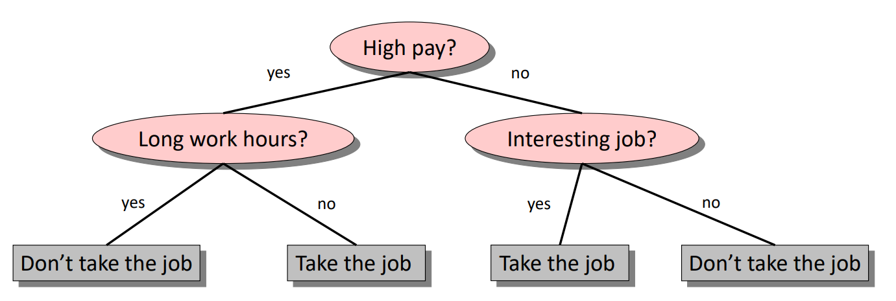
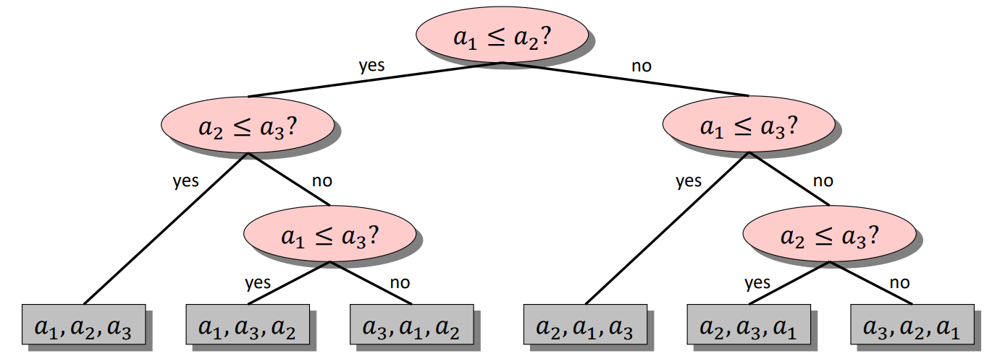
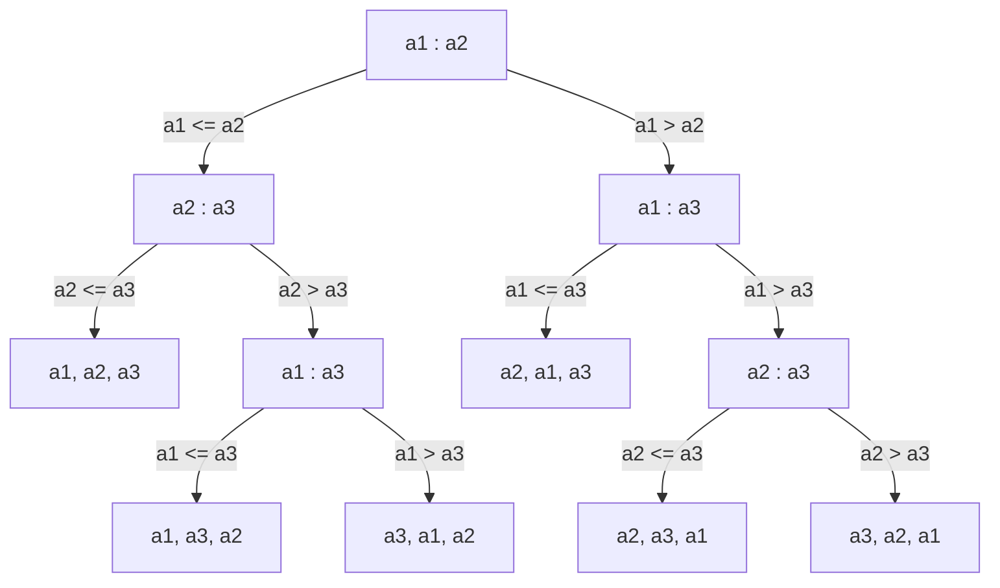

# Lower Bound for Comparison Sorting

!!! abstract "At a glance"

    - **Question:** how few comparisons can **any** comparison-based sorting algorithm make in the worst case?
    - **Key idea:** model the algorithm as a binary decision tree. It must have at least $n!$ leaves (one per input ordering), so its height is at least $\lceil \lg n! \rceil$.
    - **Result:** $\lg n! = \Theta(n \log n)$, so every comparison sort needs $\Omega(n \log n)$ comparisons in the worst case, and also on average.
    - **Consequence:** merge sort and heapsort are asymptotically optimal comparison sorts; counting and radix sort beat $n \log n$ only by leaving the comparison model.

## Motivation and Problem Context

Up to now we have proved **upper bounds**: "merge sort sorts in $O(n \log n)$". An upper bound describes one algorithm. A **lower bound** is a statement about **every possible algorithm** for a problem in a given model of computation, including algorithms nobody has invented yet. Lower bounds tell an engineer when to stop searching for a faster general-purpose sort and start exploiting structure in the data instead (small integer keys, nearly sorted input, a known distribution).

> A lower bound is the minimum cost that any algorithm of a given type must pay, in the worst case (or on average), to solve a problem.

This topic proves the most famous lower bound in algorithms, and is the reason the unit continues with [counting sort](topic5.md) and [radix sort](topic6.md).

## Problem Formulation

- **Input:** $n$ distinct keys $a_1, \dots, a_n$. (Distinctness only makes the problem easier, so a lower bound for distinct keys also holds in general.)
- **Model (comparison model):** the algorithm learns about the input **only** through comparisons $a_i \le a_j$ (equivalently $<$, $>$, $\ge$; with distinct keys each comparison has two outcomes). It may do arbitrary free computation and data movement between comparisons, but it cannot inspect key values, use them as indices, or do arithmetic on them.
- **Cost:** the number of comparisons. Running time is at least this number, so a lower bound on comparisons is a lower bound on time.
- **Goal:** determine the minimum, over all correct comparison algorithms, of the worst-case number of comparisons.

## Intuition

Before any comparisons, the input could be in any of $n!$ relative orders, and the algorithm must eventually know which one it is (it must apply a different rearrangement to each). Each yes/no comparison can at best split the set of still-possible orders in half. Starting from $n!$ possibilities and halving each time, you need at least $\lg n!$ halvings to get down to one. This is the **information-theoretic** argument: sorting requires $\lg n!$ bits of information, and each comparison yields at most one bit.

A good everyday analogy is the "20 questions" game: if the answer is one of $2^{20} \approx 10^6$ objects, 20 yes/no questions are necessary in the worst case, no matter how cleverly you ask.

## Definitions

### Decision tree

A **decision tree** for comparison sorting of $n$ elements is a full binary tree in which:

- each **internal node** is labelled with a comparison $a_i : a_j$;
- the **left** subtree is followed if $a_i \le a_j$, the **right** if $a_i > a_j$;
- each **leaf** is labelled with a permutation $\pi$, meaning "the sorted order is $a_{\pi(1)} \le a_{\pi(2)} \le \dots \le a_{\pi(n)}$".

Any deterministic comparison sort, for a fixed $n$, corresponds to exactly one decision tree: "unroll" the algorithm and record which comparison it makes next for each possible history of answers. Loops, recursion and data movement disappear; only the sequence of comparisons remains.

<figure markdown="span">
    {width="60%"}
    <figcaption>A generic decision tree: at each internal node a question is asked, the answer selects a child, and a decision is made at a leaf.</figcaption>
    <p align='right' style="font-size:0.8em"><i>Image Source: <a href="https://www.comp.nus.edu.sg/~stevenha/cs3230/lectures/lec04a.pdf" target="_blank"> NUS Notes</a></i></p>
</figure>

<figure markdown="span">
    {width="80%"}
    <figcaption>Decision tree of a comparison sort on three elements: each root-to-leaf path is one execution, and each of the 3! = 6 leaves is a distinct output ordering.</figcaption>
    <p align='right' style="font-size:0.8em"><i>Image Source: <a href="https://www.comp.nus.edu.sg/~stevenha/cs3230/lectures/lec04a.pdf" target="_blank"> NUS Notes</a></i></p>
</figure>

The same idea for insertion sort on $\langle a_1, a_2, a_3 \rangle$:



There are $6 = 3!$ leaves, and the height is $3$, so insertion sort makes at most $3$ comparisons on three elements. Since $\lceil \lg 6 \rceil = 3$, no algorithm can do better.

### Correspondence between the tree and the algorithm

| Decision tree quantity | Algorithm quantity |
| --- | --- |
| Root-to-leaf path | One execution on one input ordering |
| Length of that path | Number of comparisons on that input |
| Height $h$ | Worst-case number of comparisons |
| Average leaf depth (uniform over leaves) | Average number of comparisons on a random permutation |
| Number of leaves $L$ | Number of distinguishable outcomes |

## Key Results

### Lemma 1: a correct sort needs at least $n!$ reachable leaves

Each of the $n!$ orderings of distinct keys requires a different output permutation. If two different orderings reached the same leaf, the algorithm would apply the same rearrangement to both and get one of them wrong. Therefore $L \ge n!$.

### Lemma 2: a binary tree of height $h$ has at most $2^h$ leaves

By induction on $h$: a tree of height $0$ is a single leaf ($2^0 = 1$). A tree of height $h$ is a root with two subtrees of height at most $h - 1$, each with at most $2^{h-1}$ leaves, so at most $2^h$ in total.

### Theorem: every comparison sort makes $\Omega(n \log n)$ comparisons in the worst case

Combining the lemmas,

$$
n! \le L \le 2^h \quad\Longrightarrow\quad h \ge \lg (n!).
$$

It remains to show $\lg(n!) = \Omega(n \log n)$. Two proofs follow; know at least the elementary one.

**Elementary proof (no Stirling).** Keep only the largest $n/2$ factors of $n!$, each of which is at least $n/2$:

$$
n! = \prod_{k=1}^{n} k \;\ge\; \prod_{k=\lceil n/2 \rceil}^{n} k \;\ge\; \left(\frac{n}{2}\right)^{n/2}.
$$

Taking logarithms, $\lg(n!) \ge \frac{n}{2}\lg\frac{n}{2} = \frac{n}{2}\lg n - \frac{n}{2}$, which is at least $\frac{n}{4}\lg n$ for $n \ge 4$. Hence $h = \Omega(n \log n)$.

**Tight version via Stirling's approximation.** Stirling's formula states

$$
n! = \sqrt{2\pi n}\left(\frac{n}{e}\right)^{n}\left(1 + \Theta\!\left(\frac{1}{n}\right)\right).
$$

Taking $\lg$ of both sides,

$$
\begin{aligned}
\lg(n!) &= n\lg n - n\lg e + \tfrac{1}{2}\lg(2\pi n) + O(1/n) \\
        &= n\lg n - 1.4427\,n + O(\log n).
\end{aligned}
$$

The leading term is $n \lg n$; the others are lower order. So $h \ge n\lg n - 1.443\,n + O(\log n)$.

**Upper bound on $\lg n!$.** Since $n! \le n^n$, $\lg(n!) \le n \lg n$. Together, $\lg(n!) = \Theta(n \log n)$.

!!! warning "Important"

    The exam proof has exactly three steps: (1) at least $n!$ leaves, because every permutation needs a distinct leaf; (2) at most $2^h$ leaves in a binary tree of height $h$; (3) $h \ge \lg n! = \Omega(n \log n)$, shown with $n! \ge (n/2)^{n/2}$ or with Stirling. Skipping step 1's justification, or writing $\lg n! = n \lg n$ exactly, loses marks.

### Corollary 1: average case is also $\Omega(n \log n)$

In any binary tree with $L$ leaves, the average leaf depth is at least $\lg L$. (Sketch: a tree minimising the total leaf depth is balanced; making it unbalanced only increases the sum. Formally, by induction: if the subtrees have $L_1$ and $L_2$ leaves, the average depth is at least $1 + \frac{L_1 \lg L_1 + L_2 \lg L_2}{L}$, which is minimised at $L_1 = L_2$, giving $\lg L$.) With $L \ge n!$ and each permutation equally likely, the expected number of comparisons is at least $\lg n! = \Omega(n \log n)$. **Randomisation does not help either:** a randomised comparison sort is a probability distribution over deterministic decision trees, each of which has average depth $\ge \lg n!$ on random inputs, so its expected cost is also $\Omega(n \log n)$. This is why [randomised quicksort](topic4.md) is optimal only up to a constant.

!!! warning "Important"

    The bound is not only about the worst case. Because the **average** leaf depth of a tree with $n!$ leaves is at least $\lg n!$, the average-case and the expected (randomised) number of comparisons are also $\Omega(n \log n)$. No pivot strategy, shuffle or clever comparison order can make a comparison sort sub-$n \log n$ on average.

### Corollary 2: merge sort and heapsort are asymptotically optimal

Their worst-case comparison counts are $O(n \log n)$, matching the lower bound. Merge sort is in fact within about $0.44\,n$ comparisons of $\lg n!$ in the worst case ($n\lceil \lg n \rceil - 2^{\lceil \lg n \rceil} + 1$ versus $n \lg n - 1.443\,n$).

## Method: applying the bound

To prove an $\Omega(\cdot)$ lower bound with a decision tree:

1. Fix the model: what operations reveal information, and how many outcomes does each have ($b$)?
2. Count the number of distinct answers $N$ the algorithm must be able to produce.
3. Conclude height $\ge \log_b N$.

For example, searching a sorted array of $n$ elements for a key (with $n + 1$ possible answers: one of $n$ positions or "absent") with 3-way comparisons needs $\Omega(\log n)$ comparisons, which is why binary search is optimal.

**Reduction.** If sorting can be reduced to problem $P$ in $o(n \log n)$ extra time, then $P$ inherits the $\Omega(n \log n)$ lower bound in the same model. For instance, a comparison-based priority queue supporting `insert` and `extract-min` both in $o(\log n)$ would let us sort in $o(n \log n)$ ($n$ inserts, $n$ extracts), which is impossible. So binary heaps' $O(\log n)$ operations are optimal for comparison-based priority queues where both operations are needed.

## Worked Examples

### Example 1: exact minimum comparisons for small $n$

| $n$ | $n!$ | $\lceil \lg n! \rceil$ (lower bound) | Merge sort worst case | $n \lg n$ (rounded) |
| --- | --- | --- | --- | --- |
| 3 | 6 | 3 | 3 | 5 |
| 4 | 24 | 5 | 5 | 8 |
| 5 | 120 | 7 | 8 | 12 |
| 8 | 40320 | 16 | 17 | 24 |
| 10 | 3628800 | 22 | 25 | 33 |
| 12 | 479001600 | 29 | 33 | 43 |
| 100 | $\approx 9.3 \times 10^{157}$ | 525 | 573 | 664 |
| 1000 | huge | 8530 | 8977 | 9966 |

Five elements can in fact be sorted with 7 comparisons (the Ford-Johnson merge-insertion algorithm achieves it), so the bound is exactly tight at $n = 5$. For larger $n$ the true optimum may exceed $\lceil \lg n! \rceil$ slightly; the bound is a floor, not a promise.

### Example 2: a lower bound is about a model, not a problem

Sorting $n$ integers in the range $0..k-1$ with $k = O(n)$ takes $\Theta(n)$ time with [counting sort](topic5.md). Counting sort does not contradict the theorem: it uses a key **as an array index**, an operation with $k$ possible outcomes that the comparison model forbids. The decision tree argument simply does not apply.

### Example 3: merging two sorted lists

How many comparisons are needed to merge two sorted lists of length $n$ each? The number of possible interleavings is $\binom{2n}{n}$, so a decision tree gives $\lg \binom{2n}{n} = 2n - O(\log n)$. (A stronger adversary argument shows $2n - 1$ comparisons are necessary, which the standard merge achieves.)

## Python Implementation

The lower bound is a proof, not an algorithm, but it can be computed exactly and compared with real algorithms.

```python
import math


def comparison_lower_bound(n):
    """Minimum worst-case comparisons any comparison sort needs: ceil(log2(n!))."""
    return (math.factorial(n) - 1).bit_length()   # exact integer ceil(log2(n!)) for n >= 1


def merge_sort_worst_comparisons(n):
    """Worst-case comparisons of top-down merge sort: n*ceil(lg n) - 2^ceil(lg n) + 1."""
    if n <= 1:
        return 0
    c = (n - 1).bit_length()                       # ceil(log2 n)
    return n * c - (1 << c) + 1
```

- `(m - 1).bit_length()` equals $\lceil \lg m \rceil$ for integers $m \ge 1$, avoiding floating-point error on huge factorials.
- The merge sort formula was verified by brute force over all permutations for $n \le 8$.

## Edge Cases and Pitfalls

| Case / pitfall | What goes wrong | Fix |
| --- | --- | --- |
| Concluding "no sort can beat $n \log n$" | False for integer keys, strings with radix methods, or bounded ranges | State the model: comparison-based sorting |
| Concluding "every input needs $n \log n$" | The bound is for the worst case (and average); sorted input costs insertion sort $n - 1$ comparisons | Distinguish worst, average and best cases |
| Using $\lg n! \approx n \lg n$ as an equality in calculations | Off by about $1.44n$; wrong exact counts | Use Stirling or $\lceil \lg n! \rceil$ for exact small-$n$ answers |
| Forgetting why there are $n!$ leaves | Proof incomplete | Argue that two different orderings at the same leaf would get the same output |
| Duplicate keys | Fewer than $n!$ distinct outcomes; bound weakens (about $n \lg k$ for $k$ distinct values) | Lower bound for distinct keys still holds for the general problem |
| Assuming a ternary comparison changes the bound | With 3-way compare, height $\ge \log_3 n!$, still $\Theta(n \log n)$ | Base of the log changes only the constant |

## Common Misconceptions

- **"The lower bound says $n \log n$ is the best time for sorting."** It says $n \log n$ is the best for **comparison-based** sorting. Radix sort on 32-bit integers runs in $O(n)$ time.
- **"Quicksort is not optimal because its worst case is $n^2$."** Its worst case is not optimal, but its expected cost $\approx 1.39\,n\lg n$ is within a constant factor of the average-case lower bound $\lg n!$.
- **"Randomisation can break the barrier."** No: the expected number of comparisons of any randomised comparison sort is $\Omega(n \log n)$ on some input.
- **"The bound counts all operations."** It counts comparisons only. An algorithm can do more work (moves, index arithmetic), never less than its comparisons.
- **"A tighter algorithm would need a smarter tree shape."** Any tree has height $\ge \lg n!$; balanced trees get close, and that is exactly what merge sort and merge-insertion approximate.

## Alternatives and Trade-offs

| Approach to sorting | Model | Lower bound | Achieved by |
| --- | --- | --- | --- |
| Comparison sorting, worst case | Comparison | $\lceil \lg n! \rceil = \Theta(n \log n)$ | Merge sort, heapsort |
| Comparison sorting, average case | Comparison | average leaf depth $\ge \lg n!$ | Quicksort (constant 1.39), merge sort |
| Small integer keys in $[0, k)$ | Word-RAM, indexing allowed | $\Omega(n)$ to read input | [Counting sort](topic5.md): $\Theta(n + k)$ |
| $d$-digit keys | Word-RAM | $\Omega(n)$ | [Radix sort](topic6.md): $\Theta(d(n + r))$ |
| Uniformly distributed reals | Arithmetic on keys + probability | $\Omega(n)$ | Bucket sort, expected $\Theta(n)$ |
| Nearly sorted input with $I$ inversions | Comparison, measured in $n$ and $I$ | $\Omega(n + n\log(1 + I/n))$ | Insertion sort $\Theta(n + I)$ (not optimal for large $I$); inversion-optimal adaptive sorts |

**When the bound matters (use it):** proving that a comparison-based design is already optimal; arguing that a data structure (priority queue, balanced BST) cannot have all operations in $o(\log n)$; justifying a switch to non-comparison sorting.

**When it does not apply:** keys are small integers or fixed-length strings; data is known to be almost sorted; you only need partial order (top-$k$ needs only $O(n + k \log n)$ with a heap or $O(n)$ with selection).

## In Practice

- **Library sorts are comparison sorts** because they must work with any user-defined ordering (`key=` in Python, `Comparator` in Java, `operator<` in C++). Their designers therefore accept $\Theta(n \log n)$ and compete on constants and adaptivity: Timsort and Powersort (CPython since 3.11) reduce comparisons on inputs with existing runs, which does not contradict the bound because those inputs are not worst-case.
- **Escaping the model when keys allow it.** GPU libraries such as NVIDIA's CUB sort primitive keys with radix sort; NumPy's `kind="stable"` sort uses radix sort for 16-bit-or-smaller integer types. Both exploit the key representation, which comparison sorts cannot.
- **Comparisons can be expensive.** For string keys, a comparison is not $O(1)$; it is proportional to the common prefix length. That is why string-specialised sorts (MSD radix, multikey quicksort) can beat comparison sorts that make $\Theta(n \log n)$ full string comparisons.
- **Information-theoretic thinking beyond sorting.** The same counting argument gives the $\Omega(\log n)$ bound for search, the bit-length of compression schemes, and limits on how many tests are needed in group testing.

## Interview and Competitive Programming

**Recognition cues**

- "Can you do better than $O(n \log n)$?" → ask about the key domain: bounded integers suggest counting/radix sort; otherwise explain the comparison lower bound.
- "Design a data structure with $O(1)$ insert and $O(1)$ extract-min" → impossible in the comparison model; it would sort in $O(n)$.
- "Find the minimum and maximum with as few comparisons as possible" → pairs trick, $\lceil 3n/2 \rceil - 2$ comparisons; lower bounds for such problems use adversary arguments, a cousin of decision trees.

**Constraints to complexity:** when $n \le 10^6$ and keys are arbitrary comparables, $O(n \log n)$ is both necessary and sufficient. When the statement says values are in $[0, 10^6]$, a linear-time counting approach is often intended.

**Traps**

- Claiming "hash-based sorting in $O(n)$": hashing loses order information; it cannot sort.
- Assuming a heap built in $O(n)$ means you can sort in $O(n)$: building is $O(n)$, but extracting all elements in order costs $\Theta(n \log n)$, exactly as the bound requires.

## Using AI Assistants Critically

- Assistants sometimes state "the lower bound for sorting is $\Omega(n \log n)$" without the word **comparison**; in an exam answer or design review, that omission is an error.
- Generated proofs often assert $\lg n! = n \lg n$ or wave at "Stirling" without the inequality direction. Check that each step is a valid **lower** bound ($\ge$), not an approximation ($\approx$).
- Watch for the claim "$2^h \ge n!$ because the tree is complete": the inequality holds for **every** binary tree; completeness is irrelevant.
- If an assistant proposes an "$O(n)$ comparison sort" or an "$O(1)$ priority queue", ask which operation leaves the comparison model. If none does, the claim is false.
- Verify numeric claims (e.g. "5 elements need 8 comparisons") by computing $\lceil \lg n! \rceil$ with exact integer arithmetic as in the implementation above, not floating point.
- For average-case claims, ask whether the argument covers randomised algorithms; the correct statement is that it does (expected cost $\Omega(n \log n)$).

## Practice

**Beginner**

1. *Draw the tree.* Input: selection sort on three elements. Output: its full decision tree, its height, and the number of leaves. Is any leaf unreachable? Difficulty: easy.
2. *Compute bounds.* Input: $n = 6, 7, 16$. Output: $\lceil \lg n! \rceil$ for each, computed by hand using $\lg$ of each factor. Difficulty: easy.
3. *Model check.* Input: a list of five algorithms (insertion, counting, heapsort, radix, quicksort). Output: which ones the lower bound applies to, with a one-line reason each. Difficulty: easy.

**Intermediate**

1. *Elementary bound.* Prove $\lg(n!) \ge \frac{n}{2}\lg\frac{n}{2}$ and deduce $\lg(n!) \ge \frac{n}{4}\lg n$ for $n \ge 4$. Difficulty: medium.
2. *Searching lower bound.* Prove that any search in a sorted array of $n$ elements using 3-way comparisons ($<, =, >$, where an $=$ outcome ends the search) needs at least $\lceil \lg(n+1) \rceil$ comparisons in the worst case. Difficulty: medium.
3. *Multiset sorting.* Input: $n$ keys with only $k$ distinct values, each appearing $n/k$ times. Output: a decision tree lower bound in terms of $n$ and $k$ (count the distinguishable outcomes). Difficulty: medium.

**Advanced**

1. *Average-depth lemma.* Prove by induction that a binary tree with $L$ leaves has total leaf depth at least $L \lg L$. Difficulty: hard.
2. *Priority queue reduction.* Prove that no comparison-based priority queue can support both `insert` and `extract-min` in $o(\log n)$ amortised time. Difficulty: hard.
3. *Merging bound.* Show via an adversary that merging two sorted lists of length $n$ requires $2n - 1$ comparisons in the worst case. Difficulty: hard.

**Interview / CP**

1. *Min and max together.* Input: $n$ integers. Output: both minimum and maximum using at most $\lceil 3n/2 \rceil - 2$ comparisons. Constraints: $n \le 10^6$. Difficulty: medium.
2. *Linear-time sort.* Input: $n \le 10^6$ integers in $[0, 10^6]$. Output: sorted order in $O(n + \text{range})$ time. Explain why this does not violate the lower bound. Difficulty: medium.
3. *Second largest.* Input: $n$ distinct integers. Output: the second largest using $n + \lceil \lg n \rceil - 2$ comparisons (tournament method). Difficulty: hard.

## Self-Check Questions

??? question "Q1. Why must the decision tree of a correct comparison sort have at least $n!$ leaves?"

    Each of the $n!$ input orderings of distinct keys needs a different rearrangement to become sorted. If two orderings ended at the same leaf the algorithm would output the same permutation for both and be wrong on at least one.

??? question "Q2. State and prove the bound on the number of leaves of a binary tree of height $h$."

    At most $2^h$. Height 0 has one leaf; a tree of height $h$ consists of a root and two subtrees of height $\le h-1$, each with at most $2^{h-1}$ leaves.

??? question "Q3. Show $\lg n! = \Theta(n \log n)$ without Stirling."

    Upper: $n! \le n^n$ so $\lg n! \le n \lg n$. Lower: the top $n/2$ factors are each $\ge n/2$, so $n! \ge (n/2)^{n/2}$ and $\lg n! \ge \frac{n}{2}\lg\frac{n}{2} = \Omega(n \log n)$.

??? question "Q4. Counting sort runs in $O(n + k)$. Does it contradict the lower bound?"

    No. It uses keys as array indices, a $k$-way branching operation outside the comparison model. The decision tree argument only applies to algorithms that learn about keys by pairwise comparison.

??? question "Q5. Is randomised quicksort's expected $O(n \log n)$ consistent with the lower bound?"

    Yes. The bound says expected comparisons are $\Omega(n \log n)$ even for randomised algorithms; quicksort's $\approx 1.39\, n \lg n$ matches up to a constant factor.

??? question "Q6. What is the minimum number of comparisons to sort 5 elements, and is it achievable?"

    $\lceil \lg 120 \rceil = 7$, and 7 is achievable (Ford-Johnson merge-insertion). Merge sort needs 8 in the worst case.

??? question "Q7. A colleague claims their new comparator-based sort is $O(n \log \log n)$ on all inputs. How do you respond?"

    That is impossible in the comparison model: some input requires $\lceil \lg n! \rceil = \Theta(n \log n)$ comparisons. Either the analysis is wrong, the claim is about a restricted input class, or the algorithm uses non-comparison operations on keys.

## Complexity Summary

| Quantity | Value |
| --- | --- |
| Leaves of a correct decision tree | $\ge n!$ |
| Worst-case comparisons (any comparison sort) | $\ge \lceil \lg n! \rceil = n\lg n - 1.443\,n + O(\log n)$ |
| Average-case comparisons (any comparison sort, incl. randomised) | $\ge \lg n!$, i.e. $\Omega(n \log n)$ |
| $\lg n!$ elementary bounds | $\frac{n}{2}\lg\frac{n}{2} \le \lg n! \le n \lg n$ |
| Merge sort worst case | $n\lceil \lg n \rceil - 2^{\lceil \lg n \rceil} + 1$ |
| Comparison search in sorted array | $\Omega(\log n)$ |

## Key Takeaways

- A lower bound is a statement about every algorithm in a model, not about one algorithm.
- Any deterministic comparison sort is a binary decision tree; worst-case comparisons equal its height.
- $n!$ leaves and at most $2^h$ leaves give $h \ge \lg n! = \Theta(n \log n)$.
- The same bound holds for average-case and for randomised comparison sorts.
- Merge sort and heapsort are asymptotically optimal; quicksort is optimal in expectation up to a constant.
- Non-comparison sorts (counting, radix, bucket) escape the bound by using key values directly, not by being cleverer comparison sorts.
- Always state the model when quoting the bound.
