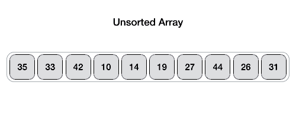
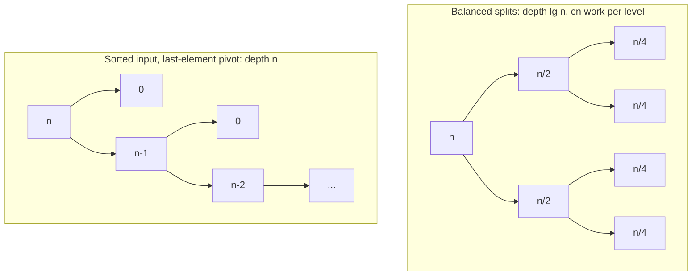

# Quicksort Analysis and Performance

!!! abstract "At a glance"

    - **Problem:** sort an array in place, fast on typical inputs.
    - **Key idea:** divide and conquer where all the work is in the **divide** step: partition around a pivot so that smaller elements go left and larger go right, then sort both sides recursively; no combine step is needed.
    - **Complexity:** $\Theta(n \log n)$ best and average (about $1.39\, n \lg n$ comparisons on random inputs), $\Theta(n^2)$ worst case; $O(\log n)$ stack if you recurse on the smaller side.
    - **Partition schemes:** Lomuto (simple, pivot ends in final place), Hoare (fewer swaps, handles duplicates better), 3-way / Dutch national flag (many duplicates).
    - **Used in:** the core of introsort (C++ `std::sort`), pdqsort (Rust `sort_unstable`, Go `sort`), Java's dual-pivot quicksort for primitive arrays.

## Motivation and Problem Context

Merge sort ([Unit 3](../unit3/topic6.md)) guarantees $\Theta(n \log n)$ but needs an $O(n)$ buffer and copies every element at every level. Heapsort ([Topic 5.1](topic1.md)) is in place but cache-unfriendly. Quicksort sits in between: in place, sequential memory access, a very tight inner loop, and on typical data it is the fastest comparison sort in practice. Its weakness is a quadratic worst case that a careless pivot rule triggers on very common inputs such as already-sorted arrays. Understanding **why** quicksort is fast and **when** it degrades is the core of this topic. How randomness removes the bad cases is the subject of [Randomised Quicksort](topic4.md).

Quicksort was invented by Tony Hoare around 1959–1960 and published in 1961–62. He later remarked that he had initially thought it too simple to be worth publishing.

## Problem Formulation

- **Input:** array $A[lo..hi]$ of keys from a totally ordered set (duplicates allowed).
- **Output:** the same array, permuted into non-decreasing order.
- **Constraints:** in place ($O(1)$ extra memory apart from the recursion stack); comparison model.
- **Partition subproblem:** given $A[lo..hi]$ and a pivot value $x$ taken from it, rearrange so that there is an index $p$ with every element of the left part $\le x$ and every element of the right part $\ge x$.

## Intuition

If we knew the median, we could put every smaller element to its left and every larger one to its right in one linear scan; the median would then be in its final position and the two halves would be independent problems of size $n/2$. That gives $T(n) = 2T(n/2) + \Theta(n) = \Theta(n \log n)$. Quicksort's bet is that we do not need the exact median: **almost any pivot that is not near the extremes is good enough**. Even a 1-to-9 split gives $\Theta(n \log n)$. Only consistently terrible pivots (the minimum or maximum, over and over) cause trouble.

<figure markdown="span">
    {width="100%"}
    <figcaption>Partitioning in action: elements are compared with the pivot and swapped so that smaller elements gather on one side, after which the pivot is placed between the two groups.</figcaption>
    <p align='right' style="font-size:0.8em"><i>Image Source: <a href="https://akshitadixit.github.io/Structurex/quickSort.html/"> Structurex</a></i></p>
</figure>

## Baseline Approach

A natural first attempt at "partition around a pivot" uses extra lists:

```text
NAIVE-QUICKSORT(L)
    if |L| <= 1 return L
    x = L[0]
    return NAIVE-QUICKSORT([y in L[1..] : y < x]) + [x] + NAIVE-QUICKSORT([y in L[1..] : y >= x])
```

It is correct and short, but it has three problems that motivate the real algorithm:

1. **Memory:** it allocates new lists at every level, $\Theta(n)$ extra per level and $\Theta(n \log n)$ total allocation on average, losing the in-place advantage over merge sort.
2. **Fixed first-element pivot:** sorted or reverse-sorted input makes every split $0$ / $n-1$, giving $\Theta(n^2)$ time and $\Theta(n)$ recursion depth (a stack overflow in Python for $n$ around $1000$).
3. **Duplicates:** with all keys equal, the `>=` side receives everything, again $\Theta(n^2)$.

The algorithm design below fixes (1) with in-place partition, and addresses (2) and (3) with better partition schemes and pivot choices.

## Algorithm Design

### Lomuto partition

Use the last element $x = A[hi]$ as pivot. Scan $j$ from $lo$ to $hi - 1$ while maintaining a boundary $i$:

- $A[lo..i]$: elements $\le x$
- $A[i+1..j-1]$: elements $> x$
- $A[j..hi-1]$: not yet examined

When $A[j] \le x$, grow the left region by swapping $A[j]$ into position $i + 1$. At the end, swap the pivot into position $i + 1$, its final sorted position.

### Hoare partition

Use $x = A[lo]$ as pivot (often after swapping a better candidate there). Two indices move towards each other: $i$ from the left stops at an element $\ge x$, $j$ from the right stops at an element $\le x$; if they have not crossed, swap and continue. It returns $j$ such that every element of $A[lo..j]$ is $\le$ every element of $A[j+1..hi]$.

| | Lomuto | Hoare |
| --- | --- | --- |
| Pivot position after partition | Final sorted position, returned index $p$ | **Not** necessarily in final position |
| Recursive calls | $A[lo..p-1]$ and $A[p+1..hi]$ | $A[lo..j]$ and $A[j+1..hi]$ |
| Swaps on random input | about $n/2$ per partition | about $n/6$ per partition (roughly 3 times fewer) |
| All keys equal | Every element $\le x$: split $n-1$ / $0$, $\Theta(n^2)$ | $i$ and $j$ stop at every element and meet in the middle: balanced, $\Theta(n \log n)$ |
| Ease of proof and implementation | Easier | Subtle (strict vs non-strict comparisons, return value) |

### 3-way partition (Dutch national flag)

When there are many duplicates, separate the array into three regions in one pass: $< x$, $= x$, $> x$. Elements equal to the pivot are then excluded from both recursive calls. Dijkstra's Dutch national flag scheme maintains:

- $A[lo..lt-1] < x$
- $A[lt..i-1] = x$
- $A[i..gt]$ unexamined
- $A[gt+1..hi] > x$

If the input has only $k$ distinct keys, 3-way quicksort's expected cost drops to $O(n \log k)$-type behaviour; with all keys equal it finishes in a single linear pass.

### Pivot choice

| Technique | Description | Pros | Cons |
| --- | --- | --- | --- |
| First / last element | Use $A[lo]$ or $A[hi]$ | Trivial | $\Theta(n^2)$ on sorted or reverse-sorted input, very common in practice |
| Middle element | Use $A[\lfloor (lo+hi)/2 \rfloor]$ | Good on sorted input | Still has deterministic bad inputs |
| Median-of-three | Median of first, middle, last | Cheap, avoids sorted-input worst case, reduces expected comparisons | Adversarial "median-of-3 killer" inputs exist |
| Random element | Uniform random index | Expected $O(n \log n)$ for **every** input ([Topic 5.4](topic4.md)) | Needs an RNG; unlucky runs possible (very unlikely) |
| Median of medians | Exact median in linear worst-case time | Guarantees $\Theta(n \log n)$ worst case | Large constant factor; rarely used for sorting |

### Controlling recursion depth

Even when time is quadratic, stack space need not be linear. After partitioning, **recurse on the smaller part and loop on the larger part**. Each recursive call is on at most half of the current range, so the recursion depth is at most $\lg n$, i.e. $O(\log n)$ stack, whatever the pivots.

## Pseudocode

```text
QUICKSORT(A, lo, hi)                     // Lomuto version
    if lo < hi
        p = LOMUTO-PARTITION(A, lo, hi)
        QUICKSORT(A, lo, p - 1)
        QUICKSORT(A, p + 1, hi)

LOMUTO-PARTITION(A, lo, hi)
    x = A[hi]
    i = lo - 1
    for j = lo to hi - 1
        if A[j] <= x
            i = i + 1
            swap A[i], A[j]
    swap A[i + 1], A[hi]
    return i + 1

HOARE-PARTITION(A, lo, hi)
    x = A[lo]
    i = lo - 1 ; j = hi + 1
    loop
        repeat i = i + 1 until A[i] >= x
        repeat j = j - 1 until A[j] <= x
        if i >= j
            return j
        swap A[i], A[j]

QUICKSORT-HOARE(A, lo, hi)               // middle pivot, O(log n) stack
    while lo < hi
        swap A[lo], A[floor((lo + hi) / 2)]
        j = HOARE-PARTITION(A, lo, hi)
        if j - lo < hi - j                // left part is smaller
            QUICKSORT-HOARE(A, lo, j)
            lo = j + 1
        else
            QUICKSORT-HOARE(A, j + 1, hi)
            hi = j

PARTITION-3WAY(A, lo, hi)                // returns (lt, gt)
    x = A[lo]
    lt = lo ; i = lo ; gt = hi
    while i <= gt
        if A[i] < x
            swap A[lt], A[i] ; lt = lt + 1 ; i = i + 1
        else if A[i] > x
            swap A[i], A[gt] ; gt = gt - 1          // do not advance i
        else
            i = i + 1
    return (lt, gt)

QUICKSORT-3WAY(A, lo, hi)
    if lo < hi
        (lt, gt) = PARTITION-3WAY(A, lo, hi)
        QUICKSORT-3WAY(A, lo, lt - 1)
        QUICKSORT-3WAY(A, gt + 1, hi)
```

## Worked Example

### Lomuto partition of $\langle 7, 2, 1, 8, 6, 3, 5, 4 \rangle$, pivot $x = 4$

| $j$ | $A[j]$ | $A[j] \le 4$? | $i$ after | array after step |
| --- | --- | --- | --- | --- |
| 0 | 7 | no | -1 | 7 2 1 8 6 3 5 4 |
| 1 | 2 | yes, swap $A[0], A[1]$ | 0 | 2 7 1 8 6 3 5 4 |
| 2 | 1 | yes, swap $A[1], A[2]$ | 1 | 2 1 7 8 6 3 5 4 |
| 3 | 8 | no | 1 | 2 1 7 8 6 3 5 4 |
| 4 | 6 | no | 1 | 2 1 7 8 6 3 5 4 |
| 5 | 3 | yes, swap $A[2], A[5]$ | 2 | 2 1 3 8 6 7 5 4 |
| 6 | 5 | no | 2 | 2 1 3 8 6 7 5 4 |
| end | | swap $A[3], A[7]$ | | 2 1 3 **4** 6 7 5 8 |

Return $p = 3$. The pivot 4 is in its final position; recurse on $\langle 2, 1, 3 \rangle$ and $\langle 6, 7, 5, 8 \rangle$.

### Hoare partition of the same array, pivot $x = A[0] = 7$

| step | $i$ stops at | $j$ stops at | action | array |
| --- | --- | --- | --- | --- |
| 1 | 0 (7 $\ge$ 7) | 7 (4 $\le$ 7) | swap | 4 2 1 8 6 3 5 7 |
| 2 | 3 (8 $\ge$ 7) | 6 (5 $\le$ 7) | swap | 4 2 1 5 6 3 8 7 |
| 3 | 6 (8 $\ge$ 7) | 5 (3 $\le$ 7) | $i \ge j$: return $j = 5$ | 4 2 1 5 6 3 \| 8 7 |

Left part $\langle 4, 2, 1, 5, 6, 3 \rangle$ is all $\le 7$, right part $\langle 8, 7 \rangle$ is all $\ge 7$. Note that the pivot 7 is **not** in its final position (it is at index 7, but belongs at index 6); that is why Hoare quicksort recurses on $A[lo..j]$ and $A[j+1..hi]$ without excluding a pivot. Only 2 swaps were needed, versus 4 for Lomuto.

### 3-way partition of $\langle 3, 5, 3, 1, 3, 6, 2, 3 \rangle$, pivot $x = 3$

| $A[i]$ examined | case | $lt$ | $i$ | $gt$ | array |
| --- | --- | --- | --- | --- | --- |
| 3 | $=$ | 0 | 1 | 7 | 3 5 3 1 3 6 2 3 |
| 5 | $>$: swap with $A[gt]$ | 0 | 1 | 6 | 3 3 3 1 3 6 2 5 |
| 3 | $=$ | 0 | 2 | 6 | 3 3 3 1 3 6 2 5 |
| 3 | $=$ | 0 | 3 | 6 | 3 3 3 1 3 6 2 5 |
| 1 | $<$: swap with $A[lt]$ | 1 | 4 | 6 | 1 3 3 3 3 6 2 5 |
| 3 | $=$ | 1 | 5 | 6 | 1 3 3 3 3 6 2 5 |
| 6 | $>$: swap with $A[gt]$ | 1 | 5 | 5 | 1 3 3 3 3 2 6 5 |
| 2 | $<$: swap with $A[lt]$ | 2 | 6 | 5 | 1 2 3 3 3 3 6 5 |

Result $(lt, gt) = (2, 5)$: all four 3s are in their final positions; only $\langle 1, 2 \rangle$ and $\langle 6, 5 \rangle$ remain to be sorted.

### Recursion trees: balanced versus degenerate



## Correctness

### Lomuto partition (loop invariant)

At the start of each iteration of the `for` loop with index $j$:

1. every element of $A[lo..i]$ is $\le x$;
2. every element of $A[i+1..j-1]$ is $> x$;
3. $A[hi] = x$.

- **Initialization:** $i = lo - 1$, $j = lo$: both ranges are empty; $A[hi] = x$ by choice.
- **Maintenance:** if $A[j] > x$, only $j$ advances and condition 2 extends to include $A[j]$. If $A[j] \le x$, $i$ increments and $A[i]$ (the first element of the "$> x$" region, or $A[j]$ itself if that region is empty) swaps with $A[j]$; now $A[i] \le x$ and the element moved to position $j$ is $> x$, so both conditions hold for $j + 1$.
- **Termination:** $j = hi$. Every element of $A[lo..hi-1]$ is in one of the two regions. Swapping $A[i+1]$ (the first $> x$ element, or $A[hi]$ itself) with $A[hi]$ places $x$ at $p = i+1$ with $A[lo..p-1] \le x < A[p+1..hi]$.

### Quicksort (strong induction on $n = hi - lo + 1$)

Base: $n \le 1$ is sorted. Step: partition returns $p$ with $A[lo..p-1] \le A[p] \le A[p+1..hi]$, and both sides have fewer than $n$ elements. By the inductive hypothesis both recursive calls sort their ranges, and since every element on the left is $\le A[p] \le$ every element on the right, the whole range is sorted. No combine step is needed.

### Hoare partition (key facts)

- After each swap, $A[lo..i] \le x$ and $A[j..hi] \ge x$.
- The scans never leave $[lo, hi]$: on the first pass $i$ stops at $lo$ because $A[lo] = x$; afterwards the elements just swapped act as sentinels that stop each scan.
- When $hi > lo$, the returned $j$ satisfies $lo \le j < hi$, so **both** recursive ranges are strictly smaller than the original. This guarantees termination.

!!! warning "Important"

    With Hoare partition, the pivot must not be taken from $A[hi]$ (for example, $x = A[hi]$ when it is the unique maximum makes the partition return $j = hi$, and the call on $A[lo..hi]$ repeats forever). Choose the pivot at $A[lo]$, or swap a middle or random element there first. Also recurse on $A[lo..j]$, not $A[lo..j-1]$.

### 3-way partition

The four-region invariant listed in Algorithm Design holds initially (all regions empty except "unexamined") and each branch keeps it: a $<$ element swaps into the end of the $<$ region (the element it displaces is an $=$ element already examined, or itself); a $>$ element swaps to the front of the $>$ region and $i$ does not advance because the incoming $A[i]$ is unexamined; an $=$ element just extends the $=$ region. The loop ends when the unexamined region is empty.

## Complexity Analysis

Partitioning a range of $n$ elements costs $\Theta(n)$ (exactly $n - 1$ comparisons for Lomuto). If the pivot ends with $q$ elements on its left, the running time satisfies

$$
T(n) = T(q) + T(n - 1 - q) + \Theta(n).
$$

### Worst case: $\Theta(n^2)$

When every split is $0$ / $n-1$ (sorted input with last-element pivot, or all-equal keys with Lomuto):

$$
T(n) = T(n-1) + \Theta(n) = \Theta\!\left(\sum_{k=1}^{n} k\right) = \Theta(n^2),
$$

with exactly $\binom{n}{2}$ comparisons for Lomuto. It can be shown by substitution that $\max_q [T(q) + T(n-1-q)] + \Theta(n)$ is $\Theta(n^2)$, so no split pattern is worse than this.

### Best case: $\Theta(n \log n)$

Perfect halving gives $T(n) = 2T(n/2) + \Theta(n)$, which is case 2 of the [Master Theorem](../unit3/topic5.md): $\Theta(n \log n)$.

### Any constant-proportion split: still $\Theta(n \log n)$

Suppose every split is 9-to-1: $T(n) = T(9n/10) + T(n/10) + cn$. In the recursion tree every full level costs at most $cn$; the shortest path to a leaf has length $\log_{10} n$ and the longest $\log_{10/9} n \approx 21.9 \lg n$. Hence $T(n) = \Theta(n \log n)$ (the constant grows as the split becomes more lopsided). This explains why quicksort is robust: bad splits must be **consistently extreme** to hurt.

### Average case over random inputs: $\approx 1.39\, n \lg n$

Assume distinct keys in uniformly random order and a fixed pivot rule (e.g. last element). Then the pivot's rank is uniform over $1..n$ and the subarrays are again uniformly random. Let $C(n)$ be the expected number of comparisons:

$$
C(n) = (n - 1) + \frac{1}{n}\sum_{q=0}^{n-1}\bigl(C(q) + C(n-1-q)\bigr) = (n - 1) + \frac{2}{n}\sum_{q=0}^{n-1} C(q), \qquad C(0) = C(1) = 0.
$$

Multiply by $n$ and subtract the same identity for $n - 1$:

$$
nC(n) - (n-1)C(n-1) = 2(n-1) + 2C(n-1) \quad\Longrightarrow\quad nC(n) = (n+1)C(n-1) + 2(n-1).
$$

Divide by $n(n+1)$ and use $\frac{2(n-1)}{n(n+1)} = \frac{4}{n+1} - \frac{2}{n}$; the left side telescopes:

$$
\frac{C(n)}{n+1} = \sum_{k=2}^{n}\left(\frac{4}{k+1} - \frac{2}{k}\right) = 2H_n + \frac{4}{n+1} - 4,
$$

so

$$
\boxed{C(n) = 2(n+1)H_n - 4n \approx 2n \ln n \approx 1.386\, n \lg n.}
$$

Quicksort makes about 39% more comparisons than the lower bound $\lg n! \approx n \lg n$ ([Topic 5.2](topic2.md)), yet it is usually faster than merge sort because each comparison is cheaper (no buffer copies, sequential access, register-friendly inner loop).

!!! warning "Important"

    This average is over **random inputs** with a fixed pivot rule. Real inputs are not random (they are often sorted or nearly sorted), so this result alone does not protect you. [Randomised quicksort](topic4.md) proves the same expected bound for **every** input, with the randomness coming from the algorithm.

### Space

- In place: $O(1)$ extra apart from the stack.
- Stack depth: $\Theta(n)$ in the worst case for naive recursion; $O(\log n)$ guaranteed when recursing on the smaller side and looping on the larger.

### Duplicates

| Input | Lomuto | Hoare | 3-way |
| --- | --- | --- | --- |
| All keys equal | $\Theta(n^2)$ | $\Theta(n \log n)$ | $\Theta(n)$ |
| $k$ distinct values, many copies each | degrades towards $n^2/k$-type cost | $\Theta(n \log n)$ | about $n \lg k$-scale, entropy-optimal up to a constant |

## Python Implementation

=== "Lomuto"

    ```python
    def lomuto_partition(a, lo, hi):
        """Partition a[lo..hi] around pivot a[hi]; return the pivot's final index."""
        pivot = a[hi]
        i = lo - 1                       # a[lo..i] holds elements <= pivot
        for j in range(lo, hi):
            if a[j] <= pivot:
                i += 1
                a[i], a[j] = a[j], a[i]
        a[i + 1], a[hi] = a[hi], a[i + 1]
        return i + 1


    def quicksort_lomuto(a, lo=0, hi=None):
        if hi is None:
            hi = len(a) - 1
        if lo < hi:
            p = lomuto_partition(a, lo, hi)
            quicksort_lomuto(a, lo, p - 1)
            quicksort_lomuto(a, p + 1, hi)
        return a
    ```

=== "Hoare (O(log n) stack)"

    ```python
    def hoare_partition(a, lo, hi):
        """Partition a[lo..hi] around pivot a[lo]; return j with
        every element of a[lo..j] <= every element of a[j+1..hi]."""
        pivot = a[lo]
        i, j = lo - 1, hi + 1
        while True:
            i += 1
            while a[i] < pivot:
                i += 1
            j -= 1
            while a[j] > pivot:
                j -= 1
            if i >= j:
                return j
            a[i], a[j] = a[j], a[i]


    def quicksort_hoare(a, lo=0, hi=None):
        """Recurse on the smaller side, loop on the larger: stack depth O(log n)."""
        if hi is None:
            hi = len(a) - 1
        while lo < hi:
            mid = (lo + hi) // 2
            a[lo], a[mid] = a[mid], a[lo]          # middle element as pivot
            p = hoare_partition(a, lo, hi)
            if p - lo < hi - p:
                quicksort_hoare(a, lo, p)          # note: p, not p - 1
                lo = p + 1
            else:
                quicksort_hoare(a, p + 1, hi)
                hi = p
        return a
    ```

=== "3-way"

    ```python
    def partition3(a, lo, hi):
        """Dutch national flag: return (lt, gt) with
        a[lo..lt-1] < pivot, a[lt..gt] == pivot, a[gt+1..hi] > pivot."""
        pivot = a[lo]
        lt, i, gt = lo, lo, hi
        while i <= gt:
            if a[i] < pivot:
                a[lt], a[i] = a[i], a[lt]
                lt += 1
                i += 1
            elif a[i] > pivot:
                a[i], a[gt] = a[gt], a[i]
                gt -= 1                            # do not advance i: a[i] is unexamined
            else:
                i += 1
        return lt, gt


    def quicksort_3way(a, lo=0, hi=None):
        if hi is None:
            hi = len(a) - 1
        if lo < hi:
            lt, gt = partition3(a, lo, hi)
            quicksort_3way(a, lo, lt - 1)
            quicksort_3way(a, gt + 1, hi)
        return a
    ```

**Walkthrough of the non-obvious lines**

- `hi=None` default lets callers write `quicksort_lomuto(xs)`; using `len(a) - 1` as a default argument directly is impossible because defaults are evaluated once.
- In Hoare, the inner `while a[i] < pivot` uses **strict** comparisons. Using `<=` would let $i$ run past equal elements and off the end of the range.
- `quicksort_hoare` recurses on `(lo, p)` including `p`, because Hoare's $j$ is a boundary, not the pivot's final position.
- The `while lo < hi` loop with one recursive call is manual tail-call elimination; Python does not optimise tail calls, so this matters for real stack depth. Measured depth on $10^5$ random keys was 12.
- In `partition3`, after swapping with `gt` the new `a[i]` has not been examined, so `i` must not advance.
- Lomuto with naive recursion hits Python's default recursion limit (1000) on sorted input of a few thousand elements: a direct demonstration of the $\Theta(n)$ worst-case depth.

## Edge Cases and Pitfalls

| Case / pitfall | What goes wrong | Fix |
| --- | --- | --- |
| Sorted / reverse-sorted input with first or last pivot | $\Theta(n^2)$ time, $\Theta(n)$ depth, stack overflow | Middle, median-of-3 or random pivot; recurse on smaller side |
| All keys equal with Lomuto | Every split is $n-1$ / $0$: quadratic | Use Hoare or 3-way partition |
| Hoare with pivot $A[hi]$ | Can return $j = hi$: infinite recursion | Pivot at $A[lo]$ (swap a chosen pivot there) |
| Hoare recursing on $(lo, j-1)$ and $(j+1, hi)$ | Element at $j$ never sorted relative to others; wrong output | Recurse on $(lo, j)$ and $(j+1, hi)$ |
| `<=` in Hoare's scans | Index runs past the range on equal keys | Strict `<` and `>` |
| Advancing `i` after the `>` swap in 3-way | An unexamined element is skipped: wrong output | Only decrement `gt` |
| Midpoint `(lo + hi) / 2` in fixed-width languages | Integer overflow for large indices | `lo + (hi - lo) / 2` in C/C++/Java |
| Empty array or single element | `hi = -1`; code must not index | Guard `lo < hi` |

## Common Misconceptions

- **"Quicksort is $O(n \log n)$."** Only in the best and average cases. The worst case is $\Theta(n^2)$; state which case you mean.
- **"Sorted input is the easy case."** For first/last-element pivots it is the worst case. Real-world data is often sorted, which is exactly why naive quicksort fails in production.
- **"Quicksort's worst case needs a rare adversarial input."** Sorted input, reverse-sorted input and all-equal keys (for Lomuto) are all common.
- **"Hoare partition puts the pivot in its final place."** It does not; it only splits into $\le$ and $\ge$ parts.
- **"Quicksort is stable because partition scans left to right."** Long-distance swaps reorder equal keys. Quicksort is not stable.
- **"Recursion depth equals running time order."** Time can be $\Theta(n^2)$ while depth is $O(\log n)$ with smaller-side recursion; they are separate resources.

## Alternatives and Trade-offs

| Algorithm | Worst time | Average time | Extra space | Stable | Practical speed |
| --- | --- | --- | --- | --- | --- |
| Quicksort (Lomuto, fixed pivot) | $\Theta(n^2)$ | $\Theta(n \log n)$ | $O(\log n)$ to $O(n)$ stack | No | Fast on random data, fragile |
| Quicksort (Hoare, median-of-3) | $\Theta(n^2)$ | $\Theta(n \log n)$ | $O(\log n)$ | No | Very fast |
| 3-way quicksort | $\Theta(n^2)$ | $\Theta(n \log n)$, $\Theta(n)$ with few distinct keys | $O(\log n)$ | No | Best with many duplicates |
| [Randomised quicksort](topic4.md) | $\Theta(n^2)$ (vanishingly unlikely) | $\Theta(n \log n)$ expected for every input | $O(\log n)$ | No | Very fast |
| Introsort | $\Theta(n \log n)$ | $\Theta(n \log n)$ | $O(\log n)$ | No | As fast as quicksort |
| [Merge sort](../unit3/topic6.md) | $\Theta(n \log n)$ | $\Theta(n \log n)$ | $O(n)$ | Yes | Good; best for linked lists and external data |
| [Heapsort](topic1.md) | $\Theta(n \log n)$ | $\Theta(n \log n)$ | $O(1)$ | No | Slower due to cache misses |

**When to use quicksort:** large in-memory arrays of primitives or small records, stability not needed, memory tight, average speed matters.

**When NOT to use it:** stability required; hard real-time worst-case guarantees (use introsort, heapsort or merge sort); linked lists (no random access, merge sort is natural); data larger than memory (external merge sort); adversarial input with a deterministic pivot rule.

## In Practice

- **C++ `std::sort`** must run in $O(n \log n)$ comparisons in the worst case (required since C++11). libstdc++ implements this with introsort: median-of-three quicksort, a switch to heapsort when the recursion depth exceeds about $2\lg n$, and a final insertion sort pass over small partitions.
- **Java `Arrays.sort` for primitive arrays** uses dual-pivot quicksort (Yaroslavskiy's algorithm, introduced in JDK 7), which partitions into three ranges with two pivots. For object arrays Java uses TimSort, because stability is observable for objects.
- **Rust `slice::sort_unstable`** was originally based on pdqsort (pattern-defeating quicksort) and was replaced by ipnsort, a pdqsort descendant, in Rust 1.81. **Go's `sort` package** switched to pdqsort in Go 1.19. pdqsort combines quicksort with insertion sort for small slices, heapsort fallback, and detection of already-sorted or all-equal patterns.
- **C `qsort`** is named after quicksort, but the C standard specifies neither the algorithm nor its complexity; implementations vary, so do not assume quicksort behaviour or stability.
- **Why quicksort is fast:** the partition loop reads memory sequentially (prefetch-friendly) and touches each element a constant number of times per level. Modern variants such as block partitioning (used in pdqsort) also reduce branch mispredictions, which can dominate run time on random data.
- **Quickselect**, the one-sided version of quicksort, finds the $k$-th smallest element in expected $O(n)$; C++ `std::nth_element` is a production version.

## Interview and Competitive Programming

**Recognition cues**

- "Sort colours / three categories in one pass, $O(1)$ space" → Dutch national flag (LeetCode 75 Sort Colors).
- "$k$-th largest / median / top-$k$ unordered" → quickselect (expected $O(n)$) rather than full sort.
- "Move all negatives before positives in place", "partition array around a value" → Lomuto or Hoare partition.
- "Implement sort without built-ins" → quicksort with a random or middle pivot plus 3-way partition, or merge sort.

**Template (partition-based selection)**

```python
import random


def quickselect(a, k):
    """Return the k-th smallest element (0-based) of a; expected O(n). Mutates a.
    Uses lomuto_partition from the implementation above."""
    lo, hi = 0, len(a) - 1
    while True:
        r = random.randint(lo, hi)
        a[r], a[hi] = a[hi], a[r]
        p = lomuto_partition(a, lo, hi)
        if p == k:
            return a[p]
        if p < k:
            lo = p + 1
        else:
            hi = p - 1
```

**Traps**

- Online judges include large sorted, reverse-sorted and all-equal tests precisely to break naive quicksort; a last-element-pivot Lomuto quicksort is a common time-limit failure on problems such as LeetCode 912 Sort an Array.
- Recursion depth in Python: even a correct quicksort on $10^5$ elements can overflow the stack unless you recurse on the smaller side.
- Comparator-based quicksort with an inconsistent comparator can loop forever in Hoare's scans.

## Using AI Assistants Critically

- Generated partition code is the classic place for off-by-one bugs: mixing Lomuto's return convention (recurse on $p-1$, $p+1$) with Hoare's (recurse on $j$, $j+1$) produces code that passes small tests and fails on duplicates.
- Assistants often produce the "Pythonic" list-comprehension quicksort and call it in place; it is not, and it is $\Theta(n^2)$ on sorted input if it uses the first element as pivot.
- Check generated Hoare code for `<=`/`>=` in the scanning loops; with duplicates this runs out of bounds or loops forever.
- Check claims such as "median-of-three guarantees $O(n \log n)$": false, adversarial inputs exist; only median-of-medians or an introsort fallback guarantees it.
- Verify with a brute-force oracle against `sorted()` on random lists with **many duplicates** (e.g. values in $[-5, 5]$), plus sorted, reversed and all-equal arrays of size $10^4$ to expose quadratic behaviour and recursion limits.
- Use an invariant assert after partition in tests: `assert all(x <= a[p] for x in a[lo:p]) and all(x >= a[p] for x in a[p+1:hi+1])`.
- Run a doubling experiment on sorted input: if time quadruples when $n$ doubles, the pivot rule is broken.

## Practice

**Beginner**

1. *Trace Lomuto.* Input: $\langle 2, 8, 7, 1, 3, 5, 6, 4 \rangle$. Output: the array after each loop iteration and the returned index. Difficulty: easy.
2. *Count comparisons.* Input: sorted array of size $n$, last-element pivot. Output: exact number of comparisons made by Lomuto quicksort as a formula in $n$. Difficulty: easy.
3. *Trace Hoare.* Input: $\langle 13, 19, 9, 5, 12, 8, 7, 4, 11, 2, 6, 21 \rangle$, pivot $A[lo]$. Output: array after each swap and the returned $j$. Difficulty: easy.

**Intermediate**

1. *Equal keys.* Input: $n$ equal keys. Output: running time of Lomuto, Hoare and 3-way quicksort with justification. Difficulty: medium.
2. *Unbalanced split.* Solve $T(n) = T(n/5) + T(4n/5) + cn$ with a recursion tree; give the depth of the deepest leaf. Difficulty: medium.
3. *Stack depth.* Prove that recursing on the smaller side gives recursion depth at most $\lfloor \lg n \rfloor$. Difficulty: medium.

**Advanced**

1. *Median-of-3 killer.* Construct an input of size $n$ that forces median-of-three quicksort (median of first, middle, last) into $\Theta(n^2)$ time. Difficulty: hard.
2. *Swaps analysis.* Show that Lomuto partition performs on average about $n/2$ swaps and Hoare about $n/6$ on random permutations. Difficulty: hard.
3. *Dual-pivot quicksort.* Implement quicksort with two pivots $p_1 \le p_2$ and three regions; compare comparison and swap counts with single-pivot quicksort experimentally. Difficulty: hard.

**Interview / CP**

1. *LeetCode 75 Sort Colors.* Input: array of 0s, 1s and 2s. Output: sorted in place in one pass with $O(1)$ extra space. Difficulty: medium.
2. *LeetCode 215 Kth Largest Element in an Array.* Input: array, $k$; $n \le 10^5$. Output: $k$-th largest in expected $O(n)$ using quickselect. Difficulty: medium.
3. *Wiggle partition.* Input: $n \le 10^5$ integers. Output: rearrange so that $A[0] < A[1] > A[2] < A[3] \dots$ if possible, using a median found by quickselect and a 3-way partition (LeetCode 324 Wiggle Sort II). Difficulty: hard.

## Self-Check Questions

??? question "Q1. What is the loop invariant of Lomuto partition?"

    Before iteration $j$: $A[lo..i] \le x$, $A[i+1..j-1] > x$, and $A[hi] = x$. At termination the final swap puts $x$ between the two regions at index $i+1$.

??? question "Q2. Why is quicksort $\Theta(n^2)$ on sorted input with a last-element pivot?"

    The pivot is the maximum each time, so the split is $n-1$ / $0$: $T(n) = T(n-1) + \Theta(n) = \Theta(n^2)$, with exactly $n(n-1)/2$ comparisons.

??? question "Q3. A 99-to-1 split at every level: what is the running time?"

    $\Theta(n \log n)$. Each level costs at most $cn$ and the depth is $\log_{100/99} n = \Theta(\log n)$; only the constant grows.

??? question "Q4. Derive the recurrence for the expected comparisons on random input and state its solution."

    $C(n) = n - 1 + \frac{2}{n}\sum_{q=0}^{n-1} C(q)$; solving by the subtract-and-telescope trick gives $C(n) = 2(n+1)H_n - 4n \approx 1.39\, n \lg n$.

??? question "Q5. Why does Hoare quicksort recurse on $A[lo..j]$ rather than $A[lo..j-1]$?"

    Hoare partition does not place the pivot at $j$; it only guarantees $A[lo..j] \le A[j+1..hi]$. Excluding $A[j]$ would leave it unsorted relative to its range.

??? question "Q6. An input has $10^6$ elements but only three distinct values. Which quicksort variant, and what cost?"

    3-way (Dutch national flag) partition: after one partition, all copies of the pivot are final, so the recursion handles at most two more distinct values; total $\Theta(n)$.

??? question "Q7. How do you guarantee $O(\log n)$ stack depth even when time is quadratic?"

    Recurse on the smaller part and iterate on the larger. Each recursive call handles at most half the current range, so depth $\le \lg n$.

??? question "Q8. Quicksort makes about 39% more comparisons than merge sort on average. Why is it often faster?"

    Its comparisons are cheaper: in-place partition with sequential memory access, no buffer copying, few writes (especially Hoare), and a tight inner loop. Constant factors and cache behaviour outweigh the comparison count.

## Complexity Summary

| Variant / case | Time | Stack space | Comparisons |
| --- | --- | --- | --- |
| Best (balanced splits) | $\Theta(n \log n)$ | $\Theta(\log n)$ | about $n \lg n$ |
| Average (random input, fixed pivot) | $\Theta(n \log n)$ | $\Theta(\log n)$ expected | $2(n+1)H_n - 4n \approx 1.39\, n\lg n$ |
| Worst (extreme pivots) | $\Theta(n^2)$ | $\Theta(n)$ naive, $O(\log n)$ smaller-side | $n(n-1)/2$ |
| Partition (any scheme) | $\Theta(n)$ | $O(1)$ | $n - 1$ (Lomuto) |
| 3-way, all keys equal | $\Theta(n)$ | $O(1)$ | about $n$ |

## Key Takeaways

- Quicksort does all its work in partitioning; correctness rests on the partition invariant plus strong induction.
- Lomuto is easiest to prove; Hoare makes fewer swaps and tolerates duplicates; 3-way partition makes duplicates nearly free.
- Any constant-proportion split gives $\Theta(n \log n)$; only consistently extreme pivots give $\Theta(n^2)$.
- Average comparisons on random input: $2(n+1)H_n - 4n \approx 1.39\, n \lg n$, derived by subtract-and-telescope.
- Sorted, reverse-sorted and all-equal inputs are realistic worst cases for naive pivot rules.
- Recurse on the smaller side for $O(\log n)$ stack, independent of pivot quality.
- Production sorts wrap quicksort in safeguards: median-of-3 or random pivots, insertion sort for small ranges, and a heapsort fallback (introsort, pdqsort).
