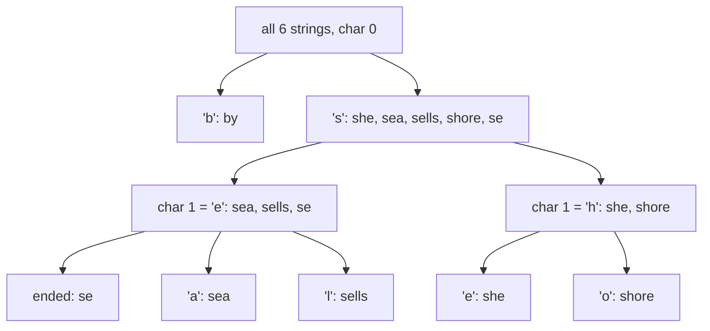

# Radix Sort

!!! abstract "At a glance"

    - **Problem:** sort $n$ keys that are fixed-length sequences of digits (integers, fixed-width strings, dates) faster than $n \log n$.
    - **Key idea (LSD):** sort by the least significant digit first, then the next, and so on, using a **stable** sort ([counting sort](topic5.md)) for each pass; stability carries the earlier passes' work forward.
    - **Complexity:** $\Theta(d(n + r))$ for $d$ digits in base $r$; for $b$-bit keys choosing $r \approx n$ gives $\Theta(bn / \log n)$, which is $\Theta(n)$ when $b = O(\log n)$.
    - **Variants:** MSD radix sort (most significant digit first, recursive, good for variable-length strings); bucket sort for uniformly distributed reals.
    - **Used in:** GPU sorting of primitive keys, database and analytics engines, suffix-array construction, NumPy's stable sort for small integer types.

## Motivation and Problem Context

[Counting sort](topic5.md) is linear only when the key range $k$ is $O(n)$. Real keys are often 32- or 64-bit integers, phone numbers, IP addresses, dates or fixed-length codes: the range is enormous, but each key is made of a few **small digits**. Radix sort exploits that structure: it runs counting sort once per digit, so the range of each pass is only the base $r$.

Historically this is how IBM punched-card sorters worked: an operator ran the deck through the machine once per column, starting from the rightmost column, and the machine distributed cards into 10 bins by that column's digit. The LSD method's counter-intuitive order (least significant first) is exactly what made those machines work.

Scenario: a telecom company must sort $5 \times 10^7$ call records by 10-digit phone number every night. A comparison sort performs about $n \lg n \approx 1.3 \times 10^9$ comparisons. LSD radix sort with base $10^5$ makes just 2 passes over the data.

## Problem Formulation

- **Input:** $n$ records, each with a key consisting of $d$ digits $x = (x_{d-1}, \dots, x_1, x_0)$ in base $r$, where $x_{d-1}$ is the most significant digit and each $x_i \in \{0, \dots, r-1\}$.
- **Order:** lexicographic on the digit sequence, most significant first (for integers this is numeric order).
- **Output:** the records in non-decreasing key order (stably, for the LSD algorithm).
- **Assumptions:** extracting a digit costs $O(1)$ (shifts and masks for integers, indexing for strings); keys are non-negative integers or fixed-length strings (negative numbers and floats need a bit transformation, see Edge Cases).

## Intuition

Think of sorting dates by (year, month, day). If you first sort stably by day, then stably by month, then stably by year, the result is fully sorted: the final pass orders by year, and among equal years the earlier passes have already arranged months and, among equal months, days. Each stable pass **refines** the order without destroying what earlier passes established for ties. This is the same multi-key idea introduced in [Topic 5.1](topic1.md), applied to the digits of a single key.

The MSD alternative is how humans sort a pile of exam scripts by name: first split into piles by first letter, then split each pile by second letter, and so on.

## Baseline Approach

1. **Comparison sort:** $\Theta(n \log n)$ comparisons, each of which may itself cost $O(d)$ for multi-digit keys or strings.
2. **Counting sort on the whole key:** $k = r^d$. For 32-bit keys $k = 2^{32}$, impossible in time and memory.
3. **MSD first, naively:** sort by the most significant digit, then by the next one **over the whole array**. Wrong: the second pass destroys the first. MSD must instead recurse **within each bucket**, which creates many small subproblems (overhead) and is the reason LSD is simpler for fixed-length keys.

LSD resolves (2) by using $d$ passes with range $r$ each, and resolves (3) by going from least significant to most significant digit with a stable sort, so no recursion is needed.

## Algorithm Design

### LSD radix sort

```text
for i = 0 to d - 1:          // least significant digit first
    stably sort the array by digit i
```

Why must the per-digit sort be stable? After processing digits $0..i-1$, the array is sorted by the suffix $(x_{i-1} \dots x_0)$. Sorting by digit $i$ must keep records with equal digit $i$ in that order, otherwise the earlier work is lost. Counting sort is the natural choice: stable, and $\Theta(n + r)$ per pass.

!!! warning "Important"

    LSD radix sort is correct **only** if every pass is stable. Selection sort, heapsort or quicksort as the digit sort give wrong answers (see the counterexample in the Worked Example). In an exam proof, the word "stable" must appear in the inductive step.

### Choosing the base

For $b$-bit integer keys, use digits of $s$ bits: $r = 2^s$ and $d = \lceil b / s \rceil$. Then

$$
T(n) = \Theta\!\left(\frac{b}{s}\,(n + 2^s)\right).
$$

- Small $s$: many cheap passes ($s = 1$ gives $b$ passes).
- Large $s$: few passes but $2^s$ counters per pass.

The two terms balance when $2^s \approx n$, i.e. $s \approx \lg n$:

- If $b \le \lfloor \lg n \rfloor$: choose $s = b$ (one pass, counting sort), $T = \Theta(n)$.
- If $b > \lfloor \lg n \rfloor$: choose $s = \lfloor \lg n \rfloor$, giving $T = \Theta\!\left(\frac{b\, n}{\lg n}\right)$. For keys bounded by a polynomial in $n$ ($b = c \lg n$), this is $\Theta(n)$ with $c$ passes.

Choosing $s$ much larger than $\lg n$ makes the $2^s$ term dominate; choosing it much smaller wastes passes.

!!! warning "Important"

    Radix sort is linear only under conditions: $d$ is constant (or $b = O(\log n)$) and $r = O(n)$. For arbitrary-length keys, $d$ grows and so does the running time. Always state $\Theta(d(n + r))$ and then the conditions under which it becomes $\Theta(n)$.

In practice, $s = 8$ (byte-wise, $r = 256$, four passes for 32-bit keys) or $s = 11$ to $16$ are common because the count array then fits in L1/L2 cache, which matters more than the pass count.

### MSD radix sort

Partition by the most significant digit into $r$ buckets (a counting-sort pass), then recursively sort each bucket on the next digit. Strings that end early go into a special "end" bucket that sorts before all characters. Advantages: examines only as many characters as needed to distinguish keys (good for long strings with distinct prefixes) and handles variable-length keys naturally. Disadvantages: recursion on many tiny buckets, each costing $\Theta(r)$ for its count array; real implementations switch to insertion sort for small buckets.

### Bucket sort (briefly)

For $n$ real numbers drawn independently and uniformly from $[0, 1)$: create $n$ buckets, put $x$ into bucket $\lfloor n x \rfloor$, sort each bucket with insertion sort, and concatenate. If $n_i$ is the size of bucket $i$, the time is $\Theta(n) + \sum_i O(n_i^2)$. Each $n_i$ is Binomial$(n, 1/n)$, so $E[n_i^2] = \text{Var}(n_i) + E[n_i]^2 = (1 - 1/n) + 1 = 2 - 1/n$, giving **expected** time $\Theta(n)$. With a skewed distribution, most elements may land in one bucket and the cost degrades to that of the inner sort ($\Theta(n^2)$ with insertion sort).

## Pseudocode

```text
RADIX-SORT-LSD(A, n, b, s)             // b-bit non-negative keys, s bits per digit
    r = 2^s
    for shift = 0, s, 2s, ... while shift < b
        A = COUNTING-SORT(A, n, r, key(x) = (x >> shift) AND (r - 1))   // stable
    return A

MSD-SORT(A, lo, hi, d)                  // strings; char(x, d) = 0 if x has ended
    if hi - lo <= 1
        return
    stably distribute A[lo..hi-1] into buckets 0..R by char(x, d)   // counting sort
    for each bucket c = 1 to R          // bucket 0 holds finished strings
        MSD-SORT(A, start(c), end(c), d + 1)

BUCKET-SORT(A, n)                      // A[i] in [0, 1)
    let B[0..n-1] be empty lists
    for each x in A
        append x to B[floor(n * x)]
    for i = 0 to n - 1
        INSERTION-SORT(B[i])
    return B[0] ++ B[1] ++ ... ++ B[n-1]
```

## Worked Example

### LSD on $\langle 329, 457, 657, 839, 436, 720, 355 \rangle$, base 10, $d = 3$

| Input | After pass 1 (ones) | After pass 2 (tens) | After pass 3 (hundreds) |
| --- | --- | --- | --- |
| 329 | 72**0** | 7**2**0 | **3**29 |
| 457 | 35**5** | 3**2**9 | **3**55 |
| 657 | 43**6** | 4**3**6 | **4**36 |
| 839 | 45**7** | 8**3**9 | **4**57 |
| 436 | 65**7** | 3**5**5 | **6**57 |
| 720 | 32**9** | 4**5**7 | **7**20 |
| 355 | 83**9** | 6**5**7 | **8**39 |

Observe stability at work: in pass 2, 329 and 720 both have tens digit 2; 720 stays before 329 because pass 1 put it first (ones digit 0 < 9). In pass 3, 329 and 355 tie on the hundreds digit and remain in the order established by pass 2 (tens 2 < 5), which is correct.

**What goes wrong with an unstable pass:** if pass 3 swapped 329 and 355 (both have hundreds digit 3), the output would begin $355, 329$: wrong. Stability is not optional.

### MSD on $\langle$ "she", "sea", "by", "sells", "shore", "se" $\rangle$



Reading the leaves left to right gives: by, se, sea, sells, she, shore. Note that "se" sorts before "sea" because the end-of-string bucket comes first, and MSD never looked past the third character of any string.

### Choosing $r$ for $n = 10^6$ 32-bit keys

| bits per digit $s$ | base $r$ | passes $d$ | work $\approx d(n + r)$ |
| --- | --- | --- | --- |
| 1 | 2 | 32 | $3.2 \times 10^7$ |
| 8 | 256 | 4 | $4.0 \times 10^6$ |
| 16 | 65536 | 2 | $2.1 \times 10^6$ |
| 20 ($\approx \lg n$) | $\approx 10^6$ | 2 | $4.1 \times 10^6$ |
| 32 | $4.3 \times 10^9$ | 1 | $4.3 \times 10^9$ |

The theory favours $s \approx 16$ here; practice often prefers $s = 8$ or $11$ because the count array stays in L1 cache.

## Correctness

**Theorem.** If each pass uses a stable sort, then after LSD passes over digits $0, 1, \dots, i$, the array is sorted by the key suffix $(x_i, x_{i-1}, \dots, x_0)$. After all $d$ passes it is sorted.

**Proof by induction on $i$.**

- **Base ($i = 0$):** the first pass sorts by $x_0$ alone, which is exactly the claim.
- **Inductive step:** assume the array is sorted by $(x_{i-1}, \dots, x_0)$ before pass $i$. Take any two records $a$ and $b$ and suppose that $(a_i, \dots, a_0) < (b_i, \dots, b_0)$ lexicographically. Two cases:
    - $a_i < b_i$: pass $i$ sorts by digit $i$, so $a$ is placed before $b$.
    - $a_i = b_i$: then $(a_{i-1}, \dots, a_0) < (b_{i-1}, \dots, b_0)$, so by the hypothesis $a$ was before $b$ before pass $i$. Since pass $i$ is **stable** and $a, b$ have equal digit $i$, $a$ stays before $b$.

    In both cases $a$ precedes $b$, so the array is sorted by $(x_i, \dots, x_0)$.
- **Conclusion:** after pass $d-1$ the array is sorted by the full key. Records with identical full keys stay in input order (each pass is stable), so LSD radix sort is itself stable.

**MSD correctness** follows by induction on the digit position: after distributing by digit $d$, every record in bucket $c$ is smaller than every record in bucket $c' > c$, and each bucket is recursively sorted on the remaining digits.

## Complexity Analysis

| Algorithm | Time | Extra space | Notes |
| --- | --- | --- | --- |
| LSD radix sort | $\Theta(d(n + r))$ | $\Theta(n + r)$ | Same cost for every input order |
| LSD, $b$-bit keys, $s = \lg n$ | $\Theta(bn / \lg n)$ | $\Theta(n)$ | $\Theta(n)$ when $b = O(\log n)$ |
| MSD radix sort (strings) | $O(N + m \cdot r)$, where $N$ = total characters examined and $m$ = number of recursive calls | $\Theta(n + d \cdot r)$ for the auxiliary array and recursion | Examines only distinguishing prefixes; each small bucket still pays $\Theta(r)$ |
| Bucket sort (uniform input) | $\Theta(n)$ expected, $\Theta(n^2)$ worst with insertion sort | $\Theta(n)$ | Depends on the distribution |

**Comparison with $n \log n$.** For $n = 10^6$ and 32-bit keys, $\lg n \approx 20$, so a comparison sort does about $2 \times 10^7$ comparisons while radix sort with $s = 8$ does 4 passes of about $10^6$ simple operations each. Radix sort wins when keys are short relative to $\lg n$; for long keys ($b \gg \lg n$, e.g. 256-bit hashes with small $n$) comparison sorts can win because comparisons usually resolve on the first word.

## Python Implementation

=== "LSD integers"

    ```python
    def radix_sort_lsd(a, bits_per_digit=8):
        """Sort non-negative integers, least significant digit first."""
        if not a:
            return []
        base = 1 << bits_per_digit
        mask = base - 1
        max_value = max(a)
        shift = 0
        out = list(a)
        while (max_value >> shift) > 0:
            out = counting_sort(out, base, key=lambda x: (x >> shift) & mask)
            shift += bits_per_digit
        return out
    ```

=== "LSD fixed-length strings"

    ```python
    def radix_sort_strings_lsd(words, width):
        """Sort equal-length ASCII strings of length `width`."""
        out = list(words)
        for pos in range(width - 1, -1, -1):
            out = counting_sort(out, 128, key=lambda w: ord(w[pos]))
        return out
    ```

=== "MSD strings"

    ```python
    def msd_radix_sort(words):
        """Sort ASCII strings of any length, most significant character first."""
        words = list(words)
        _msd(words, 0, len(words), 0)
        return words


    def _char_at(word, d):
        return ord(word[d]) + 1 if d < len(word) else 0     # 0 means "string ended"


    def _msd(words, lo, hi, d):
        if hi - lo <= 1:
            return
        count = [0] * 130                       # 0 = end of string, 1..128 = ASCII codes
        for w in words[lo:hi]:
            count[_char_at(w, d) + 1] += 1
        for c in range(1, 130):                 # count[c] = start offset of bucket c
            count[c] += count[c - 1]
        aux = [None] * (hi - lo)
        for w in words[lo:hi]:                  # left to right with start offsets: stable
            c = _char_at(w, d)
            aux[count[c]] = w
            count[c] += 1
        words[lo:hi] = aux
        start = lo + count[0]                   # strings that ended are already in place
        for c in range(1, 129):
            end = lo + count[c]
            _msd(words, start, end, d + 1)      # recurse only inside each bucket
            start = end
    ```

=== "Bucket sort"

    ```python
    def bucket_sort(a):
        """Sort floats in [0, 1). Expected O(n) if inputs are roughly uniform."""
        n = len(a)
        buckets = [[] for _ in range(n)]
        for x in a:
            buckets[int(n * x)].append(x)
        out = []
        for b in buckets:
            b.sort()                       # any stable sort; buckets are small on average
            out.extend(b)
        return out
    ```

**Walkthrough of the non-obvious lines**

- `counting_sort` is the stable routine from [Topic 5.5](topic5.md); the `key` lambda extracts one digit.
- `(x >> shift) & mask` extracts an $s$-bit digit with a shift and a bitwise AND, both $O(1)$.
- The loop condition `(max_value >> shift) > 0` stops as soon as all remaining digits are zero, so small keys need fewer passes.
- The lambda captures `shift` by reference, but `counting_sort` calls it immediately within the same iteration, so each pass sees the correct value.
- In MSD, offsets are computed as **start** positions (`count[c + 1] += 1` then prefix sums) and records are placed left to right, the stable alternative to right-to-left placement mentioned in [Topic 5.5](topic5.md).
- Tests: random 30-bit integers with digit sizes 1, 4, 8, 11 and 16 bits; random strings over a small alphabet including the empty string; floats in $[0, 1)$; all checked against `sorted()`.

## Edge Cases and Pitfalls

| Case / pitfall | What goes wrong | Fix |
| --- | --- | --- |
| Unstable per-digit sort | Later passes scramble earlier ones: wrong output | Use stable counting sort for each pass |
| Processing MSD-first with LSD logic (no recursion) | Each pass destroys the previous one | LSD must start from the least significant digit; MSD must recurse per bucket |
| Negative integers (two's complement) | Negative numbers have the top bit set and sort after positives | Flip the sign bit (XOR with $2^{b-1}$) before sorting and back afterwards, or offset by the minimum |
| IEEE-754 floats | Bit patterns of negative floats are ordered in reverse | Map: if sign bit set, invert all bits; else flip the sign bit. Then sort as unsigned integers |
| Variable-length strings with LSD | Short strings have no digit at a position | Pad with a character smaller than all others, or use MSD |
| Too large a base | $2^s$ counters exceed cache or memory; $\Theta(r)$ term dominates | Choose $r \approx n$ at most; often $r = 2^8$ to $2^{16}$ |
| Many tiny buckets in MSD | $\Theta(r)$ count array per bucket dominates | Switch to insertion sort for small buckets |
| Bucket sort on skewed data | One bucket gets most elements: quadratic | Use only when the distribution is known; or sample to choose bucket boundaries |

## Common Misconceptions

- **"Radix sort is always $O(n)$."** It is $\Theta(d(n + r))$. It is linear only when the number of digits is constant (or $O(1)$ multiples of $\lg n$ bits) and $r = O(n)$.
- **"Radix sort starts with the most significant digit."** LSD starts with the least significant; that is what makes the non-recursive version correct. MSD is a different algorithm.
- **"Any sort works for each digit."** Only a stable one does for LSD.
- **"Radix sort is in place."** LSD with counting sort needs $\Theta(n + r)$ extra space. In-place MSD variants (American flag sort) exist but are not stable.
- **"Bucket sort is linear for any input."** Its $\Theta(n)$ bound is an expectation over a uniform input distribution.
- **"Radix sort always beats quicksort."** For long keys or small $n$, the $d$ passes and the extra memory traffic can lose to a cache-friendly comparison sort.

## Alternatives and Trade-offs

| Algorithm | Time | Space | Stable | Keys | Best when |
| --- | --- | --- | --- | --- | --- |
| [Counting sort](topic5.md) | $\Theta(n + k)$ | $\Theta(n + k)$ | Yes | integers in $[0, k)$ | $k = O(n)$ |
| LSD radix sort | $\Theta(d(n + r))$ | $\Theta(n + r)$ | Yes | fixed-length digit strings | many fixed-width integer keys |
| MSD radix sort | depends on distinguishing prefixes | $\Theta(n + d r)$ | Yes (with aux array) | variable-length strings | strings with short distinguishing prefixes |
| Bucket sort | $\Theta(n)$ expected | $\Theta(n)$ | Yes | reals with known distribution | uniform data |
| [Quicksort](topic3.md) / introsort | $\Theta(n \log n)$ | $O(\log n)$ | No | any comparable | general-purpose, in place |
| Merge sort / Timsort | $\Theta(n \log n)$ | $\Theta(n)$ | Yes | any comparable | stability, presorted runs, custom comparators |

**When to use radix sort:** large $n$ with fixed-width integer or string keys; parallel or GPU sorting; when the same key format is sorted repeatedly (database columns, network packets by address).

**When NOT to use it:** custom comparators or keys without a digit decomposition; small $n$; very long keys with little shared prefix; memory too tight for an $O(n)$ buffer; when only top-$k$ is needed.

## In Practice

- **GPUs.** Radix sort is the standard sort for primitive keys on GPUs because each pass is a data-parallel count, prefix-sum and scatter. NVIDIA's CUB library provides `DeviceRadixSort`, and Thrust uses radix sort for primitive key types.
- **NumPy.** `np.sort(..., kind="stable")` uses radix sort for integer types of 16 bits or less and Timsort/merge sort otherwise, according to the NumPy documentation.
- **Databases and analytics.** Column stores and query engines commonly radix-partition fixed-width keys for sorting, hash joins and aggregation, because a radix pass touches each value once and parallelises well.
- **Strings and genomics.** MSD radix sort and its relative multikey (3-way radix) quicksort are standard for sorting large string collections; suffix-array construction for genome indexing relies on radix passes over integer ranks.
- **Networking.** Routers and packet classifiers use radix-tree (trie) structures keyed on address bits, the data-structure cousin of MSD radix sort.
- **Engineering realities.** Radix sort's passes are memory-bound: each pass reads and writes all $n$ records, and the scatter step writes to $r$ different locations, which stresses caches and TLBs when $r$ is large. Production implementations tune the digit size to the cache and often compute histograms for all digits in a single initial pass.

## Interview and Competitive Programming

**Recognition cues**

- "Sort in linear time", "$O(n)$ time and space" with integer inputs → radix sort or counting sort.
- "Maximum gap between successive elements in sorted order, in linear time" → radix sort, or bucket sort with the pigeonhole principle (LeetCode 164 Maximum Gap).
- "Sort strings of equal length" or "sort IP addresses" → LSD on characters or bytes.
- "Suffix array in $O(n \log n)$" → prefix doubling with radix (counting) sort on rank pairs.

**Template: sort pairs $(a, b)$ with $0 \le a, b < n$ in $\Theta(n)$**

```text
counting-sort by b (secondary key)
counting-sort by a (primary key)      // stable, so ties keep b-order
```

This is exactly a 2-digit LSD radix sort in base $n$, the inner step of suffix-array prefix doubling.

**Constraints to complexity**

| Constraint | Signal |
| --- | --- |
| $n \le 10^7$, 32-bit keys, tight time limit | LSD radix sort with 8- or 16-bit digits |
| keys $< n^2$ | 2 passes of base $n$: $\Theta(n)$ |
| arbitrary objects with a comparator | radix sort not applicable |

**Traps**

- Forgetting negative numbers in hidden tests.
- Using Python radix sort for speed: in pure Python, the library sort (implemented in C) is usually faster; radix sort pays off in C/C++/Rust or vectorised code.

## Using AI Assistants Critically

- LLM-generated radix sort often uses an unstable inner sort, or rebuilds buckets in an order that reverses ties; check every pass for stability with a test that has many equal digits.
- Generated code commonly loops `while max_value // exp > 0` but forgets negative inputs, or computes the number of passes from `len(str(max_value))` and breaks on zero or negative values. Test with `0`, negatives and a single element.
- Assistants frequently claim "radix sort is $O(n)$" without conditions or call MSD and LSD interchangeable. Ask for $\Theta(d(n + r))$ and the stability argument.
- Watch for lambdas capturing a loop variable that is evaluated later (e.g. building a list of key functions in a loop); in this page's code each lambda is used immediately, which is safe.
- Verify with brute force: compare against `sorted()` for random integers of several bit widths and random strings of varying length including the empty string.
- Benchmark claims with a doubling experiment and also by varying the digit size; if doubling $n$ doubles time across a range, the implementation is behaving linearly.

## Practice

**Beginner**

1. *Trace LSD.* Input: $\langle 170, 45, 75, 90, 802, 24, 2, 66 \rangle$ in base 10. Output: the array after each pass. Difficulty: easy.
2. *Trace strings.* Input: the 3-letter words COW, DOG, SEA, RUG, ROW, MOB, BOX, TAB. Output: the list after each character pass of LSD. Difficulty: easy.
3. *Passes.* Input: $n = 10^6$ keys of 40 bits. Output: number of passes and counter-array size for digit sizes 8, 10 and 20 bits. Difficulty: easy.

**Intermediate**

1. *Stability proof.* Show by counterexample that LSD radix sort fails if the per-digit sort is selection sort. Difficulty: medium.
2. *Keys in $[0, n^3)$.* Sort $n$ integers in this range in $\Theta(n)$ time; justify the base and the number of passes. Difficulty: medium.
3. *Negative and float keys.* Implement the bit transformations that make LSD radix sort correct for signed 32-bit integers and for 32-bit floats. Difficulty: medium.

**Advanced**

1. *Optimal digit size.* Prove that for $b$-bit keys, choosing $s = \min(b, \lfloor \lg n \rfloor)$ minimises $\Theta((b/s)(n + 2^s))$ up to a constant factor. Difficulty: hard.
2. *Bucket sort analysis.* Prove $E[n_i^2] = 2 - 1/n$ for bucket sort and deduce expected $\Theta(n)$ time. Difficulty: hard.
3. *Multikey quicksort.* Implement 3-way radix quicksort for strings and compare it with MSD radix sort on a dictionary of words. Difficulty: hard.

**Interview / CP**

1. *LeetCode 164 Maximum Gap.* Input: $n \le 10^5$ non-negative integers $< 2^{31}$. Output: the maximum difference between successive elements in sorted order, in linear time. Difficulty: hard.
2. *Sort pairs.* Input: $n \le 10^6$ pairs $(a, b)$ with $0 \le a, b < n$. Output: pairs sorted lexicographically in $\Theta(n)$. Difficulty: medium.
3. *IPv4 sort.* Input: $n \le 10^6$ IPv4 addresses as dotted strings. Output: addresses in numeric order using 4 byte-wise passes. Difficulty: medium.

## Self-Check Questions

??? question "Q1. Why does LSD radix sort process the least significant digit first?"

    Each stable pass refines the order: after pass $i$, the array is sorted by the last $i+1$ digits. The final pass, on the most significant digit, decides the order, and stability keeps the lower-digit order for ties. Going MSD-first without recursion would let later passes destroy earlier ones.

??? question "Q2. Prove the inductive step of LSD's correctness."

    If $a_i < b_i$, pass $i$ puts $a$ first. If $a_i = b_i$ then $a$'s lower suffix is smaller, so $a$ was already before $b$ by the hypothesis, and the stable pass keeps it there.

??? question "Q3. What is the running time of LSD radix sort, and when is it linear?"

    $\Theta(d(n + r))$. Linear when $d = O(1)$ and $r = O(n)$, e.g. $b$-bit keys with $b = O(\log n)$ using base $r \approx n$.

??? question "Q4. Sort $n$ integers in $[0, n^2)$ in linear time."

    Use base $n$: each key has 2 digits. Two stable counting-sort passes cost $\Theta(n + n)$ each, $\Theta(n)$ total.

??? question "Q5. When is MSD preferable to LSD?"

    For variable-length strings, or when keys are long but distinguished by short prefixes: MSD examines only the characters needed and handles different lengths naturally.

??? question "Q6. Why is bucket sort's linear bound only an expectation?"

    It relies on elements spreading evenly among buckets. Under the uniform assumption $E[n_i^2] = 2 - 1/n$, but if all elements fall into one bucket, the inner sort costs $\Theta(n^2)$ with insertion sort.

??? question "Q7. You need to sort $10^8$ 64-bit keys on a GPU. Which algorithm and digit size?"

    LSD radix sort, which parallelises as count, prefix-sum, scatter per pass. Digit sizes of 4 to 8 bits are typical so per-block histograms fit in fast on-chip memory; 64-bit keys then need 8 to 16 passes.

## Complexity Summary

| Algorithm | Time | Extra space | Stable | Condition for linear time |
| --- | --- | --- | --- | --- |
| LSD radix sort | $\Theta(d(n + r))$ | $\Theta(n + r)$ | Yes | $d = O(1)$, $r = O(n)$ |
| LSD, $b$-bit keys, $r = 2^{\lfloor \lg n \rfloor}$ | $\Theta(bn / \log n)$ | $\Theta(n)$ | Yes | $b = O(\log n)$ |
| MSD radix sort | proportional to characters examined plus bucket overhead | $\Theta(n + d r)$ | Yes | short distinguishing prefixes |
| Bucket sort | $\Theta(n)$ expected, $\Theta(n^2)$ worst | $\Theta(n)$ | Yes | uniform input |

## Key Takeaways

- Radix sort decomposes keys into digits and runs a stable linear-time sort per digit.
- LSD processes digits from least to most significant; correctness is induction on digits and depends entirely on stability.
- Cost is $\Theta(d(n + r))$; for $b$-bit keys pick $r \approx 2^{\lg n}$ to get $\Theta(bn / \log n)$, linear when $b = O(\log n)$.
- MSD radix sort recurses per bucket; it suits variable-length strings and examines only distinguishing prefixes.
- Bucket sort is linear only in expectation under a uniform distribution.
- In practice radix sort dominates on GPUs and for fixed-width keys; digit size is tuned to cache, not just to the formula.
