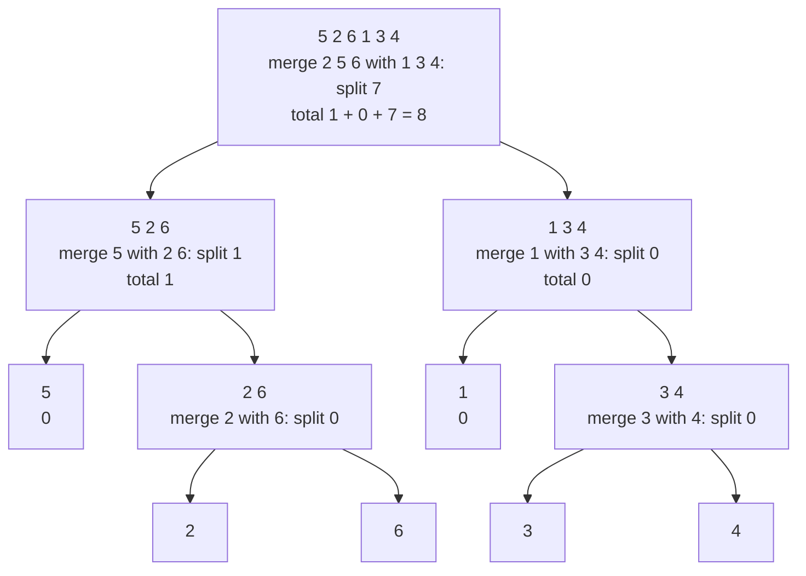

# Counting Inversions

!!! abstract "At a glance"

    - **Problem:** count pairs $(i, j)$ with $i < j$ and $A[i] > A[j]$, a measure of how far an array is from sorted.
    - **Key idea:** piggyback on merge sort. Inversions split into left-half, right-half and cross pairs; cross pairs are counted in bulk during the merge, because when a right element is output, **every remaining left element** forms an inversion with it.
    - **Complexity:** $\Theta(n \log n)$ time, $\Theta(n)$ extra space, versus $\Theta(n^2)$ for checking all pairs. A Fenwick tree (BIT) gives an alternative $O(n \log n)$ method.
    - **Used in:** Kendall tau rank correlation, comparing rankings (recommendation systems, search results, voting), measuring presortedness, minimum adjacent swaps, permutation parity.

## Motivation and Problem Context

Two users rate the same 10 films. How similar are their tastes? One natural measure: list the films in the order user A ranks them and write down user B's rank for each. If B agrees with A completely, the sequence is $1, 2, \dots, 10$ (sorted). Every pair of films that B orders differently from A appears as an **inversion**. The number of inversions is the **Kendall tau distance** between the two rankings. Recommendation systems, search-engine evaluation (comparing a new ranking algorithm against a baseline), sports and voting analysis, and statistics (Kendall's rank correlation) all need this number for large $n$, where an $O(n^2)$ scan over all pairs is too slow.

Inversions also measure the cost of sorting by adjacent swaps (bubble sort and insertion sort perform exactly $I$ swaps or shifts, see [Topic 5.1](topic1.md)) and decide the parity of a permutation, which settles puzzles such as whether a 15-puzzle configuration is solvable.

## Problem Formulation

- **Input:** array $A[0..n-1]$ of comparable keys (duplicates allowed).
- **Output:** $I(A) = \left|\{(i, j) : 0 \le i < j < n,\ A[i] > A[j]\}\right|$.
- **Notes:** pairs with $A[i] = A[j]$ are **not** inversions. $0 \le I(A) \le \binom{n}{2}$; $I = 0$ iff $A$ is sorted; $I = \binom{n}{2}$ iff $A$ is strictly decreasing.
- **Model:** comparison model; the output can be as large as about $n^2/2$, so it needs a 64-bit integer for $n$ beyond about $65{,}000$.

## Intuition

Split $A$ into a left half $L$ and a right half $R$. Every inversion is one of three kinds:

1. both elements in $L$ (a **left** inversion),
2. both in $R$ (a **right** inversion),
3. one in $L$ and one in $R$ (a **split** inversion: $x \in L$, $y \in R$, $x > y$).

Kinds 1 and 2 are smaller instances of the same problem: recurse. For kind 3, the positions inside each half no longer matter, only which half an element came from. So we may **sort each half** first. If $L$ and $R$ are sorted, then during the merge, the moment we output $y$ from $R$ because $y < L[i]$, every element $L[i], L[i+1], \dots$ is also greater than $y$: that is $|L| - i$ split inversions counted in $O(1)$. The recursion sorts the halves anyway, so we get the count almost for free from [merge sort](../unit3/topic6.md).

## Baseline Approach

```text
BRUTE-FORCE-INVERSIONS(A, n)
    count = 0
    for i = 0 to n - 2
        for j = i + 1 to n - 1
            if A[i] > A[j]
                count = count + 1
    return count
```

This examines all $\binom{n}{2}$ pairs: $\Theta(n^2)$ time. For $n = 10^6$ that is $5 \times 10^{11}$ comparisons, hours of computation. The bottleneck is that it confirms inversions **one at a time**, while the output can be $\Theta(n^2)$. To be faster we must count inversions **in groups** without listing them, which is exactly what the merge step achieves.

## Algorithm Design

**Divide:** split at the midpoint. **Conquer:** recursively count inversions in each half **and return each half sorted**. **Combine:** merge the two sorted halves while counting split inversions.

The modification to the standard merge is one line. With pointers $i$ into $L$ and $j$ into $R$:

- If $L[i] \le R[j]$: output $L[i]$. No new inversion: $L[i]$ is not greater than $R[j]$ or any later element of $R$ (they are all $\ge R[j]$).
- If $L[i] > R[j]$: output $R[j]$ and add $|L| - i$: all of $L[i..]$ are $\ge L[i] > R[j]$, and each of them precedes $R[j]$ in the original array.

Using $\le$ (take from the left on ties) is what keeps equal elements from being counted, and it is also what makes merge sort stable.

!!! warning "Important"

    The count added is $|L| - i$ (the number of **remaining** left elements), not 1 and not $|R| - j$. And it is added when an element is taken from the **right** half. These two details are the usual source of wrong answers in exams and contests.

## Pseudocode

```text
SORT-AND-COUNT(A)
    if |A| <= 1
        return (A, 0)
    mid = floor(|A| / 2)
    (L, x) = SORT-AND-COUNT(A[0 .. mid-1])
    (R, y) = SORT-AND-COUNT(A[mid .. |A|-1])
    (M, z) = MERGE-AND-COUNT(L, R)
    return (M, x + y + z)

MERGE-AND-COUNT(L, R)
    i = 0 ; j = 0 ; split = 0 ; M = empty list
    while i < |L| and j < |R|
        if L[i] <= R[j]
            append L[i] to M ; i = i + 1
        else
            append R[j] to M ; j = j + 1
            split = split + (|L| - i)      // R[j] is smaller than all of L[i..]
    append L[i..] and R[j..] to M
    return (M, split)
```

## Worked Example

Count inversions in $A = \langle 5, 2, 6, 1, 3, 4 \rangle$. By hand the inversions are $(5,2), (5,1), (5,3), (5,4), (2,1), (6,1), (6,3), (6,4)$: $8$ in total.



**Top-level merge of $L = \langle 2, 5, 6 \rangle$ and $R = \langle 1, 3, 4 \rangle$:**

| $L[i]$ | $R[j]$ | action | added | running split |
| --- | --- | --- | --- | --- |
| 2 | 1 | $2 > 1$: output 1 | $3 - 0 = 3$ (pairs $(2,1), (5,1), (6,1)$) | 3 |
| 2 | 3 | output 2 | 0 | 3 |
| 5 | 3 | $5 > 3$: output 3 | $3 - 1 = 2$ (pairs $(5,3), (6,3)$) | 5 |
| 5 | 4 | $5 > 4$: output 4 | $3 - 1 = 2$ (pairs $(5,4), (6,4)$) | 7 |
| 5 | none | append 5, 6 | 0 | 7 |

Totals: left half $\langle 5, 2, 6 \rangle$ contributes $1$ (the pair $(5,2)$), right half $\langle 1, 3, 4 \rangle$ contributes $0$, split contributes $7$: $1 + 0 + 7 = 8$.

### Kendall tau distance example

Ranking A: $\langle A, B, C, D, E \rangle$. Ranking B: $\langle C, A, E, B, D \rangle$. Replace each item in A's order by its position in B: $A \to 1, B \to 3, C \to 0, D \to 4, E \to 2$, giving $\langle 1, 3, 0, 4, 2 \rangle$. Its inversions are $(1,0), (3,0), (3,2), (4,2)$, so the Kendall tau distance is $4$: four pairs of items are ordered differently by the two rankings. The Kendall rank correlation coefficient (no ties) is

$$
\tau = 1 - \frac{4 \cdot I}{n(n-1)} = 1 - \frac{16}{20} = 0.2,
$$

where $\tau = 1$ means identical rankings and $\tau = -1$ means reversed.

## Correctness

**Lemma (merge-and-count).** If $L$ and $R$ are sorted, `MERGE-AND-COUNT` returns the number of pairs $(x, y)$ with $x \in L$, $y \in R$, $x > y$, and returns $L \cup R$ sorted.

*Proof.* The merged output is sorted by the standard merge argument ([Unit 3](../unit3/topic6.md)). For counting, fix $y = R[j]$ and look at the moment $y$ is output (every element of $R$ is output exactly once, either in the loop or in the final append).

- If $y$ is output inside the loop, then $L[i] > y$ at that moment. Every element $L[i'], i' \ge i$, satisfies $L[i'] \ge L[i] > y$: $|L| - i$ inversions, which the algorithm adds. Every element $L[i'], i' < i$, was output earlier, when $L[i'] \le R[j']$ for some $j' \le j$, so $L[i'] \le R[j'] \le y$: not an inversion.
- If $y$ is output in the final append, then $L$ is exhausted: every element of $L$ was output earlier with $L[i'] \le$ some $R[j'] \le y$, so $y$ has no split inversions; the algorithm adds 0.

Thus each $y \in R$ contributes exactly its number of larger elements in $L$, and the sum is the number of split inversions.

**Theorem.** `SORT-AND-COUNT(A)` returns $A$ sorted and $I(A)$.

*Proof by strong induction on $n$.* For $n \le 1$ there are no pairs. For $n \ge 2$, every inversion $(i, j)$ has both indices in the left half, both in the right half, or $i$ in the left and $j$ in the right (since $i < j$, never the reverse). By the inductive hypothesis $x$ and $y$ count the first two kinds exactly, and the recursive calls return sorted halves. Sorting a half does not change which elements are in it, so the split inversions of $A$ are exactly the pairs counted by the lemma. The three sets are disjoint, so the total is $x + y + z$.

## Complexity Analysis

`MERGE-AND-COUNT` does $\Theta(|L| + |R|)$ work: one extra addition per right-element output. Hence

$$
T(n) = 2T(n/2) + \Theta(n) = \Theta(n \log n)
$$

by case 2 of the [Master Theorem](../unit3/topic5.md), identical to merge sort. The count is computed in $\Theta(n \log n)$ time even though it can be as large as $\Theta(n^2)$, because each addition accounts for up to $|L|$ inversions at once.

!!! warning "Important"

    The answer can be as large as $\binom{n}{2}$. For $n = 2 \times 10^5$ that is about $2 \times 10^{10}$, far above the 32-bit limit of about $2.1 \times 10^9$. In C, C++ and Java, the counter and the per-call return values must be 64-bit.

**Space:** $\Theta(n)$ for the merge buffers; recursion depth $\Theta(\log n)$. The slicing in the Python version below allocates $\Theta(n \log n)$ in total over the run (but only $\Theta(n)$ live at any time); an index-based version with one shared buffer uses $\Theta(n)$ allocation.

### Fenwick tree (BIT) alternative

Scan $A$ from left to right, keeping a frequency structure of the values seen so far. When processing $A[t]$, the number of inversions it closes is the number of earlier elements greater than $A[t]$:

$$
\text{greater}(t) = t - \#\{s < t : A[s] \le A[t]\}.
$$

A Fenwick tree (binary indexed tree) over value ranks answers "how many seen values have rank $\le r$" and records a new value in $O(\log m)$ each, where $m \le n$ is the number of distinct values. After **coordinate compression** (replace each value by its rank among the sorted distinct values), the total is $O(n \log n)$ time and $O(n)$ space. The BIT approach is often easier to adapt to online variants (elements arriving one at a time) and to related queries such as "count of smaller elements after self".

## Python Implementation

=== "Merge-based"

    ```python
    def count_inversions(a):
        """Return (sorted copy of a, number of pairs i < j with a[i] > a[j])."""
        if len(a) <= 1:
            return list(a), 0
        mid = len(a) // 2
        left, inv_left = count_inversions(a[:mid])
        right, inv_right = count_inversions(a[mid:])
        merged, inv_split = merge_and_count(left, right)
        return merged, inv_left + inv_right + inv_split


    def merge_and_count(left, right):
        merged = []
        i = j = 0
        split = 0
        while i < len(left) and j < len(right):
            if left[i] <= right[j]:            # <= : equal elements are not inversions
                merged.append(left[i])
                i += 1
            else:
                merged.append(right[j])
                split += len(left) - i         # right[j] is smaller than all of left[i:]
                j += 1
        merged.extend(left[i:])
        merged.extend(right[j:])
        return merged, split
    ```

=== "Fenwick tree"

    ```python
    def count_inversions_bit(a):
        """Fenwick-tree method: O(n log n) after coordinate compression."""
        ranks = {v: r for r, v in enumerate(sorted(set(a)), start=1)}
        m = len(ranks)
        tree = [0] * (m + 1)

        def add(i):
            while i <= m:
                tree[i] += 1
                i += i & -i

        def prefix(i):
            s = 0
            while i > 0:
                s += tree[i]
                i -= i & -i
            return s

        inversions = 0
        for seen, v in enumerate(a):
            r = ranks[v]
            inversions += seen - prefix(r)     # earlier elements strictly greater than v
            add(r)
        return inversions
    ```

=== "Kendall tau distance"

    ```python
    def kendall_tau_distance(rank_a, rank_b):
        """Number of item pairs ordered differently by two rankings of the same items."""
        position_in_b = {item: i for i, item in enumerate(rank_b)}
        sequence = [position_in_b[item] for item in rank_a]
        return count_inversions(sequence)[1]
    ```

**Walkthrough of the non-obvious lines**

- `count_inversions` returns the sorted list as well as the count; the parent call needs sorted halves for the merge count to be valid.
- `split += len(left) - i` is the only change from plain merge sort.
- In the BIT version, `seen - prefix(r)` counts earlier elements with rank **greater** than $r$; using `prefix(r - 1)` instead would wrongly count equal values as inversions.
- `i & -i` isolates the lowest set bit, the step size of a Fenwick tree.
- Python integers do not overflow, but in C++/Java the count must be a 64-bit type: for $n = 10^5$ the maximum is about $5 \times 10^9 > 2^{31}$.
- All three functions were tested against the $O(n^2)$ brute force on random arrays with many duplicates, plus empty, single-element, sorted and reversed inputs ($n(n-1)/2$ inversions).

## Edge Cases and Pitfalls

| Case / pitfall | What goes wrong | Fix |
| --- | --- | --- |
| Using `<` instead of `<=` in the merge | Equal elements counted as inversions | Take from the left on ties |
| Adding 1 instead of `len(left) - i` | Counts only one inversion per right element | Add the number of remaining left elements |
| Counting when taking from the left | Counts non-inversions | Count only when the right element is smaller |
| 32-bit counter in C++/Java | Overflow for $n \gtrsim 65{,}000$ | Use `long long` / `long` |
| Not returning the sorted halves | Merge count is meaningless on unsorted halves | Return `(sorted, count)` from each call |
| BIT without coordinate compression | Huge or negative values break array indexing | Map values to ranks $1..m$ first |
| Python recursion on huge $n$ | Depth is only $\lceil \lg n \rceil$, so fine; slicing cost is the real overhead | Use an index-based version with one shared buffer for performance |
| Variant "count $i < j$ with $A[i] > 2A[j]$" | Merge comparison and counting condition differ; counting during the merge gives wrong answers | Count in a separate two-pointer pass over the sorted halves before merging |

## Common Misconceptions

- **"Counting inversions needs $\Omega(n^2)$ time because there can be $n^2/2$ of them."** We count without listing; the merge adds up to $|L|$ inversions in one step.
- **"The number of inversions equals the minimum number of swaps to sort."** It equals the minimum number of **adjacent** swaps. With arbitrary swaps the minimum is $n - (\text{number of cycles})$.
- **"Equal elements form half an inversion."** Under the standard definition they form none. Statistical versions (Kendall's tau-b) handle ties separately.
- **"Merge sort and the BIT method do different things."** Both compute exactly $I(A)$ in $O(n \log n)$; they differ in structure (offline divide and conquer vs online scan) and in which variants they adapt to easily.
- **"Kendall tau distance needs the items to be numbers."** It needs two rankings of the same items; map one ranking to positions in the other and count inversions.

## Alternatives and Trade-offs

| Method | Time | Space | Online? | Notes |
| --- | --- | --- | --- | --- |
| Brute force | $\Theta(n^2)$ | $O(1)$ | Yes | Fine for $n \le 5000$; useful as a test oracle |
| Insertion sort, count shifts | $\Theta(n + I)$ | $O(1)$ | Yes | Fast only when $I$ is small (nearly sorted data) |
| Merge-and-count | $\Theta(n \log n)$ | $\Theta(n)$ | No | Simple, deterministic, sorts as a side effect |
| Fenwick tree + compression | $O(n \log n)$ | $O(n)$ | Yes (values known in advance or compressed) | Easily extended to per-element counts |
| Order-statistic balanced BST | $O(n \log n)$ | $O(n)$ | Yes, fully | Heavier constant; handles unknown values online |

**When to use merge-and-count:** a one-off total count on a static array; when you also need the sorted array; when you want the simplest provably correct $O(n \log n)$ solution.

**When to use the BIT:** per-element counts ("for each element, how many larger elements are to its left"), streaming input, or when you need range queries on top.

**When NOT to use either:** $n$ tiny (brute force is clearer), or when the data is nearly sorted and you need it sorted anyway (insertion sort counts in $\Theta(n + I)$ while sorting).

## In Practice

- **Rank correlation in statistics.** Kendall's $\tau$ is computed from the number of discordant pairs, which is the inversion count after sorting by one variable. W. R. Knight's 1966 method computes it in $O(n \log n)$ using exactly the merge-sort idea; SciPy provides the coefficient as `scipy.stats.kendalltau`, with corrections for ties.
- **Recommendation and search evaluation.** Comparing a model's ranking with a ground-truth ranking, or two search-engine result lists, uses Kendall tau distance or its weighted variants. Ranking-quality metrics in information retrieval are often reported alongside it.
- **Measuring presortedness.** Adaptive sorting theory measures input disorder by inversions (and by runs); Timsort and Powersort are designed to exploit inputs with few runs, and insertion sort's cost is $\Theta(n + I)$.
- **Bioinformatics.** Genome rearrangement studies compare gene orders between species; inversion-like distances between permutations (and the related signed reversal distance) quantify evolutionary differences.
- **Permutation parity.** The parity of $I$ determines whether a permutation is even or odd, which decides solvability of sliding-tile puzzles and the sign of a term in the determinant expansion.

## Interview and Competitive Programming

**Recognition cues**

- "Minimum number of adjacent swaps to sort" → inversion count.
- "Count pairs $i < j$ with $A[i] > A[j]$" or "with $A[i] > k \cdot A[j]$" → merge-and-count (with a separate counting pass for the $k$ variant), or BIT.
- "For each element, count smaller elements to its right" → BIT from the right, or merge sort tracking original indices (LeetCode 315 Count of Smaller Numbers After Self).
- "How similar are two rankings" → Kendall tau distance.
- "Is every inversion local?" → LeetCode 775 Global and Local Inversions (an $O(n)$ structural check beats counting).

**Template (merge-and-count over indices)**

```text
solve(lo, hi):                       // half-open [lo, hi)
    if hi - lo <= 1: return 0
    mid = (lo + hi) / 2
    cnt = solve(lo, mid) + solve(mid, hi)
    // optional: two-pointer pass over sorted halves for custom pair condition
    cnt += merge A[lo..mid) and A[mid..hi) into buffer, counting (mid - i) when taking from the right
    copy buffer back to A[lo..hi)
    return cnt
```

**Constraints to complexity**

| Constraint | Approach |
| --- | --- |
| $n \le 5 \times 10^3$ | Brute force $O(n^2)$ acceptable |
| $n \le 2 \times 10^5$ to $10^6$ | Merge-and-count or BIT, $O(n \log n)$; 64-bit counter |
| Values up to $10^9$ | Coordinate compression before BIT |

**Traps**

- SPOJ INVCNT (Inversion Count) and similar problems are designed so that 32-bit counters overflow.
- For LeetCode 493 Reverse Pairs, counting $A[i] > 2A[j]$ inside the merge comparison is wrong; do a separate pass, and beware overflow of $2A[j]$ in fixed-width languages.

## Using AI Assistants Critically

- Generated merge-and-count code frequently adds `mid - j` or `1` instead of the number of remaining left elements, or counts on the wrong branch. Cross-check against the brute-force $O(n^2)$ count on thousands of small random arrays.
- Assistants often use `<` in the merge, silently counting equal elements; always include duplicates in tests.
- For the BIT version, check the off-by-one between `prefix(r)` and `prefix(r - 1)` and whether ranks start at 1 (a Fenwick tree cannot use index 0).
- Ask whether the returned halves are sorted; some generated versions count on unsorted subarrays and are only correct by luck on small inputs.
- When adapting to variants (reverse pairs, range-sum counts), expect the assistant to reuse the plain merge condition; insist on a separate counting pass and test it against brute force.
- Use `hypothesis` with `lists(integers(min_value=-5, max_value=5))` to generate many duplicates; property: merge count equals BIT count equals brute force, and the returned list equals `sorted(a)`.

## Practice

**Beginner**

1. *By hand.* Input: $\langle 3, 1, 2, 5, 4 \rangle$. Output: all inversions listed, and the count. Difficulty: easy.
2. *Extremes.* Output: the inversion count of a sorted array, a reversed array of length $n$, and an array with all equal elements. Difficulty: easy.
3. *Trace the merge.* Input: $L = \langle 1, 4, 7 \rangle$, $R = \langle 2, 3, 8 \rangle$. Output: the split inversion count with a trace table. Difficulty: easy.

**Intermediate**

1. *Adjacent swaps.* Prove that the minimum number of adjacent swaps needed to sort $A$ equals $I(A)$. Difficulty: medium.
2. *Kendall tau.* Input: two rankings of $n \le 10^5$ items. Output: the Kendall tau distance and coefficient in $O(n \log n)$. Difficulty: medium.
3. *Expected inversions.* Prove that a uniformly random permutation of $n$ distinct elements has $n(n-1)/4$ inversions in expectation. Difficulty: medium.

**Advanced**

1. *Significant inversions.* Count pairs $i < j$ with $A[i] > 2A[j]$ in $O(n \log n)$; prove your counting pass correct. Difficulty: hard.
2. *Per-element counts.* For each $i$, output the number of $j > i$ with $A[j] < A[i]$, using merge sort that tracks original indices. Difficulty: hard.
3. *Inversions after rotations.* Given a permutation of $0..n-1$, output the inversion count after each of the $n$ cyclic left rotations in total $O(n \log n)$. Difficulty: hard.

**Interview / CP**

1. *SPOJ INVCNT Inversion Count.* Input: several test cases, each with $n \le 2 \times 10^5$ integers. Output: inversion count per test case. Difficulty: medium.
2. *LeetCode 315 Count of Smaller Numbers After Self.* Input: $n \le 10^5$ integers. Output: for each element, the number of smaller elements to its right. Difficulty: hard.
3. *LeetCode 493 Reverse Pairs.* Input: $n \le 5 \times 10^4$ integers. Output: number of pairs $i < j$ with $A[i] > 2A[j]$. Difficulty: hard.

## Self-Check Questions

??? question "Q1. Why is it valid to sort the two halves before counting split inversions?"

    A split inversion depends only on which half each element is in and their values, not on their positions within the halves. Sorting a half permutes elements inside it without moving any element across halves.

??? question "Q2. When $R[j]$ is output during the merge, why exactly $|L| - i$ new inversions?"

    $L[i] > R[j]$ and $L$ is sorted, so all of $L[i..]$ exceed $R[j]$; the already-output $L[0..i-1]$ were $\le$ some earlier $R[j'] \le R[j]$, so they do not.

??? question "Q3. What is the recurrence and running time?"

    $T(n) = 2T(n/2) + \Theta(n) = \Theta(n \log n)$, the same as merge sort.

??? question "Q4. How does the algorithm count up to $n^2/2$ inversions in $O(n \log n)$ time?"

    It never lists them: one addition of $|L| - i$ accounts for many inversions at once.

??? question "Q5. Two search engines return the same 10 pages in different orders. How do you quantify their disagreement?"

    Kendall tau distance: map engine A's order to positions in engine B's list and count inversions; optionally normalise to $\tau = 1 - 4I/(n(n-1))$.

??? question "Q6. Why must the merge use $\le$ rather than $<$?"

    On ties, taking from the left means equal pairs are never counted (they are not inversions), and it also keeps merge sort stable.

??? question "Q7. Compare the merge-based and BIT methods."

    Both are $O(n \log n)$. Merge-based is offline, deterministic, sorts as a side effect, needs no compression. BIT scans left to right, supports online insertion and per-element counts, but needs coordinate compression for large values.

??? question "Q8. Is the number of inversions the minimum number of swaps to sort?"

    Only for adjacent swaps. With arbitrary swaps, the minimum is $n$ minus the number of cycles in the permutation, which can be much smaller.

## Complexity Summary

| Method | Time | Extra space |
| --- | --- | --- |
| Brute force | $\Theta(n^2)$ | $O(1)$ |
| Insertion sort counting | $\Theta(n + I)$ | $O(1)$ |
| Merge-and-count | $\Theta(n \log n)$ | $\Theta(n)$ |
| Fenwick tree + compression | $O(n \log n)$ | $O(n)$ |
| Kendall tau distance | $O(n \log n)$ | $O(n)$ |

## Key Takeaways

- An inversion is a pair out of order; $I(A)$ ranges from $0$ (sorted) to $\binom{n}{2}$ (reversed).
- Divide and conquer: inversions = left + right + split; split inversions are counted during the merge of sorted halves.
- The key line: when a right element is output, add the number of remaining left elements.
- $T(n) = 2T(n/2) + \Theta(n) = \Theta(n \log n)$, counting $\Theta(n^2)$ inversions without listing them.
- A Fenwick tree with coordinate compression is an equally fast, online-friendly alternative.
- Inversions equal the minimum number of adjacent swaps and define the Kendall tau distance between rankings.
- Use 64-bit counters and test against brute force with many duplicates.
