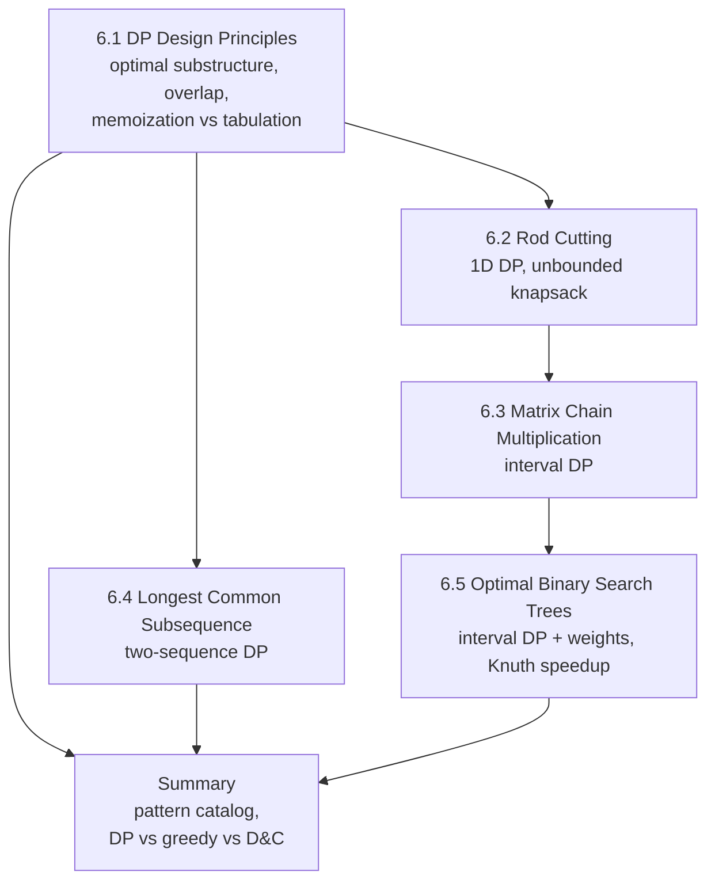

# Dynamic Programming

!!! success "Learning Outcome"

     
     - {{ lo }}
     

## Why This Unit Matters

Dynamic programming (DP) turns problems with exponentially many candidate solutions into polynomial-time algorithms by solving each distinct subproblem once. It is behind tools you use daily: `git diff`, DNA sequence aligners, spell checkers, speech recognizers, the join-order planner in a database, and the contraction planner in NumPy's `einsum`.

DP is also the single most tested paradigm in technical interviews and programming contests. The skill being tested is not recalling a specific table, but **recognizing** that a problem has optimal substructure and overlapping subproblems, **defining** a state, and **justifying** the recurrence. This unit trains exactly that, and ends by comparing DP with divide and conquer and greedy so you can critique which paradigm fits a given problem.

## Prerequisites

- Asymptotic notation and counting operations: [Unit 2: Asymptotic Analysis](../unit2/topic1.md).
- Recurrences, recursion trees, and the Master method: [Unit 3](../unit3/overview.md), especially [Recursion Trees](../unit3/topic3.md) and [Master Method](../unit3/topic5.md).
- Divide and conquer design: [Unit 4](../unit4/overview.md). DP is what you reach for when divide and conquer's subproblems overlap.
- Proof by induction and contradiction (for cut-and-paste optimal substructure arguments).
- Binary search trees (for Topic 5).

## Topic Map

| Topic | Core question | Key result |
| --- | --- | --- |
| [6.1 DP Design Principles](topic1.md) | When and how can recomputation be eliminated? | Time = states $\times$ transition cost; 5-step recipe; memoization vs tabulation |
| [6.2 Rod Cutting](topic2.md) | How should a rod be cut to maximize revenue? | $r_n = \max_i(p_i + r_{n-i})$; $\Theta(2^n) \to \Theta(n^2)$ |
| [6.3 Matrix Chain Multiplication](topic3.md) | In what order should a chain of matrices be multiplied? | $m[i,j] = \min_k(m[i,k] + m[k+1,j] + p_{i-1}p_kp_j)$; $\Theta(n^3)$ |
| [6.4 Longest Common Subsequence](topic4.md) | What is the longest subsequence shared by two sequences? | match: diagonal $+1$, else max(up, left); $\Theta(mn)$ |
| [6.5 Optimal Binary Search Trees](topic5.md) | Which BST minimizes expected search cost for known frequencies? | $e[i,j] = \min_r(e[i,r-1] + e[r+1,j] + w(i,j))$; $\Theta(n^3)$, $\Theta(n^2)$ with Knuth |

## How to Study This Unit

1. Read Topic 6.1 first and learn the 5-step recipe (state, transition, base, order, answer + reconstruction); every later topic applies it explicitly.
2. For each problem topic, close the page and re-derive the recurrence from the "first/last decision" idea before looking at it again.
3. Fill at least one table completely by hand per topic (exam questions almost always include a table trace and a reconstruction).
4. Run the Python implementations and test them against a brute-force solver on small random inputs.
5. Finish with the [Unit 6 Summary](summary.md): the pattern catalog and the DP vs greedy vs divide-and-conquer guide directly target the second learning outcome.
