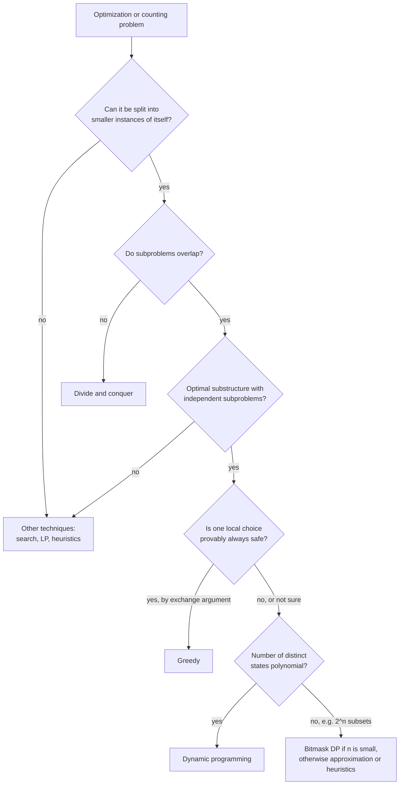

# Unit 6 Summary

## Key Results

### Design principles

| Concept | One-line statement |
| --- | --- |
| Optimal substructure | An optimal solution contains optimal solutions to its subproblems (prove by cut-and-paste) |
| Overlapping subproblems | Naive recursion revisits the same states; there are few distinct states |
| Running time | $O(\#\text{states} \times \text{cost per transition})$, i.e. $O(V + E)$ of the subproblem DAG |
| Correctness | Correct bases + correct recurrence + topological evaluation order $\Rightarrow$ every entry correct (induction) |
| Memoization | Top-down, computes only reachable states, recursion overhead and depth limits |
| Tabulation | Bottom-up, you choose the order, allows rolling arrays |
| Rolling arrays | Keep only the rows a transition reads; loses reconstruction information |

### Problems in this unit

| Problem | State | Recurrence | Base | Order | Time | Space |
| --- | --- | --- | --- | --- | --- | --- |
| [Fibonacci](topic1.md) | $F[i]$ | $F[i-1] + F[i-2]$ | $F[0]=0, F[1]=1$ | $i$ increasing | $\Theta(n)$ | $\Theta(1)$ rolling |
| [Rod cutting](topic2.md) | $r[j]$ best revenue for length $j$ | $\max_{1 \le i \le j}(p_i + r[j-i])$ | $r[0]=0$ | $j$ increasing | $\Theta(n^2)$ | $\Theta(n)$ |
| [Matrix chain](topic3.md) | $m[i,j]$ min cost of $A_i..A_j$ | $\min_{i \le k < j}(m[i,k] + m[k+1,j] + p_{i-1}p_kp_j)$ | $m[i,i]=0$ | length increasing | $\Theta(n^3)$ | $\Theta(n^2)$ |
| [LCS](topic4.md) | $c[i][j]$ LCS of $X_i, Y_j$ | match: $c[i-1][j-1]+1$; else $\max(c[i-1][j], c[i][j-1])$ | row/col 0 $= 0$ | row-major | $\Theta(mn)$ | $\Theta(mn)$; $\Theta(\min(m,n))$ length only |
| [Optimal BST](topic5.md) | $e[i,j]$ min expected cost for $k_i..k_j$ | $\min_{i \le r \le j}(e[i,r-1] + e[r+1,j] + w(i,j))$ | $e[i,i-1]=q_{i-1}$ | length increasing | $\Theta(n^3)$; $\Theta(n^2)$ Knuth | $\Theta(n^2)$ |

### Brute force vs DP

| Problem | Search space / naive recursion | DP |
| --- | --- | --- |
| Fibonacci | $\Theta(\varphi^n)$ calls | $\Theta(n)$ |
| Rod cutting | $2^{n-1}$ cut patterns; $2^n$ calls | $\Theta(n^2)$ |
| Matrix chain | Catalan $C_{n-1} = \Theta(4^n/n^{3/2})$ parenthesizations | $\Theta(n^3)$ |
| LCS | $2^m$ subsequences of $X$ | $\Theta(mn)$ |
| Optimal BST | Catalan $C_n$ tree shapes | $\Theta(n^3)$ / $\Theta(n^2)$ |

## DP Patterns Catalog

Most DP problems belong to a handful of families. Recognizing the family gives you the state shape, the transition shape, and the fill order immediately.

| Family | State shape | Typical transition | Fill order | Unit examples | Other classic members |
| --- | --- | --- | --- | --- | --- |
| **Linear (1D prefix)** | $dp[i]$ = answer for prefix / size $i$ | choose the last (or first) step: $dp[i] = \text{opt}_{j<i}(dp[j] + \text{cost}(j, i))$ | $i$ increasing | Fibonacci, rod cutting | LIS ($O(n^2)$, or $O(n \log n)$ with tails + binary search), house robber, word break, weighted interval scheduling |
| **Knapsack (item $\times$ capacity)** | $dp[i][c]$ = best using first $i$ items with capacity $c$ (often rolled to $dp[c]$) | skip or take item $i$: $\max(dp[i-1][c],\ dp[i-1][c-w_i] + v_i)$ | items outer; capacity **descending** for 0/1, **ascending** for unbounded | rod cutting (unbounded) | 0/1 knapsack, subset sum, coin change (min coins / number of ways), partition equal subset sum |
| **Two-sequence (prefix pairs)** | $dp[i][j]$ = answer for $X_i, Y_j$ | compare $x_i, y_j$: diagonal on match, otherwise up/left (or diagonal with a cost) | row-major | LCS | edit distance, sequence alignment (Needleman-Wunsch, Smith-Waterman), shortest common supersequence, interleaving strings |
| **Interval** | $dp[i][j]$ = answer for contiguous range $i..j$ | choose a split point or root $k$: $\text{opt}_k(dp[i][k] + dp[k+1][j] + \text{cost}(i,k,j))$ | length increasing | matrix chain, optimal BST | polygon triangulation, burst balloons, minimum cost to cut a stick, longest palindromic subsequence |

Beyond this unit you will meet **grid DP** (paths in a matrix, a special case of two-dimensional prefix DP), **tree DP** (state per subtree), **bitmask DP** (state = subset, for $n \le 20$, e.g. travelling salesman in $O(2^n n^2)$), and **DP on DAGs** (shortest/longest paths in a DAG, Bellman-Ford, Floyd-Warshall).

### The four named interview patterns at a glance

| Pattern | State | Transition | Complexity | Classic trap |
| --- | --- | --- | --- | --- |
| 0/1 knapsack | $K[c]$ | $K[c] = \max(K[c], K[c-w]+v)$, $c$ descending | $O(nW)$, pseudo-polynomial | ascending loop reuses items |
| Coin change (min coins) | $D[a]$ | $1 + \min_{c \le a} D[a-c]$ | $O(\text{amount} \cdot k)$ | greedy fails for $\{1,3,4\}$, amount 6 |
| Edit distance | $E[i][j]$ | $\min(E[i-1][j]+1,\ E[i][j-1]+1,\ E[i-1][j-1]+[x_i \ne y_j])$ | $O(mn)$ | base row/column are $j$ and $i$, not 0 |
| LIS | $L[i]$ = LIS ending at $i$ | $1 + \max_{j<i,\ a_j<a_i} L[j]$ | $O(n^2)$ / $O(n \log n)$ | answer is $\max_i L[i]$, not $L[n]$ |

## Important for Exams

!!! warning "Important"

    - Justify **both** DP properties: optimal substructure (cut-and-paste contradiction) and overlapping subproblems (show repeated states). Assertions without justification lose marks.
    - Always write the **meaning** of the state in words, then the recurrence with **base cases** and the **range** of the min/max index ($1 \le i \le j$ for rod cutting, $i \le k < j$ for matrix chain, $i \le r \le j$ for OBST).
    - Interval DPs (matrix chain, OBST) are filled by **increasing length**, not row by row.
    - Naive rod cutting makes exactly $2^n$ calls ($\Theta(2^n)$), not $O(n^n)$; DP is $\Theta(n^2)$ because state $j$ tries $j$ choices.
    - In the matrix chain cost term use $p_{i-1}\,p_k\,p_j$; $A_i$ is $p_{i-1} \times p_i$.
    - In OBST, $e[i, i-1] = q_{i-1}$ (not 0), and $w(i,j)$ includes the dummy probabilities $q_{i-1}..q_j$.
    - After an LCS traceback, check the answer is a subsequence of **both** strings (for `ABCBDAB` / `BDCABA` one LCS is `BCBA`).
    - Record the argmax/argmin (`first_cut`, `s`, `root`) during the fill; you need it for reconstruction.
    - $O(nW)$ for knapsack is **pseudo-polynomial**, not polynomial.

## Choosing the Right Technique

### DP vs greedy vs divide and conquer

| Question about the problem | Divide and conquer | Dynamic programming | Greedy |
| --- | --- | --- | --- |
| Do subproblems overlap? | No (disjoint) | Yes | Only one subproblem remains after each choice |
| Is there a choice at each step? | No, fixed split | Yes, try all options | Yes, but one option is provably safe |
| Proof technique | Induction + recurrence | Optimal substructure + induction over states | Greedy-choice property (exchange argument) + optimal substructure |
| Typical complexity | Recurrence via the [Master method](../unit3/topic5.md) | states $\times$ transitions | Often $O(n \log n)$ (sorting) |
| Examples | Merge sort, binary search, Strassen, FFT ([Unit 4](../unit4/overview.md)) | Rod cutting, LCS, matrix chain, OBST, 0/1 knapsack | Activity selection, fractional knapsack, Huffman, Dijkstra, MST ([Unit 7](../unit7/overview.md)) |

### Decision guide

### Paradigm pairs that students confuse

| Pair | How to tell them apart |
| --- | --- |
| Fractional vs 0/1 knapsack | Fractional: greedy by value/weight is optimal. 0/1: greedy fails; use DP $O(nW)$. |
| Activity selection vs weighted interval scheduling | Unweighted: greedy by earliest finish time. Weighted: greedy fails; DP over intervals sorted by finish time. |
| Coin change with canonical vs arbitrary coins | Canonical systems (e.g. 1, 5, 10, 25): greedy works. Arbitrary ($\{1,3,4\}$): DP. |
| Merge sort vs matrix chain | Both split a sequence; merge sort's split is fixed and halves are disjoint (D&C); matrix chain must try every split and reuses intervals (DP). |
| Shortest path vs longest simple path | Shortest paths have optimal substructure (Bellman-Ford DP, greedy Dijkstra for non-negative weights); longest simple path does not (NP-hard). |

## Mixed Practice

??? question "Q1. A problem's naive recursion makes 3^n calls but only n^2 distinct calls. What does this tell you, and what is the DP running time if each state does O(n) work?"
    Heavy overlap: memoization or tabulation computes each of the $n^2$ states once, giving $O(n^2 \cdot n) = O(n^3)$ time instead of $\Theta(3^n)$.

??? question "Q2. Using the CLRS price table (1, 5, 8, 9, 10, 17, 17, 20, 24, 30), compute r[5] and give an optimal cut."
    $r[5] = \max(1 + 10,\ 5 + 8,\ 8 + 5,\ 9 + 1,\ 10 + 0) = 13$; cut $2 + 3$.

??? question "Q3. For dimensions ⟨10, 20, 5, 30⟩, which parenthesization is optimal and what is its cost?"
    $(A_1A_2)A_3$: $10 \cdot 20 \cdot 5 + 10 \cdot 5 \cdot 30 = 1000 + 1500 = 2500$. The other order costs $20 \cdot 5 \cdot 30 + 10 \cdot 20 \cdot 30 = 3000 + 6000 = 9000$.

??? question "Q4. What is the LCS of X = ABCDGH and Y = AEDFHR, and the insert/delete-only edit distance?"
    LCS = `ADH`, length 3. Indel distance $= 6 + 6 - 2 \cdot 3 = 6$.

??? question "Q5. Why are matrix chain and optimal BST filled by increasing interval length, while LCS is filled row by row?"
    Interval states $[i,j]$ depend on strictly shorter intervals that can lie in later rows (e.g. $m[k+1, j]$). LCS state $(i,j)$ depends only on $(i-1,j)$, $(i,j-1)$, $(i-1,j-1)$, all earlier in row-major order.

??? question "Q6. Critique: 'Since greedy is faster, we should always try greedy first and fall back to DP if tests fail.'"
    Passing tests does not prove a greedy algorithm correct; small counterexamples (coin change $\{1,3,4\}$, OBST with the hottest key at the root, 0/1 knapsack) show greedy can fail silently. Use greedy only with a proof (exchange argument); otherwise use DP, validated against brute force on small inputs.

??? question "Q7. Is the 0/1 knapsack DP with running time O(nW) polynomial? Does that contradict knapsack being NP-hard?"
    No, it is pseudo-polynomial: $W$ is encoded in $\log W$ bits, so $O(nW)$ is exponential in the input size. There is no contradiction.

??? question "Q8. In the OBST recurrence, what is the role of w(i, j), and why can it be computed in O(1) per state?"
    It is the total probability of the range; attaching the subtrees under a root increases every node's depth by one, adding $w(i,j)$ to the cost. $w(i,j) = w(i,j-1) + p_j + q_j$, so it is built incrementally (or from prefix sums).

??? question "Q9. You must diff two 100,000-line log files that are almost identical. Which approach do you choose and why?"
    Not the $\Theta(mn)$ LCS table ($10^{10}$ cells). Use Myers' $O((m+n)D)$ algorithm (Git's default diff algorithm), which is fast because the edit distance $D$ is small, in its linear-space variant.

??? question "Q10. Merge sort and matrix chain both split a sequence. Why is one divide and conquer and the other DP?"
    Merge sort splits at a fixed midpoint and its halves are disjoint, so nothing is recomputed and there is no choice to optimize. Matrix chain must choose among all split points, and the same sub-intervals appear under many different splits, so it needs DP.

??? question "Q11. A memoized solution in Python fails with RecursionError for n = 10^5. Give two fixes and their trade-offs."
    (1) Convert to bottom-up tabulation: no recursion and usually faster, but you must design the evaluation order. (2) Raise `sys.setrecursionlimit`: minimal code change, but deep stacks can crash the interpreter. Tabulation is the robust fix.

??? question "Q12. State Knuth's optimization and name one unit problem where it applies and one where it does not in general."
    If optimal split points are monotone, $\text{opt}[i,j-1] \le \text{opt}[i,j] \le \text{opt}[i+1,j]$, an $O(n^3)$ interval DP becomes $O(n^2)$. It applies to optimal BST (Knuth 1971); it does not hold for matrix chain multiplication in general.
