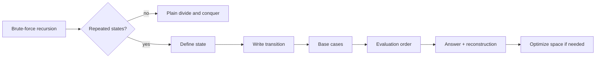
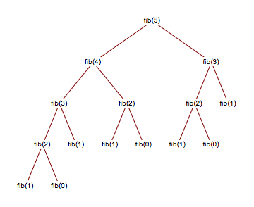

# Dynamic Programming Design Principles

!!! abstract "At a glance"

    - **Problem class:** optimization, counting, and feasibility problems whose answer can be assembled from answers to smaller instances of the same problem.
    - **Key idea:** if the same subproblems recur (overlapping subproblems) and an optimal answer is built from optimal sub-answers (optimal substructure), solve each subproblem **once** and store it.
    - **Cost model:** running time $\approx$ (number of distinct states) $\times$ (work per transition); space $\approx$ number of stored states (often reducible).
    - **Two implementations:** top-down memoization (recursion + cache) and bottom-up tabulation (loops in dependency order).
    - **Used in:** sequence alignment, diff tools, speech recognition (Viterbi), shortest paths (Bellman-Ford, Floyd-Warshall), query optimizers, reinforcement learning (Bellman equations), text layout.

## Motivation and Problem Context

Dynamic programming was introduced by Richard Bellman in the 1950s as a general method for optimizing multistage decision processes[^1]. The word "programming" means *planning with a table*, not writing code.

Consider a factory that buys steel rods and sells pieces at length-dependent prices. A rod of length $n$ can be cut in $2^{n-1}$ ways. Enumerating all of them is hopeless for $n = 60$ ($\approx 5.8 \times 10^{17}$ options), yet the best revenue can be found in a few thousand operations. The gap between "try everything" and "a few thousand operations" is what this unit is about.

The same structure appears whenever a decision splits the problem into smaller copies of itself and those smaller copies keep reappearing:

| Scenario | Repeated subproblem |
| --- | --- |
| `git diff` comparing two files | "best alignment of the first $i$ lines of A with the first $j$ lines of B" |
| Spell checker suggesting corrections | "edit distance between prefixes" |
| Choosing which jobs fit in a server's memory budget | "best value using the first $i$ jobs with capacity $c$" |
| Speech recognition decoding | "most likely state sequence ending in state $s$ at time $t$" |

## Problem Formulation

DP is a *design technique*, not a single algorithm. A problem is a good DP candidate when it can be phrased as:

- **Input:** a structured object (sequence, pair of sequences, interval, grid, tree, set of items with a capacity).
- **Output:** an optimal value (min/max), a count, or a yes/no answer, often together with a witness (the actual cut, alignment, or tree).
- **Structure:** the answer for an instance can be expressed through answers for a *polynomial number* of smaller instances, via a recurrence.
- **Assumption:** subproblems are **independent**: solving one does not constrain the resources available to another (this is what fails for longest simple path, below).

## Intuition

Draw the recursion tree of a naive recursive solution. If the tree has exponentially many nodes but only polynomially many *distinct labels*, the tree is mostly repetition. Collapse equal nodes and the tree becomes a **directed acyclic graph (DAG) of subproblems**. Dynamic programming is simply: *evaluate that DAG once per node, in an order where every node's dependencies are already done.*

!!! tip "Mental model"

    Naive recursion explores a **tree** of calls. DP evaluates the **DAG** you get by merging identical calls. The speedup equals (tree size) / (DAG size).

## Definitions

**Optimal substructure.** A problem has optimal substructure if an optimal solution contains within it optimal solutions to its subproblems. Proof pattern (cut-and-paste): assume the sub-solution inside an optimal solution is *not* optimal; replace it with a better one; the whole solution improves, contradicting optimality.

**Overlapping subproblems.** The recursive formulation revisits the same subproblem many times. Without overlap (e.g. merge sort, where every call works on a disjoint subarray), memoization gains nothing and plain divide-and-conquer is correct and sufficient.

**State.** The minimal set of parameters that identifies a subproblem, e.g. $(i)$ for "prefix of length $i$", $(i, j)$ for "interval $i..j$" or "prefixes of two strings", $(i, c)$ for "first $i$ items, capacity $c$".

**Transition (recurrence).** The rule expressing a state's value in terms of smaller states, normally an `min`/`max`/`sum` over the possible *first* (or *last*) decision.

**Subproblem graph.** Vertices are states; an edge $u \to v$ means "computing $u$ requires $v$". DP is valid only if this graph is acyclic.

## Key Results

**Result 1 (Running time).** If a DP has $S$ distinct states and each state's transition examines $T$ candidates in $O(1)$ each, then both memoized and tabulated versions run in $O(S \cdot T)$ time (plus the cost of the reconstruction pass, normally $O(S)$ or less). Equivalently, time is $O(V + E)$ of the subproblem DAG.

*Sketch.* Each state is computed exactly once (memo check or table order guarantees it); computing it costs $O(T)$ beyond the lookups.

**Result 2 (Correctness by induction over the DAG).** If (a) base cases are correct, (b) the recurrence is correct assuming correct values for smaller states, and (c) the evaluation order is a topological order of the subproblem DAG, then every table entry is correct.

*Sketch.* Strong induction on the position of a state in the topological order: when a state is computed, all states it reads were computed earlier and are correct by the induction hypothesis; by (b) the state is correct.

**Result 3 (Not every optimization problem has optimal substructure).** In a graph, a *shortest* simple path from $u$ to $v$ through $w$ consists of shortest paths $u \leadsto w$ and $w \leadsto v$. For the *longest simple path* this fails: the longest simple paths $u \leadsto w$ and $w \leadsto v$ can share vertices, so concatenating them is not a simple path. The subproblems are not independent, and no polynomial-time DP is known (the problem is NP-hard).

!!! warning "Important"

    For an exam answer "Why can DP be applied?", you must justify **both** properties: optimal substructure (with a cut-and-paste argument) **and** overlapping subproblems (by pointing to repeated states in the recursion). Stating them without justification earns little credit.

## The 5-Step DP Recipe

Every DP in this unit is designed with the same five decisions, plus reconstruction.

| Step | Question to answer | Rod cutting (Topic 2) | LCS (Topic 4) |
| --- | --- | --- | --- |
| 1. State | What does `dp[...]` mean, in one sentence? | $r[j]$ = best revenue for a rod of length $j$ | $c[i][j]$ = LCS length of $X[1..i], Y[1..j]$ |
| 2. Transition | What is the first/last decision, and how does it reduce the state? | $r[j] = \max_{1 \le i \le j}(p_i + r[j-i])$ | match: $c[i-1][j-1]+1$; else $\max(c[i-1][j], c[i][j-1])$ |
| 3. Base case | Which states are answered directly? | $r[0] = 0$ | $c[i][0] = c[0][j] = 0$ |
| 4. Order | In which order are dependencies ready? | $j = 1, 2, \dots, n$ | row by row, left to right |
| 5. Answer | Which state (or combination) is the final answer? | $r[n]$ | $c[m][n]$ |
| + Reconstruction | What extra table records the winning choice? | `first_cut[j]` | walk back through matches |



!!! warning "Important"

    Write the **meaning** of the state in words before writing any recurrence. Most wrong DPs come from a state whose meaning is vague ("dp[i] is the answer up to i"): you cannot prove or debug a recurrence for a quantity you have not defined.

## Worked Examples

### Example 1: Fibonacci, from exponential to constant space

$F(0) = 0,\ F(1) = 1,\ F(n) = F(n-1) + F(n-2)$.

**Naive recursion.** The call tree below shows $F(3)$, $F(2)$, ... recomputed again and again.

<figure markdown="span">
    {width="100%"}
    <figcaption>Recursion tree of the naive Fibonacci procedure: identical subtrees (for example the one rooted at F(3)) appear many times, which is exactly the overlapping-subproblems property.</figcaption>
    <p align='right' style="font-size:0.8em"><i>Image Source: <a href="https://mathematica.stackexchange.com/questions/116344/how-do-i-create-a-recursive-tree-plot-for-the-fibonacci-sequence"> Mathematica Stack Exchange</a></i></p>
</figure>

The number of calls satisfies $C(n) = C(n-1) + C(n-2) + 1$ with $C(0)=C(1)=1$, which solves to $C(n) = 2F(n+1) - 1 = \Theta(\varphi^n)$ with $\varphi \approx 1.618$:

| $n$ | 5 | 10 | 20 | 30 |
| --- | --- | --- | --- | --- |
| calls of naive `fib(n)` | 15 | 177 | 21,891 | 2,692,537 |
| distinct states | 6 | 11 | 21 | 31 |

**Memoized (top-down).** Same recursion, but each $F(k)$ is stored the first time it is computed. $n+1$ states, $O(1)$ work each: $\Theta(n)$ time, $\Theta(n)$ space (table + recursion stack).

**Tabulated (bottom-up).** Fill `f[0..n]` left to right. $\Theta(n)$ time, $\Theta(n)$ space, no recursion.

**Rolling variables.** `f[i]` depends only on `f[i-1]` and `f[i-2]`, so keep two variables: $\Theta(n)$ time, $\Theta(1)$ space.

```python
from functools import cache

def fib_memo(n, memo=None):
    if memo is None:
        memo = {}
    if n < 2:
        return n
    if n not in memo:
        memo[n] = fib_memo(n - 1, memo) + fib_memo(n - 2, memo)
    return memo[n]

@cache                                   # unbounded cache, Python 3.9+
def fib_cached(n):
    if n < 2:
        return n
    return fib_cached(n - 1) + fib_cached(n - 2)

def fib_table(n):
    if n < 2:
        return n
    f = [0] * (n + 1)
    f[1] = 1
    for i in range(2, n + 1):
        f[i] = f[i - 1] + f[i - 2]
    return f[n]

def fib_rolling(n):
    prev, curr = 0, 1                    # F(0), F(1)
    for _ in range(n):
        prev, curr = curr, prev + curr
    return prev
```

- `memo=None` instead of `memo={}`: a mutable default argument would be shared across calls, which is a classic Python bug.
- `fib_rolling` returns `prev`: after $n$ iterations `prev` holds $F(n)$ and `curr` holds $F(n+1)$.
- `fib_cached(5000)` raises `RecursionError` under CPython's default recursion limit of 1000; the tabulated and rolling versions do not.

!!! note "Fibonacci is a warm-up, not the best algorithm"

    $F(n)$ can be computed in $O(\log n)$ arithmetic operations by matrix exponentiation (see [Unit 4](../unit4/overview.md)). DP is the right tool for showing *how* overlap is removed, not the fastest way to compute Fibonacci numbers.

### Example 2: Counting grid paths (a two-dimensional state)

Count the monotone paths (only right or down moves) from the top-left to the bottom-right of an $r \times c$ grid where some cells are blocked.

1. **State:** $P[i][j]$ = number of paths from $(0,0)$ to $(i,j)$.
2. **Transition:** the last move came from above or from the left: $P[i][j] = P[i-1][j] + P[i][j-1]$, and $P[i][j] = 0$ if $(i,j)$ is blocked.
3. **Base:** $P[0][0] = 1$ (if not blocked); out-of-grid values are 0.
4. **Order:** row by row, left to right.
5. **Answer:** $P[r-1][c-1]$.

$\Theta(rc)$ time; $\Theta(c)$ space with a single rolling row, because row $i$ only reads row $i-1$ and the current row. Without blocks the answer is $\binom{r+c-2}{r-1}$, which is a useful test oracle.

### Example 3: Recognizing the paradigm

| Problem | Repeated subproblems? | Optimal substructure? | Verdict |
| --- | --- | --- | --- |
| Merge sort | No (disjoint halves) | n/a | Divide and conquer |
| Fibonacci | Yes | n/a (not optimization) | DP (counting/evaluation) |
| Rod cutting | Yes ($r[j]$ reused) | Yes | DP |
| Activity selection | Yes | Yes, **and** a greedy choice is always safe | Greedy (DP also works, but slower) |
| Longest simple path | Yes | **No** (subpaths interact) | No polynomial DP known |

## Memoization vs Tabulation

| Aspect | Top-down memoization | Bottom-up tabulation |
| --- | --- | --- |
| Code shape | Recursive, mirrors the recurrence | Nested loops |
| States computed | Only those reachable from the query | All states in the table |
| Evaluation order | Automatic (recursion discovers it) | Must be designed by you |
| Overhead | Function calls, hashing, recursion stack | Array indexing only |
| Recursion depth | Can hit language limits (Python: 1000 by default) | None |
| Space optimization | Hard (cache keeps everything) | Easy (rolling rows/arrays) |
| Best when | Sparse state space, complex order, prototyping | Dense state space, large inputs, need for speed/space savings |

Both perform the same asymptotic work when every state is needed. Tabulation usually wins by a constant factor in Python.

### Space optimization (rolling arrays)

If row $i$ of the table depends only on rows $i-1$ and $i$, keep two rows (or one, filled in the right direction). Fibonacci goes from $\Theta(n)$ to $\Theta(1)$; LCS length from $\Theta(mn)$ to $\Theta(\min(m,n))$; 0/1 knapsack from $\Theta(nW)$ to $\Theta(W)$.

!!! warning "Important"

    Rolling arrays discard the information needed for **reconstruction**. If the question asks for the actual solution (which cuts, which subsequence), either keep the full table, keep a separate choice table, or use a divide-and-conquer reconstruction such as Hirschberg's method (Topic 4).

### Python specifics: `functools.cache`, `lru_cache`, recursion limits

| Tool | Behavior | Gotcha |
| --- | --- | --- |
| `@functools.cache` (3.9+) | Unbounded memo dictionary keyed by arguments | Arguments must be hashable: pass tuples, not lists |
| `@functools.lru_cache(maxsize=None)` | Same as `cache` | Plain `@lru_cache` defaults to `maxsize=128` and **evicts** entries, which can silently reintroduce exponential work |
| `f.cache_clear()` | Empties the cache | A module-level cached function keeps results between test cases; clear it if inputs change through globals |
| `sys.setrecursionlimit(k)` | Raises CPython's depth limit (default 1000) | Raising it too far can crash the interpreter with a C stack overflow; prefer converting to bottom-up |

## Edge Cases and Pitfalls

| Case / pitfall | What goes wrong | Fix |
| --- | --- | --- |
| Missing or wrong base case | Infinite recursion, or every entry is off by a constant | Derive bases from the state's meaning (empty prefix, zero capacity, single element) |
| Uninitialized "impossible" states | `0` used where "unreachable" was meant; minimization returns 0 | Initialize to $\pm\infty$ (or `None`) and handle it explicitly |
| Wrong evaluation order | Reading a cell before it is computed (silently uses 0) | Check every dependency points to an already-filled cell; draw the dependency arrows |
| Memo key missing a parameter | Two different subproblems share a cache slot | The key must be the **full** state; anything the result depends on must be in it |
| `@lru_cache` without `maxsize=None` | Evictions recompute subproblems, time explodes | Use `@cache` or `@lru_cache(maxsize=None)` |
| Mutable default `memo={}` | Results leak between unrelated calls | Default to `None` and create a dict inside |
| Deep recursion in Python | `RecursionError` for $n$ in the thousands | Tabulate, or iterate states in topological order |
| Rolling array then reconstruct | Choices already overwritten | Keep a choice table or the full table |

## Common Misconceptions

- **"DP is just recursion with a cache."** That is one implementation. DP is the *design*: defining states, proving the recurrence, choosing an order. Caching a recursion that has no overlap gives no speedup, and caching a recursion with the wrong state gives wrong answers.
- **"Every optimization problem with overlapping subproblems can be solved by DP."** Without optimal substructure over independent subproblems (longest simple path), a recurrence on small states does not exist.
- **"Memoization is always slower than tabulation."** Asymptotically they match when all states are needed. Memoization wins when only a small fraction of states is reachable.
- **"DP solutions are always polynomial."** DP is polynomial in the number of states. 0/1 knapsack runs in $O(nW)$, which is **pseudo-polynomial**: exponential in the number of bits of $W$.
- **"Greedy and DP are rivals for the same problems."** Greedy is a DP where one choice is provably always safe, so only one branch of the transition needs evaluating (see [Unit 7](../unit7/overview.md)).

## Alternatives and Trade-offs

| Paradigm | Subproblems | Choice at each step | Typical proof | Typical cost |
| --- | --- | --- | --- | --- |
| Divide and conquer ([Unit 4](../unit4/overview.md)) | Disjoint | None (fixed split) | Induction + recurrence ([Master method](../unit3/topic5.md)) | Recurrence-defined, e.g. $O(n \log n)$ |
| Dynamic programming | Overlapping | Try **all** options, keep the best | Optimal substructure + induction over DAG | states $\times$ transition cost |
| Greedy ([Unit 7](../unit7/overview.md)) | One remaining subproblem | Commit to **one** locally best option | Greedy-choice property (exchange argument) | Often $O(n \log n)$ |
| Backtracking / branch and bound | Search tree | Explore, prune | Exhaustiveness | Exponential worst case |

**Use DP when** the brute force has exponential branching but few distinct states, and you can argue optimal substructure.
**Avoid DP when** the state space is itself exponential (e.g. subsets of 60 items), a greedy choice is provably safe (cheaper), subproblems do not overlap (plain recursion suffices), or memory for the table is the bottleneck and no rolling trick applies.

## In Practice

- **Bioinformatics:** Needleman-Wunsch (global alignment) and Smith-Waterman (local alignment) are two-sequence DPs closely related to LCS and edit distance.
- **Version control:** line-based diff is an LCS/shortest-edit-script problem; Git's default diff algorithm is Myers' algorithm, a refinement that is fast when files differ little.
- **Graph algorithms:** Bellman-Ford and Floyd-Warshall shortest paths are DPs over "number of edges used" and "intermediate vertices allowed".
- **Signal processing and NLP:** the Viterbi algorithm (most likely hidden-state sequence) is DP over (time, state).
- **Reinforcement learning:** value iteration and policy iteration solve Bellman equations, the same principle Bellman introduced.
- **Databases:** cost-based query optimizers (System R lineage, PostgreSQL) use DP over subsets of relations to choose join orders (Topic 3).
- **Typesetting:** TeX's line-breaking chooses breakpoints for a whole paragraph by minimizing total "badness" with a DP-style algorithm, instead of greedily filling lines.
- **Performance reality:** tables of Python lists are slow; for large DPs, iterate over contiguous arrays, prefer bottom-up order that walks memory sequentially, and roll arrays to stay in cache.

## Interview and Competitive Programming

### Recognition cues

- "Count the number of ways...", "minimum/maximum cost to...", "is it possible to..." with choices at each step.
- Constraints such as $n \le 5000$ (suggests $O(n^2)$ states), $n, W \le 10^3$-ish (suggests a 2D table), $n \le 20$ (bitmask DP over $2^n$ subsets).
- A naive recursion with two or more branches and parameters that take few distinct values.

### Constraints to complexity

Rough guide: about $10^8$ simple operations per second in C++, far fewer in Python.

| Constraint | Feasible DP |
| --- | --- |
| $n \le 20$ | $O(2^n \cdot n)$ bitmask DP |
| $n \le 500$ | $O(n^3)$ interval DP (Topics 3, 5) |
| $n \le 5000$ | $O(n^2)$ (LCS, edit distance, quadratic LIS) |
| $n \le 10^5$ to $10^6$ | $O(n)$ or $O(n \log n)$ (linear DP, LIS with binary search) |

### Named patterns you must recognize

The full catalog by pattern family is in the [Unit 6 Summary](summary.md).

| Pattern | State | Transition | Time |
| --- | --- | --- | --- |
| 0/1 knapsack | $K[c]$ = best value with capacity $c$ using items seen so far | for each item $(w,v)$, for $c$ **descending**: $K[c] = \max(K[c], K[c-w]+v)$ | $O(nW)$ |
| Coin change (min coins) | $D[a]$ = fewest coins summing to $a$ | $D[a] = 1 + \min_{c \le a} D[a-c]$ | $O(\text{amount} \cdot k)$ |
| Edit distance | $E[i][j]$ = edits turning $A[1..i]$ into $B[1..j]$ | $\min(E[i-1][j]+1,\ E[i][j-1]+1,\ E[i-1][j-1]+[a_i \ne b_j])$ | $O(mn)$ |
| Longest increasing subsequence | $L[i]$ = LIS length ending at $i$ | $L[i] = 1 + \max_{j<i,\ a_j<a_i} L[j]$ | $O(n^2)$; $O(n \log n)$ with patience-sorting tails |

The most common knapsack trap, in code:

```python
def knapsack_01(weights, values, capacity):
    best = [0] * (capacity + 1)              # best[c]: max value within capacity c
    for w, v in zip(weights, values):
        for c in range(capacity, w - 1, -1): # descending: each item used at most once
            best[c] = max(best[c], best[c - w] + v)
    return best[capacity]
```

Iterating `c` **ascending** would let `best[c - w]` already include the current item, turning 0/1 knapsack into *unbounded* knapsack (the rod-cutting / coin-change structure).

**Common traps:** greedy coin change fails for coins $\{1, 3, 4\}$ and amount 6 (greedy: $4+1+1$, optimal: $3+3$); off-by-one between 0-indexed strings and 1-indexed tables; returning `inf` instead of $-1$ for "impossible"; integer overflow in counting DPs (take the result modulo the given prime at every addition).

## Using AI Assistants Critically

- LLM-generated DPs often have a state whose meaning is never stated; ask the assistant (or yourself) to write the state's definition in one sentence and check that the recurrence matches it.
- Watch for `@lru_cache` with the default `maxsize=128`, and for lists passed into cached functions (unhashable, raises `TypeError`).
- Assistants frequently mix up 0/1 and unbounded knapsack by flipping the inner loop direction; test with an instance where reusing an item would change the answer.
- Verify with a brute-force oracle on small random inputs (enumerate all subsets/cuts/subsequences) and compare; property-based testing with `hypothesis` automates this.
- Check complexity claims empirically: double $n$ and time it; an $O(n^2)$ DP should take about 4 times longer, an exponential one will blow up immediately.
- Be skeptical of "optimal" space-optimized versions that also claim to reconstruct the solution; rolling arrays usually cannot.

## Practice

### Beginner

1. *Climbing stairs.* Input: $n$ ($1 \le n \le 45$). Output: number of ways to climb $n$ steps taking 1 or 2 steps at a time. Write the state, transition, base cases, and an $O(1)$-space version. *Difficulty: easy.*
2. *Minimum path sum.* Input: an $r \times c$ grid of non-negative integers ($r, c \le 200$). Output: the minimum sum of a path from top-left to bottom-right moving only right or down. *Difficulty: easy.*
3. *Tribonacci with memoization.* Input: $n \le 10^4$. Output: $T(n)$ where $T(n) = T(n-1)+T(n-2)+T(n-3)$, $T(0)=0, T(1)=T(2)=1$. Implement both top-down and bottom-up and explain which one fails at $n = 10^4$ in Python and why. *Difficulty: easy.*

### Intermediate

1. *Coin change (number of ways).* Input: coin denominations ($k \le 100$) and an amount ($\le 10^4$). Output: the number of distinct multisets of coins summing to the amount. Explain why the loop order (coins outer vs amounts outer) changes what is counted. *Difficulty: medium.*
2. *House robber.* Input: $n \le 10^5$ non-negative house values in a line. Output: maximum total from houses with no two adjacent. Prove optimal substructure. *Difficulty: medium.*
3. *Grid paths with obstacles modulo a prime.* Input: $r, c \le 1000$ and a grid of free/blocked cells. Output: the number of monotone paths modulo $10^9+7$, using $O(c)$ memory. *Difficulty: medium.*

### Advanced

1. *Longest simple path vs longest path in a DAG.* Show that longest path in a DAG has optimal substructure and give an $O(V+E)$ DP; explain precisely why the argument fails for general graphs. *Difficulty: hard.*
2. *Subset sum is pseudo-polynomial.* Input: $n$ integers and target $T$. Give an $O(nT)$ DP and explain why this does not contradict subset sum being NP-complete. *Difficulty: hard.*
3. *Weighted interval scheduling.* Input: $n \le 10^5$ intervals with weights. Output: maximum total weight of pairwise non-overlapping intervals in $O(n \log n)$. Show why the greedy rule for unweighted activity selection fails here. *Difficulty: hard.*

### Interview / Competitive Programming

1. *LeetCode 322 Coin Change.* Fewest coins for an amount, or $-1$ if impossible. *Difficulty: medium.*
2. *LeetCode 300 Longest Increasing Subsequence.* Solve in $O(n \log n)$. *Difficulty: medium.*
3. *LeetCode 72 Edit Distance.* Minimum insertions, deletions, and substitutions to convert one word into another. *Difficulty: medium-hard.*

## Self-Check Questions

??? question "Q1. State the two properties a problem needs for DP and explain how you would justify each in an exam answer."
    **Optimal substructure:** an optimal solution contains optimal solutions to subproblems; justify with a cut-and-paste contradiction (replace a suboptimal piece with a better one to improve the whole). **Overlapping subproblems:** the naive recursion revisits the same states; justify by showing two different branches that reach the same state, or by comparing the exponential number of calls to the polynomial number of distinct states.

??? question "Q2. Naive Fibonacci makes 2,692,537 calls for n = 30. How many does the memoized version make, and why?"
    About $2n - 1 = 59$ calls: each $F(k)$ for $k \ge 2$ is computed once and makes two calls, one of which hits the cache. There are only $n+1 = 31$ distinct states, so work is $\Theta(n)$.

??? question "Q3. Why does merge sort not benefit from memoization?"
    Its subproblems are disjoint subarrays; no subarray is sorted twice. There is no overlap to exploit, so a cache would only add overhead.

??? question "Q4. A student uses @lru_cache on a recursive edit distance and it is unexpectedly slow for 2000-character strings. Give two likely reasons."
    (1) `@lru_cache` defaults to `maxsize=128`, so most of the ~4 million states are evicted and recomputed. (2) Recursion depth up to $m+n$ exceeds Python's default limit of 1000, so they may have raised the limit and are paying heavy call overhead. A bottom-up table (or two rolling rows) fixes both.

??? question "Q5. Why does the longest simple path problem lack optimal substructure while the shortest path problem has it?"
    A shortest $u \leadsto v$ path through $w$ splits into shortest $u \leadsto w$ and $w \leadsto v$ paths that can be combined freely (if they shared a vertex, a shortcut would exist). Longest simple sub-paths may share vertices; combining them gives a non-simple path. The subproblems are not independent.

??? question "Q6. Is an O(nW) algorithm for 0/1 knapsack polynomial? Explain."
    No. The input encodes $W$ in $\Theta(\log W)$ bits, so $O(nW)$ is exponential in the input size. It is pseudo-polynomial: polynomial in the numeric value of $W$.

??? question "Q7. When would you prefer memoization over tabulation?"
    When only a small portion of the state space is reachable from the query (sparse states), when the correct evaluation order is awkward to write, or when prototyping. Prefer tabulation for dense state spaces, deep dependency chains, and when you need rolling-array space savings.

??? question "Q8. You compressed an LCS table to two rows. Your manager now wants the actual subsequence. What are your options?"
    Recompute with the full $\Theta(mn)$ table and trace back; or use Hirschberg's divide-and-conquer method, which reconstructs the LCS in $O(mn)$ time and $O(\min(m,n))$ space by finding the optimal split point of the middle row and recursing.

## Complexity Summary

| Computation | Time | Space |
| --- | --- | --- |
| Naive recursive Fibonacci | $\Theta(\varphi^n)$ | $\Theta(n)$ stack |
| Memoized / tabulated Fibonacci | $\Theta(n)$ | $\Theta(n)$ |
| Rolling-variable Fibonacci | $\Theta(n)$ | $\Theta(1)$ |
| Grid paths $r \times c$ | $\Theta(rc)$ | $\Theta(c)$ rolling |
| Generic DP | $O(\text{states} \times \text{transition cost})$ | $O(\text{states})$, often reducible |
| 0/1 knapsack | $O(nW)$ pseudo-polynomial | $O(W)$ rolling |
| LIS | $O(n^2)$ or $O(n \log n)$ | $O(n)$ |

## Key Takeaways

- DP = optimal substructure + overlapping subproblems; justify both, never just assert them.
- Design with the recipe: state (in words), transition, base cases, order, answer, then reconstruction.
- Running time is states $\times$ transition cost; count both explicitly.
- Memoization and tabulation do the same work; they differ in order discovery, overhead, recursion depth, and space optimization.
- Rolling arrays save memory but destroy the information needed for reconstruction.
- In Python, use `@cache` or `@lru_cache(maxsize=None)`, pass hashable arguments, and avoid deep recursion for large inputs.
- Greedy is the special case where one choice is provably safe; divide and conquer is the special case with no overlap.

[^1]: A. Levitin, *Introduction to the Design and Analysis of Algorithms*, Pearson; T. Cormen, C. Leiserson, R. Rivest, C. Stein, *Introduction to Algorithms*, MIT Press, Chapter 15 (3rd ed.).
