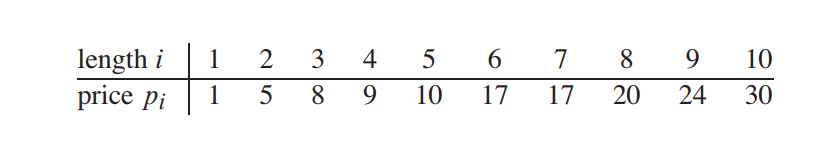
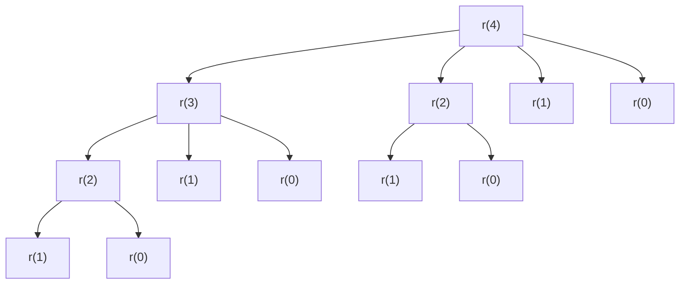
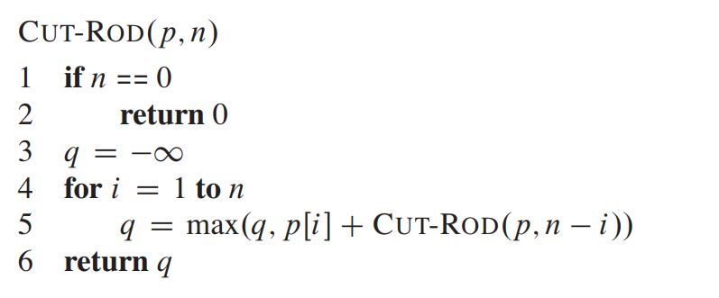
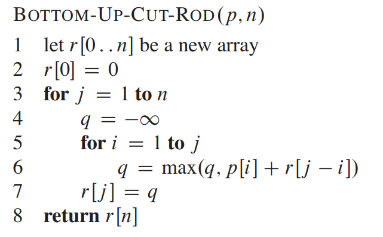

# Rod Cutting

!!! abstract "At a glance"

    - **Problem:** cut a rod of length $n$ into integer-length pieces to maximize total revenue, given a price $p_i$ for each piece length $i$.
    - **Key idea:** choose the length $i$ of the *first* piece; the rest of the rod must then be cut optimally, giving $r_n = \max_{1 \le i \le n}(p_i + r_{n-i})$.
    - **Complexity:** naive recursion makes $2^n$ calls; memoized or bottom-up DP runs in $\Theta(n^2)$ time and $\Theta(n)$ space.
    - **Pattern:** a one-dimensional **unbounded knapsack**: each piece length may be used any number of times.
    - **Used in:** cutting-stock planning (steel, timber, paper rolls), and as the canonical first DP in CLRS Chapter 15[^1].

## Motivation and Problem Context

A steel company buys long rods and sells shorter rods. The market price per length is not proportional to length: sometimes two short rods are worth more than one long rod, sometimes the opposite. The company wants to know how to cut each incoming rod to maximize revenue.

The price table used throughout this page (CLRS):

<figure markdown="span">
    {width="60%"}
    <figcaption>Sample price table: a piece of length i sells for p_i, for lengths 1 to 10.</figcaption>
    <p align='right' style="font-size:0.8em"><i>Image Source: Introduction to Algorithms (CLRS), Chapter 15</i></p>
</figure>

For a rod of length 4, the eight possible ways to cut it are:

<figure markdown="span">
    {width="90%"}
    <figcaption>All 2^3 = 8 ways to cut a rod of length 4, with the price of each piece written above it. Option (c), two pieces of length 2, earns 5 + 5 = 10, the maximum.</figcaption>
    <p align='right' style="font-size:0.8em"><i>Image Source: Introduction to Algorithms (CLRS), Chapter 15</i></p>
</figure>

## Problem Formulation

- **Input:** an integer $n \ge 0$ and prices $p_1, p_2, \dots, p_n \ge 0$, where $p_i$ is the price of a piece of length $i$.
- **Output:** the maximum revenue $r_n$ obtainable by cutting the rod into pieces of integer lengths $i_1 + i_2 + \dots + i_k = n$ (with $k \ge 1$; $k = 1$ means "no cut"), i.e. $r_n = \max (p_{i_1} + \dots + p_{i_k})$, **and** an optimal list of piece lengths.
- **Assumptions:** cuts are free (variants below add a cost); any number of pieces of each length may be sold; prices are known in advance.

!!! note "How many cut patterns?"

    There are $n-1$ positions at distance $1, 2, \dots, n-1$ from the left end, each independently cut or not, giving $2^{n-1}$ ordered decompositions. (If order does not matter, the count is the number of integer partitions of $n$, which still grows faster than any polynomial.)

## Intuition

Every cut pattern has a *leftmost piece*. Fix its length $i$: you earn $p_i$, and you are left with an ordinary rod of length $n - i$ and no other constraint. Whatever you do with that remainder, it should be the best possible thing for a rod of length $n-i$. So the whole problem reduces to "best first piece + best answer for a shorter rod", and there are only $n+1$ different shorter rods.

## Baseline Approach

Translate the intuition directly into recursion (CLRS `CUT-ROD`):

```text
CUT-ROD(p, n)
    if n == 0
        return 0
    q = -infinity
    for i = 1 to n
        q = max(q, p[i] + CUT-ROD(p, n - i))
    return q
```

Let $T(n)$ be the number of calls made by `CUT-ROD(p, n)`, including the top call:

$$
T(0) = 1, \qquad T(n) = 1 + \sum_{j=0}^{n-1} T(j).
$$

Subtracting the equations for $n$ and $n-1$ gives $T(n) - T(n-1) = T(n-1)$, so $T(n) = 2T(n-1) = 2^n$. The algorithm explores **every** one of the $2^{n-1}$ cut patterns (and then some), even though it only ever asks about $n+1$ distinct rod lengths: `CUT-ROD(p, 2)` is called $2^{n-3}$ times inside `CUT-ROD(p, n)`.



*Recursion tree for $n = 4$ (leaves $r(0)$ under every $r(1)$ omitted): $r(2)$ and $r(1)$ are recomputed repeatedly.*

!!! warning "Important"

    The naive running time is $\Theta(2^n)$, **not** $O(n^n)$ or $O(n!)$. The exact call count is $2^n$, which you can derive from the recurrence above; examiners expect the derivation.

## Algorithm Design

Apply the [5-step DP recipe](topic1.md#the-5-step-dp-recipe):

1. **State:** $r[j]$ = maximum revenue for a rod of length $j$, for $0 \le j \le n$.
2. **Transition:** the first piece has some length $i \in \{1, \dots, j\}$:
   $$ r[j] = \max_{1 \le i \le j} \bigl(p_i + r[j-i]\bigr). $$
3. **Base case:** $r[0] = 0$ (an empty rod earns nothing).
4. **Order:** $r[j]$ reads only $r[0..j-1]$, so fill $j = 1, 2, \dots, n$.
5. **Answer:** $r[n]$.
6. **Reconstruction:** store `first_cut[j]` = the $i$ that achieved the maximum. Then cut `first_cut[n]`, move to the remainder, and repeat until the length is 0.

Top-down memoization gives the same $\Theta(n^2)$ bound: the recursion is unchanged, but each $r[j]$ is computed once and looked up afterwards.

## Pseudocode

=== "Bottom-up with reconstruction"

    ```text
    EXTENDED-BOTTOM-UP-CUT-ROD(p, n)
        let r[0..n] and s[0..n] be new arrays
        r[0] = 0
        for j = 1 to n                     // rod length
            q = -infinity
            for i = 1 to j                 // length of first piece
                if p[i] + r[j - i] > q
                    q = p[i] + r[j - i]
                    s[j] = i
            r[j] = q
        return r, s

    PRINT-CUT-ROD-SOLUTION(p, n)
        (r, s) = EXTENDED-BOTTOM-UP-CUT-ROD(p, n)
        while n > 0
            print s[n]
            n = n - s[n]
    ```

=== "Top-down memoized"

    ```text
    MEMOIZED-CUT-ROD(p, n)
        let r[0..n] be a new array, every entry = -infinity
        return MEMOIZED-CUT-ROD-AUX(p, n, r)

    MEMOIZED-CUT-ROD-AUX(p, n, r)
        if r[n] >= 0                       // already solved
            return r[n]
        if n == 0
            q = 0
        else
            q = -infinity
            for i = 1 to n
                q = max(q, p[i] + MEMOIZED-CUT-ROD-AUX(p, n - i, r))
        r[n] = q
        return q
    ```

=== "CLRS figures"

    <figure markdown="span">
        {width="70%"}
        <figcaption>CLRS CUT-ROD: the naive top-down recursion that tries every first-piece length.</figcaption>
        <p align='right' style="font-size:0.8em"><i>Image Source: Introduction to Algorithms (CLRS), Chapter 15</i></p>
    </figure>

    <figure markdown="span">
        {width="60%"}
        <figcaption>CLRS BOTTOM-UP-CUT-ROD: fills r[1..n] in increasing order of length so every r[j - i] is ready when needed.</figcaption>
        <p align='right' style="font-size:0.8em"><i>Image Source: Introduction to Algorithms (CLRS), Chapter 15</i></p>
    </figure>

## Worked Example

### Example 1: CLRS prices, $n = 10$

Prices $p = (1, 5, 8, 9, 10, 17, 17, 20, 24, 30)$ for lengths $1..10$.

Computing $r[4]$ in detail (all smaller values already known: $r[0..3] = 0, 1, 5, 8$):

| first piece $i$ | $p_i + r[4-i]$ | value |
| --- | --- | --- |
| 1 | $1 + r[3] = 1 + 8$ | 9 |
| 2 | $5 + r[2] = 5 + 5$ | **10** |
| 3 | $8 + r[1] = 8 + 1$ | 9 |
| 4 | $9 + r[0] = 9 + 0$ | 9 |

So $r[4] = 10$ and $s[4] = 2$. Filling every length the same way:

| $j$ | 0 | 1 | 2 | 3 | 4 | 5 | 6 | 7 | 8 | 9 | 10 |
| --- | --- | --- | --- | --- | --- | --- | --- | --- | --- | --- | --- |
| $p_j$ | – | 1 | 5 | 8 | 9 | 10 | 17 | 17 | 20 | 24 | 30 |
| $r[j]$ | 0 | 1 | 5 | 8 | 10 | 13 | 17 | 18 | 22 | 25 | 30 |
| $s[j]$ | – | 1 | 2 | 3 | 2 | 2 | 6 | 1 | 2 | 3 | 10 |

**Reconstruction for $n = 7$:** $s[7] = 1$ → cut 1, remainder 6; $s[6] = 6$ → cut 6, remainder 0. Pieces $1 + 6$, revenue $1 + 17 = 18$. (Ties exist: $2 + 2 + 3$ also gives $5+5+8 = 18$; with a strict `>` the first maximizer found is kept.)

### Example 2: a "pieces available" table (unbounded knapsack view)

A common classroom layout builds a 2D table where row $i$ means "only piece lengths $1..i$ are allowed". With prices $p = (2, 5, 7, 8)$ for lengths $1..4$ and rod length $5$:

$$
R[i][j] =
\begin{cases}
R[i-1][j] & \text{if } i > j \quad\text{(piece } i \text{ does not fit)} \\
\max\bigl(R[i-1][j],\ p_i + R[i][j-i]\bigr) & \text{otherwise}
\end{cases}
\qquad R[0][j] = 0.
$$

- $R[i-1][j]$: do not use piece length $i$ at all.
- $p_i + R[i][j-i]$: use one piece of length $i$; stay in **row $i$** because the same length may be used again.

| allowed lengths | price of newest | $j=0$ | 1 | 2 | 3 | 4 | 5 |
| --- | --- | --- | --- | --- | --- | --- | --- |
| none | – | 0 | 0 | 0 | 0 | 0 | 0 |
| $\{1\}$ | 2 | 0 | 2 | 4 | 6 | 8 | 10 |
| $\{1,2\}$ | 5 | 0 | 2 | 5 | 7 | 10 | 12 |
| $\{1,2,3\}$ | 7 | 0 | 2 | 5 | 7 | 10 | 12 |
| $\{1,2,3,4\}$ | 8 | 0 | 2 | 5 | 7 | 10 | 12 |

The maximum revenue is $R[4][5] = 12$ (for example $1 + 2 + 2$: $2 + 5 + 5$). Both layouts give the same answer; the 1D version is simpler and is what the 2D table collapses to if you roll it.

!!! warning "Important"

    In the 2D layout the "use piece $i$" term is $p_i + R[i][j - i]$: **same row**, column shifted by the piece length $i$. Writing $R[i-1][j-i]$ gives 0/1 knapsack (each length at most once), which is a different problem and gives a wrong answer here.

## Correctness

**Optimal substructure (cut-and-paste).** Let an optimal solution for length $j \ge 1$ have first piece $i$. The remaining pieces form a cut pattern for length $j - i$ with revenue $R'$. If $R' < r[j-i]$, replace those pieces by an optimal pattern for $j - i$: the total becomes $p_i + r[j-i] > p_i + R'$, contradicting optimality. Hence $r[j] = p_i + r[j-i]$ for the optimal $i$.

**The recurrence is exhaustive.** Every cut pattern of length $j \ge 1$ has exactly one first piece with some length $i \in \{1, \dots, j\}$ (including $i = j$, no cut). So the maximum over $i$ considers every pattern's best possible completion, and $r[j] \ge$ the revenue of any pattern. Together with optimal substructure, $r[j]$ equals the optimum.

**Induction over the table (loop invariant).** *Invariant:* at the start of iteration $j$ of the outer loop, $r[0..j-1]$ hold the optimal revenues.

- *Initialization:* before $j = 1$, only $r[0] = 0$ is set, which is correct.
- *Maintenance:* iteration $j$ evaluates $p_i + r[j-i]$ for all $i$, reading only correct entries; by the two arguments above it stores the optimum in $r[j]$, and $s[j]$ is a maximizing $i$.
- *Termination:* after $j = n$, $r[0..n]$ are all optimal; $r[n]$ is the answer. Following $s$ produces pieces whose prices sum to $r[n]$ because each step realizes $r[j] = p_{s[j]} + r[j - s[j]]$.

## Complexity Analysis

| Version | Time | Space | Reason |
| --- | --- | --- | --- |
| Naive `CUT-ROD` | $\Theta(2^n)$ | $\Theta(n)$ stack | $T(n) = 1 + \sum_{j<n} T(j) = 2^n$ calls |
| Memoized | $\Theta(n^2)$ | $\Theta(n)$ table + $\Theta(n)$ stack | each $r[j]$ solved once with $j$ candidates |
| Bottom-up | $\Theta(n^2)$ | $\Theta(n)$ | inner loop runs $\sum_{j=1}^{n} j = n(n+1)/2$ times |
| Reconstruction | $O(n)$ | $O(n)$ | at most $n$ pieces |

The subproblem DAG has $n + 1$ vertices and $\sum_j j = \Theta(n^2)$ edges, matching the "states $\times$ transitions" rule from [Topic 1](topic1.md#key-results). The bound is $\Theta(n^2)$ for every input (no early exit), so best, average, and worst cases coincide.

## Python Implementation

```python
def cut_rod(prices, n):
    """prices[i] = price of a piece of length i (prices[0] is unused).
    Returns (maximum revenue, list of piece lengths)."""
    revenue = [0] * (n + 1)      # revenue[j]: best revenue for a rod of length j
    first_cut = [0] * (n + 1)    # first_cut[j]: first piece in an optimal cut of j
    for j in range(1, n + 1):
        best = float("-inf")
        for i in range(1, j + 1):
            if prices[i] + revenue[j - i] > best:
                best = prices[i] + revenue[j - i]
                first_cut[j] = i
        revenue[j] = best
    pieces = []
    length = n
    while length > 0:
        pieces.append(first_cut[length])
        length -= first_cut[length]
    return revenue[n], pieces


prices = [0, 1, 5, 8, 9, 10, 17, 17, 20, 24, 30]
print(cut_rod(prices, 7))   # (18, [1, 6])
print(cut_rod(prices, 4))   # (10, [2, 2])
```

- `prices[0]` is a placeholder so that `prices[i]` is the price of length `i`, matching the pseudocode's 1-indexing.
- `best` starts at $-\infty$, not 0, exactly as in the pseudocode; with non-negative prices both work, but $-\infty$ stays correct if a variant introduces negative values (e.g. cut costs).
- The reconstruction loop terminates because `first_cut[length] >= 1` for every `length >= 1`.
- For a top-down version, decorate an inner `r(length)` with `@functools.cache`; recursion depth is $n$, so prefer the bottom-up form for $n$ in the thousands.

## Edge Cases and Pitfalls

| Case / pitfall | What goes wrong | Fix |
| --- | --- | --- |
| $n = 0$ | Code that reads `prices[n]` or loops `range(1, 1)` incorrectly | Return `(0, [])`; base case $r[0] = 0$ |
| Price list shorter than $n$ (no price for long pieces) | `IndexError`, or silently treating missing lengths as 0 | Loop $i$ only up to `min(j, len(prices) - 1)` |
| 0-indexed price list `[1, 5, 8, ...]` | Every price shifted by one length | Pad with `prices[0] = 0` or use `prices[i - 1]` consistently |
| Memo sentinel `r[n] >= 0` with negative revenues allowed | Valid negative results treated as "unsolved" | Use `None` as the sentinel |
| Inner loop starts at $i = 0$ | $r[j] = p_0 + r[j]$ reads itself; infinite recursion top-down | First piece length is at least 1 |
| Only storing $r$ | Cannot report the cut | Store `first_cut` during the max |
| 2D table using $R[i-1][j-i]$ | Solves 0/1 knapsack, not rod cutting | Stay in row $i$ |

## Common Misconceptions

- **"Cut where the price per inch $p_i / i$ is highest."** Greedy by density fails: for $n = 4$ with CLRS prices, the best density among lengths $\le 4$ is length 3 ($8/3 \approx 2.67$), giving $8 + 1 = 9$, but $2 + 2$ gives 10.
- **"The 2D table is required."** The pieces-available table is one valid layout; the 1D recurrence over the first piece is enough and uses $\Theta(n)$ space.
- **"Memoization makes it $O(n)$."** There are $n + 1$ states but state $j$ examines $j$ choices: $\Theta(n^2)$.
- **"Rod cutting is 0/1 knapsack."** Each length can be used repeatedly; it is the *unbounded* knapsack with item weight $i$ and value $p_i$, and capacity exactly filled.

## Alternatives and Trade-offs

| Approach | Time | Space | Gives the cut? | When to use |
| --- | --- | --- | --- | --- |
| Brute force over $2^{n-1}$ patterns | $\Theta(n 2^{n})$ | $O(n)$ | yes | Test oracle for $n \le 20$ |
| Naive recursion | $\Theta(2^n)$ | $O(n)$ | with extra work | Never in production |
| Memoized top-down | $\Theta(n^2)$ | $\Theta(n)$ | yes | Quick to write from the recurrence |
| Bottom-up 1D | $\Theta(n^2)$ | $\Theta(n)$ | yes | Default choice |
| Bottom-up over $k$ piece types | $\Theta(nk)$ | $\Theta(n)$ | yes | Only $k \ll n$ lengths have prices |
| Greedy by density | $O(n \log n)$ | $O(n)$ | yes | Only if prices are proven to make it optimal; not in general |

**Variants worth knowing**

- *Fixed cost $c$ per cut:* $r[j] = \max\bigl(p_j,\ \max_{1 \le i < j}(p_i + r[j-i] - c)\bigr)$; the "no cut" option is separated because it incurs no cost.
- *Limited stock of each length:* becomes a bounded knapsack.
- *Cuts at given positions with cost equal to the current stick length:* an **interval** DP like [Matrix Chain Multiplication](topic3.md), not a linear one.

## In Practice

- **Cutting-stock problems** in steel, paper, textile, and timber industries generalize rod cutting: meet customer orders for many lengths using as few stock rods as possible. Industrial solvers use linear programming with column generation (Gilmore-Gomory), where pricing each new cutting pattern is a knapsack problem solved by exactly this kind of DP.
- **Unbounded knapsack structure** recurs in currency/coin systems, making change, and resource packing, so the same 1D loop appears widely.
- **Performance:** for $n$ up to about $10^4$ the $\Theta(n^2)$ Python loop is fine; beyond that, restrict $i$ to lengths that actually have prices, or vectorize the inner `max` with NumPy.

## Interview and Competitive Programming

**Recognition cues:** "split a length/amount into parts, each part has a value, parts can repeat" → unbounded knapsack / rod cutting. "Cut at fixed positions, cost depends on the current segment" → interval DP.

**Template (unbounded knapsack, maximize):**

```python
def unbounded_max(capacity, items):          # items: list of (weight, value)
    best = [0] * (capacity + 1)
    for c in range(1, capacity + 1):
        for w, v in items:
            if w <= c:
                best[c] = max(best[c], best[c - w] + v)
    return best[capacity]
```

**Constraints:** $n \le 10^4$ with up to $n$ piece lengths → $O(n^2)$ is fine in C++, borderline in Python. **Traps:** forgetting that "no cut" is allowed; requiring the capacity to be filled exactly (initialize unreachable states to $-\infty$); confusing with 0/1 knapsack loop order.

## Using AI Assistants Critically

- Assistants often write the recurrence with `prices[i]` on a 0-indexed list, shifting every price; check `cut_rod(prices, 1) == prices-of-length-1`.
- Generated solutions frequently state "$O(n)$ with memoization"; count the inner loop and correct it to $\Theta(n^2)$.
- A common generated "2D" version uses `dp[i-1][j-i]`, silently solving 0/1 knapsack; test with prices where repeating a length is optimal (CLRS $n = 4$, answer 10 from $2+2$).
- Ask for the reconstruction too: many answers return only the revenue, or reconstruct from `revenue` by re-scanning in a way that breaks with ties.
- Cross-check against a brute force over all $2^{n-1}$ cut masks for random prices with $n \le 12$.
- Sanity-check timing: doubling $n$ should roughly quadruple the bottom-up run time.

## Practice

### Beginner

1. Using the CLRS price table, fill $r[1..8]$ and $s[1..8]$ by hand and list the optimal pieces for $n = 8$. *Difficulty: easy.*
2. Draw the full recursion tree of `CUT-ROD(p, 4)` and count the calls; confirm the count equals $2^4$. *Difficulty: easy.*
3. Given prices $p = (3, 5, 8, 9)$ for lengths $1..4$, find the best revenue for $n = 4$ and all optimal cut patterns. *Difficulty: easy.*

### Intermediate

1. *Rod cutting with cut cost.* Input: $n \le 1000$, prices $p_1..p_n$, a fixed cost $c$ per cut. Output: maximum profit. Modify the recurrence and the pseudocode. *Difficulty: medium.*
2. *Minimum pieces.* Among all optimal-revenue cuts, output one using the fewest pieces. Define the extended state and tie-breaking rule. *Difficulty: medium.*
3. *Only some lengths sell.* Input: $n \le 10^5$, $k \le 50$ (length, price) pairs; pieces of other lengths are scrap worth 0. Output: maximum revenue in $O(nk)$. *Difficulty: medium.*

### Advanced

1. *Prove or refute:* if $p_i / i$ is non-increasing in $i$, then cutting into all length-1 pieces is optimal. *Difficulty: hard.*
2. *Limited supply.* Each length $i$ can be sold at most $m_i$ times. Design a DP and give its complexity. *Difficulty: hard.*
3. *Two-dimensional cutting.* A rectangular sheet $W \times H$ can be cut by full-width guillotine cuts into rectangles with given prices. Define the state and recurrence and analyze the time. *Difficulty: hard.*

### Interview / Competitive Programming

1. *LeetCode 1547 Minimum Cost to Cut a Stick.* Given stick length and cut positions, where each cut costs the current stick length, minimize total cost (interval DP). *Difficulty: hard.*
2. *LeetCode 518 Coin Change II.* Number of combinations of coins that make an amount (unbounded knapsack counting). *Difficulty: medium.*
3. *Integer break.* Split $n \le 58$ into at least two positive integers to maximize their product. Solve with a rod-cutting style DP and compare with the mathematical rule. *Difficulty: medium.*

## Self-Check Questions

??? question "Q1. Derive the number of calls made by naive CUT-ROD(p, n)."
    $T(0) = 1$ and $T(n) = 1 + \sum_{j=0}^{n-1} T(j)$. Then $T(n) - T(n-1) = T(n-1)$ for $n \ge 1$, so $T(n) = 2T(n-1)$ and $T(n) = 2^n$.

??? question "Q2. Why is it enough to consider only the first piece, instead of all pairs of pieces?"
    Every cut pattern has a unique first piece. Once it is fixed, the rest is an independent rod-cutting instance, and by optimal substructure it should be cut optimally. Trying all splits $r[i] + r[j-i]$ would also be correct but does redundant work.

??? question "Q3. Using the table above, what is the optimal cut for n = 9, and what is the revenue?"
    $s[9] = 3$ → cut 3, remainder 6; $s[6] = 6$. Pieces $3 + 6$, revenue $8 + 17 = 25$.

??? question "Q4. Show that greedy by price density fails."
    CLRS prices, $n = 4$: densities $1, 2.5, 2.67, 2.25$. Greedy takes length 3 (revenue 8) then length 1 (revenue 1), total 9. Optimal is $2 + 2$ with revenue 10.

??? question "Q5. How does the recurrence change if every cut costs c?"
    $r[j] = \max\bigl(p_j,\ \max_{1 \le i < j}(p_i + r[j-i] - c)\bigr)$, with $r[0] = 0$. The whole-rod option is listed separately because it has no cut.

??? question "Q6. Explain why rod cutting is an unbounded knapsack and not a 0/1 knapsack."
    Item $i$ has weight $i$ and value $p_i$; the capacity is $n$. Any length can appear multiple times in a cut, so items are reusable. In the 2D table, using piece $i$ stays in row $i$ ($R[i][j-i]$), whereas 0/1 knapsack moves to the previous row.

??? question "Q7. A memoized implementation uses r[n] >= 0 to detect solved states. When does this break?"
    When valid revenues can be negative (e.g. with cut costs exceeding piece prices). A negative stored optimum would be treated as unsolved and recomputed. Use a distinct sentinel such as `None`.

## Complexity Summary

| Algorithm | Time | Space |
| --- | --- | --- |
| Naive recursion | $\Theta(2^n)$ | $\Theta(n)$ |
| Brute-force enumeration | $\Theta(n \cdot 2^{n-1})$ | $O(n)$ |
| Memoized DP | $\Theta(n^2)$ | $\Theta(n)$ |
| Bottom-up DP + reconstruction | $\Theta(n^2)$ | $\Theta(n)$ |
| $k$ priced lengths only | $\Theta(nk)$ | $\Theta(n)$ |

## Key Takeaways

- Model the decision as "length of the first piece"; the remainder is an independent smaller instance.
- $r[j] = \max_{1 \le i \le j}(p_i + r[j-i])$, $r[0] = 0$, filled for $j = 1..n$.
- Naive recursion makes exactly $2^n$ calls; DP needs $\Theta(n^2)$ time and $\Theta(n)$ space.
- Record the argmax (`first_cut`) to reconstruct the actual pieces.
- Rod cutting is the unbounded knapsack; greedy by density does not work.
- Correctness = cut-and-paste optimal substructure + exhaustive first choice + induction on $j$.

[^1]: T. Cormen, C. Leiserson, R. Rivest, C. Stein, *Introduction to Algorithms*, 3rd ed., MIT Press, 2009, Section 15.1.
