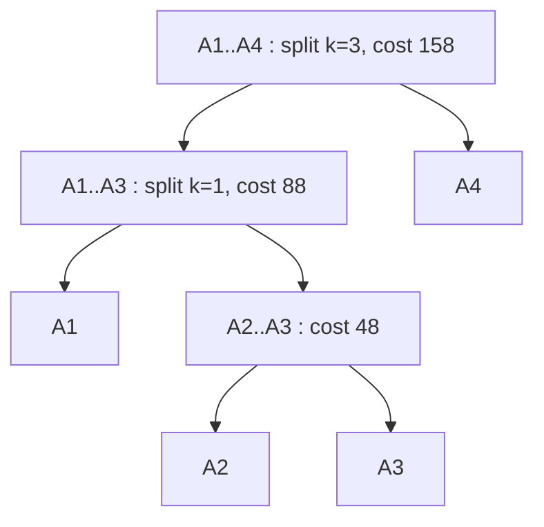

# Matrix Chain Multiplication

!!! abstract "At a glance"

    - **Problem:** given matrices $A_1, A_2, \dots, A_n$ with compatible dimensions, choose the parenthesization of $A_1 A_2 \cdots A_n$ that minimizes the number of scalar multiplications.
    - **Key idea:** the **last** multiplication splits the chain at some $k$: $(A_i \cdots A_k)(A_{k+1} \cdots A_j)$. Try every $k$; both sides must be optimal. This is **interval DP**.
    - **Complexity:** the number of parenthesizations is a Catalan number ($\Omega(4^n / n^{3/2})$); DP runs in $\Theta(n^3)$ time and $\Theta(n^2)$ space.
    - **Used in:** `numpy.linalg.multi_dot`, `einsum` contraction-order optimization, tensor-network libraries, and (with the same "best way to combine a sequence" structure) database join ordering.

## Motivation and Problem Context

Matrix multiplication is **associative** but not commutative: $(AB)C = A(BC)$, but in general $AB \ne BA$. The *result* does not depend on the parenthesization, but the *cost* does, sometimes by orders of magnitude.

!!! example "Same product, half the work"

    $A$ is $10 \times 5$, $B$ is $5 \times 20$, $C$ is $20 \times 10$. Multiplying a $p \times q$ matrix by a $q \times r$ matrix costs $p \cdot q \cdot r$ scalar multiplications and produces a $p \times r$ matrix.

    | Order | Cost |
    | --- | --- |
    | $(AB)C$ | $10 \cdot 5 \cdot 20 + 10 \cdot 20 \cdot 10 = 1000 + 2000 = 3000$ |
    | $A(BC)$ | $5 \cdot 20 \cdot 10 + 10 \cdot 5 \cdot 10 = 1000 + 500 = 1500$ |

    With realistic shapes (a $10^4 \times 10$ feature matrix, a $10 \times 10^4$ projection, and a $10^4 \times 1$ vector), the wrong order materializes a $10^4 \times 10^4$ intermediate (about $10^9$ multiplications and 800 MB of float64) while the right order needs about $2 \times 10^5$ multiplications.

In machine learning, scientific computing, and graphics pipelines, products of several matrices or tensors are evaluated constantly, so picking the order is a real engineering decision.

## Problem Formulation

- **Input:** a dimension sequence $P = \langle p_0, p_1, \dots, p_n \rangle$, where matrix $A_i$ has dimensions $p_{i-1} \times p_i$ for $i = 1..n$.
- **Output:** the minimum number of scalar multiplications $m[1, n]$ to compute $A_1 A_2 \cdots A_n$, **and** an optimal full parenthesization.
- **Cost model:** multiplying $p \times q$ by $q \times r$ with the standard algorithm costs $pqr$ scalar multiplications. Additions, memory traffic, and faster algorithms (Strassen, [Unit 4](../unit4/overview.md)) are ignored.
- **Note:** the algorithm only *plans* the order; it does not multiply any matrices.

## Intuition

Look at the **final** multiplication performed. It combines a product of some prefix $A_i \cdots A_k$ with a product of the matching suffix $A_{k+1} \cdots A_j$. Its cost $p_{i-1} p_k p_j$ depends only on $i$, $k$, $j$, and the two sides are completely independent subproblems of the same kind on **contiguous intervals**. There are only $\binom{n}{2} + n$ intervals, so the exponential number of parenthesizations collapses to $O(n^2)$ states with $O(n)$ choices each.

## Baseline Approach

Let $C(n)$ be the number of full parenthesizations of a chain of $n$ matrices. Splitting at the last multiplication:

$$
C(1) = 1, \qquad C(n) = \sum_{k=1}^{n-1} C(k)\, C(n-k).
$$

This is the Catalan recurrence: $C(n) = \frac{1}{n}\binom{2n-2}{n-1}$, which grows as $\Theta(4^n / n^{3/2})$. For $n = 20$ there are $1{,}767{,}263{,}190$ parenthesizations. Enumerating them, or recursing on the recurrence without memoization, is exponential: the naive recursive `RECURSIVE-MATRIX-CHAIN` takes $\Omega(2^n)$ time because it re-solves the same intervals $[i, j]$ many times.

!!! warning "Important"

    "Multiply the cheapest adjacent pair first" is **not** optimal. Dimensions $\langle 2, 2, 4, 3 \rangle$: greedy multiplies $A_1 A_2$ first ($2 \cdot 2 \cdot 4 = 16$) then pays $2 \cdot 4 \cdot 3 = 24$, total 40; $A_1 (A_2 A_3)$ costs $24 + 12 = 36$. A cheap step now can force an expensive step later.

## Algorithm Design

Apply the [5-step DP recipe](topic1.md#the-5-step-dp-recipe):

1. **State:** $m[i, j]$ = minimum cost to compute $A_i A_{i+1} \cdots A_j$, for $1 \le i \le j \le n$. The product has dimensions $p_{i-1} \times p_j$.
2. **Transition:** choose the split $k$ with $i \le k < j$:
   $$
   m[i, j] =
   \begin{cases}
   0 & \text{if } i = j \\
   \displaystyle \min_{i \le k < j} \bigl\{ m[i, k] + m[k+1, j] + p_{i-1}\, p_k\, p_j \bigr\} & \text{if } i < j
   \end{cases}
   $$
3. **Base case:** a single matrix needs no multiplication, $m[i, i] = 0$.
4. **Order:** $m[i, j]$ depends on strictly **shorter** intervals, so fill by increasing chain length $\ell = j - i + 1 = 2, 3, \dots, n$ (diagonal by diagonal).
5. **Answer:** $m[1, n]$.
6. **Reconstruction:** $s[i, j]$ = the optimal $k$. The outermost split is $s[1, n]$; recurse on both sides.

!!! warning "Important"

    Filling the table row by row ($i = 1..n$, $j = i..n$) is **wrong**: $m[1, 3]$ needs $m[2, 3]$, which is in a later row. Interval DP must be filled by increasing length (or by $i$ decreasing, $j$ increasing).

## Pseudocode

```text
MATRIX-CHAIN-ORDER(p)                  // p[0..n]; A_i is p[i-1] x p[i]
    n = length(p) - 1
    let m[1..n, 1..n] and s[1..n, 1..n] be new tables
    for i = 1 to n
        m[i, i] = 0
    for len = 2 to n                   // chain length
        for i = 1 to n - len + 1
            j = i + len - 1
            m[i, j] = infinity
            for k = i to j - 1         // last multiplication splits after A_k
                cost = m[i, k] + m[k+1, j] + p[i-1] * p[k] * p[j]
                if cost < m[i, j]
                    m[i, j] = cost
                    s[i, j] = k
    return m, s

PRINT-OPTIMAL-PARENS(s, i, j)
    if i == j
        print "A_i"
    else
        print "("
        PRINT-OPTIMAL-PARENS(s, i, s[i, j])
        PRINT-OPTIMAL-PARENS(s, s[i, j] + 1, j)
        print ")"
```

## Worked Example

Four matrices with $P = \langle 5, 4, 6, 2, 7 \rangle$:

| Matrix | $A_1$ | $A_2$ | $A_3$ | $A_4$ |
| --- | --- | --- | --- | --- |
| Dimension | $5 \times 4$ | $4 \times 6$ | $6 \times 2$ | $2 \times 7$ |

**Length 2** (one split each):

- $m[1,2] = 5 \cdot 4 \cdot 6 = 120$, $s[1,2] = 1$
- $m[2,3] = 4 \cdot 6 \cdot 2 = 48$, $s[2,3] = 2$
- $m[3,4] = 6 \cdot 2 \cdot 7 = 84$, $s[3,4] = 3$

**Length 3:**

| Interval | $k$ | $m[i,k] + m[k+1,j] + p_{i-1} p_k p_j$ | value |
| --- | --- | --- | --- |
| $[1,3]$ | 1 | $0 + 48 + 5 \cdot 4 \cdot 2$ | **88** |
| $[1,3]$ | 2 | $120 + 0 + 5 \cdot 6 \cdot 2$ | 180 |
| $[2,4]$ | 2 | $0 + 84 + 4 \cdot 6 \cdot 7$ | 252 |
| $[2,4]$ | 3 | $48 + 0 + 4 \cdot 2 \cdot 7$ | **104** |

**Length 4:**

| $k$ | $m[1,k] + m[k+1,4] + p_0 p_k p_4$ | value |
| --- | --- | --- |
| 1 | $0 + 104 + 5 \cdot 4 \cdot 7$ | 244 |
| 2 | $120 + 84 + 5 \cdot 6 \cdot 7$ | 414 |
| 3 | $88 + 0 + 5 \cdot 2 \cdot 7$ | **158** |

Final tables (filled diagonal by diagonal):

=== "Cost table m[i, j]"

    | $i \backslash j$ | 1 | 2 | 3 | 4 |
    | :---: | :---: | :---: | :---: | :---: |
    | **1** | 0 | 120 | 88 | **158** |
    | **2** | | 0 | 48 | 104 |
    | **3** | | | 0 | 84 |
    | **4** | | | | 0 |

=== "Split table s[i, j]"

    | $i \backslash j$ | 1 | 2 | 3 | 4 |
    | :---: | :---: | :---: | :---: | :---: |
    | **1** | – | 1 | 1 | **3** |
    | **2** | | – | 2 | 3 |
    | **3** | | | – | 3 |
    | **4** | | | | – |

**Reconstruction:** $s[1,4] = 3$ → $(A_1 A_2 A_3)(A_4)$; $s[1,3] = 1$ → $(A_1)(A_2 A_3)$. Optimal parenthesization $\bigl((A_1 (A_2 A_3)) A_4\bigr)$ with **158** scalar multiplications. (Check: $A_2A_3$ costs 48 and is $4 \times 2$; $A_1(\cdot)$ costs $5\cdot4\cdot2 = 40$ and is $5 \times 2$; $(\cdot)A_4$ costs $5 \cdot 2 \cdot 7 = 70$; $48 + 40 + 70 = 158$.)



*The split table encodes this expression tree; each internal node is one matrix multiplication.*

!!! note "CLRS benchmark instance"

    For $P = \langle 30, 35, 15, 5, 10, 20, 25 \rangle$ (six matrices), the DP gives $m[1,6] = 15{,}125$ with parenthesization $\bigl((A_1(A_2A_3))((A_4A_5)A_6)\bigr)$. Use it to test your implementation.

## Correctness

**Optimal substructure.** Suppose an optimal parenthesization of $A_i \cdots A_j$ ($i < j$) performs its last multiplication between $A_i \cdots A_k$ and $A_{k+1} \cdots A_j$. Its cost is $(\text{cost of left part}) + (\text{cost of right part}) + p_{i-1} p_k p_j$. If the left part were not computed optimally, substituting an optimal parenthesization of $A_i \cdots A_k$ would lower the total without affecting the right part or the final term, contradicting optimality. The same holds for the right part. So an optimal solution is built from optimal solutions of $[i, k]$ and $[k+1, j]$.

**Exhaustiveness.** Every full parenthesization of a chain of length $\ge 2$ has exactly one last multiplication, at some $k \in [i, j-1]$. The minimum over all $k$ therefore covers every parenthesization.

**Induction on chain length.** *Claim:* after processing length $\ell$, every $m[i, j]$ with $j - i + 1 \le \ell$ is optimal.

- *Base* ($\ell = 1$): $m[i,i] = 0$ is correct.
- *Step:* for $j - i + 1 = \ell$, every $m[i,k]$ and $m[k+1,j]$ read has length $< \ell$ and is optimal by hypothesis; by optimal substructure and exhaustiveness the minimum is the optimum.

Reconstruction from $s$ is correct by the same induction: the tree rooted at split $s[i,j]$ achieves $m[i,j]$.

## Complexity Analysis

- **States:** $n(n+1)/2 = \Theta(n^2)$ intervals.
- **Work per state:** $j - i$ candidate splits, each $O(1)$.
- **Total:**
  $$
  \sum_{\ell=2}^{n} (n - \ell + 1)(\ell - 1) = \frac{n^3 - n}{6} = \Theta(n^3).
  $$
- **Space:** $\Theta(n^2)$ for $m$ and $s$. Reconstruction takes $O(n)$ time (one call per node of an $n$-leaf tree).

| Approach | Time | Space |
| --- | --- | --- |
| Enumerate all parenthesizations | $\Theta(4^n / n^{3/2})$ trees, each costed in $O(n)$ | $O(n)$ |
| Naive recursion | $\Omega(2^n)$ | $O(n)$ |
| Memoized recursion | $\Theta(n^3)$ | $\Theta(n^2)$ |
| Bottom-up DP | $\Theta(n^3)$ | $\Theta(n^2)$ |
| Hu-Shing algorithm | $O(n \log n)$ | $O(n)$ |

The $O(n \log n)$ Hu-Shing algorithm exists but is intricate; the $\Theta(n^3)$ DP is the standard answer, and since $n$ (the number of matrices) is usually small, it is what libraries use. In contrast, the cost of the actual multiplications it saves is often huge.

## Python Implementation

```python
import math

def matrix_chain_order(dims):
    """dims has length n+1; matrix A_i is dims[i-1] x dims[i] for i = 1..n.
    Returns (cost table m, split table s), both 1-indexed (row/col 0 unused)."""
    n = len(dims) - 1
    m = [[0] * (n + 1) for _ in range(n + 1)]
    s = [[0] * (n + 1) for _ in range(n + 1)]
    for length in range(2, n + 1):              # chain length
        for i in range(1, n - length + 2):
            j = i + length - 1
            m[i][j] = math.inf
            for k in range(i, j):               # split between A_k and A_(k+1)
                cost = m[i][k] + m[k + 1][j] + dims[i - 1] * dims[k] * dims[j]
                if cost < m[i][j]:
                    m[i][j] = cost
                    s[i][j] = k
    return m, s


def parenthesize(s, i, j):
    if i == j:
        return f"A{i}"
    k = s[i][j]
    return "(" + parenthesize(s, i, k) + parenthesize(s, k + 1, j) + ")"


m, s = matrix_chain_order([5, 4, 6, 2, 7])
print(m[1][4], parenthesize(s, 1, 4))      # 158 ((A1(A2A3))A4)
```

- `range(1, n - length + 2)` makes the last start index $i = n - \ell + 1$, matching the pseudocode's inclusive bound.
- `dims[k]` is the inner dimension shared by $A_k$ (columns) and $A_{k+1}$ (rows).
- With a single matrix (`dims` of length 2) the outer loop does not run and `m[1][1] = 0`.
- `parenthesize` recurses to depth at most $n$; for the small $n$ typical in practice this is fine.

## Edge Cases and Pitfalls

| Case / pitfall | What goes wrong | Fix |
| --- | --- | --- |
| Off-by-one in dimensions | Using `dims[i]` as rows of $A_i$ | $A_i$ is `dims[i-1] x dims[i]`; the final term is $p_{i-1} p_k p_j$ |
| Wrong fill order (row by row) | Reads $m[k+1][j]$ before it is computed | Loop over chain length, or $i$ from $n$ down to 1 |
| $k$ ranging to $j$ | Empty right side $[j+1, j]$ | $i \le k < j$ |
| Single matrix ($n = 1$) | Some implementations index $m[1][0]$ | Return 0 and "A1" |
| Incompatible dimensions | Problem input is invalid | Validate that consecutive inner dimensions match before planning |
| Using the cost of an *element-wise* or sparse product | The $pqr$ model no longer reflects real cost | Change the cost function; the DP structure still applies |
| Reconstruction from $m$ alone | Ties and recomputation errors | Record $s[i][j]$ during the minimization |

## Common Misconceptions

- **"Associativity means the order does not matter."** The result does not change; the *cost* can change by orders of magnitude.
- **"The DP multiplies the matrices."** It only computes the plan from the dimensions, in $\Theta(n^3)$ time independent of the matrix sizes.
- **"Always split at the smallest dimension."** Heuristics like that, or "cheapest pair first", fail on small counterexamples (see $\langle 2, 2, 4, 3 \rangle$ above).
- **"$\Theta(n^3)$ is too slow."** Here $n$ is the number of matrices (typically under a few dozen), not their dimension; the planning cost is negligible compared to the multiplications.
- **"Matrix chain is a sequence DP like LCS."** Its states are intervals and its transition chooses a split point; that makes it the template for **interval DP** (also Optimal BST, [Topic 5](topic5.md)).

## Alternatives and Trade-offs

| Approach | Optimal? | Time | When to use |
| --- | --- | --- | --- |
| Left-to-right evaluation | No | 0 planning | Shapes known to be favorable (e.g. all square) |
| Greedy (cheapest adjacent pair) | No | $O(n^2)$ | Very long chains where approximate is acceptable |
| Interval DP | Yes | $\Theta(n^3)$ | Default for chains up to hundreds of matrices |
| Hu-Shing | Yes | $O(n \log n)$ | Theoretical interest; very long chains |
| Exhaustive search | Yes | Exponential | Test oracle for $n \le 10$ |

**When NOT to use the DP plan as-is:** when the matrices are sparse or structured (cost is not $pqr$), when memory of intermediates matters more than flop count, or when GPU kernels make some shapes much faster than the model predicts. The interval DP still applies; only the cost function changes.

## In Practice

- **NumPy:** `numpy.linalg.multi_dot([A, B, C, ...])` chooses the multiplication order automatically using this kind of DP (with a direct formula for three matrices), which can be dramatically faster than `A @ B @ C` evaluated left to right.
- **Einstein summation:** `numpy.einsum(..., optimize=True)` (or `"greedy"`/`"optimal"`) and `numpy.einsum_path` plan the order of tensor contractions; the `opt_einsum` library offers several search strategies. This is matrix chain ordering generalized to tensors, where exhaustive optimal search becomes expensive and greedy heuristics are common.
- **Automatic differentiation:** forward mode vs reverse mode (backpropagation) is exactly a choice of association order for a chain of Jacobian products; reverse mode wins when the output is a scalar loss.
- **Databases:** choosing the order in which to join relations is the same "best way to combine a sequence" problem, but harder (any pair may be joined, costs depend on estimated result sizes). The System R optimizer introduced DP over subsets of relations; PostgreSQL uses exhaustive DP search for join order up to a configurable number of relations (`geqo_threshold`, default 12) and switches to a genetic heuristic beyond that.
- **Compilers and graphics:** constant folding and transform pipelines (e.g. chains of $4 \times 4$ transforms applied to many vertices) benefit from multiplying the small matrices together first.

## Interview and Competitive Programming

**Recognition cues:** "merge adjacent elements, cost depends on the merged ranges", "burst/remove items and score depends on neighbors", "optimal way to split a range" → interval DP over $[i, j]$ with a split $k$.

**Template:**

```python
def interval_dp(n, base, combine):
    """base(i) gives dp[i][i]; combine(i, k, j, left, right) gives the cost of one split."""
    dp = [[0] * n for _ in range(n)]
    for i in range(n):
        dp[i][i] = base(i)
    for length in range(2, n + 1):
        for i in range(0, n - length + 1):
            j = i + length - 1
            dp[i][j] = min(combine(i, k, j, dp[i][k], dp[k + 1][j]) for k in range(i, j))
    return dp[0][n - 1]
```

**Constraints:** $n \le 500$ fits $O(n^3)$ in C++; $n \le 5000$ needs a speedup such as Knuth's optimization (see [Topic 5](topic5.md)) when its conditions hold. **Traps:** filling in the wrong order; mixing 0-based matrix indices with 1-based dimension indices; forgetting that the state needs both endpoints.

Well-known instances: LeetCode 312 *Burst Balloons*, LeetCode 1039 *Minimum Score Triangulation of Polygon*, LeetCode 1547 *Minimum Cost to Cut a Stick*, and the classic "merge stones/slimes" problem.

## Using AI Assistants Critically

- The most frequent generated bug is the cost term: `p[i] * p[k] * p[j]` instead of `p[i-1] * p[k] * p[j]` (or the 0-based equivalent). Check against the hand-computed $\langle 10, 5, 20, 10 \rangle$ case (answer 1500).
- Generated code often fills the table with `for i ... for j ...` row-major order; verify the loop order reads only completed cells.
- Ask for the parenthesization, not only the cost, and verify it by recomputing the cost of the returned expression tree.
- Compare against an exhaustive recursive search for random dimension lists of length up to 8.
- Be suspicious of claims that a greedy rule is optimal; test with $\langle 2, 2, 4, 3 \rangle$.
- If an assistant recommends `A @ B @ C` for performance-critical code, check the shapes and consider `numpy.linalg.multi_dot`.

## Practice

### Beginner

1. For $P = \langle 10, 20, 5, 30 \rangle$, compute both parenthesization costs and identify the better one. *Difficulty: easy.*
2. Fill $m$ and $s$ for $P = \langle 3, 5, 2, 4, 6 \rangle$ and print the optimal parenthesization. *Difficulty: easy.*
3. Compute the number of parenthesizations for $n = 5$ using the Catalan recurrence. *Difficulty: easy.*

### Intermediate

1. Write `MEMOIZED-MATRIX-CHAIN` (top-down) and argue it has the same $\Theta(n^3)$ bound. *Difficulty: medium.*
2. Modify the DP to also return the **maximum** cost and explain why the "worst" order matters for estimating risk. *Difficulty: medium.*
3. *Optimal polygon triangulation.* Input: a convex polygon with $n \le 200$ vertex weights; the cost of a triangle is the product of its vertex weights. Output: the minimum total triangulation cost. Map it to matrix chain. *Difficulty: medium.*

### Advanced

1. Prove that the naive recursive algorithm takes $\Omega(2^n)$ time using $T(n) \ge 1 + \sum_{k=1}^{n-1}(T(k) + T(n-k) + 1)$. *Difficulty: hard.*
2. Generalize the cost model: multiplying $p \times q$ by $q \times r$ costs $c(p, q, r)$ for an arbitrary function. Does the DP still work? What property of $c$ is needed? *Difficulty: hard.*
3. Count exactly how many times entry $m[i, j]$ is read during the bottom-up algorithm, and sum over all entries to confirm $\Theta(n^3)$. *Difficulty: hard.*

### Interview / Competitive Programming

1. *LeetCode 312 Burst Balloons.* Maximize coins from bursting balloons where each burst scores the product of neighbors. *Difficulty: hard.*
2. *LeetCode 1039 Minimum Score Triangulation of Polygon.* *Difficulty: medium.*
3. *Slimes merging.* Input: $n \le 400$ slime sizes in a row. Merging two adjacent slimes costs the sum of their sizes. Output: minimum total cost to merge all into one. *Difficulty: medium.*

## Self-Check Questions

??? question "Q1. Why does the state need two indices i and j, while rod cutting needs only one?"
    Rod cutting only ever removes a prefix piece, so the remaining subproblem is always "a rod of length $j$". In a matrix chain the last split leaves two independent contiguous sub-chains anywhere in the sequence, so a subproblem is identified by both endpoints.

??? question "Q2. What does s[i, j] = k mean?"
    In an optimal parenthesization of $A_i \cdots A_j$, the last multiplication is $(A_i \cdots A_k) \times (A_{k+1} \cdots A_j)$.

??? question "Q3. Derive the Θ(n^3) running time."
    There are $n - \ell + 1$ intervals of length $\ell$, each trying $\ell - 1$ splits. $\sum_{\ell=2}^{n}(n-\ell+1)(\ell-1) = (n^3 - n)/6 = \Theta(n^3)$.

??? question "Q4. Why must the table be filled by increasing chain length?"
    $m[i,j]$ reads $m[i,k]$ and $m[k+1,j]$, both strictly shorter intervals. Filling by length guarantees they are ready. Row-major order would read $m[k+1, j]$ from a later row before it is computed.

??? question "Q5. Give a counterexample to 'always perform the cheapest adjacent multiplication first'."
    $P = \langle 2, 2, 4, 3 \rangle$. Greedy: $A_1A_2$ (16), then $2 \cdot 4 \cdot 3 = 24$, total 40. Optimal: $A_2A_3$ (24), then $2 \cdot 2 \cdot 3 = 12$, total 36.

??? question "Q6. A colleague computes X^T X w for a 10^6 x 100 matrix X and vector w as (X^T X) w. What would you suggest and why?"
    Compute $X^T (X w)$: $Xw$ costs $10^8$ and gives a $10^6$-vector, then $X^T(\cdot)$ costs another $10^8$. $(X^T X)$ costs $10^{10}$ before even touching $w$. If $X^T X$ is reused for many $w$, forming it once can still pay off; the cost model must include reuse.

??? question "Q7. How is matrix chain ordering related to join ordering in databases?"
    Both choose an association order for combining a sequence of objects where intermediate result sizes drive the cost. Join ordering is harder: joins are commutative and any connected pair can be joined, so optimizers use DP over subsets of relations (System R style) with estimated cardinalities, falling back to heuristics for many relations.

## Complexity Summary

| Quantity | Value |
| --- | --- |
| Number of parenthesizations | Catalan $C_{n-1} = \Theta(4^n / n^{3/2})$ |
| Naive recursion | $\Omega(2^n)$ time |
| DP states | $\Theta(n^2)$ |
| DP time | $\Theta(n^3)$, exactly $(n^3 - n)/6$ split evaluations |
| DP space | $\Theta(n^2)$ |
| Reconstruction | $O(n)$ |

## Key Takeaways

- Matrix multiplication is associative, so many parenthesizations give the same result at very different costs.
- State $m[i,j]$ over intervals; transition over the last split $k$; cost $p_{i-1} p_k p_j$ for the final product.
- Fill by increasing chain length; record $s[i,j]$ to rebuild the expression tree.
- $\Theta(n^3)$ time, $\Theta(n^2)$ space; exponential without DP; greedy heuristics are not optimal.
- This is the prototype of **interval DP**, reused for optimal BSTs, polygon triangulation, and burst-balloon style problems.
- Real libraries (`multi_dot`, `einsum` path optimizers) and query optimizers apply the same idea.
