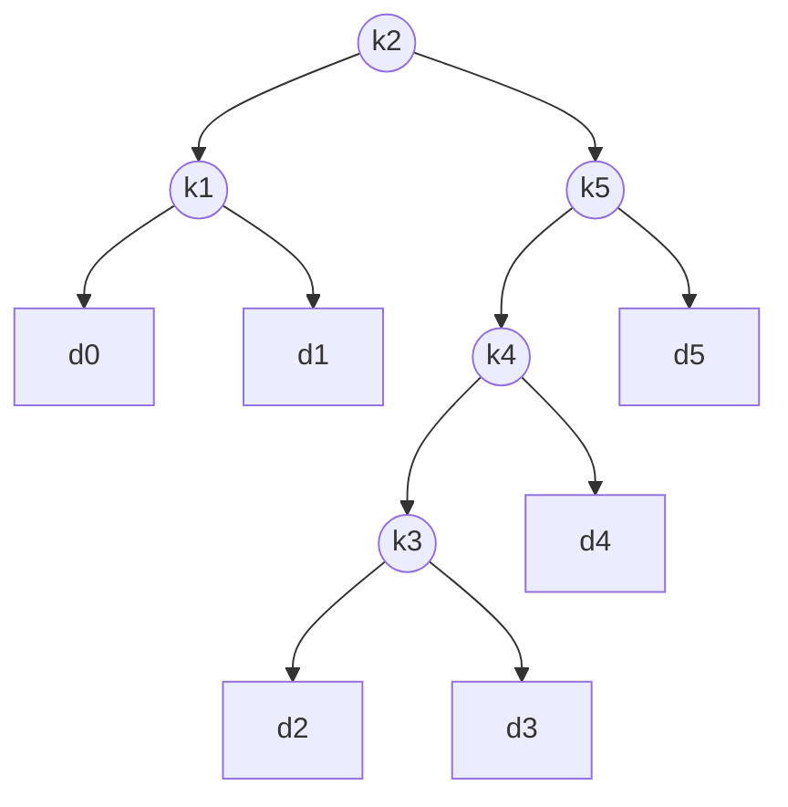

# Optimal Binary Search Trees

!!! abstract "At a glance"

    - **Problem:** given sorted keys $k_1 < \dots < k_n$ with search probabilities $p_i$, and probabilities $q_i$ for unsuccessful searches falling between keys, build the BST with minimum expected search cost.
    - **Key idea:** choose the **root** $k_r$ of the keys $k_i..k_j$; the left and right subtrees are independent optimal BSTs on $k_i..k_{r-1}$ and $k_{r+1}..k_j$, and every node in them gets one level deeper, which adds the total weight $w(i,j)$.
    - **Recurrence:** $e[i,j] = \min_{i \le r \le j}\{e[i,r-1] + e[r+1,j] + w(i,j)\}$, with $e[i,i-1] = q_{i-1}$.
    - **Complexity:** $\Theta(n^3)$ time, $\Theta(n^2)$ space; Knuth's monotonicity of roots reduces time to $\Theta(n^2)$.
    - **Used in:** static dictionaries with known access frequencies, optimal decision/lookup trees, and as the motivating example for self-adjusting trees (splay trees).

## Motivation and Problem Context

A balanced BST (AVL, red-black) guarantees $O(\log n)$ depth for **every** key. That is ideal when all keys are equally likely. But access patterns are rarely uniform: in an English-to-Dzongkha translation dictionary, "the" is looked up far more often than "quixotic". If we know the frequencies in advance and the key set does not change, we can put frequent keys near the root and rare keys deeper, and beat a balanced tree on **average** search cost.

Unsuccessful searches matter too: a spell checker looks up many strings that are *not* in the dictionary, and each such search ends at an empty position (a "dummy key") between two real keys.

| Strategy | Idea | Problem |
| --- | --- | --- |
| Balanced BST | minimize maximum depth | ignores frequencies |
| Greedy: most probable key at root | put the hottest key first | can be far from optimal (see below) |
| Optimal BST (this page) | minimize expected cost exactly | needs known, static frequencies |

## Problem Formulation

Following CLRS[^1]:

- **Input:**
    - keys $k_1 < k_2 < \dots < k_n$ with probabilities $p_1, \dots, p_n$ that a search is for $k_i$;
    - dummy keys $d_0, d_1, \dots, d_n$ with probabilities $q_0, \dots, q_n$, where $d_0$ represents values less than $k_1$, $d_n$ values greater than $k_n$, and $d_i$ ($1 \le i < n$) values strictly between $k_i$ and $k_{i+1}$;
    - $\sum_{i=1}^{n} p_i + \sum_{i=0}^{n} q_i = 1$ (or any non-negative frequencies; normalization is not needed for the optimization).
- **Output:** a BST whose internal nodes are the keys and whose leaves are the dummy keys, minimizing
  $$
  \mathbb{E}[\text{search cost}] = \sum_{i=1}^{n} (\operatorname{depth}(k_i) + 1)\, p_i + \sum_{i=0}^{n} (\operatorname{depth}(d_i) + 1)\, q_i ,
  $$
  where the cost of a search is the number of nodes examined (root has depth 0).
- **Assumptions:** probabilities are known and fixed; the key set is static; the BST order of the keys must be respected (an in-order traversal gives $d_0, k_1, d_1, \dots, k_n, d_n$).

## Intuition

Whatever key $k_r$ sits at the root, the BST property forces $k_i..k_{r-1}$ (and dummies $d_{i-1}..d_{r-1}$) into the left subtree and $k_{r+1}..k_j$ (and $d_r..d_j$) into the right subtree. Those two subtrees do not interact. Hanging them under a root pushes **every** node in them one level deeper, which increases the expected cost by exactly the sum of all probabilities in the subtree. So:

$$
\text{cost(tree)} = \text{cost(left)} + \text{cost(right)} + \underbrace{w(i,j)}_{\text{every node in } i..j \text{ examined one more time}}
$$

Subproblems are **contiguous ranges of keys**, just like the intervals in [Matrix Chain Multiplication](topic3.md): this is another interval DP, with "choose the root" in place of "choose the split".

## Baseline Approach

The number of structurally different BSTs on $n$ keys is the Catalan number $C_n = \frac{1}{n+1}\binom{2n}{n} = \Theta(4^n / n^{3/2})$. For $n = 20$ that is $6{,}564{,}120{,}420$ trees; evaluating each in $O(n)$ is out of the question.

The natural greedy idea also fails.

!!! warning "Important"

    **Putting the most probable key at the root is not optimal.** Keys $k_1, k_2, k_3$ with $p = (0.34, 0.33, 0.33)$ and all $q_i = 0$. Greedy roots at $k_1$; the remaining keys form a chain: cost $0.34 \cdot 1 + 0.33 \cdot 2 + 0.33 \cdot 3 = 1.99$. Rooting at $k_2$ gives $0.33 \cdot 1 + (0.34 + 0.33) \cdot 2 = 1.67$. A slightly less popular root can balance the rest of the tree.

    Similarly, a perfectly **balanced** tree is not optimal when probabilities are skewed: with $p = (0.8, 0.1, 0.1)$ the balanced tree (root $k_2$) costs $1.9$, while rooting at $k_1$ costs $1.3$.

## Algorithm Design

Apply the [5-step DP recipe](topic1.md#the-5-step-dp-recipe):

1. **State:** $e[i,j]$ = expected cost of an optimal BST containing keys $k_i..k_j$ (and dummies $d_{i-1}..d_j$), for $1 \le i \le n+1$, $i - 1 \le j \le n$. The case $j = i - 1$ is an **empty** range containing only the dummy $d_{i-1}$.
2. **Weight:** $w(i,j) = \sum_{l=i}^{j} p_l + \sum_{l=i-1}^{j} q_l$, the total probability of the subtree. It satisfies $w(i, i-1) = q_{i-1}$ and $w(i,j) = w(i,j-1) + p_j + q_j$, so a table of all weights costs $\Theta(n^2)$.
3. **Transition:** choose the root $k_r$, $i \le r \le j$:
   $$
   e[i,j] =
   \begin{cases}
   q_{i-1} & \text{if } j = i - 1 \\
   \displaystyle \min_{i \le r \le j} \bigl\{ e[i, r-1] + e[r+1, j] + w(i,j) \bigr\} & \text{if } i \le j
   \end{cases}
   $$
   The root itself contributes $p_r$ (depth 0, cost 1), already included in $w(i,j)$.
4. **Order:** by increasing range length $\ell = j - i + 1 = 1, 2, \dots, n$, exactly like matrix chain.
5. **Answer:** $e[1,n]$.
6. **Reconstruction:** $\text{root}[i,j]$ = the minimizing $r$. Build the tree recursively: the root is $k_{\text{root}[1,n]}$, its left subtree is the tree for $[1, r-1]$, and so on; an empty range $[i, i-1]$ becomes leaf $d_{i-1}$.

!!! warning "Important"

    The table $e$ needs rows $1..n+1$ and columns $0..n$ so that the empty ranges $e[i, i-1]$ (including $e[n+1, n] = q_n$ and $e[1,0] = q_0$) exist. Forgetting these base cells, or setting them to 0 instead of $q_{i-1}$, is the most common error in exam answers and code.

## Pseudocode

```text
OPTIMAL-BST(p, q, n)               // p[1..n], q[0..n]
    let e[1..n+1, 0..n], w[1..n+1, 0..n], root[1..n, 1..n] be new tables
    for i = 1 to n + 1
        e[i, i-1] = q[i-1]
        w[i, i-1] = q[i-1]
    for len = 1 to n
        for i = 1 to n - len + 1
            j = i + len - 1
            e[i, j] = infinity
            w[i, j] = w[i, j-1] + p[j] + q[j]
            for r = i to j              // try every key as the root
                t = e[i, r-1] + e[r+1, j] + w[i, j]
                if t < e[i, j]
                    e[i, j] = t
                    root[i, j] = r
    return e, root

BUILD-TREE(root, i, j)
    if j == i - 1
        return leaf d[j]
    r = root[i, j]
    return node(k[r], BUILD-TREE(root, i, r-1), BUILD-TREE(root, r+1, j))
```

## Worked Example

The CLRS instance with $n = 5$:

| $i$ | 0 | 1 | 2 | 3 | 4 | 5 |
| --- | --- | --- | --- | --- | --- | --- |
| $p_i$ | – | 0.15 | 0.10 | 0.05 | 0.10 | 0.20 |
| $q_i$ | 0.05 | 0.10 | 0.05 | 0.05 | 0.05 | 0.10 |

**Base cells:** $e[i, i-1] = q_{i-1}$: $e[1,0] = 0.05$, $e[2,1] = 0.10$, $e[3,2] = 0.05$, $e[4,3] = 0.05$, $e[5,4] = 0.05$, $e[6,5] = 0.10$.

**One key** ($\ell = 1$), e.g. $[1,1]$: $w(1,1) = q_0 + p_1 + q_1 = 0.30$, and the only root is $k_1$: $e[1,1] = e[1,0] + e[2,1] + 0.30 = 0.05 + 0.10 + 0.30 = 0.45$.

**Two keys** ($\ell = 2$), e.g. $[1,2]$: $w(1,2) = 0.45$.

| root $r$ | $e[1,r-1] + e[r+1,2] + w(1,2)$ | value |
| --- | --- | --- |
| 1 | $0.05 + 0.40 + 0.45$ | **0.90** |
| 2 | $0.45 + 0.05 + 0.45$ | 0.95 |

**Full range** $[1,5]$: $w(1,5) = 1.00$.

| root $r$ | $e[1,r-1] + e[r+1,5] + 1.00$ | value |
| --- | --- | --- |
| 1 | $0.05 + 2.00 + 1.00$ | 3.05 |
| 2 | $0.45 + 1.30 + 1.00$ | **2.75** |
| 3 | $0.90 + 0.90 + 1.00$ | 2.80 |
| 4 | $1.25 + 0.50 + 1.00$ | 2.75 (tie) |
| 5 | $1.75 + 0.10 + 1.00$ | 2.85 |

With strict `<`, the first minimizer $r = 2$ is kept; rooting at $k_4$ gives another optimal tree.

=== "e[i, j] (expected cost)"

    | $i \backslash j$ | 0 | 1 | 2 | 3 | 4 | 5 |
    | :---: | :---: | :---: | :---: | :---: | :---: | :---: |
    | **1** | 0.05 | 0.45 | 0.90 | 1.25 | 1.75 | **2.75** |
    | **2** | | 0.10 | 0.40 | 0.70 | 1.20 | 2.00 |
    | **3** | | | 0.05 | 0.25 | 0.60 | 1.30 |
    | **4** | | | | 0.05 | 0.30 | 0.90 |
    | **5** | | | | | 0.05 | 0.50 |
    | **6** | | | | | | 0.10 |

=== "w(i, j) (subtree weight)"

    | $i \backslash j$ | 0 | 1 | 2 | 3 | 4 | 5 |
    | :---: | :---: | :---: | :---: | :---: | :---: | :---: |
    | **1** | 0.05 | 0.30 | 0.45 | 0.55 | 0.70 | 1.00 |
    | **2** | | 0.10 | 0.25 | 0.35 | 0.50 | 0.80 |
    | **3** | | | 0.05 | 0.15 | 0.30 | 0.60 |
    | **4** | | | | 0.05 | 0.20 | 0.50 |
    | **5** | | | | | 0.05 | 0.35 |
    | **6** | | | | | | 0.10 |

=== "root[i, j]"

    | $i \backslash j$ | 1 | 2 | 3 | 4 | 5 |
    | :---: | :---: | :---: | :---: | :---: | :---: |
    | **1** | 1 | 1 | 2 | 2 | **2** |
    | **2** | | 2 | 2 | 2 | 4 |
    | **3** | | | 3 | 4 | 5 |
    | **4** | | | | 4 | 5 |
    | **5** | | | | | 5 |

**Reconstruction:** $\text{root}[1,5] = 2$ → $k_2$ at the root, left range $[1,1]$, right range $[3,5]$. $\text{root}[1,1] = 1$. $\text{root}[3,5] = 5$ → $k_5$, left $[3,4]$, right empty ($d_5$). $\text{root}[3,4] = 4$ → $k_4$, left $[3,3]$ → $k_3$, right empty ($d_4$).



*Optimal BST for the CLRS instance, expected cost 2.75. Circles are keys, squares are dummy keys (unsuccessful searches). Note that it is not balanced: $k_5$ (the most probable key, 0.20) is at depth 1, and $k_3$ (the least probable, 0.05) is at depth 3.*

**Check by depths:** keys $k_2$:1, $k_1, k_5$: 2, $k_4$: 3, $k_3$: 4 levels examined; dummies $d_0, d_1, d_5$: 3, $d_4$: 4, $d_2, d_3$: 5.
$0.10\cdot1 + (0.15+0.20)\cdot2 + 0.10\cdot3 + 0.05\cdot4 + (0.05+0.10+0.10)\cdot3 + 0.05\cdot4 + (0.05+0.05)\cdot5 = 2.75$.

## Correctness

**Optimal substructure (cut-and-paste).** Let $T$ be an optimal BST for keys $k_i..k_j$ with root $k_r$. Its left subtree $T_L$ contains exactly $k_i..k_{r-1}$ and $d_{i-1}..d_{r-1}$ (BST order), and its right subtree $T_R$ contains $k_{r+1}..k_j$ and $d_r..d_j$. Depth in $T$ = depth in the subtree + 1, so

$$
\text{cost}(T) = p_r + \bigl(\text{cost}(T_L) + w(i, r-1)\bigr) + \bigl(\text{cost}(T_R) + w(r+1, j)\bigr) = \text{cost}(T_L) + \text{cost}(T_R) + w(i,j),
$$

using $w(i,j) = w(i,r-1) + p_r + w(r+1,j)$. If $T_L$ were not optimal for its range, replacing it with a cheaper tree on the same keys keeps $T$ a valid BST and lowers $\text{cost}(T)$, a contradiction. Likewise for $T_R$.

**Exhaustiveness.** Every BST on $k_i..k_j$ has some root $k_r$ with $i \le r \le j$, so the minimum over $r$ considers every possible tree shape at the top level, and by optimal substructure each choice is completed optimally.

**Base case.** An empty key range $[i, i-1]$ is exactly the single leaf $d_{i-1}$, examined once with probability $q_{i-1}$: $e[i,i-1] = q_{i-1}$.

**Induction on range length** (filled in increasing length, so $e[i,r-1]$ and $e[r+1,j]$ are ready and correct) completes the proof. Reconstruction from `root` yields a tree achieving $e[1,n]$ by the same induction.

## Complexity Analysis

- **States:** $\Theta(n^2)$ ranges $[i,j]$ (plus $n+1$ empty ones).
- **Work per state:** $j - i + 1$ candidate roots, $O(1)$ each because $w(i,j)$ is computed incrementally.
- **Time:** $\sum_{\ell=1}^{n} (n - \ell + 1)\,\ell = \frac{n(n+1)(n+2)}{6} = \Theta(n^3)$.
- **Space:** $\Theta(n^2)$ for $e$, $w$, and `root`.
- **Reconstruction:** $O(n)$.

**Knuth's optimization ($\Theta(n^2)$).** Knuth (1971) proved that optimal roots can be chosen monotonically:

$$
\text{root}[i, j-1] \;\le\; \text{root}[i, j] \;\le\; \text{root}[i+1, j].
$$

Restricting the inner loop to this window makes the work for all ranges of a fixed length telescope to $O(n)$, giving $\Theta(n^2)$ total. In the worked example, $\text{root}[1,5] \in [\text{root}[1,4], \text{root}[2,5]] = [2, 4]$: only three candidates instead of five. The same trick applies to other interval DPs whose cost satisfies the *quadrangle inequality*; it does **not** apply to matrix chain multiplication in general.

## Python Implementation

=== "Θ(n³) DP"

    ```python
    import math

    def optimal_bst(p, q):
        """p[1..n]: key probabilities (p[0] unused); q[0..n]: dummy probabilities.
        Returns (e, root) where e[1][n] is the minimum expected search cost."""
        n = len(p) - 1
        e = [[0.0] * (n + 1) for _ in range(n + 2)]   # rows 1..n+1, cols 0..n
        w = [[0.0] * (n + 1) for _ in range(n + 2)]
        root = [[0] * (n + 1) for _ in range(n + 1)]
        for i in range(1, n + 2):
            e[i][i - 1] = q[i - 1]                    # empty range: only dummy d_(i-1)
            w[i][i - 1] = q[i - 1]
        for length in range(1, n + 1):
            for i in range(1, n - length + 2):
                j = i + length - 1
                e[i][j] = math.inf
                w[i][j] = w[i][j - 1] + p[j] + q[j]
                for r in range(i, j + 1):
                    cost = e[i][r - 1] + e[r + 1][j] + w[i][j]
                    if cost < e[i][j]:
                        e[i][j] = cost
                        root[i][j] = r
        return e, root


    def build_tree(root, i, j):
        """Optimal tree as nested tuples (key index, left, right); None is a dummy leaf."""
        if i > j:
            return None
        r = root[i][j]
        return (r, build_tree(root, i, r - 1), build_tree(root, r + 1, j))


    p = [0, 0.15, 0.10, 0.05, 0.10, 0.20]
    q = [0.05, 0.10, 0.05, 0.05, 0.05, 0.10]
    e, root = optimal_bst(p, q)
    print(round(e[1][5], 2))          # 2.75
    print(build_tree(root, 1, 5))     # (2, (1, None, None), (5, (4, (3, None, None), None), None))
    ```

=== "Knuth Θ(n²)"

    ```python
    import math

    def optimal_bst_knuth(p, q):
        n = len(p) - 1
        e = [[0.0] * (n + 1) for _ in range(n + 2)]
        w = [[0.0] * (n + 1) for _ in range(n + 2)]
        root = [[0] * (n + 1) for _ in range(n + 2)]
        for i in range(1, n + 2):
            e[i][i - 1] = w[i][i - 1] = q[i - 1]
        for length in range(1, n + 1):
            for i in range(1, n - length + 2):
                j = i + length - 1
                w[i][j] = w[i][j - 1] + p[j] + q[j]
                lo = i if length == 1 else root[i][j - 1]   # Knuth window
                hi = j if length == 1 else root[i + 1][j]
                e[i][j] = math.inf
                for r in range(lo, hi + 1):
                    cost = e[i][r - 1] + e[r + 1][j] + w[i][j]
                    if cost < e[i][j]:
                        e[i][j] = cost
                        root[i][j] = r
        return e, root
    ```

- Tables have $n+2$ rows so that `e[r + 1][j]` with `r = n` reads the base cell `e[n + 1][n]`.
- `w[i][j]` is built from `w[i][j - 1]` in $O(1)$; recomputing the sum inside the `r` loop would make the algorithm $\Theta(n^4)$.
- The functions accept raw frequencies (counts) as well as probabilities; with integer counts the result is the total weighted cost and there are no floating-point tie issues.
- Both versions were cross-checked against exhaustive search over all BSTs for random inputs with $n \le 7$.

## Edge Cases and Pitfalls

| Case / pitfall | What goes wrong | Fix |
| --- | --- | --- |
| Base cells $e[i,i-1]$ set to 0 | Unsuccessful searches ignored; wrong cost and possibly wrong tree | $e[i,i-1] = q_{i-1}$ (0 only if all $q = 0$) |
| Table too small | `IndexError` on `e[n+1][n]` or `e[i][0]` | Rows $1..n+1$, columns $0..n$ |
| Recomputing $w(i,j)$ by summation inside the root loop | $\Theta(n^4)$ time | Precompute incrementally or with prefix sums |
| Floating-point ties | Different but equally optimal roots chosen; Knuth window may behave unexpectedly near ties | Use integer frequencies, or compare with a tolerance |
| $n = 0$ | Loops do nothing; answer should be $q_0$ | Return $e[1][0] = q_0$ |
| Keys given unsorted | The tree violates BST order | Sort keys (with their $p_i$) and order dummies accordingly |
| Depth convention mix-up | Cost off by exactly 1 (or by $\sum p + \sum q$) | CLRS counts nodes examined: depth + 1 |

## Common Misconceptions

- **"The optimal BST is the balanced BST."** Only when probabilities are (close to) uniform. Skewed distributions favor deep placement of rare keys.
- **"Put the most frequent key at the root."** Greedy can be far from optimal; the root must also leave well-balanced weight on both sides.
- **"Unsuccessful searches can be ignored."** They are part of the cost; with $q_i > 0$ the optimal tree can change.
- **"OBST is like Huffman coding, so a greedy merge works."** Huffman may reorder symbols; a BST must preserve key order. Order-preserving codes (optimal alphabetic trees) need different algorithms (Hu-Tucker), and the general OBST with both $p$ and $q$ uses DP.
- **"Knuth's speedup works for any interval DP."** It requires monotone optimal split points (guaranteed by the quadrangle inequality on the cost). Matrix chain does not satisfy it in general.

## Alternatives and Trade-offs

| Structure / algorithm | Expected cost | Build time | Handles updates? | When to use |
| --- | --- | --- | --- | --- |
| Balanced BST (AVL, red-black) | $O(\log n)$ worst case | $O(n \log n)$ | yes | Unknown or changing frequencies |
| Optimal BST (DP) | optimal | $\Theta(n^3)$ or $\Theta(n^2)$ Knuth | no (rebuild) | Static keys, known frequencies, many lookups |
| Greedy root by weight balance | near-optimal in practice | $O(n \log n)$ | no | Large $n$ where $\Theta(n^2)$ is too much |
| Splay tree | within a constant factor of the optimal static BST (static optimality theorem) | none | yes | Unknown or shifting frequencies |
| Hash table | $O(1)$ expected | $O(n)$ | yes | No need for ordered queries (range, predecessor) |

**Use OBST** when the key set is static, access statistics are reliable, ordered operations are needed, and lookups vastly outnumber rebuilds. **Avoid it** when the data changes often, frequencies are unknown or drift, or a hash table suffices.

## In Practice

- **Static ordered lookups:** reserved-word tables, routing or classification tables with stable traffic statistics, and read-only dictionaries in embedded systems can be laid out as optimal (or near-optimal) search trees when ordered search is required; in many systems a hash table or perfect hashing is chosen instead.
- **Self-adjusting trees:** splay trees (Sleator and Tarjan) achieve, without knowing the frequencies, an access cost within a constant factor of the optimal static BST. This result is the practical answer to "what if I do not know $p_i$ in advance?".
- **Data compression and coding:** optimal *alphabetic* codes (codes that preserve symbol order, useful for searching compressed data) are the special case with only leaf weights, solved by the Hu-Tucker or Garsia-Wachs algorithms in $O(n \log n)$.
- **Databases:** B-trees and B+-trees are preferred for dynamic, disk-resident data; their high fan-out reduces I/O, which matters more than optimizing in-memory comparisons by frequency.
- **Decision trees and query planning:** choosing the order of tests to minimize expected cost (e.g. which predicate to evaluate first) uses the same "expected depth weighted by probability" objective.

## Interview and Competitive Programming

**Recognition cues:** "build a tree over a sorted sequence", "each element has a weight/frequency", "cost depends on depth", "choose a root/pivot for a range" → interval DP over $[i, j]$ with a root choice and a range-weight term.

**Template:** the matrix-chain interval template with the combine step `dp[i][r-1] + dp[r+1][j] + weight(i, j)` and empty-range bases. Precompute prefix sums so `weight(i, j)` is $O(1)$.

**Constraints:** $n \le 500$ → $O(n^3)$; $n \le 5000$ → needs Knuth's $O(n^2)$ (check that the quadrangle inequality holds or verify monotonicity empirically).

**Related problems:** LeetCode 96 *Unique Binary Search Trees* (counting BST shapes, Catalan numbers), LeetCode 1130 *Minimum Cost Tree From Leaf Values*, LeetCode 375 *Guess Number Higher or Lower II* (interval DP with a minimax root choice).

**Traps:** forgetting dummy keys; using $\sum p$ only for the weight when the problem also has $q$; mixing "cost = depth" with "cost = depth + 1".

## Using AI Assistants Critically

- Generated OBST code commonly drops the dummy keys entirely (treating $q = 0$) even when the problem gives $q_i$; check that the result for the CLRS instance is 2.75.
- Look for $w(i,j)$ recomputed with `sum(...)` inside the innermost loop, silently making the algorithm $\Theta(n^4)$.
- Off-by-one table sizes (`n + 1` rows instead of `n + 2`) cause `IndexError` only when the last key is chosen as root, so small tests may pass; include cases where $k_n$ should be the root.
- Assistants may present Knuth's optimization as universally valid for interval DP; ask for the monotonicity condition and test it against the plain $\Theta(n^3)$ version.
- Verify by brute force: enumerate all BSTs for $n \le 7$ and compare costs, and recompute the cost of the reconstructed tree from its depths.
- Be wary of claims that a greedy (most frequent at root) or balanced construction is optimal; use the counterexamples above.

## Practice

### Beginner

1. Keys $k_1 < k_2 < k_3$ with $p = (0.5, 0.1, 0.4)$ and all $q_i = 0$. Enumerate all five BSTs, compute their costs, and identify the optimal one. *Difficulty: easy.*
2. Compute the weight table $w(i,j)$ for $p = (0.2, 0.3, 0.1)$, $q = (0.1, 0.1, 0.1, 0.1)$. *Difficulty: easy.*
3. Explain why $e[i, i-1] = q_{i-1}$, referring to what an empty key range looks like in the tree. *Difficulty: easy.*

### Intermediate

1. Run OPTIMAL-BST by hand on $n = 4$ keys with $p = (3, 3, 1, 1)$ and $q = (2, 3, 1, 1, 1)$ (frequencies, not probabilities). Give $e$, `root`, and the tree. *Difficulty: medium.*
2. Modify the algorithm for the case with no dummy keys (all searches successful) and simplify the recurrence. *Difficulty: medium.*
3. Show that the number of distinct BSTs on $n$ keys satisfies the Catalan recurrence, and compute it for $n = 6$. *Difficulty: medium.*

### Advanced

1. Prove the cost decomposition $\text{cost}(T) = \text{cost}(T_L) + \text{cost}(T_R) + w(i,j)$ directly from the depth-based definition. *Difficulty: hard.*
2. Implement Knuth's optimization and empirically verify $\text{root}[i,j-1] \le \text{root}[i,j] \le \text{root}[i+1,j]$ on random inputs; explain why the total work becomes $\Theta(n^2)$. *Difficulty: hard.*
3. *Optimal B-ary search tree.* Generalize the state and recurrence to trees where each node holds up to $B - 1$ keys. Analyze the complexity. *Difficulty: hard.*

### Interview / Competitive Programming

1. *LeetCode 96 Unique Binary Search Trees.* Count structurally unique BSTs on $n \le 19$ keys. *Difficulty: medium.*
2. *LeetCode 1130 Minimum Cost Tree From Leaf Values.* *Difficulty: medium.*
3. *LeetCode 375 Guess Number Higher or Lower II.* *Difficulty: medium.*

## Self-Check Questions

??? question "Q1. What do the dummy keys d_i represent, and why are there n + 1 of them?"
    They represent unsuccessful searches: $d_0$ for values below $k_1$, $d_n$ for values above $k_n$, and $d_i$ for values strictly between $k_i$ and $k_{i+1}$. $n$ sorted keys create $n + 1$ gaps.

??? question "Q2. Why is w(i, j) added in the recurrence, and why does it not depend on r?"
    Placing the subtrees under the root makes every node in the range one level deeper, adding the total probability of those nodes; the root itself is examined once with probability $p_r$. Altogether this adds $w(i, j)$, the total probability of the whole range, regardless of which $r$ is chosen.

??? question "Q3. Derive the Θ(n^3) running time."
    There are $n - \ell + 1$ ranges of length $\ell$, each trying $\ell$ roots: $\sum_{\ell=1}^{n}(n-\ell+1)\ell = n(n+1)(n+2)/6 = \Theta(n^3)$.

??? question "Q4. In the worked example, why is the most probable key k5 not the root?"
    Rooting at $k_5$ forces $k_1..k_4$ (total key probability 0.40 plus dummies) into a single left subtree, making that side deep. The DP finds that rooting at $k_2$ (or $k_4$) balances the weight better: $e = 2.75$ versus $2.85$ for $r = 5$.

??? question "Q5. State Knuth's monotonicity property and what it buys."
    $\text{root}[i,j-1] \le \text{root}[i,j] \le \text{root}[i+1,j]$. Searching only that window makes the work for each diagonal telescope to $O(n)$, reducing total time from $\Theta(n^3)$ to $\Theta(n^2)$.

??? question "Q6. A colleague proposes a red-black tree instead of an OBST for a read-only dictionary with known, very skewed lookup frequencies. Evaluate."
    The red-black tree guarantees $O(\log n)$ worst case but ignores frequencies, so its expected cost can be noticeably higher than the OBST's. For a static dictionary with reliable statistics, OBST (or a near-optimal approximation for large $n$) gives lower average cost. If statistics are uncertain, a splay tree adapts automatically; if ordered queries are not needed, a hash table is simpler.

??? question "Q7. Compare the OBST DP with matrix chain multiplication."
    Both are interval DPs over ranges $[i, j]$ filled by increasing length, with $\Theta(n^2)$ states and $\Theta(n)$ choices: matrix chain chooses a split $k$ with cost $p_{i-1}p_kp_j$; OBST chooses a root $r$ with cost $w(i,j)$, and has empty-range base cases $e[i,i-1] = q_{i-1}$. OBST admits Knuth's $\Theta(n^2)$ speedup; matrix chain in general does not.

??? question "Q8. Why is a greedy 'most probable key at the root' rule wrong? Give a counterexample."
    $p = (0.34, 0.33, 0.33)$, $q = 0$. Greedy roots at $k_1$, leaving a chain: cost 1.99. Rooting at $k_2$ costs 1.67. The root choice must consider how it splits the remaining weight, which only the full comparison over all roots captures.

## Complexity Summary

| Algorithm | Time | Space |
| --- | --- | --- |
| Enumerate all BSTs | $\Theta(C_n \cdot n)$, $C_n = \Theta(4^n/n^{3/2})$ | $O(n)$ |
| OBST DP (CLRS) | $\Theta(n^3)$ | $\Theta(n^2)$ |
| OBST DP + Knuth | $\Theta(n^2)$ | $\Theta(n^2)$ |
| Reconstruction | $O(n)$ | $O(n)$ stack |
| Optimal alphabetic tree (leaf weights only, Hu-Tucker) | $O(n \log n)$ | $O(n)$ |

## Key Takeaways

- Expected search cost weights each node's (depth + 1) by its probability, including unsuccessful searches (dummy keys).
- Choosing the root splits the range into independent left and right ranges; depth increases add exactly $w(i,j)$.
- $e[i,j] = \min_r(e[i,r-1] + e[r+1,j] + w(i,j))$, $e[i,i-1] = q_{i-1}$, filled by increasing range length; record `root`.
- $\Theta(n^3)$ time, $\Theta(n^2)$ space; Knuth's monotone roots give $\Theta(n^2)$.
- Neither greedy (hottest key at root) nor balanced trees are optimal in general.
- Use OBST for static data with known frequencies; prefer balanced, splay, or hash structures when data or frequencies change.

[^1]: T. Cormen, C. Leiserson, R. Rivest, C. Stein, *Introduction to Algorithms*, 3rd ed., MIT Press, 2009, Section 15.5; D. E. Knuth, "Optimum binary search trees", *Acta Informatica* 1 (1971).
