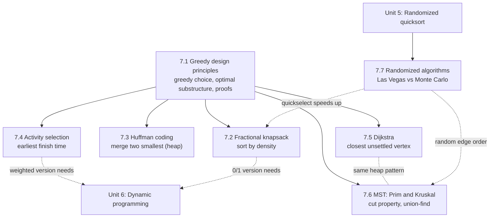

# Greedy Algorithms and Randomization

!!! success "Learning Outcome"

     
     - {{ lo }}
     

## Why This Unit Matters

Greedy algorithms are the fastest route from a problem to an efficient solution: sort or use a heap, then make one irrevocable decision per step. They power data compression (Huffman coding in gzip, PNG and JPEG), network routing (Dijkstra in OSPF), network design and clustering (minimum spanning trees), and scheduling. They are also the paradigm most often applied *incorrectly*: many plausible greedy rules are wrong, and the only protection is a proof or a counterexample.

Randomized algorithms complete the toolkit. Coin flips make simple algorithms fast on every input (randomized quicksort and quickselect), give practical answers where deterministic methods are impractical (Miller–Rabin primality for cryptographic keys), and protect real systems from adversarial inputs (seeded hash tables).

In interviews and competitive programming, interval scheduling, heap-based merging, Dijkstra, MST with union-find and quickselect are among the most frequently tested patterns. In exams, the emphasis is on **proofs** (exchange argument, greedy stays ahead, cut property) and on **choosing** between greedy, DP and divide and conquer.

## Prerequisites

| Topic | Where |
|---|---|
| Asymptotic notation, best/average/worst case | [Unit 2](../unit2/topic1.md) |
| Probability basics (expectation, indicator variables) | [Unit 1](../unit1/topic3.md) |
| Divide and conquer | [Unit 4](../unit4/topic1.md) |
| Randomized quicksort and its analysis | [Unit 5, Topic 5.4](../unit5/topic4.md) |
| Dynamic programming principles (optimal substructure) | [Unit 6](../unit6/topic1.md) |
| Heaps, graphs (adjacency lists), BFS | Data structures prerequisite courses |

## Topic Map

| Topic | Core question | Key result |
|---|---|---|
| [7.1 Greedy design principles](topic1.md) | When is a locally best choice globally optimal, and how do we prove it? | Greedy-choice property + optimal substructure; exchange, stays-ahead and structural-bound proofs; counterexamples (0/1 knapsack, coin change) |
| [7.2 Fractional knapsack](topic2.md) | How do we fill a capacity with divisible items? | Sort by $v_i/w_i$; at most one fractional item; $O(n \log n)$ |
| [7.3 Huffman coding](topic3.md) | What is the shortest prefix code for given frequencies? | Merge two least frequent; optimal; $O(k \log k)$; $H \le L < H + 1$ |
| [7.4 Activity selection](topic4.md) | How many non-overlapping intervals can one resource serve? | Earliest finish time; $O(n \log n)$; weighted version needs DP |
| [7.5 Dijkstra's algorithm](topic5.md) | Shortest paths from one source with non-negative weights? | Settle closest vertex; $O((V + E)\log V)$; fails with negative edges |
| [7.6 Minimum spanning trees](topic6.md) | Cheapest way to connect all vertices? | Cut property; Kruskal $O(E \log E)$, Prim $O(E \log V)$ or $O(V^2)$ |
| [7.7 Randomized algorithms](topic7.md) | How can coin flips make algorithms faster or simpler? | Las Vegas vs Monte Carlo; quickselect expected $O(n)$; Miller–Rabin error $\le 4^{-k}$ |

## How to Study This Unit

1. Start with [Topic 7.1](topic1.md) and learn the **proof templates**; every later topic reuses them.
2. For each greedy algorithm, first try to **break** two or three alternative greedy rules with small counterexamples. Knowing why the wrong rules fail is what makes the right rule memorable.
3. Trace each algorithm by hand once (tables in each topic), then run the Python code on the same input and compare.
4. Keep a one-line justification for each algorithm: "exchange on the first differing choice", "stays ahead on finish time", "cut property", "non-negative edges make settled distances final".
5. For randomized algorithms, always state **what is random** (the algorithm's coins, not the input) and **what is bounded** (expected time or error probability).
6. Finish with the [Unit 7 Summary](summary.md) and its mixed practice questions.
