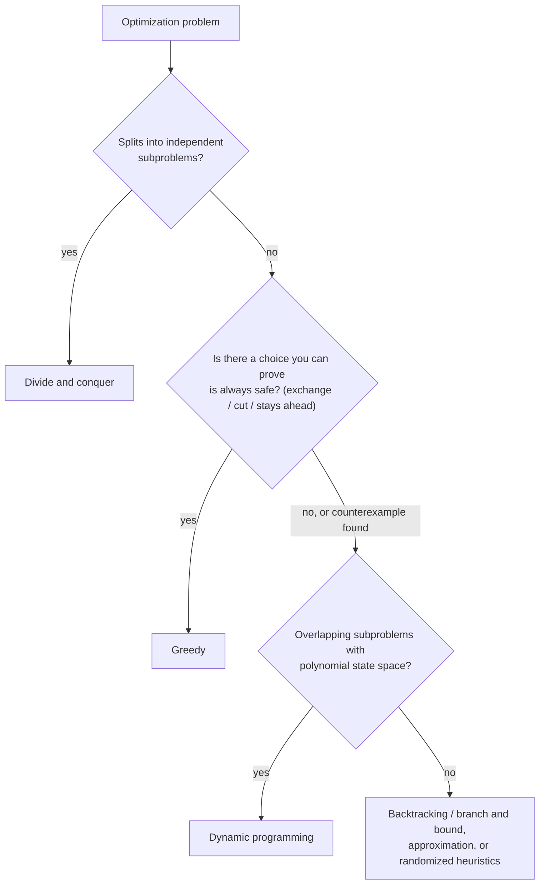

# Unit 7 Summary

## Key Results

### Greedy algorithms

| Problem | Greedy rule | Data structure | Time | Proof technique | Fails when |
|---|---|---|---|---|---|
| Fractional knapsack | Highest $v_i / w_i$ first; at most one fractional item | Sort | $O(n \log n)$ ($O(n)$ with selection) | Exchange (move weight $\delta$ to denser item) | Items indivisible (0/1 knapsack) |
| Huffman coding | Merge the two least frequent trees | Min-heap | $O(k \log k)$ + $O(n)$ counting | Exchange (rarest are deepest siblings) + induction ($B(T) = B(T') + f(x) + f(y)$) | Only adjacent merges allowed (interval DP) |
| Activity selection | Earliest finish time | Sort | $O(n \log n)$ | Exchange ($f_1 \le f_o$) or stays ahead ($f_{g_r} \le f_{o_r}$) | Weighted intervals (DP) |
| Interval partitioning | By start time; reuse earliest-freed resource | Sort + min-heap | $O(n \log n)$ | Structural bound (depth) | |
| Dijkstra | Settle closest unsettled vertex | Min-heap (lazy deletion) | $O((V + E) \log V)$; array $O(V^2)$ | Stays ahead / invariant: settled $d[u] = \delta(s, u)$ | Negative edges (Bellman–Ford) |
| Kruskal | Lightest edge joining two components | Sort + union-find | $O(E \log E) = O(E \log V)$ | Cut property | Directed graphs (arborescence) |
| Prim | Lightest edge leaving the tree | Min-heap or array | $O(E \log V)$; array $O(V^2)$ | Cut property | Directed graphs |
| Coin change (largest first) | Largest coin $\le$ remaining | Sort | $O(\lvert D \rvert \log \lvert D \rvert)$ | Only for canonical systems | $\{1, 3, 4\}$, amount 6 |

### Randomized algorithms

| Algorithm | Type | Time | Guarantee |
|---|---|---|---|
| Randomized quicksort | Las Vegas | Expected $O(n \log n)$ | Always correct; worst case $O(n^2)$ with vanishing probability |
| Quickselect | Las Vegas | Expected $O(n)$ | Always correct |
| Miller–Rabin ($k$ rounds) | Monte Carlo, one-sided | $O(k \log^3 n)$ | Composite accepted with probability $\le 4^{-k}$; primes never rejected |
| Karger min-cut (one trial) | Monte Carlo | $O(m \, \alpha(n))$ | Success $\ge 2/(n(n-1))$; $\binom{n}{2} \ln n$ trials give failure $\le 1/n$ |
| Universal hashing | Las Vegas (data structure) | Expected $O(1 + \alpha)$ per operation | $\Pr[h(x) = h(y)] \le 1/m$ for $x \ne y$ |
| Reservoir sampling | Exact sampling | $O(N)$, $O(k)$ memory | Each item kept with probability $k/N$ |

### Key formulas

| Formula | Meaning |
|---|---|
| $\sum v_i x_i$ s.t. $\sum w_i x_i \le W$, $0 \le x_i \le 1$ | Fractional knapsack |
| $B(T) = \sum_c f(c) \, d_T(c)$ | Cost of a prefix-code tree |
| $H \le L_{\text{Huffman}} < H + 1$, $H = -\sum p_i \log_2 p_i$ | Huffman is within 1 bit/symbol of entropy |
| $\text{OPT}(j) = \max(\text{OPT}(j-1), w_j + \text{OPT}(p(j)))$ | Weighted interval scheduling (DP) |
| if $d[u] + w(u,v) < d[v]$: $d[v] \leftarrow d[u] + w(u,v)$ | Relaxation |
| $O(m \, \alpha(n))$ | Union-find with path compression + union by rank |
| $\varepsilon \to \varepsilon^k$ | One-sided error after $k$ independent runs |
| $\Pr[X \ge a] \le \mathbb{E}[X]/a$ | Markov's inequality (Las Vegas → Monte Carlo) |
| $\mathbb{E}[T(n)] \le \sum_j 2c(3/4)^j n = 8cn$ | Quickselect expected linear time |

## Important for Exams

!!! warning "Important"

    - A greedy proof needs **both** the greedy-choice property and optimal substructure. Optimal substructure alone also holds for 0/1 knapsack, where greedy fails.
    - In an exchange argument, you must show the modified solution is **feasible** and **no worse**. Missing feasibility is the most common lost mark.
    - Greedy for **coin change** works only for canonical systems; give $\{1, 3, 4\}$, amount 6, as a counterexample.
    - Activity selection sorts by **finish** time. Earliest start and shortest duration are wrong; know their counterexamples.
    - Dijkstra requires **non-negative edges**, not merely no negative cycles. Adding a constant to all edges does not fix negative weights.
    - Prim and Dijkstra differ only in the priority key: **edge weight** vs **distance from source**. The MST is not a shortest-path tree.
    - Huffman codes are not unique; their **total cost** is. Show tie-breaking and verify $\sum f \cdot \text{len}$.
    - **Expected** time of a randomized algorithm (over its coins, worst input) is different from **average-case** time (over an input distribution).

**Classic mistakes**

| Mistake | Correct statement |
|---|---|
| "Greedy by ratio solves knapsack" | Only fractional knapsack; 0/1 needs DP |
| "Huffman gives the best compression possible" | Optimal among symbol-by-symbol prefix codes; arithmetic coding/ANS can do better |
| "Mark a vertex visited when pushed" (Dijkstra) | Settle on pop; skip stale entries |
| "Kruskal is always faster than Prim" | On dense graphs, array Prim $O(V^2)$ wins |
| "MST algorithms break with negative weights" | They work; only Dijkstra-style shortest paths break |
| "Monte Carlo answers are unreliable" | Error can be made smaller than $10^{-20}$ by repetition |
| "Quickselect is $O(n)$" | Expected $O(n)$; worst case $O(n^2)$; median of medians is $O(n)$ worst case |

### Choosing a proof technique

| Situation | Technique | Example |
|---|---|---|
| Solution is a set; one element of an optimal solution can be swapped for the greedy element | Exchange argument | Activity selection, fractional knapsack, cut property |
| Solution is an order; adjacent pairs can be swapped | Exchange of adjacent inversions | Earliest deadline first, minimizing weighted completion time |
| Natural progress measure after $k$ steps | Greedy stays ahead | Activity selection (finish times), Dijkstra (settled distances) |
| A lower bound holds for every solution and greedy meets it | Structural bound | Interval partitioning (depth) |
| Greedy merges or reduces the instance size | Greedy choice + induction on size | Huffman coding |
| Independent sets with exchange property | Matroid theorem | Kruskal (graphic matroid) |
| Randomized algorithm, expected time | Linearity of expectation, indicator variables, good-pivot phases | Quicksort, quickselect |
| Randomized algorithm, error bound | Per-run error bound, then independent repetition | Miller–Rabin, Karger |

## Choosing the Right Technique

### Greedy vs dynamic programming vs divide and conquer

| Criterion | Divide and conquer | Dynamic programming | Greedy |
|---|---|---|---|
| Subproblem structure | Independent, non-overlapping | Overlapping | One subproblem after each choice |
| Choices examined per step | Fixed split (no choice) | All choices | One (the greedy choice) |
| Required properties | Problem splits into same-type parts and results combine | Optimal substructure + overlapping subproblems | Optimal substructure + greedy-choice property |
| Correctness argument | Induction on recursion; combine step correct | Recurrence correctness | Exchange / stays ahead / cut property |
| Typical complexity | Recurrence, e.g. $O(n \log n)$ | Table size × transition, e.g. $O(n^2)$, $O(nW)$ | $O(n \log n)$ (sort or heap) |
| Typical memory | Recursion stack | Table (can often be reduced) | $O(n)$ or less |
| Risk | Expensive combine step | Large state space; pseudo-polynomial time | **Wrong answer** if property does not hold |
| Examples | Merge sort, Strassen, closest pair | 0/1 knapsack, LCS, matrix chain, weighted intervals | Huffman, activity selection, Dijkstra, MST |

**Critique.**

- **Greedy** is the most efficient and simplest when it applies, but it is the most fragile: correctness depends on a property that is easy to assume and hard to prove. Always look for a counterexample first.
- **Dynamic programming** is the safe default for optimization with overlapping subproblems; it trades time and memory for certainty. Many greedy algorithms are DP algorithms in which only one transition needs to be examined.
- **Divide and conquer** is best when subproblems are independent; when they overlap, it recomputes them exponentially often and DP (memoization) is required.
- **Randomization** is orthogonal: it can be added to any paradigm (random pivots in divide and conquer, random hashing in DP memo tables, random tie-breaking or random restarts in greedy heuristics) to defeat adversarial inputs or simplify the algorithm.

### Decision guide

### Matching problems to algorithms

| If the problem says... | Think |
|---|---|
| Divisible items, capacity | Fractional knapsack greedy |
| Indivisible items, capacity | 0/1 knapsack DP |
| Merge any two, cost = sum | Huffman / min-heap |
| Merge adjacent only | Interval DP |
| Max non-overlapping intervals | Earliest finish greedy |
| Max weight non-overlapping intervals | DP + binary search |
| Min rooms for all intervals | Sort by start + min-heap |
| Shortest paths, weights $\ge 0$ | Dijkstra |
| Shortest paths, negative edges | Bellman–Ford |
| Connect all vertices cheaply | MST (Kruskal / Prim) |
| $k$-th smallest, unsorted | Quickselect |
| Large primality test | Miller–Rabin |
| Uniform sample from a stream | Reservoir sampling |
| Adversarial keys in a hash table | Universal / seeded hashing |

## Mixed Practice

??? question "Q1. Give an instance where greedy by value/weight ratio is optimal for fractional knapsack but not for 0/1 knapsack, and explain the difference."

    $W = 50$; items $(60, 10)$, $(100, 20)$, $(120, 30)$. Fractional: $60 + 100 + \tfrac{2}{3} \cdot 120 = 240$ (optimal). 0/1: greedy takes items 1 and 2 for 160, but items 2 and 3 give 220. The fractional exchange moves an arbitrary weight to a denser item, which needs divisibility.

??? question "Q2. Construct a Huffman code for frequencies A:5, B:9, C:12, D:13, E:16, F:45 and give its total cost."

    Merges: 5 + 9 = 14; 12 + 13 = 25; 14 + 16 = 30; 25 + 30 = 55; 45 + 55 = 100. Code lengths: F 1, C 3, D 3, E 3, A 4, B 4. Cost $= 45(1) + 12(3) + 13(3) + 16(3) + 5(4) + 9(4) = 45 + 36 + 39 + 48 + 20 + 36 = 224$.

??? question "Q3. Which proof technique would you use for activity selection, and what is the key inequality?"

    An exchange argument: replace the first activity $o$ of an optimal solution with the earliest-finishing activity $1$. Feasibility follows from $f_1 \le f_o$. Alternatively, greedy stays ahead with $f_{g_r} \le f_{o_r}$.

??? question "Q4. A graph has one negative edge but no negative cycle. Can Dijkstra be used? What should you use?"

    No. A vertex may be settled before a cheaper path through the negative edge is discovered. Use Bellman–Ford ($O(VE)$), or a DAG shortest-path algorithm if the graph is acyclic.

??? question "Q5. For a complete graph on 5000 vertices, would you choose Kruskal or Prim? Justify with complexities."

    $E \approx 1.25 \times 10^7$. Kruskal: $O(E \log E)$, about $3 \times 10^8$ comparisons plus memory for all edges. Array-based Prim: $O(V^2) = 2.5 \times 10^7$. Choose array Prim.

??? question "Q6. Explain why the cut property implies that Kruskal's algorithm is correct."

    When Kruskal adds edge $(u, v)$, consider the cut between $u$'s component and the rest. The current forest respects it, and every lighter edge was already processed and lies within one component, so $(u, v)$ is a light crossing edge, hence safe. By induction the forest stays inside some MST.

??? question "Q7. Weighted interval scheduling: why does greedy fail, and what replaces it?"

    Weights break the exchange: replacing the first optimal interval with the earliest-finishing one can lose weight (e.g. $[0,3)$ weight 1 vs $[1,4)$ weight 100). Use DP: $\text{OPT}(j) = \max(\text{OPT}(j-1), w_j + \text{OPT}(p(j)))$, $O(n \log n)$ with binary search for $p(j)$.

??? question "Q8. Classify each as Las Vegas or Monte Carlo: randomized quicksort, Miller–Rabin, Karger, quickselect, Bloom filter lookups."

    Las Vegas: randomized quicksort, quickselect. Monte Carlo: Miller–Rabin (one-sided), Karger, Bloom filter lookups (false positives only).

??? question "Q9. How many Miller–Rabin rounds give an error probability below $10^{-18}$ for a composite input?"

    Need $4^{-k} < 10^{-18}$, i.e. $k > 18 / \log_{10} 4 \approx 29.9$. So 30 rounds suffice.

??? question "Q10. Compare greedy, DP and divide and conquer for computing the minimum number of coins for an arbitrary coin system."

    Greedy: $O(\lvert D \rvert \log \lvert D \rvert)$ but correct only for canonical systems. Divide and conquer (plain recursion on the amount): correct but exponential due to overlapping subproblems. DP: $O(\lvert D \rvert \cdot A)$, always correct. Choose DP unless the system is known to be canonical.

??? question "Q11. Why does a production hash table seed its hash function randomly at startup?"

    With a fixed public hash function, an attacker can construct many colliding keys and force $O(n)$ operations (hash flooding). A random seed (or a randomly chosen function from a universal family) makes collisions unpredictable, restoring expected $O(1)$ operations for every input.

??? question "Q12. Show that minimizing the maximum lateness is solved by earliest deadline first, and name the proof technique."

    Exchange of adjacent inversions: if job $i$ runs immediately before job $j$ with $d_i > d_j$, swap them. Job $j$ finishes earlier, and job $i$ now finishes when $j$ used to, with lateness $C - d_i < C - d_j$, which was already counted. So the maximum lateness does not increase. Repeating removes all inversions and yields the EDF order.
