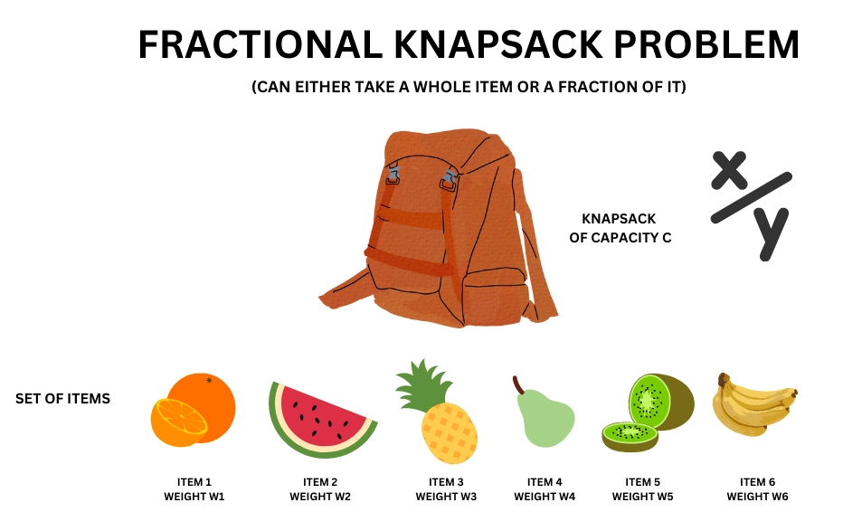
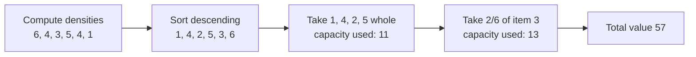

# Fractional Knapsack Problem

!!! abstract "At a glance"

    - **Problem:** fill a capacity-$W$ knapsack with *divisible* items to maximize total value.
    - **Key idea:** sort by value density $v_i / w_i$ and take as much as possible of the densest item first; at most one item is taken partially.
    - **Complexity:** $O(n \log n)$ with sorting; $O(n)$ expected with a selection-based variant.
    - **Contrast:** the 0/1 version (indivisible items) is *not* solved by this greedy rule; it needs dynamic programming.
    - **Used in:** resource allocation with divisible goods, LP relaxations and bounds in branch-and-bound for 0/1 knapsack.

<figure markdown="span">
    {width="60%"}
    <figcaption>In the fractional knapsack, each item may be taken whole or in any fraction, subject to the total weight not exceeding the capacity.</figcaption>
</figure>

## Motivation and Problem Context

A trader has a truck that can carry $W$ kilograms and several commodities available: rice, cardamom, chilli, butter. Each commodity has a total available weight and a total market value. Any amount of each can be loaded. Which mix maximizes the value of the load?

The answer is the textbook greedy rule: load the commodity with the highest value per kilogram first, then the next, until the truck is full. This page proves why that rule is optimal, and why the same rule fails as soon as goods become indivisible (laptops, paintings, crates), which is the 0/1 knapsack problem from [Unit 6](../unit6/topic1.md).

Fractional knapsack matters beyond its own applications: it is the **linear-programming relaxation** of 0/1 knapsack, so its value is an upper bound used to prune search in branch-and-bound solvers.

## Problem Formulation

- **Input:** $n$ items, item $i$ with value $v_i > 0$ and weight $w_i > 0$; capacity $W \ge 0$.
- **Decision:** a fraction $x_i \in [0, 1]$ of each item.
- **Objective and constraint:**

$$
\text{maximize } \sum_{i=1}^{n} v_i x_i \quad \text{subject to} \quad \sum_{i=1}^{n} w_i x_i \le W, \qquad 0 \le x_i \le 1.
$$

- **Output:** the optimal value and the fractions $x_1, \dots, x_n$.
- **Assumptions:** taking fraction $x_i$ of an item yields exactly $x_i v_i$ value (value is linear in quantity).

| Feature | Fractional knapsack | 0/1 knapsack |
|---|---|---|
| Decision variable | $x_i \in [0, 1]$ | $x_i \in \{0, 1\}$ |
| Greedy by density | Optimal | Not optimal |
| Best known exact algorithm | Greedy, $O(n \log n)$ (or $O(n)$) | DP, $O(nW)$ pseudo-polynomial; NP-hard in general |
| Typical goods | Gold dust, grain, fuel, bandwidth | Laptops, paintings, containers |

## Intuition

Every unit of capacity is interchangeable. The only question is what each unit of capacity is "worth" when filled with a given item: exactly its **density** $d_i = v_i / w_i$. To maximize total value, fill each unit of capacity with the highest-density material still available. Because items are divisible, we never face the situation where the densest item "does not quite fit": we simply take the part that fits.

Mental model: pour liquids into a jug, most valuable-per-litre first.

## Baseline Approach

Without the density insight, one might try:

- **All $2^n$ subsets of whole items**, then fill leftover space with a fraction of one more item: exponential, and still needs an argument that only one fractional item is required.
- **Treat it as a general linear program** and call an LP solver: correct (it *is* an LP) but heavy machinery, polynomial but with large constants, for a problem with a two-line solution.
- **Greedy by highest value** or **lowest weight**: simple but wrong. Highest value fails for items $(v, w) = (10, 10), (9, 1), (9, 1)$, $W = 10$: it takes the value-10 item (value 10) instead of both small items plus 8/10 of the big one (value $18 + 8 = 26$).

## Algorithm Design

The bottleneck in the baseline is deciding *which* items to include. The density observation removes this decision: after sorting by density, the optimal solution has a fixed shape.

**Structure of an optimal solution.** Sort items so that $d_1 \ge d_2 \ge \dots \ge d_n$. Then there is an optimal solution of the form

$$
x = (1, 1, \dots, 1, \; f, \; 0, 0, \dots, 0), \qquad 0 \le f < 1,
$$

that is, a prefix of whole items, at most one fractional item, and nothing after it. The algorithm just computes this prefix.

Design steps:

1. Compute densities.
2. Sort indices by density, descending.
3. Scan: if the whole item fits, take it; otherwise take the fraction $\text{remaining} / w_i$ and stop.

## Pseudocode

```text
FRACTIONAL-KNAPSACK(v[1..n], w[1..n], W):
    order = indices 1..n sorted by v[i] / w[i] in decreasing order
    x[1..n] = 0
    remaining = W
    total = 0
    for each i in order:
        if remaining == 0:
            break
        if w[i] <= remaining:
            x[i] = 1
            remaining = remaining - w[i]
            total = total + v[i]
        else:
            x[i] = remaining / w[i]
            total = total + v[i] * x[i]
            remaining = 0
    return total, x
```

## Worked Example

Capacity $W = 13$.

| Item | 1 | 2 | 3 | 4 | 5 | 6 |
|---|---|---|---|---|---|---|
| Value $v_i$ | 6 | 12 | 18 | 25 | 8 | 4 |
| Weight $w_i$ | 1 | 3 | 6 | 5 | 2 | 4 |
| Density $v_i / w_i$ | 6 | 4 | 3 | 5 | 4 | 1 |

**Sorted by density (descending):** 1 (6), 4 (5), 2 (4), 5 (4), 3 (3), 6 (1). Items 2 and 5 tie; either order gives the same value.

| Step | Item | $v_i$ | $w_i$ | Fraction taken | Value added | Remaining capacity | Total value |
|---|---|---|---|---|---|---|---|
| 1 | 1 | 6 | 1 | 1 | 6 | $13 - 1 = 12$ | 6 |
| 2 | 4 | 25 | 5 | 1 | 25 | $12 - 5 = 7$ | 31 |
| 3 | 2 | 12 | 3 | 1 | 12 | $7 - 3 = 4$ | 43 |
| 4 | 5 | 8 | 2 | 1 | 8 | $4 - 2 = 2$ | 51 |
| 5 | 3 | 18 | 6 | $2/6 = 1/3$ | $18 \times \tfrac{1}{3} = 6$ | 0 | **57** |

Item 6 is not used. **Maximum value = 57**, with $x = (1, 1, \tfrac{1}{3}, 1, 1, 0)$.

!!! note "Correction to earlier versions of these notes"

    An earlier version listed item 5 as $(v, w) = (12, 3)$ in the trace and reported a total of 55. With the given data (item 5 has $v = 8$, $w = 2$) the correct optimum is 57.



## Correctness

We prove the greedy solution $G$ is optimal by an **exchange argument**. Assume items are indexed in density order $d_1 \ge d_2 \ge \dots \ge d_n$.

**Claim.** For any feasible solution $O = (o_1, \dots, o_n)$, $\text{value}(G) \ge \text{value}(O)$.

**Proof.**

1. If $\sum_i w_i \le W$, greedy takes everything, which is clearly optimal. Assume otherwise; then greedy uses the full capacity, and we may assume $O$ does too (adding more of any item never decreases value since $v_i > 0$).
2. Let $O$ be an optimal solution that agrees with $G$ on the longest possible prefix. Suppose $O \ne G$, and let $i$ be the first index where they differ. Greedy takes as much of item $i$ as possible given its earlier choices, so $o_i < g_i$.
3. Since both solutions use exactly $W$ capacity and agree before $i$, $O$ must place the "missing" weight $(g_i - o_i) w_i$ on some items $j > i$, so there is a $j > i$ with $o_j > g_j \ge 0$.
4. **Exchange.** Move a weight $\delta = \min\big((g_i - o_i) w_i,\; o_j w_j\big) > 0$ from item $j$ to item $i$: set $o_i \leftarrow o_i + \delta / w_i$ and $o_j \leftarrow o_j - \delta / w_j$. Total weight is unchanged, so $O'$ is **feasible**, and fractions stay in $[0, 1]$ by the choice of $\delta$.
5. **Value change:** $\delta \cdot d_i - \delta \cdot d_j = \delta (d_i - d_j) \ge 0$ since $d_i \ge d_j$. So $O'$ is also optimal.
6. Repeating the exchange either increases the agreement prefix or moves strictly more of item $i$'s shortfall, and terminates with $o_i = g_i$; this contradicts the choice of $O$ as the optimal solution agreeing longest with $G$. Hence $O = G$ up to tie reordering, and $G$ is optimal. $\blacksquare$

!!! warning "Important"

    The exchange in step 4 moves an *arbitrary amount* $\delta$ of weight. That is only possible because items are divisible. In 0/1 knapsack, you can only swap whole items, which may leave capacity unused or overflow it, and the argument collapses. Counterexample: $W = 50$, items $(60, 10), (100, 20), (120, 30)$: greedy by density gets $160$, the optimum is $220$.

**Greedy-choice property** (as in [Topic 7.1](topic1.md)): some optimal solution takes as much as possible of the densest item. **Optimal substructure:** after taking it, the rest is a fractional knapsack instance on the remaining items with reduced capacity.

## Complexity Analysis

| Step | Cost |
|---|---|
| Compute densities | $\Theta(n)$ |
| Sort by density | $\Theta(n \log n)$ comparison sort |
| Greedy scan | $O(n)$ |
| **Total** | $\Theta(n \log n)$ time, $\Theta(n)$ extra space for the order and fractions |

**Linear-time variant (enrichment).** Sorting is more than necessary: we only need the **critical item** (the one taken fractionally). Using linear-time selection on densities (median of medians, or randomized quickselect from [Topic 7.7](topic7.md)), find the median density, check whether the denser half fits, and recurse into one half. The work satisfies $T(n) = T(n/2) + O(n)$, so $T(n) = O(n)$ (deterministic with median of medians, expected with quickselect). In practice the $O(n \log n)$ sort is simpler and fast enough.

## Python Implementation

```python
def fractional_knapsack(values, weights, capacity):
    """Return (best_value, fractions) where fractions[i] is the share of item i taken."""
    n = len(values)
    order = sorted(range(n), key=lambda i: values[i] / weights[i], reverse=True)

    fractions = [0.0] * n
    remaining = capacity
    total = 0.0
    for i in order:
        if remaining == 0:
            break
        if weights[i] <= remaining:
            fractions[i] = 1.0
            remaining -= weights[i]
            total += values[i]
        else:
            fractions[i] = remaining / weights[i]
            total += values[i] * fractions[i]
            remaining = 0
    return total, fractions
```

- Sorting **indices** rather than items keeps `fractions` aligned with the original input order.
- `fractional_knapsack([6, 12, 18, 25, 8, 4], [1, 3, 6, 5, 2, 4], 13)` returns `(57.0, [1.0, 1.0, 0.333..., 1.0, 1.0, 0.0])`.
- `remaining` becomes exactly 0 after the fractional item, so the loop stops; at most one fraction is strictly between 0 and 1.
- For exact arithmetic (money, contest judges) use `fractions.Fraction` for the partial item, or compare densities by cross-multiplication `v_i * w_j > v_j * w_i`.

## Edge Cases and Pitfalls

| Case / pitfall | What goes wrong | Fix |
|---|---|---|
| $W = 0$ | Loop must not divide or take anything | Return value 0 immediately (`remaining == 0` check) |
| Total weight $\le W$ | Greedy should take everything; no fractional item | Loop ends naturally with all fractions 1 |
| Item with $w_i = 0$ | Density $v_i / 0$ raises an error | Take zero-weight items first (infinite density) or reject them in input validation |
| Ties in density | Different but equally optimal fraction vectors | Any tie order is optimal; do not test against one specific vector |
| Sorting ascending by mistake | Takes the worst items first | Use `reverse=True` (descending density) |
| Sorting by value or weight alone | Plausible but wrong (see Baseline) | Sort by $v_i / w_i$ |
| Floating-point densities | Near-equal ratios may be misordered | Cross-multiply integers or use `Fraction` |
| Applying it to 0/1 knapsack | Suboptimal answer | Use DP for 0/1 knapsack |

## Common Misconceptions

- **"Greedy by density solves knapsack."** Only the fractional version. For 0/1 knapsack it can be arbitrarily bad: items $(2, 1)$ and $(W, W)$ with capacity $W$; greedy takes the density-2 item and then cannot fit the other, getting 2 instead of $W$.
- **"The greedy solution may take several items fractionally."** At most one item is fractional; everything before it is whole, everything after it is zero.
- **"Sorting is unavoidable."** Linear-time selection finds the critical item in $O(n)$; sorting is a convenience.
- **"Fractional knapsack is unrelated to 0/1 knapsack."** Its value is an upper bound on the 0/1 optimum (the LP relaxation) and is the standard bound in branch-and-bound for 0/1 knapsack.

## Alternatives and Trade-offs

| Approach | Problem | Time | Optimal? | Notes |
|---|---|---|---|---|
| Greedy by density (sort) | Fractional | $O(n \log n)$ | Yes | Standard answer |
| Greedy by density (selection) | Fractional | $O(n)$ | Yes | More complex; rarely needed |
| General LP solver | Fractional | Polynomial | Yes | Overkill unless extra constraints exist |
| DP over capacity | 0/1 | $O(nW)$ | Yes | Pseudo-polynomial; see [Unit 6](../unit6/topic1.md) |
| Greedy by density | 0/1 | $O(n \log n)$ | No | Taking the better of (greedy, single best item) gives a 1/2-approximation |
| Branch and bound with fractional bound | 0/1 | Exponential worst case | Yes | Fast in practice |

**Use** the greedy algorithm when items are divisible and value is linear in quantity. **Do not use** it when items are indivisible, when there are extra constraints (item conflicts, multiple knapsacks, minimum order sizes), or when value is non-linear in quantity (diminishing returns).

## In Practice

- **Branch-and-bound and integer programming:** solvers for 0/1 knapsack compute the fractional-knapsack bound at each node of the search tree to prune branches that cannot beat the current best.
- **Resource allocation:** allocating divisible resources (bandwidth, budget, compute time) to tasks with linear returns follows the same density rule.
- **Portfolio intuition:** "spend on the highest marginal return first" is the density rule; real portfolio problems add risk and non-linearity and become proper optimization problems.
- **Engineering note:** for large $n$, the sort dominates and is cache-friendly; computing densities once (not inside the comparator repeatedly in a language without key-based sort) avoids redundant division.

## Interview and Competitive Programming

**Recognition cues**

- "Items can be broken", "any amount", "fraction", "liquid", "per unit" → fractional knapsack greedy.
- "Each item taken at most once, whole" with capacity → 0/1 knapsack DP, not greedy.
- "Maximize value loading units, each box type has count and units-per-box" → fractional-style greedy over unit values with integer boxes (sort by unit value, take as many boxes as fit). This is greedy-correct because every box of a type has the same weight 1.

**Constraints mapping**

| Constraints | Likely intended solution |
|---|---|
| $n \le 10^5$, divisible items | Sort by density, $O(n \log n)$ |
| $n \le 100$, $W \le 10^5$, indivisible | 0/1 DP, $O(nW)$ |
| $n \le 40$, large $W$, indivisible | Meet in the middle, $O(2^{n/2} n)$ |

**Common traps:** integer division when computing density in some languages; printing with insufficient precision; forgetting the early exit when capacity is 0.

## Using AI Assistants Critically

- LLMs often apply the density greedy to 0/1 knapsack without comment. Check which version the problem is before accepting the code.
- Generated code commonly sorts the items but then returns fractions in sorted order, misaligned with the input. Check that `fractions[i]` refers to the original item `i`.
- Watch for `int(remaining / w)` truncation or integer division `//` in the fractional step, which silently drops the partial item.
- Assistants sometimes "prove" optimality by restating the greedy rule. A real proof must perform the weight-$\delta$ exchange and check feasibility.
- Verify with a brute-force cross-check: the greedy value must be at least the best 0/1 subset value and at least the value of any random feasible fractional vector (scaled to fit).
- Ask for the density comparison with exact arithmetic when inputs are integers; floating-point ties can flip the order.

## Practice

### Beginner

1. **Hand trace.** $W = 15$; items $(v, w)$: $(10, 2), (5, 3), (15, 5), (7, 7), (6, 1), (18, 4), (3, 1)$. Output: the optimal value and fractions. Difficulty: Easy.
2. **Which item is fractional?** Given densities already sorted and prefix sums of weights, output the index of the critical item. $n \le 10^5$. Difficulty: Easy.
3. **0/1 counterexample.** Construct a 3-item instance where density greedy for 0/1 knapsack is worse than optimal by at least 50%. Difficulty: Easy.

### Intermediate

1. **Box loading.** Input: $m$ box types, each with count $c_j$ and units per box $u_j$; truck holds at most $T$ boxes. Output: maximum units loaded. Constraints: $m \le 1000$, $c_j, u_j \le 1000$, $T \le 10^6$. Difficulty: Medium.
2. **Exact output.** Same as fractional knapsack but all inputs are integers $\le 10^9$; output the optimal value as an irreducible fraction $p/q$. $n \le 10^5$. Difficulty: Medium.
3. **Minimum capacity for a target.** Input: items and a target value $V$. Output: the minimum capacity $W$ such that the fractional optimum is at least $V$, or report impossible. Difficulty: Medium.

### Advanced

1. **Linear-time fractional knapsack.** Design and analyze an $O(n)$ algorithm using a selection subroutine. Prove the recurrence $T(n) = T(n/2) + O(n)$ applies. Difficulty: Hard.
2. **Upper bound for branch and bound.** For 0/1 knapsack, prove that the fractional optimum on the remaining items is a valid upper bound at every node of a branch-and-bound tree. Difficulty: Hard.
3. **Half approximation.** Prove that $\max(\text{greedy-by-density whole items}, \text{single most valuable item that fits})$ is at least half the 0/1 optimum. Difficulty: Hard.

### Interview / CP

1. **Maximum units on a truck.** Input: up to 1000 box types `[count, units_per_box]`, truck size $\le 10^6$. Output: maximum total units. Difficulty: Easy.
2. **Fractional knapsack with queries.** Input: $n \le 10^5$ items, then $q \le 10^5$ capacity queries. Output: optimal value for each capacity. Expected $O((n + q) \log n)$ with prefix sums and binary search. Difficulty: Medium.
3. **Two resources.** Items have weight and volume; knapsack has limits on both; items divisible. Explain why simple density greedy no longer works and what technique (LP) is needed. Difficulty: Hard.

## Self-Check Questions

??? question "Q1. Why is at most one item taken fractionally in the greedy solution?"

    The scan takes items whole while they fit. The first item that does not fit is taken fractionally to fill the remaining capacity exactly, after which capacity is 0 and the loop stops. So all earlier items are whole, the critical item is fractional, and later items are zero.

??? question "Q2. Where exactly does the exchange argument use divisibility?"

    In moving an arbitrary weight $\delta$ from a lower-density item $j$ to a higher-density item $i$. That move requires changing $x_i$ and $x_j$ by arbitrary real amounts. With $x_i \in \{0, 1\}$ such a move is generally impossible.

??? question "Q3. Compute the fractional and 0/1 optima for $W = 50$, items $(60, 10), (100, 20), (120, 30)$."

    Fractional: $60 + 100 + \tfrac{20}{30} \cdot 120 = 240$. 0/1: best is items 2 and 3, value 220 (greedy by density would take items 1 and 2 for 160).

??? question "Q4. Can fractional knapsack be solved faster than $O(n \log n)$?"

    Yes, in $O(n)$ using linear-time selection to find the critical density: compute the median density, test whether all items at least that dense fit, and recurse into one half, giving $T(n) = T(n/2) + O(n) = O(n)$.

??? question "Q5. A tie in density occurs between items 2 and 5 in the worked example. Does the order matter?"

    No. Both have density 4 and both are taken whole; the total is 57 either way. In general, swapping equal-density items changes the fraction vector but not the value.

??? question "Q6. How is fractional knapsack used to solve 0/1 knapsack exactly?"

    As a bound in branch and bound: at each node, the fractional optimum of the remaining items with the remaining capacity is an upper bound on any 0/1 completion. If bound plus current value does not exceed the best known solution, the node is pruned.

??? question "Q7. A logistics team says value is not linear: the 10th tonne of rice is worth less than the first. Does the greedy still apply?"

    Not directly. The proof relies on value being $v_i x_i$ (constant marginal value per unit). With diminishing returns, split each item into segments with decreasing marginal value; if marginal values are non-increasing (concave value), greedy over segments still works. For general non-linear value, use convex optimization or DP.

## Complexity Summary

| Variant | Time | Space | Notes |
|---|---|---|---|
| Sort-based greedy | $\Theta(n \log n)$ | $\Theta(n)$ | Standard |
| Selection-based greedy | $\Theta(n)$ (deterministic or expected) | $\Theta(n)$ | Finds the critical item only |
| 0/1 knapsack DP (contrast) | $\Theta(nW)$ | $\Theta(W)$ with a 1D table | Pseudo-polynomial |

## Key Takeaways

- Sort by density $v_i / w_i$ descending and fill; at most one item is fractional.
- Optimality follows from an exchange argument that moves an arbitrary weight $\delta$ to a denser item, which needs divisibility.
- The same greedy is wrong for 0/1 knapsack; that problem needs DP or branch and bound.
- The fractional optimum upper-bounds the 0/1 optimum and is the standard pruning bound.
- Time is $O(n \log n)$ with sorting, $O(n)$ with linear-time selection.
- Implement with index sorting, exact density comparison when needed, and guards for $W = 0$ and $w_i = 0$.
