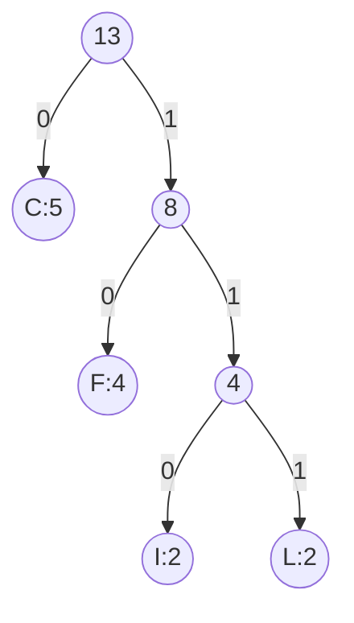
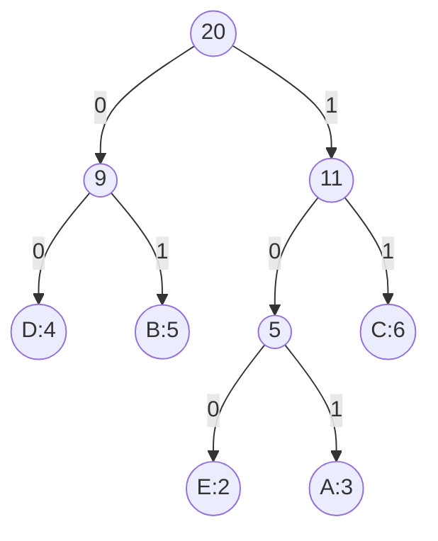
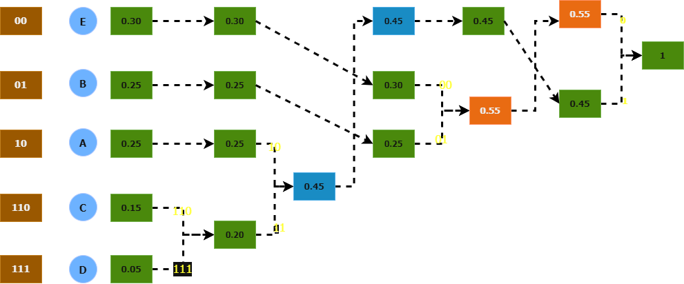

# Huffman Coding

!!! abstract "At a glance"

    - **Problem:** assign binary codewords to symbols with known frequencies so that no codeword is a prefix of another and the total encoded length is minimized.
    - **Key idea:** repeatedly merge the two least frequent symbols (or subtrees) into one; rare symbols end up deep in the tree with long codes.
    - **Complexity:** $O(k \log k)$ to build the code for $k$ distinct symbols with a min-heap, plus $O(n)$ to count and encode a text of length $n$.
    - **Guarantee:** optimal among all prefix codes for the given frequencies (exchange argument + induction).
    - **Used in:** DEFLATE (gzip, zlib, PNG), baseline JPEG, MP3, HTTP/2 header compression (HPACK), the literal stage of Zstandard.

## Motivation and Problem Context

ASCII stores every character in 8 bits, whether it is `e` (very common in English) or `q` (rare). That is wasteful: if common symbols got short codes and rare symbols got long ones, the average length per symbol would fall.

Data compression has two broad families:

| Type | Meaning | Examples |
|---|---|---|
| Lossless | Original data reconstructed exactly | Huffman coding, LZ77/DEFLATE (ZIP, gzip, PNG), arithmetic coding |
| Lossy | Approximate reconstruction is acceptable | JPEG image quantization, MP3/AAC audio, video codecs |

Huffman coding is a **lossless** technique. Even lossy formats use it: JPEG and MP3 first discard information (lossy step), then compress the remaining data losslessly with Huffman codes.

Variable-length codes create a decoding problem: given the bit string `0110`, where does one codeword end and the next begin? The answer is to use a **prefix code**, and Huffman's algorithm finds the best one.

## Problem Formulation

- **Input:** an alphabet $C$ of $k \ge 1$ symbols, each with frequency $f(c) > 0$ (counts or probabilities).
- **Output:** a binary codeword for each symbol, forming a **prefix code**: no codeword is a prefix of another.
- **Objective:** minimize the total encoded length

$$
B(T) = \sum_{c \in C} f(c) \cdot d_T(c),
$$

where $T$ is the binary code tree and $d_T(c)$ is the depth of leaf $c$ (equal to the codeword length). With probabilities, $B(T)$ is the **expected codeword length** in bits per symbol.

**Prefix codes are trees.** Put symbols at the leaves of a binary tree; a left edge is `0`, a right edge is `1`; the codeword of a symbol is the path from the root. Because symbols are only at leaves, no codeword can be a prefix of another, and decoding is unambiguous: walk from the root, emit a symbol when you reach a leaf, restart at the root.

| Code type | Example for {A, B, C, D} | Prefix-free? | Decodable without separators? |
|---|---|---|---|
| Fixed length | 00, 01, 10, 11 | Yes | Yes, but no compression from skewed frequencies |
| Variable, not prefix-free | 0, 01, 1, 10 | No (`0` is a prefix of `01`) | No: `010` is `A C A`, `B A` or `A D` |
| Variable, prefix-free | 0, 10, 110, 111 | Yes | Yes |

## Intuition

The two rarest symbols cost the least when they are pushed deep into the tree. In an optimal tree they can always be made **siblings at the deepest level**. Once they are siblings, they behave like a single "super-symbol" whose frequency is their sum: every bit spent above that pair is paid by both. So: merge them, and solve the smaller problem with one fewer symbol. Repeat.

Mental model: build the tree **bottom-up**, cheapest pieces first, so that the expensive symbols are added last and stay close to the root.

## Baseline Approach

- **Fixed-length code:** $\lceil \log_2 k \rceil$ bits per symbol. Simple, but ignores frequencies entirely.
- **Try all prefix-code trees:** the number of full binary trees with $k$ labelled leaves grows faster than exponentially; infeasible beyond tiny $k$.
- **Shannon–Fano (top-down splitting):** sort symbols, split them into two groups of nearly equal total frequency, recurse. Intuitive and historically earlier, but **not always optimal**. Huffman (1952) showed that building bottom-up fixes this.

## Algorithm Design

From the intuition we need a structure that repeatedly yields the two smallest frequencies and accepts a new merged frequency: a **min-priority queue**. Each merge reduces the number of trees by one, so there are exactly $k - 1$ merges.

Greedy rule: **merge the two trees of smallest total frequency.** This is the greedy choice; the merged tree is a symbol of the reduced problem (optimal substructure).

## Pseudocode

```text
HUFFMAN(C, f):
    Q = min-priority queue of leaf nodes, one per symbol c, keyed by f(c)
    repeat |C| - 1 times:
        x = EXTRACT-MIN(Q)
        y = EXTRACT-MIN(Q)
        z = new internal node with left = x, right = y
        f(z) = f(x) + f(y)
        INSERT(Q, z)
    return EXTRACT-MIN(Q)          // root of the code tree

ASSIGN-CODES(node, prefix, codes):
    if node is a leaf:
        codes[node.symbol] = prefix   (use "0" if the tree is a single leaf)
    else:
        ASSIGN-CODES(node.left,  prefix + "0", codes)
        ASSIGN-CODES(node.right, prefix + "1", codes)
```

## Worked Example

### Example 1: encode `CCCFFIICCFFLL`

**Frequencies** ($n = 13$): C = 5, F = 4, I = 2, L = 2.

| Step | Queue before (freq) | Extract $x$, $y$ | New node |
|---|---|---|---|
| 1 | I:2, L:2, F:4, C:5 | I:2, L:2 | (IL):4 |
| 2 | (IL):4, F:4, C:5 | F:4, (IL):4 (tie; either order) | (F,IL):8 |
| 3 | C:5, (F,IL):8 | C:5, (F,IL):8 | root:13 |



| Symbol | Frequency | Code | Length | Bits used |
|---|---|---|---|---|
| C | 5 | 0 | 1 | $5 \times 1 = 5$ |
| F | 4 | 10 | 2 | $4 \times 2 = 8$ |
| I | 2 | 110 | 3 | $2 \times 3 = 6$ |
| L | 2 | 111 | 3 | $2 \times 3 = 6$ |
| | | | **Total** | **25 bits** |

Comparison: 8-bit ASCII needs $13 \times 8 = 104$ bits; the best fixed-length code for 4 symbols needs $13 \times 2 = 26$ bits; Huffman needs 25 bits for the payload.

!!! note "About the code table overhead"

    The decoder needs the code. Real formats do not ship the tree itself; DEFLATE sends only the **code lengths** of a *canonical* Huffman code (from which the codewords are reconstructed in a fixed order), and that header is itself compressed. For tiny inputs like this one, the header can cost more than the savings; Huffman pays off on large inputs. (Earlier versions of these notes added an ad hoc "9-bit table + 32 bits of characters"; header size depends on the format and is not part of the Huffman optimization.)

### Example 2: encode `BCCABBDDAECCBBAEDDCC`

**Frequencies** ($n = 20$): C = 6, B = 5, D = 4, A = 3, E = 2.

| Step | Queue before | Merge | New node |
|---|---|---|---|
| 1 | E:2, A:3, D:4, B:5, C:6 | E, A | (EA):5 |
| 2 | D:4, B:5, (EA):5, C:6 | D, B (B and (EA) tie at 5) | (DB):9 |
| 3 | (EA):5, C:6, (DB):9 | (EA), C | (EA,C):11 |
| 4 | (DB):9, (EA,C):11 | both | root:20 |



| Symbol | Frequency | Code | Bits used |
|---|---|---|---|
| D | 4 | 00 | 8 |
| B | 5 | 01 | 10 |
| E | 2 | 100 | 6 |
| A | 3 | 101 | 9 |
| C | 6 | 11 | 12 |
| | | **Total** | **45 bits** |

A fixed 3-bit code would use 60 bits.

!!! warning "Important"

    Ties can be broken either way, and left/right labels can be swapped. Different choices give **different codewords** (and sometimes different code lengths), but **every** Huffman tree has the same minimum total cost. In step 2 above, merging D with (EA) instead of B gives codes E = 000, A = 001, D = 01, B = 10, C = 11, also 45 bits. In an exam, show your tie-breaking and check the total, not the exact bit patterns.

### Example 3: probabilities given

$P(E) = 0.30$, $P(B) = 0.25$, $P(A) = 0.25$, $P(C) = 0.15$, $P(D) = 0.05$. Merges: D + C = 0.20; 0.20 + A = 0.45; E + B = 0.55; 0.45 + 0.55 = 1.

<figure markdown="span">
    {width="90%"}
    <figcaption>Successive merges of the two smallest probabilities, read right to left to obtain the codes E = 00, B = 01, A = 10, C = 110, D = 111.</figcaption>
</figure>

Expected length $= 0.30(2) + 0.25(2) + 0.25(2) + 0.15(3) + 0.05(3) = 2.20$ bits/symbol, versus 3 bits for a fixed-length code. The entropy is $H = -\sum p_i \log_2 p_i \approx 2.15$ bits, and indeed $H \le 2.20 < H + 1$ (see Complexity Analysis).

## Correctness

Huffman's algorithm is the canonical example of an **exchange argument plus induction** on the number of symbols.

**Lemma 0 (full tree).** An optimal prefix-code tree is *full*: every internal node has two children. Otherwise, an internal node with a single child could be replaced by that child, shortening every codeword below it.

**Lemma 1 (greedy choice).** Let $x, y$ be the two symbols of lowest frequency. There is an optimal tree in which $x$ and $y$ are **sibling leaves at maximum depth**.

*Proof.* Take any optimal tree $T$. By Lemma 0, the deepest level contains two sibling leaves $a, b$. Assume $f(x) \le f(y)$ and $f(a) \le f(b)$; then $f(x) \le f(a)$ and $f(y) \le f(b)$. Swap $x$ with $a$ to get $T'$:

$$
B(T) - B(T') = f(x)d_T(x) + f(a)d_T(a) - f(x)d_T(a) - f(a)d_T(x) = \big(f(a) - f(x)\big)\big(d_T(a) - d_T(x)\big) \ge 0,
$$

since $f(a) \ge f(x)$ and $a$ is at maximum depth. So $T'$ is no worse. Swapping $y$ with $b$ the same way gives $T''$ with $B(T'') \le B(T)$, so $T''$ is optimal and has $x, y$ as deepest siblings. $\blacksquare$

**Lemma 2 (optimal substructure).** Let $C' = C \setminus \{x, y\} \cup \{z\}$ with $f(z) = f(x) + f(y)$. If $T'$ is an optimal tree for $C'$, then the tree $T$ obtained by replacing leaf $z$ with an internal node whose children are $x$ and $y$ is optimal for $C$.

*Proof.* $d_T(x) = d_T(y) = d_{T'}(z) + 1$, so

$$
B(T) = B(T') - f(z) d_{T'}(z) + \big(f(x) + f(y)\big)\big(d_{T'}(z) + 1\big) = B(T') + f(x) + f(y).
$$

Suppose some tree $U$ for $C$ had $B(U) < B(T)$. By Lemma 1 we may assume $x, y$ are siblings in $U$. Replacing them and their parent with a leaf $z$ gives $U'$ for $C'$ with $B(U') = B(U) - f(x) - f(y) < B(T) - f(x) - f(y) = B(T')$, contradicting the optimality of $T'$. $\blacksquare$

**Theorem.** HUFFMAN produces an optimal prefix code.

*Proof by induction on $k = |C|$.* For $k = 1$ (or 2) the result is immediate. For $k > 2$, the algorithm first merges the two least frequent symbols $x, y$ into $z$ and then (by the structure of the loop) runs HUFFMAN on $C'$, which has $k - 1$ symbols and so produces an optimal $T'$ by the induction hypothesis. By Lemma 2, expanding $z$ into $x, y$ gives an optimal tree for $C$; Lemma 1 justifies that committing to $x, y$ as siblings loses nothing. $\blacksquare$

!!! warning "Important"

    A common incomplete proof says "Huffman merges the smallest two, so they are deepest, so it is optimal". The proof needs **both** lemmas: Lemma 1 (some optimal tree has $x, y$ as deepest siblings, shown by the swap inequality) and Lemma 2 (the cost identity $B(T) = B(T') + f(x) + f(y)$ that reduces the problem to $k - 1$ symbols).

## Complexity Analysis

Let $n$ be the text length and $k$ the number of distinct symbols.

| Step | Cost |
|---|---|
| Count frequencies | $\Theta(n)$ |
| Build the heap | $\Theta(k)$ with heapify |
| $k - 1$ merges, each 2 extracts + 1 insert | $\Theta(k \log k)$ |
| Assign codes (tree traversal) | $\Theta(k)$ nodes; writing all codewords is $O(k^2)$ characters in the worst case (a skewed tree), usually much less |
| Encode the text | $\Theta(n + \text{output bits})$ |
| Decode by walking the tree | $\Theta(\text{output bits})$ |

**Total:** $O(n + k \log k)$ time, $O(k)$ space for the tree (plus the output). For bytes, $k \le 256$, so tree construction is negligible next to the $O(n)$ passes.

**Linear-time construction (enrichment).** If the frequencies are already sorted, Huffman's algorithm runs in $O(k)$ with **two FIFO queues**: one holding the sorted leaves, one holding merged nodes (which are created in non-decreasing order of weight). Each extract-min compares the two queue heads.

**How good is optimal?** For probabilities $p_i$ with entropy $H = -\sum p_i \log_2 p_i$, every prefix code has expected length $L \ge H$, and the Huffman code achieves

$$
H \le L_{\text{Huffman}} < H + 1.
$$

The "+1" matters when one symbol is very likely: with $P(\text{a}) = 0.99$, Huffman must still spend at least 1 bit per symbol although $H \approx 0.08$. This is why modern compressors also use arithmetic coding or ANS (see In Practice).

## Python Implementation

```python
import heapq
from collections import Counter
from itertools import count


class Node:
    def __init__(self, freq, symbol=None, left=None, right=None):
        self.freq = freq
        self.symbol = symbol      # set only for leaves
        self.left = left
        self.right = right


def build_huffman_tree(freq):
    """freq: dict symbol -> positive count. Returns the root Node."""
    tiebreak = count()            # avoids comparing Node objects on equal freq
    heap = [(f, next(tiebreak), Node(f, symbol=s)) for s, f in freq.items()]
    heapq.heapify(heap)
    while len(heap) > 1:
        f1, _, x = heapq.heappop(heap)
        f2, _, y = heapq.heappop(heap)
        heapq.heappush(heap, (f1 + f2, next(tiebreak), Node(f1 + f2, left=x, right=y)))
    return heap[0][2]


def assign_codes(root):
    """Walk the tree: left edge = '0', right edge = '1'."""
    if root.symbol is not None:   # single distinct symbol: give it code "0"
        return {root.symbol: "0"}
    codes = {}
    stack = [(root, "")]
    while stack:
        node, prefix = stack.pop()
        if node.symbol is not None:
            codes[node.symbol] = prefix
        else:
            stack.append((node.left, prefix + "0"))
            stack.append((node.right, prefix + "1"))
    return codes


def huffman_encode(text):
    if not text:
        return "", {}
    codes = assign_codes(build_huffman_tree(Counter(text)))
    return "".join(codes[ch] for ch in text), codes


def huffman_decode(bits, codes):
    decode_map = {code: sym for sym, code in codes.items()}
    out, current = [], ""
    for b in bits:
        current += b
        if current in decode_map:   # prefix-free: first match is the symbol
            out.append(decode_map[current])
            current = ""
    return "".join(out)
```

- Heap entries are `(freq, tiebreak, node)`. Without the unique `tiebreak` counter, two equal frequencies would make `heapq` compare `Node` objects and raise `TypeError`.
- Each loop iteration is exactly one greedy merge from the pseudocode; the loop runs $k - 1$ times.
- A one-symbol alphabet would otherwise get the empty codeword `""` and encode to zero bits; `assign_codes` gives it `"0"`.
- `huffman_encode("CCCFFIICCFFLL")` produces 25 bits with codes `C=0, F=10, I=110, L=111`; `huffman_encode("BCCABBDDAECCBBAEDDCC")` produces 45 bits. The implementation was checked against an exhaustive search over all merge orders on small random inputs.
- The decoder is clear rather than fast (string building per bit). Production decoders walk the tree bit by bit or use lookup tables indexed by the next several bits.

## Edge Cases and Pitfalls

| Case / pitfall | What goes wrong | Fix |
|---|---|---|
| Empty input | Heap is empty; `heap[0]` fails | Return empty output before building the tree |
| One distinct symbol | Root is a leaf; code would be `""` | Assign code `"0"` explicitly |
| Equal frequencies in `heapq` | Python compares nodes and raises `TypeError` | Add a unique counter as the second tuple element |
| Assuming codes are unique | Tie-breaking changes codewords | Compare total cost, not exact codes, in tests |
| Shipping the tree naively | Header overhead dominates small inputs | Use canonical Huffman codes and send only code lengths |
| Non-prefix variable-length code | Ambiguous decoding | Only leaves carry symbols; verify prefix-freeness in tests |
| Very skewed distributions | Huffman wastes up to ~1 bit/symbol vs entropy | Use arithmetic coding / ANS, or code blocks of symbols |
| Very deep trees | Codes longer than the format allows (DEFLATE limits code length to 15 bits) | Use a length-limited construction (e.g. package-merge) |

## Common Misconceptions

- **"Huffman coding gives the best possible compression."** It is optimal among codes that assign a whole number of bits to each symbol independently, for the given frequencies. Arithmetic coding, ANS, and context modelling can do better.
- **"The most frequent symbol always gets a 1-bit code."** Not necessarily: with four equal frequencies every symbol gets 2 bits.
- **"There is a unique Huffman code."** Tie-breaking and left/right choices give many optimal codes with the same cost.
- **"Huffman is the same as Shannon–Fano."** Shannon–Fano splits top-down and is not always optimal; Huffman merges bottom-up and is.
- **"Prefix-free means decodable; decodable means prefix-free."** Prefix-free codes are instantly decodable. Some non-prefix codes are uniquely decodable but need lookahead; prefix codes lose nothing in optimality (Kraft–McMillan), so we restrict to them.

## Alternatives and Trade-offs

| Method | Bits/symbol vs entropy | Speed | Adaptivity | Notes |
|---|---|---|---|---|
| Fixed-length code | $\lceil \log_2 k \rceil$ | Fastest | None | No compression from skew |
| Shannon–Fano | Close to $H$ but not always optimal | Fast | Static | Historical |
| **Huffman** | $H \le L < H + 1$, optimal prefix code | Fast (table decoding) | Static or two-pass; adaptive variants exist | Standard entropy coder in many formats |
| Arithmetic / range coding | Approaches $H$ for the whole message | Slower | Easily adaptive | Used where compression ratio matters most |
| ANS (asymmetric numeral systems, e.g. FSE/tANS) | Close to arithmetic coding | Close to Huffman speed | Static tables per block | Used in Zstandard |
| LZ77 / LZ-family | Exploits repeated substrings, not symbol frequency | Fast | Adaptive | Usually combined with an entropy coder |

**Use Huffman** when you need a simple, fast, patent-free, well-supported entropy coder and symbol probabilities are not extremely skewed. **Avoid** it (alone) when probabilities are highly skewed, when the source has strong context dependence, or when the main redundancy is repeated substrings (use LZ first).

## In Practice

- **DEFLATE** (RFC 1951) combines LZ77 with Huffman coding; it is the compression inside **gzip**, **zlib**, **ZIP** archives and **PNG** images. It uses canonical Huffman codes with lengths limited to 15 bits, and each block may use fixed or dynamic (data-specific) codes.
- **JPEG** (baseline) entropy-codes quantized DCT coefficients with Huffman tables; the standard also defines an arithmetic-coding option.
- **MP3** uses Huffman coding of quantized spectral values.
- **HTTP/2 HPACK** compresses header string literals with a fixed (static) Huffman code defined in the specification.
- **Zstandard** uses Huffman coding for literals and Finite State Entropy (a tabled ANS variant) for other streams; **Brotli** combines LZ77, Huffman coding and context modelling.
- **Performance reality:** decoding is the hot path. Fast decoders avoid bit-by-bit tree walks and instead use table lookups on the next 8–12 bits to decode a symbol in one step; canonical codes make these tables compact.

## Interview and Competitive Programming

**Recognition cues**

- "Repeatedly combine two elements; cost of combining is their sum; minimize total cost" → Huffman pattern with a min-heap (e.g. connecting ropes, merging files/piles when any two may be merged).
- "Design an optimal prefix code / variable-length encoding" → Huffman.
- If only **adjacent** elements may be merged, it is **not** Huffman; it becomes an interval DP (matrix-chain style), [Unit 6](../unit6/topic3.md).

**Reusable template**

```text
push all weights into a min-heap
total = 0
while heap has more than one element:
    a = pop, b = pop
    total += a + b
    push a + b
return total
```

**Constraints mapping:** $n \le 10^5$ to $10^6$ weights → $O(n \log n)$ heap solution. If weights are pre-sorted, the two-queue method gives $O(n)$.

**Traps:** using 32-bit integers for the running total (sums can reach $10^{14}$ or more); forgetting the $n = 1$ case (total cost 0); confusing "any two" with "adjacent two".

## Using AI Assistants Critically

- Generated Python Huffman code frequently pushes bare `Node` objects or `(freq, node)` tuples into `heapq` and crashes on equal frequencies. Look for a tie-breaking counter or a correct `__lt__`.
- LLM code often ignores the single-symbol input (empty codeword) and the empty input. Test both explicitly.
- Assistants sometimes produce non-optimal trees by sorting once and merging in a fixed order (Shannon–Fano or a "chain" tree). Verify optimality by comparing total cost with an exhaustive search for small alphabets.
- Hand-worked examples from AI tools often contain arithmetic errors in the bits-per-symbol table. Recompute $\sum f(c) \cdot \text{len}(c)$ yourself.
- Ask for the proof's two lemmas explicitly; a "proof" that only says "rare symbols get long codes" is not a proof.
- Round-trip test: `decode(encode(x)) == x` on random strings, plus a check that no codeword is a prefix of another.

## Practice

### Beginner

1. **Hand construction.** Frequencies: a:45, b:13, c:12, d:16, e:9, f:5. Output: a Huffman tree, the codes, and the total cost. Difficulty: Easy.
2. **Prefix check.** Input: up to $10^4$ binary codewords. Output: whether the set is prefix-free. Difficulty: Easy.
3. **Compare with fixed length.** For text `MISSISSIPPI`, compute the Huffman encoded length and compare with a 2-bit fixed code. Difficulty: Easy.

### Intermediate

1. **Decode a stream.** Input: a code table (prefix-free) and a bit string of length up to $10^6$. Output: the decoded text in $O(\text{bits})$ time. Difficulty: Medium.
2. **Canonical codes.** Input: code lengths for $k \le 256$ symbols. Output: canonical codewords (shorter codes first, ties by symbol order) and verify they form a prefix code. Difficulty: Medium.
3. **Two-queue Huffman.** Input: $k \le 10^6$ frequencies already sorted. Output: the optimal total cost in $O(k)$. Difficulty: Medium.

### Advanced

1. **Ternary Huffman.** Generalize to a code alphabet of size 3. Show why you may need to add dummy zero-frequency symbols so that $(k - 1)$ is divisible by 2. Difficulty: Hard.
2. **Entropy bound.** Prove $L_{\text{Huffman}} < H + 1$ using the Shannon code lengths $\lceil -\log_2 p_i \rceil$ and the Kraft inequality. Difficulty: Hard.
3. **Length-limited codes.** Show an input where the Huffman tree has depth $k - 1$ (Fibonacci-like frequencies), and explain why formats cap code length. Difficulty: Hard.

### Interview / CP

1. **Minimum cost to connect ropes.** Input: $n \le 10^5$ rope lengths. Connecting two ropes costs the sum of their lengths. Output: minimum total cost. Difficulty: Medium.
2. **Merge files.** Input: $n \le 10^5$ file sizes; merging two files costs their combined size; any two may be merged. Output: minimum total merge cost. Difficulty: Medium.
3. **Adjacent merges only.** Same as above but only adjacent piles may be merged, $n \le 400$. Output: minimum cost. Explain why the heap greedy fails. Difficulty: Hard.

## Self-Check Questions

??? question "Q1. Why must codes be prefix-free, and how does the tree representation guarantee it?"

    Without the prefix property, a bit string may split into codewords in several ways and decoding needs separators or lookahead. In the tree, symbols live only at leaves; the path to one leaf can never pass through another leaf, so no codeword is a prefix of another.

??? question "Q2. Two students build different Huffman trees for the same frequencies and get different codes. Can both be correct?"

    Yes. Tie-breaking and left/right labelling change the codes. Both are correct if each tree was built by always merging the two smallest weights; all such trees have the same minimum total cost $B(T)$.

??? question "Q3. State the identity used in the optimal-substructure lemma."

    If $T$ is obtained from $T'$ by expanding leaf $z$ (with $f(z) = f(x) + f(y)$) into an internal node with children $x, y$, then $B(T) = B(T') + f(x) + f(y)$.

??? question "Q4. What is the time complexity of building the Huffman tree, and which data structure determines it?"

    $O(k \log k)$ for $k$ symbols: $k - 1$ iterations, each with two extract-min and one insert on a binary min-heap at $O(\log k)$ each. With pre-sorted frequencies and two queues it is $O(k)$.

??? question "Q5. For probabilities $(0.99, 0.01)$, what does Huffman achieve and why is it unsatisfying?"

    Codes 0 and 1, so 1 bit per symbol. The entropy is about 0.08 bits, so Huffman uses about 12 times the information-theoretic minimum. Arithmetic coding or ANS, or Huffman over blocks of symbols, closes this gap.

??? question "Q6. Why does merging the two largest frequencies instead fail?"

    It pushes the most frequent symbols deep into the tree, giving them long codes. Lemma 1's swap inequality shows that putting a high-frequency symbol deeper than a low-frequency one strictly increases (or does not decrease) cost; the optimum places the rarest symbols deepest.

??? question "Q7. A colleague proposes Huffman for compressing log files with many repeated lines. What do you advise?"

    Huffman alone only exploits single-symbol frequencies, not repeated substrings. Use an LZ-family stage first (as DEFLATE, Zstandard and Brotli do) and Huffman or ANS as the entropy-coding stage.

## Complexity Summary

| Operation | Time | Space |
|---|---|---|
| Frequency count | $\Theta(n)$ | $O(k)$ |
| Tree construction (binary heap) | $\Theta(k \log k)$ | $\Theta(k)$ |
| Tree construction (sorted input, two queues) | $\Theta(k)$ | $\Theta(k)$ |
| Encoding | $\Theta(n + \text{bits})$ | output size |
| Decoding (tree walk) | $\Theta(\text{bits})$ | $\Theta(k)$ |
| Expected length | $H \le L < H + 1$ | |

## Key Takeaways

- A prefix code is a binary tree with symbols at leaves; cost is $\sum f(c) \cdot \text{depth}(c)$.
- Huffman greedily merges the two least frequent trees, $k - 1$ times, using a min-heap: $O(k \log k)$.
- Correctness: the two rarest symbols can be deepest siblings (exchange), and merging them reduces the problem with $B(T) = B(T') + f(x) + f(y)$ (induction).
- Huffman codes are not unique, but their total cost is.
- Huffman is within 1 bit/symbol of entropy; arithmetic coding and ANS do better on skewed data.
- In practice Huffman is the entropy-coding stage of DEFLATE (gzip, ZIP, PNG), JPEG and MP3, usually after a modelling stage such as LZ77.
- In Python, put a unique tie-breaker in heap entries.
