# Activity Selection Problem

!!! abstract "At a glance"

    - **Problem:** choose the maximum number of mutually non-overlapping activities (intervals) for a single resource.
    - **Key idea:** sort by finish time and repeatedly take the earliest-finishing activity compatible with the last one chosen.
    - **Complexity:** $\Theta(n \log n)$ for sorting, then a $\Theta(n)$ scan.
    - **Proof:** exchange argument (or greedy stays ahead).
    - **Variants:** weighted intervals need DP (sort + binary search); scheduling *all* intervals on the fewest resources (interval partitioning) is a different greedy with a heap.

## Motivation and Problem Context

One seminar hall, one operating theatre, one runway, one CPU core, one meeting room: many systems have a single resource that can serve only one request at a time. Requests arrive as time intervals, and we want to serve as many as possible.

Concretely: the college auditorium receives requests for the semester, each with a start and end time. The administrator wants to approve the largest number of non-conflicting requests. This is the **activity selection** (or **interval scheduling**) problem. It is the classic example where one greedy rule is provably optimal and several equally plausible rules are not ([Topic 7.1](topic1.md)).

| Domain | Activities | Resource |
|---|---|---|
| Room booking | Meetings, classes, events | A room |
| Operating systems | Jobs with fixed time windows | A CPU core or device |
| Transport | Flights or trains needing a slot | A runway or platform |
| Broadcasting | Programmes with fixed air times | A channel |
| Cloud | Reservations of a dedicated machine | A machine |

## Problem Formulation

- **Input:** $n$ activities; activity $i$ occupies the half-open interval $[s_i, f_i)$ with $s_i < f_i$.
- **Compatibility:** activities $i$ and $j$ are compatible if their intervals do not overlap: $f_i \le s_j$ or $f_j \le s_i$. Using half-open intervals means an activity may start exactly when another finishes.
- **Output:** a maximum-size set of pairwise compatible activities.
- **Assumptions:** one resource; all activities have equal value (each counts 1). Weighted values change the problem (see Alternatives).

!!! warning "Important"

    State whether intervals are open, closed or half-open. With closed intervals $[s, f]$, two activities sharing an endpoint *conflict*, and the compatibility test becomes $s_j > f_i$ instead of $s_j \ge f_i$. Many wrong answers in tests come from this one character.

## Intuition

Whatever you choose first, you want to leave the resource free as early as possible so the rest of the timeline is as large as possible. The activity that **finishes first** frees the resource earliest. Choosing it can never hurt: any other first choice finishes later, and therefore leaves a subset of the room that the earliest-finishing choice leaves.

## Baseline Approach

- **Brute force:** check all $2^n$ subsets for compatibility and keep the largest: $O(2^n \cdot n)$.
- **DP over sorted intervals:** sort by finish time; let $\text{OPT}(j) = \max(\text{OPT}(j - 1), 1 + \text{OPT}(p(j)))$ where $p(j)$ is the last activity compatible with $j$. Correct and $O(n \log n)$, but it computes a whole table when a single scan suffices.
- **Plausible but wrong greedy rules:**

| Rule | Counterexample | Greedy | Optimal |
|---|---|---|---|
| Earliest start | $[0,10), [1,2), [3,4)$ | 1 | 2 |
| Shortest duration | $[0,5), [4,7), [6,11)$ | 1 | 2 |
| Fewest overlaps | Known 11-interval counterexample (Kleinberg–Tardos) | suboptimal | larger |

## Algorithm Design

The DP recurrence has two options per activity. The greedy insight is that for the activity with the **earliest finish time**, the "take it" option is always at least as good. So we never need the table: take the earliest finisher, discard everything that overlaps it, and repeat on what remains. After sorting by finish time, "what remains" is simply "later activities that start at or after the last chosen finish time", so one pass suffices with a single variable `last_finish`.

## Pseudocode

```text
ACTIVITY-SELECTION(A):                     // A = list of (s, f)
    sort A by finish time f, ascending
    chosen = empty list
    last_finish = -infinity
    for each (s, f) in A:
        if s >= last_finish:               // compatible with last chosen activity
            append (s, f) to chosen
            last_finish = f
    return chosen
```

## Worked Example

| Activity | A1 | A2 | A3 | A4 | A5 | A6 |
|---|---|---|---|---|---|---|
| Start $s_i$ | 1 | 3 | 0 | 5 | 8 | 5 |
| Finish $f_i$ | 2 | 4 | 6 | 7 | 9 | 9 |

Sorted by finish time: A1 (2), A2 (4), A3 (6), A4 (7), A5 (9), A6 (9).

| Step | Activity | $[s, f)$ | `last_finish` before | $s \ge$ `last_finish`? | Action | `last_finish` after |
|---|---|---|---|---|---|---|
| 1 | A1 | [1, 2) | $-\infty$ | yes | select | 2 |
| 2 | A2 | [3, 4) | 2 | $3 \ge 2$ yes | select | 4 |
| 3 | A3 | [0, 6) | 4 | $0 \ge 4$ no | skip | 4 |
| 4 | A4 | [5, 7) | 4 | $5 \ge 4$ yes | select | 7 |
| 5 | A5 | [8, 9) | 7 | $8 \ge 7$ yes | select | 9 |
| 6 | A6 | [5, 9) | 9 | $5 \ge 9$ no | skip | 9 |

**Selected:** {A1, A2, A4, A5}, so the maximum is **4** activities.

```mermaid
gantt
    dateFormat X
    axisFormat %s
    section Selected
    A1 :done, 1, 2
    A2 :done, 3, 4
    A4 :done, 5, 7
    A5 :done, 8, 9
    section Rejected
    A3 :0, 6
    A6 :5, 9
```



## Correctness

Assume activities are sorted so that $f_1 \le f_2 \le \dots \le f_n$.

### Proof 1: exchange argument

**Lemma (greedy choice).** There is an optimal solution containing activity 1 (the earliest finisher).

*Proof.* Let $O$ be an optimal solution and let $o$ be its activity with the earliest finish time. If $o = 1$, done. Otherwise define $O' = O \setminus \{o\} \cup \{1\}$.

- **Feasible:** every other activity $j \in O$ starts at or after $f_o$ (they are compatible with $o$ and finish later). Since $f_1 \le f_o$, every such $j$ starts at or after $f_1$, so activity 1 is compatible with all of them.
- **Same size:** $|O'| = |O|$, so $O'$ is optimal and contains activity 1. $\blacksquare$

**Lemma (optimal substructure).** If $O$ is optimal and contains activity 1, then $O \setminus \{1\}$ is optimal for the subproblem $S' = \{ j : s_j \ge f_1 \}$.

*Proof.* If some compatible set in $S'$ were larger than $O \setminus \{1\}$, adding activity 1 to it (compatible with all of $S'$ by definition) would beat $O$. $\blacksquare$

**Theorem.** The greedy algorithm returns an optimal solution. *By induction on $n$:* greedy picks activity 1 (safe by the first lemma), then effectively runs on $S'$ (the scan skips exactly the activities starting before $f_1$), which by induction it solves optimally; by the second lemma, the combination is optimal.

### Proof 2: greedy stays ahead

Let greedy choose $g_1, g_2, \dots, g_k$ and an optimal solution choose $o_1, \dots, o_m$, both listed in order of finish time.

**Claim.** $f_{g_r} \le f_{o_r}$ for every $r \le k$.

*Induction.* For $r = 1$, greedy picks the global earliest finisher. Suppose $f_{g_{r-1}} \le f_{o_{r-1}}$. Activity $o_r$ starts at or after $f_{o_{r-1}} \ge f_{g_{r-1}}$, so $o_r$ was still available to greedy at step $r$; greedy picks the earliest-finishing available activity, so $f_{g_r} \le f_{o_r}$.

**Conclusion.** If $m > k$, then $o_{k+1}$ starts at or after $f_{o_k} \ge f_{g_k}$, so it was compatible with greedy's last choice and greedy would not have stopped at $k$. Contradiction; hence $k = m$. $\blacksquare$

!!! warning "Important"

    In the exchange proof, the key inequality is $f_1 \le f_o$. That is what guarantees feasibility of $O'$. If you sort by start time or by duration, this inequality fails, and so does the proof (and the algorithm).

## Complexity Analysis

| Step | Cost |
|---|---|
| Sort by finish time | $\Theta(n \log n)$ |
| Single scan with `last_finish` | $\Theta(n)$ |
| **Total** | $\Theta(n \log n)$ time; $O(n)$ space (sorted copy and output) |

If the input is already sorted by finish time, the algorithm is $\Theta(n)$. If times are small integers (e.g. minutes of a day), counting sort or bucketing makes the whole thing $O(n + T)$ ([Unit 5](../unit5/topic5.md)).

## Python Implementation

```python
def select_activities(activities):
    """activities: list of (start, finish) with start < finish.
    Returns a maximum-size list of mutually compatible activities."""
    chosen = []
    last_finish = float("-inf")
    for start, finish in sorted(activities, key=lambda a: a[1]):
        if start >= last_finish:          # compatible with the last chosen one
            chosen.append((start, finish))
            last_finish = finish
    return chosen
```

- `key=lambda a: a[1]` sorts by **finish** time; sorting by the default tuple order would sort by start time, which is the classic bug.
- `start >= last_finish` encodes half-open intervals; change to `>` for closed intervals.
- `select_activities([(1, 2), (3, 4), (0, 6), (5, 7), (8, 9), (5, 9)])` returns `[(1, 2), (3, 4), (5, 7), (8, 9)]`. The function was checked against brute force over all subsets on random small inputs.

## Variants: Weighted Intervals and Interval Partitioning

### Weighted interval scheduling (greedy fails, DP works)

Now each activity has a weight $w_i$ and we maximize total weight. Earliest-finish greedy fails: $[0, 3)$ with weight 1 and $[1, 4)$ with weight 100; greedy takes weight 1.

Sort by finish time; let $p(j)$ be the number of activities that finish at or before $s_j$ (found by binary search). Then

$$
\text{OPT}(j) = \max\big(\text{OPT}(j-1),\; w_j + \text{OPT}(p(j))\big), \qquad \text{OPT}(0) = 0.
$$

The first option skips activity $j$; the second takes it and keeps only activities that end before it starts. Total time $\Theta(n \log n)$. This is a standard dynamic-programming problem ([Unit 6](../unit6/topic1.md)).

```python
from bisect import bisect_right


def max_weight_schedule(jobs):
    """jobs: list of (start, finish, weight). Weighted interval scheduling by DP."""
    jobs = sorted(jobs, key=lambda j: j[1])
    finishes = [f for _, f, _ in jobs]
    best = [0] * (len(jobs) + 1)          # best[j] = optimum using first j jobs
    for j, (s, f, w) in enumerate(jobs, start=1):
        p = bisect_right(finishes, s, 0, j - 1)   # jobs ending at or before s
        best[j] = max(best[j - 1], w + best[p])
    return best[-1]
```

Example: jobs $(s, f, w)$ = (1,3,5), (2,5,6), (4,6,5), (6,7,4), (5,8,11), (7,9,2).

| $j$ | Job $(s, f, w)$ | $p(j)$ | $\text{OPT}(j-1)$ | $w_j + \text{OPT}(p(j))$ | $\text{OPT}(j)$ |
|---|---|---|---|---|---|
| 1 | (1, 3, 5) | 0 | 0 | 5 | 5 |
| 2 | (2, 5, 6) | 0 | 5 | 6 | 6 |
| 3 | (4, 6, 5) | 1 | 6 | 10 | 10 |
| 4 | (6, 7, 4) | 3 | 10 | 14 | 14 |
| 5 | (5, 8, 11) | 2 | 14 | 17 | **17** |
| 6 | (7, 9, 2) | 4 | 17 | 16 | 17 |

Maximum weight 17 (jobs 2 and 5).

### Interval partitioning (schedule all intervals on fewest resources)

Now every activity must be scheduled, and we want the **minimum number of rooms**. Different objective, different greedy:

- **Lower bound:** the **depth** $d$ (maximum number of intervals containing a common point) is a lower bound on the rooms needed.
- **Greedy:** process intervals by **start time**; assign each to a room that is already free (the one that frees earliest, kept in a min-heap of finish times), otherwise open a new room.
- **Proof (structural bound):** a new room is opened only when all existing rooms are busy at time $s$, i.e. $d$ intervals overlap at $s$. So greedy never uses more than $d$ rooms, matching the lower bound.

```python
import heapq


def min_rooms(intervals):
    """Interval partitioning: fewest resources so no two overlapping intervals share one."""
    end_times = []                        # min-heap of finish times of busy rooms
    for start, finish in sorted(intervals):
        if end_times and end_times[0] <= start:
            heapq.heapreplace(end_times, finish)   # reuse the room that frees earliest
        else:
            heapq.heappush(end_times, finish)
    return len(end_times)
```

Trace for lectures [9,11), [9,13), [10,12), [11,14), [12,15), [13,16), [14,16):

| Interval | Earliest free time (heap min) | Action | Heap of finish times |
|---|---|---|---|
| [9, 11) | none | new room | {11} |
| [9, 13) | 11 > 9 | new room | {11, 13} |
| [10, 12) | 11 > 10 | new room | {11, 12, 13} |
| [11, 14) | 11 ≤ 11 | reuse | {12, 13, 14} |
| [12, 15) | 12 ≤ 12 | reuse | {13, 14, 15} |
| [13, 16) | 13 ≤ 13 | reuse | {14, 15, 16} |
| [14, 16) | 14 ≤ 14 | reuse | {15, 16, 16} |

Three rooms, equal to the depth (three lectures overlap at time 10).

| Variant | Objective | Algorithm | Time |
|---|---|---|---|
| Activity selection | Max number of compatible intervals, one resource | Greedy, earliest finish | $O(n \log n)$ |
| Weighted interval scheduling | Max total weight, one resource | DP + binary search | $O(n \log n)$ |
| Interval partitioning | Min resources to schedule all | Greedy by start + min-heap | $O(n \log n)$ |
| Minimum removals to make disjoint | $n - $ activity selection answer | Same greedy | $O(n \log n)$ |
| Minimum points stabbing all intervals | Fewest points hitting every interval | Greedy by finish: place point at $f$ | $O(n \log n)$ |
| $k$ resources, max number scheduled | Max intervals on $k$ machines | Greedy by finish with a balanced BST of machine free times | $O(n \log n)$ |

## Edge Cases and Pitfalls

| Case / pitfall | What goes wrong | Fix |
|---|---|---|
| Sorting by start time | Long early activity blocks many short ones | Sort by finish time |
| Closed vs half-open intervals | Touching intervals wrongly accepted or rejected | Decide the convention; use `>=` (half-open) or `>` (closed) |
| Ties in finish time | None for correctness; any tie order works | No fix needed; do not over-engineer |
| Empty input | Must return an empty selection | The loop handles it naturally |
| Weighted version solved greedily | Suboptimal total weight | Use the DP with binary search |
| Using the activity-selection greedy for room count | Answers the wrong question | Use interval partitioning (sort by start, heap of ends) |
| Zero-length intervals $s = f$ | May be counted infinitely or break assumptions | Reject or define explicitly in the input contract |

## Common Misconceptions

- **"Shortest activity first is best because it uses the least time."** Counterexample $[0,5), [4,7), [6,11)$: the short middle interval blocks both others.
- **"Greedy works for weighted intervals too."** No; weights break the exchange (swapping in the earliest finisher may lose weight). Use DP.
- **"Activity selection and interval partitioning are the same problem."** One maximizes intervals on one resource (sort by finish); the other schedules all intervals on minimum resources (sort by start). The keys differ because the objectives differ.
- **"The greedy solution is the unique optimum."** Many optimal sets may exist; greedy returns one (the one with earliest finish times).

## Alternatives and Trade-offs

| Approach | Time | Handles weights? | Notes |
|---|---|---|---|
| Brute force over subsets | $O(2^n n)$ | Yes | Only for testing |
| Unweighted DP with $p(j)$ | $O(n \log n)$ | Yes (weighted form) | More general, more code |
| **Earliest-finish greedy** | $O(n \log n)$ | No | Simplest optimal method for unweighted |
| Earliest-start / shortest / fewest-conflicts greedy | $O(n \log n)$ or more | No | Not optimal |

**Use** the greedy for unweighted maximization on one resource. **Do not use** it for weighted intervals, for multiple non-identical resources, or when activities have flexible start times (that becomes a different scheduling problem).

## In Practice

- **Calendar and booking systems** use interval logic constantly; detecting conflicts uses sorted intervals or interval trees, and "fit as many as possible" admission uses the earliest-finish rule.
- **Real-time and OS scheduling:** the earliest-deadline-first idea, a close relative proved by a similar exchange argument, is a standard real-time scheduling policy ([Topic 7.1](topic1.md)).
- **Resource provisioning:** the interval-partitioning greedy (min-heap of finish times) is exactly how you compute peak concurrent usage, e.g. the number of servers, licences or connections needed for a set of sessions.
- **Engineering note:** the scan is branch-light and cache-friendly; for large inputs the sort dominates.

## Interview and Competitive Programming

**Recognition cues**

- "Maximum number of non-overlapping intervals / meetings / events" → sort by end, scan.
- "Minimum number of intervals to remove so the rest do not overlap" → $n$ minus the activity-selection answer.
- "Minimum number of points / arrows to hit all intervals" → sort by end, place a point at each end when needed.
- "Minimum meeting rooms / platforms / servers" → sort by start, min-heap of end times (or a sweep over sorted start and end events).
- "Maximum profit from non-overlapping jobs" → weighted DP with binary search.

**Constraints mapping:** $n \le 2 \times 10^5$ and times up to $10^9$ → $O(n \log n)$ sort-based solution; do not build arrays indexed by time.

**Common traps:** default tuple sort orders by start, not end; off-by-one between touching intervals; using `int` max sentinel instead of $-\infty$ when times may be negative.

## Using AI Assistants Critically

- LLM solutions often write `intervals.sort()` (sorting by start) and then apply the earliest-finish logic. Check the sort key explicitly.
- Generated code frequently mixes up `>` and `>=` for touching intervals. Ask which interval convention the problem uses and test `[(1, 2), (2, 3)]`.
- For "maximum profit" variants, assistants sometimes return the unweighted greedy. Cross-check against brute force with random weights.
- When an assistant "proves" correctness, check that it uses $f_1 \le f_o$ to establish feasibility; proofs that only say "it leaves more room" are intuition, not proof.
- For room-counting, verify the answer equals the maximum overlap depth computed by a simple sweep on random inputs.
- Property-based tests: generated selection must be pairwise compatible, and its size must equal the brute-force optimum for $n \le 10$.

## Practice

### Beginner

1. **Trace.** Activities $(s, f)$: (1,4), (3,5), (0,6), (5,7), (3,9), (5,9), (6,10), (8,11), (8,12), (2,14), (12,16). Output: the greedy selection and its size. Difficulty: Easy.
2. **Counterexample.** Show that "pick the activity with the latest start time first, then scan backwards" is also optimal, or give a counterexample. Difficulty: Easy.
3. **Closed intervals.** Modify the pseudocode for closed intervals $[s, f]$ and give an input where the answers differ. Difficulty: Easy.

### Intermediate

1. **Minimum removals.** Input: $n \le 10^5$ intervals. Output: the minimum number to remove so that the rest are non-overlapping. Difficulty: Medium.
2. **Weighted scheduling.** Input: $n \le 5 \times 10^4$ jobs with start, end, profit up to $10^9$. Output: maximum total profit of non-overlapping jobs. Difficulty: Medium.
3. **Platforms.** Input: arrival and departure times of $n \le 10^5$ trains. Output: the minimum number of platforms. Difficulty: Medium.

### Advanced

1. **Two resources.** Input: $n \le 10^5$ intervals and $k = 2$ identical rooms. Output: maximum number of intervals scheduled. Prove your greedy choice. Difficulty: Hard.
2. **Fewest-conflicts counterexample.** Construct an instance where "choose the activity overlapping the fewest others" is suboptimal. Difficulty: Hard.
3. **Lower bound.** Prove that interval partitioning needs at least depth $d$ resources and that the greedy uses exactly $d$. Difficulty: Hard.

### Interview / CP

1. **Movie festival.** Input: $n \le 2 \times 10^5$ movies with start and end times. Output: the maximum number of movies you can watch entirely. Difficulty: Easy.
2. **Burst balloons with arrows.** Input: $n \le 10^5$ closed intervals. Output: the minimum number of vertical lines hitting all. Difficulty: Medium.
3. **Meeting rooms with assignment.** Input: $n \le 2 \times 10^5$ customers with arrival and departure days. Output: minimum rooms and a room number for each customer. Difficulty: Medium.

## Self-Check Questions

??? question "Q1. Why does sorting by finish time work but sorting by start time does not?"

    The exchange proof needs $f_1 \le f_o$ so that replacing the optimal solution's first activity with ours keeps all other activities compatible. Earliest start gives no such bound: $[0, 10)$ starts first but blocks $[1, 2)$ and $[3, 4)$.

??? question "Q2. What is the time complexity, and what dominates it?"

    $\Theta(n \log n)$, dominated by sorting. The scan is $\Theta(n)$. If the input is presorted by finish time, the algorithm is linear.

??? question "Q3. State the greedy-stays-ahead invariant for activity selection."

    For every $r$, the $r$-th activity chosen by greedy finishes no later than the $r$-th activity of any optimal solution: $f_{g_r} \le f_{o_r}$.

??? question "Q4. Give an instance showing that earliest-finish greedy fails for weighted interval scheduling."

    $[0, 3)$ with weight 1 and $[1, 4)$ with weight 100. Greedy takes the first (finishes earlier) and cannot take the second; optimum is 100.

??? question "Q5. Why does interval partitioning sort by start time rather than finish time?"

    Every interval must be scheduled; the question is only which room. Processing by start time ensures that when an interval arrives, all earlier-starting intervals are already placed, so a new room is opened only when all rooms are busy at that start time, which proves the depth bound is met.

??? question "Q6. An admin wants to maximize the number of approved bookings in two identical halls. Can you run the one-hall greedy twice?"

    Not in general: running it twice may be suboptimal. Process intervals by finish time and assign each to the hall whose last booking ends latest but still before the interval's start (best fit); this greedy is optimal for $k$ identical resources.

??? question "Q7. A test case `[(1, 2), (2, 3)]` returns 1 instead of 2. What is the likely bug?"

    The compatibility check uses `start > last_finish` (closed-interval semantics) while the problem uses half-open intervals. Use `start >= last_finish`.

## Complexity Summary

| Problem | Algorithm | Time | Space |
|---|---|---|---|
| Activity selection | Earliest-finish greedy | $\Theta(n \log n)$ | $O(n)$ |
| Activity selection, presorted | Single scan | $\Theta(n)$ | $O(1)$ extra |
| Weighted interval scheduling | DP + binary search | $\Theta(n \log n)$ | $\Theta(n)$ |
| Interval partitioning | Sort by start + min-heap | $\Theta(n \log n)$ | $O(n)$ |
| Brute force (testing only) | All subsets | $O(2^n n)$ | $O(n)$ |

## Key Takeaways

- Sort by **finish time** and take every activity compatible with the last one chosen.
- Prove it by exchange ($f_1 \le f_o$ keeps the swapped solution feasible) or by greedy stays ahead ($f_{g_r} \le f_{o_r}$).
- Earliest start, shortest duration and fewest conflicts are all wrong rules.
- Weights destroy the greedy-choice property; use DP with $p(j)$ by binary search.
- Interval partitioning is a different objective: sort by start, reuse the earliest-freed resource, and match the depth lower bound.
- Be explicit about interval endpoints; `>=` versus `>` is the most common bug.
