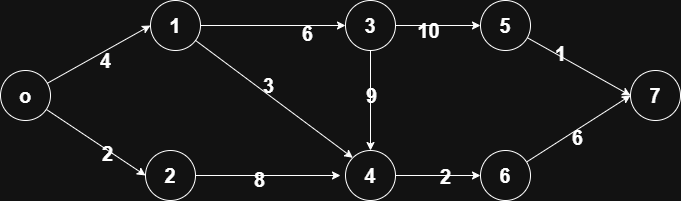

# Dijkstra's Algorithm

!!! abstract "At a glance"

    - **Problem:** single-source shortest paths in a weighted graph with **non-negative** edge weights.
    - **Key idea:** repeatedly settle the unsettled vertex with the smallest tentative distance, then relax its outgoing edges; a settled distance is final.
    - **Complexity:** $O((V + E) \log V)$ with a binary heap (lazy deletion); $O(V^2)$ with an array; $O(E + V \log V)$ with a Fibonacci heap.
    - **Fails with negative edges:** use Bellman–Ford ($O(VE)$) instead.
    - **Used in:** link-state routing (OSPF, IS-IS), road navigation (as the base of A* and preprocessing-based methods), games and robotics path planning.

## Motivation and Problem Context

A router needs the cheapest route to every other router in its network. A navigation app needs the fastest route from your location to every nearby junction to answer your query. A game character needs the shortest walkable path around obstacles. All of these are **single-source shortest path (SSSP)** problems.

Breadth-first search solves SSSP when every edge has the same cost. Real edges have different costs (distance, latency, travel time). Dijkstra's algorithm, designed by Edsger W. Dijkstra in 1956 and published in 1959, generalizes BFS to non-negative weights. It is greedy: at each step it commits to the closest unsettled vertex and never revisits that decision.

!!! note "History"

    Dijkstra later recalled designing the algorithm in about twenty minutes while sitting at a café terrace in Amsterdam, without pencil and paper. (The popular "napkin" version of the story is an embellishment.)

## Problem Formulation

- **Input:** a directed or undirected graph $G = (V, E)$; a weight function $w: E \to \mathbb{R}_{\ge 0}$; a source $s \in V$.
- **Output:** for every $v \in V$, the shortest-path distance

$$
\delta(s, v) = \min \{ w(P) : P \text{ is a path from } s \text{ to } v \}, \qquad \delta(s, v) = \infty \text{ if no path exists},
$$

and a **predecessor** $\pi(v)$ so that the shortest paths form a tree rooted at $s$.

- **Assumption:** $w(u, v) \ge 0$ for every edge. This assumption is essential.

**Relaxation.** All shortest-path algorithms in this course use one primitive. For an edge $(u, v)$:

$$
\text{if } d[u] + w(u, v) < d[v] \text{ then } d[v] \leftarrow d[u] + w(u, v), \; \pi(v) \leftarrow u.
$$

$d[v]$ is always an upper bound on $\delta(s, v)$ (it is the length of some real path), and relaxation can only decrease it.

## Intuition

Imagine pouring water in at the source: it spreads along pipes at constant speed and reaches vertices in order of their true distance. The first time the water reaches a vertex, it has arrived along a shortest path. Dijkstra simulates this: it processes vertices in **increasing order of distance**. When the closest unsettled vertex is chosen, no cheaper route to it can appear later, because any such route would have to pass through vertices that are at least as far away and then add non-negative edges.

## Baseline Approach

- **Enumerate all paths:** exponentially many simple paths; infeasible.
- **Bellman–Ford:** relax every edge $V - 1$ times. Correct even with negative edges, but $\Theta(VE)$, which is $\Theta(V^3)$ on dense graphs.
- **BFS:** $O(V + E)$ but only correct when all weights are equal.

The bottleneck of Bellman–Ford is that it relaxes edges blindly, many times. With non-negative weights we can relax each edge **once**, in the right order: the order of increasing distance of its tail.

## Algorithm Design

1. Keep tentative distances $d[\cdot]$, with $d[s] = 0$ and $\infty$ elsewhere.
2. Keep a set $S$ of **settled** vertices whose distances are final.
3. Greedy choice: pick the unsettled vertex $u$ with the smallest $d[u]$; settle it.
4. Relax every edge leaving $u$.

The only data-structure question is how to find the minimum quickly. A **min-priority queue** keyed by $d$ does this. Python's `heapq` has no decrease-key operation, so we use **lazy deletion**: when $d[v]$ improves, push a new entry $(d[v], v)$; when popping, skip entries for vertices already settled (stale entries).

## Pseudocode

```text
DIJKSTRA(G, w, s):
    for each vertex v in V:
        d[v] = infinity
        parent[v] = NIL
    d[s] = 0
    Q = min-priority queue containing (0, s)
    settled = empty set
    while Q is not empty:
        (du, u) = EXTRACT-MIN(Q)
        if u in settled:
            continue                      // stale entry: u was settled earlier
        add u to settled
        for each edge (u, v) with weight w(u, v):
            if du + w(u, v) < d[v]:       // relax
                d[v] = du + w(u, v)
                parent[v] = u
                INSERT(Q, (d[v], v))
    return d, parent
```

## Worked Example

Directed graph, source vertex 0:

<figure markdown="span">
    {width="80%"}
    <figcaption>Directed graph with edges 0→1 (4), 0→2 (2), 1→3 (6), 1→4 (3), 2→4 (8), 3→4 (9), 3→5 (10), 4→6 (2), 5→7 (1), 6→7 (6).</figcaption>
</figure>

Each row shows the state **after** settling the vertex in the first column and relaxing its edges. Settled distances are in **bold**; a dash means already settled.

| Settled | $d[0]$ | $d[1]$ | $d[2]$ | $d[3]$ | $d[4]$ | $d[5]$ | $d[6]$ | $d[7]$ | Heap after (distance, vertex) |
|---|---|---|---|---|---|---|---|---|---|
| start | 0 | $\infty$ | $\infty$ | $\infty$ | $\infty$ | $\infty$ | $\infty$ | $\infty$ | (0,0) |
| 0 | **0** | 4 | 2 | $\infty$ | $\infty$ | $\infty$ | $\infty$ | $\infty$ | (2,2), (4,1) |
| 2 | – | 4 | **2** | $\infty$ | 10 | $\infty$ | $\infty$ | $\infty$ | (4,1), (10,4) |
| 1 | – | **4** | – | 10 | 7 | $\infty$ | $\infty$ | $\infty$ | (7,4), (10,3), (10,4) stale |
| 4 | – | – | – | 10 | **7** | $\infty$ | 9 | $\infty$ | (9,6), (10,3), (10,4) stale |
| 6 | – | – | – | 10 | – | $\infty$ | **9** | 15 | (10,3), (10,4) stale, (15,7) |
| 3 | – | – | – | **10** | – | 20 | – | 15 | (10,4) stale, (15,7), (20,5) |
| (pop (10,4): stale, skipped) | | | | | | | | | (15,7), (20,5) |
| 7 | – | – | – | – | – | 20 | – | **15** | (20,5) |
| 5 | – | – | – | – | – | **20** | – | – | empty |

**Final distances:** $d = [0, 4, 2, 10, 7, 20, 9, 15]$. Shortest path to 7: $0 \to 1 \to 4 \to 6 \to 7$ with cost $4 + 3 + 2 + 6 = 15$.

Notice the **stale entry** (10, 4): vertex 4 was first reached via 2 with cost 10, then improved to 7 via 1. The old entry stays in the heap and is skipped when popped. When settling 3, the edge $3 \to 4$ gives $10 + 9 = 19 > 7$, so no update; when settling 5, the edge $5 \to 7$ gives $21 > 15$.

!!! note "Correction to earlier versions of these notes"

    The earlier table asked for the distance "from point 1" but the computation (correctly) started at vertex 0, and it placed some relaxations in the wrong rows. The table above records the full state after each settlement.

## Correctness

**Invariant.** When a vertex $u$ is settled (removed from the queue for the first time), $d[u] = \delta(s, u)$.

*Proof (by contradiction; greedy stays ahead).* Suppose not, and let $u$ be the **first** vertex settled with $d[u] > \delta(s, u)$. Then $u \ne s$ (since $d[s] = 0 = \delta(s, s)$), and $u$ is reachable (otherwise $\delta = \infty = d[u]$).

Take a shortest path $P$ from $s$ to $u$. At the moment $u$ is chosen, $s$ is settled and $u$ is not, so $P$ leaves the settled set somewhere. Let $y$ be the first unsettled vertex on $P$ and $x$ its predecessor on $P$ (settled).

1. $x$ was settled earlier, and correctly by the choice of $u$: $d[x] = \delta(s, x)$. When $x$ was settled, edge $(x, y)$ was relaxed, so $d[y] \le \delta(s, x) + w(x, y) = \delta(s, y)$. Since $d[y] \ge \delta(s, y)$ always, $d[y] = \delta(s, y)$.
2. $y$ lies on a shortest path to $u$ and all remaining edges are **non-negative**, so $\delta(s, y) \le \delta(s, u)$.
3. Dijkstra chose $u$ rather than $y$, so $d[u] \le d[y]$.

Chaining: $d[u] \le d[y] = \delta(s, y) \le \delta(s, u)$, contradicting $d[u] > \delta(s, u)$. $\blacksquare$

**Termination.** Each vertex is settled at most once; each settlement pushes at most out-degree entries; the queue eventually empties. Vertices never pushed remain at $\infty$, which is correct for unreachable vertices.

!!! warning "Important"

    Step 2 is the **only** place non-negativity is used, and it is essential. With a negative edge, a path through a farther vertex can come back cheaper, so a settled distance may not be final.

### Why negative edges break Dijkstra

Edges: $s \to a$ (1), $a \to c$ (1), $s \to b$ (2), $b \to a$ ($-2$).

| Step | Action | $d[a]$ | $d[b]$ | $d[c]$ |
|---|---|---|---|---|
| 1 | Settle $s$ | 1 | 2 | $\infty$ |
| 2 | Settle $a$ (smallest), relax $a \to c$ | **1** | 2 | 2 |
| 3 | Settle $b$, relax $b \to a$: $2 - 2 = 0 < 1$ | 0 | **2** | 2 |
| 4 | $a$ already settled; its edge $a \to c$ is never re-relaxed | 0 | 2 | **2** |

Dijkstra reports $d[c] = 2$, but the true distance is $s \to b \to a \to c = 2 - 2 + 1 = 1$. The vertex $a$ was settled too early.

Use **Bellman–Ford** ($O(VE)$; also detects negative cycles reachable from $s$) whenever negative edges can occur. Adding a constant to every edge to make weights non-negative does **not** work: it penalizes paths with more edges.

## Complexity Analysis

Let $V = |V|$, $E = |E|$.

| Priority queue | Extract-min | Decrease-key / insert | Total |
|---|---|---|---|
| Unsorted array (scan for min) | $O(V)$, done $V$ times | $O(1)$, done $\le E$ times | $O(V^2 + E) = O(V^2)$ |
| Binary heap, lazy deletion (this page) | $O(\log E)$, done $\le E$ times | push $O(\log E)$, $\le E$ times | $O((V + E) \log V)$ |
| Binary heap with decrease-key | $O(\log V)$, $V$ times | $O(\log V)$, $\le E$ times | $O((V + E) \log V)$ |
| Fibonacci heap | $O(\log V)$ amortized | $O(1)$ amortized | $O(E + V \log V)$ |

For lazy deletion, the heap can hold up to $E + 1$ entries (one per successful relaxation), so each operation costs $O(\log E)$; since $E \le V^2$, $\log E \le 2 \log V$, giving $O((V + E) \log V)$. Space is $O(V + E)$.

**Which to choose?** For sparse graphs ($E = O(V)$, e.g. road networks), the binary heap gives $O(V \log V)$, far better than $O(V^2)$. For dense graphs ($E = \Theta(V^2)$), the simple array version, $O(V^2)$, beats the heap's $O(V^2 \log V)$. Fibonacci heaps are asymptotically best but have large constants and are rarely faster in practice.

## Python Implementation

```python
import heapq
import math


def dijkstra(graph, source):
    """graph: dict u -> list of (v, weight), all weights >= 0.
    Returns (dist, parent) for every vertex reachable or not."""
    dist = {u: math.inf for u in graph}
    parent = {u: None for u in graph}
    dist[source] = 0
    heap = [(0, source)]
    done = set()
    while heap:
        d, u = heapq.heappop(heap)
        if u in done:                 # stale entry (lazy deletion)
            continue
        done.add(u)
        for v, w in graph[u]:
            if d + w < dist[v]:       # relax edge (u, v)
                dist[v] = d + w
                parent[v] = u
                heapq.heappush(heap, (dist[v], v))
    return dist, parent


def shortest_path(parent, target):
    path = []
    while target is not None:
        path.append(target)
        target = parent[target]
    return path[::-1]
```

- The graph is an adjacency list; every vertex must appear as a key, even with no outgoing edges.
- `if u in done: continue` is the lazy-deletion check from the pseudocode. Equivalently, many implementations test `if d > dist[u]: continue`.
- With non-negative weights, a settled vertex is never improved, so the relaxation never needs to check `done`.
- On the worked example, `dijkstra(G, 0)` returns distances `{0: 0, 1: 4, 2: 2, 3: 10, 4: 7, 5: 20, 6: 9, 7: 15}` and `shortest_path(parent, 7)` returns `[0, 1, 4, 6, 7]`. The function was cross-checked against Bellman–Ford on random non-negative graphs.
- `shortest_path` assumes the target is reachable; check `dist[target] < math.inf` first.

## Edge Cases and Pitfalls

| Case / pitfall | What goes wrong | Fix |
|---|---|---|
| Negative edge weights | Settled vertices are not final; wrong distances | Validate input; use Bellman–Ford |
| No stale-entry check | Vertices processed many times; worst case much slower | Skip if settled (or if `d > dist[u]`) |
| Marking visited on push instead of pop | A vertex is "finalized" before its best distance is known | Mark settled only when popped |
| Unreachable vertices | Distance stays $\infty$; path reconstruction loops or fails | Check `dist[v] == inf` before reconstructing |
| Vertex missing from the adjacency dict | `KeyError` on `graph[u]` or `dist[v]` | Include every vertex as a key |
| Undirected graph stored one way | Missing edges, wrong answers | Add both $(u, v)$ and $(v, u)$ |
| Large weights in fixed-width languages | Integer overflow in $d[u] + w$ | Use 64-bit integers or a safe infinity |
| Early exit for a single target | Stopping when target is *pushed* is wrong | Stop when target is *popped* |

## Common Misconceptions

- **"Dijkstra works if there are no negative cycles."** No: it needs no negative **edges**. Negative edges without cycles still break it (example above).
- **"Add a constant to all weights to remove negatives."** This changes which path is shortest, because paths with more edges are penalized more.
- **"Dijkstra finds the shortest path to one target."** It computes the whole shortest-path tree; stopping early at the target is an optimization.
- **"Fibonacci heaps make it faster in practice."** Asymptotically yes; in practice binary heaps usually win due to constants and cache behaviour.
- **"Dijkstra is DP, not greedy."** It is both in spirit: it relies on optimal substructure (subpaths of shortest paths are shortest), and greedily fixes vertices in distance order.

## Alternatives and Trade-offs

| Algorithm | Weights | Time | Use when |
|---|---|---|---|
| BFS | All equal (unweighted) | $O(V + E)$ | Unit weights |
| 0-1 BFS (deque) | Weights in $\{0, 1\}$ | $O(V + E)$ | Binary costs |
| DAG shortest path (topological order) | Any, including negative | $O(V + E)$ | Graph is acyclic |
| **Dijkstra** | Non-negative | $O((V + E) \log V)$ | General non-negative SSSP |
| A* search | Non-negative + admissible heuristic | Often far less than Dijkstra in practice | Single target, good heuristic (maps, games) |
| Bellman–Ford | Any; detects negative cycles | $O(VE)$ | Negative edges |
| Floyd–Warshall | Any, no negative cycles | $O(V^3)$ | All pairs, dense, small $V$ |
| Johnson's | Any, no negative cycles | $O(VE + V(V + E)\log V)$ | All pairs, sparse, negative edges (reweight, then Dijkstra from every vertex) |

**Use Dijkstra** for non-negative weights and one source. **Do not use** it with negative edges, for all-pairs on dense small graphs (Floyd–Warshall is simpler), or when the graph is unweighted (BFS is faster).

## In Practice

- **Link-state routing:** OSPF and IS-IS routers flood link-state information so that each router knows the topology, then each runs a shortest-path-first (Dijkstra) computation to build its forwarding table.
- **Road navigation:** continent-scale road graphs are too large for plain Dijkstra per query. Production routers use **A*** with geometric heuristics and preprocessing-based speedups such as **contraction hierarchies** (used, for example, by the open-source OSRM engine); these build on Dijkstra-style searches.
- **Games and robotics:** grid and navigation-mesh path finding typically uses A*, which is Dijkstra guided by a heuristic; with heuristic 0 it is exactly Dijkstra.
- **Libraries:** NetworkX provides `dijkstra_path` and related functions; SciPy provides `scipy.sparse.csgraph.dijkstra`; Boost Graph Library provides `dijkstra_shortest_paths`.
- **Performance reality:** for large sparse graphs, memory layout (compressed adjacency arrays rather than dicts of lists) and heap choice (binary or 4-ary heaps) matter more than the asymptotic difference between heap types.

## Interview and Competitive Programming

**Recognition cues**

- "Minimum cost / time / distance from a source", weights $\ge 0$ → Dijkstra.
- "Network delay time" (time for a signal to reach all nodes) → Dijkstra, answer is $\max_v d[v]$.
- "Minimum effort path" or "minimize the maximum edge on the path" → Dijkstra with $\max$ instead of $+$ (the bottleneck variant is also correct because $\max$ is monotone).
- "At most $k$ stops" → state $(v, \text{stops})$; Dijkstra on the expanded graph or Bellman–Ford limited to $k + 1$ rounds.
- Weights only 0 or 1 → 0-1 BFS. Negative weights → Bellman–Ford / SPFA.

**Reusable template:** the Python implementation above, with a `dist`/`d > dist[u]` stale check.

**Constraints mapping:** $V, E \le 2 \times 10^5$ → heap-based $O((V + E) \log V)$. $V \le 500$ dense → $O(V^2)$ array version or Floyd–Warshall for all pairs.

**Traps:** using `int` 32-bit distances; forgetting stale checks (TLE on adversarial tests); running Dijkstra with negative edges; on grids, pushing neighbours without bounds checks.

## Using AI Assistants Critically

- Generated code often marks vertices visited **when pushed**, which is incorrect for weighted graphs. Check that settlement happens on pop.
- Many LLM versions omit the stale-entry check; results stay correct but worst-case time degrades. Look for `if d > dist[u]: continue` or an equivalent.
- Assistants sometimes apply Dijkstra to graphs with negative edges or claim "no negative cycles" is enough. Ask the assistant to state the weight assumption and validate it in code.
- Complexity claims are frequently stated as $O(E \log E)$, $O(E \log V)$ or $O(V \log V)$ interchangeably. Derive it yourself: count pushes and pops.
- Verify with a reference: compare against a simple Bellman–Ford on random graphs with non-negative weights, and check that `parent` pointers reproduce `dist` (sum of weights along the reconstructed path).
- For performance claims, time the code on graphs of doubling size; an $O((V+E)\log V)$ implementation should roughly double (slightly more) when the graph doubles.

## Practice

### Beginner

1. **Hand trace.** Undirected graph: A–B 7, A–C 9, A–F 14, B–C 10, B–D 15, C–D 11, C–F 2, D–E 6, E–F 9. Source A. Output: all distances and the shortest-path tree. Difficulty: Easy.
2. **Path reconstruction.** Given `dist` and `parent` arrays, output the path to a target or report unreachable. Difficulty: Easy.
3. **Spot the failure.** Draw a 3-vertex graph with one negative edge where Dijkstra gives a wrong answer. Difficulty: Easy.

### Intermediate

1. **Network delay.** Input: $n \le 10^4$ nodes, $m \le 10^5$ directed edges with times, source $k$. Output: time until all nodes receive a signal, or $-1$. Difficulty: Medium.
2. **Grid with costs.** Input: an $R \times C$ grid ($R \cdot C \le 10^6$) of non-negative entry costs. Output: minimum cost from top-left to bottom-right moving in 4 directions. Difficulty: Medium.
3. **Count shortest paths.** Input: weighted graph, source $s$. Output: number of distinct shortest paths to each vertex modulo $10^9 + 7$. Difficulty: Medium.

### Advanced

1. **Second shortest path.** Output the length of the strictly second-shortest walk from $s$ to $t$. Difficulty: Hard.
2. **Prove A*.** Show that with a consistent heuristic $h$, A* equals Dijkstra on reduced weights $w'(u, v) = w(u, v) - h(u) + h(v) \ge 0$. Difficulty: Hard.
3. **Dial's algorithm.** For integer weights in $[0, C]$, design an $O(E + VC)$ version using buckets. Difficulty: Hard.

### Interview / CP

1. **Shortest routes I.** Input: $n \le 10^5$ cities, $m \le 2 \times 10^5$ one-way flights with costs up to $10^9$. Output: shortest distance from city 1 to every city. Difficulty: Medium.
2. **Path with minimum effort.** Input: height grid up to $100 \times 100$. Output: the minimum over paths of the maximum absolute height difference between consecutive cells. Difficulty: Medium.
3. **Cheapest flights within $k$ stops.** Input: $n \le 100$ cities, flights with prices, source, destination, $k$. Output: cheapest price using at most $k$ stops, or $-1$. Difficulty: Medium.

## Self-Check Questions

??? question "Q1. State the invariant that makes Dijkstra correct and the single place non-negativity is used."

    When a vertex is settled, its tentative distance equals the true shortest distance. In the proof, non-negativity guarantees $\delta(s, y) \le \delta(s, u)$ for a vertex $y$ earlier on a shortest path to $u$.

??? question "Q2. Why is the lazy-deletion version $O((V + E) \log V)$ and not $O((V + E) \log E)$?"

    It is both: the heap holds at most $E + 1$ entries, so operations cost $O(\log E)$, and $\log E \le \log V^2 = 2 \log V$. The two bounds are the same up to a constant.

??? question "Q3. For a dense graph with $V = 2000$ and $E \approx V^2$, which implementation would you choose?"

    The array-based $O(V^2) = 4 \times 10^6$ version. The binary heap would cost $O(E \log V) \approx 4 \times 10^6 \times 11$, slower by about a factor of $\log V$.

??? question "Q4. Does adding 10 to every edge weight make Dijkstra safe for weights in $[-10, \infty)$?"

    No. A path with $k$ edges gains $10k$, so paths with more edges are penalized more and the shortest path can change. Use Bellman–Ford or Johnson's reweighting with potentials.

??? question "Q5. You only need the distance to one target $t$. When can you stop early?"

    When $t$ is popped (settled), not when it is first pushed or relaxed. Its distance can still improve between push and pop.

??? question "Q6. Why is Dijkstra considered greedy, and what is the greedy choice?"

    At each step it commits irrevocably to the unsettled vertex with the smallest tentative distance, declaring its distance final. The correctness proof shows this local choice is always safe given non-negative weights.

??? question "Q7. In OSPF, every router runs Dijkstra on the same topology. Why do they not all get the same routing table?"

    Each router runs Dijkstra with **itself** as the source, so each gets its own shortest-path tree and its own next hops.

## Complexity Summary

| Implementation | Time | Space | Best for |
|---|---|---|---|
| Array (linear scan for min) | $O(V^2)$ | $O(V)$ extra | Dense graphs |
| Binary heap, lazy deletion | $O((V + E) \log V)$ | $O(V + E)$ | Sparse graphs (default in practice) |
| Binary heap, decrease-key | $O((V + E) \log V)$ | $O(V)$ heap | When an indexed heap is available |
| Fibonacci heap | $O(E + V \log V)$ | $O(V)$ | Theory |
| Bellman–Ford (negative edges) | $O(VE)$ | $O(V)$ | Negative weights, cycle detection |

## Key Takeaways

- Dijkstra solves single-source shortest paths when all edge weights are non-negative.
- Greedy rule: settle the closest unsettled vertex; its distance is final.
- The correctness proof uses non-negativity in exactly one inequality; a single negative edge can break it.
- Binary heap with lazy deletion gives $O((V + E) \log V)$; array version $O(V^2)$ is better for dense graphs.
- Mark vertices settled when **popped**, skip stale heap entries, and stop early only when the target is popped.
- Use BFS for unit weights, 0-1 BFS for 0/1 weights, Bellman–Ford for negative weights, A* for single-target search with a good heuristic.
