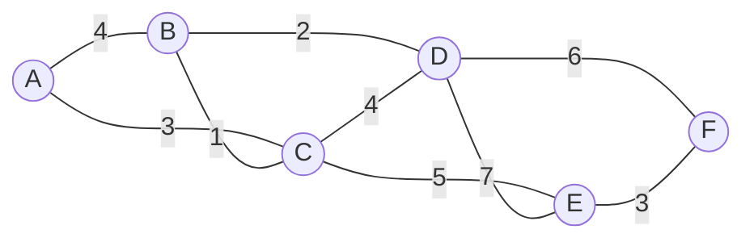

# Minimum Spanning Trees: Prim's and Kruskal's Algorithms

!!! abstract "At a glance"

    - **Problem:** connect all vertices of a connected, undirected, weighted graph using a subset of edges with minimum total weight.
    - **Key idea (cut property):** the lightest edge crossing any cut is safe to add. Kruskal adds the globally lightest safe edge; Prim grows one tree by its lightest outgoing edge.
    - **Complexity:** Kruskal $O(E \log E) = O(E \log V)$ with union-find; Prim $O(E \log V)$ with a binary heap, $O(V^2)$ with an array.
    - **Choice:** Kruskal for sparse graphs or edge lists; Prim (array) for dense graphs.
    - **Used in:** network and cable layout, single-linkage clustering, image segmentation, approximation algorithms (metric TSP).

## Motivation and Problem Context

A district wants to connect eight villages with fibre-optic cable. Laying cable between two villages has a known cost (distance, terrain, river crossings). Every village must be reachable from every other, possibly through intermediate villages, and the total cost must be minimum. Any cycle would contain a redundant cable, so the answer is a **tree** that spans all villages: a **minimum spanning tree (MST)**.

The same structure appears in clustering (group points by cutting the most expensive MST edges), in approximation algorithms for hard problems, and in circuit and pipeline design.

## Problem Formulation

- **Input:** a connected, undirected graph $G = (V, E)$ with edge weights $w: E \to \mathbb{R}$ (weights may be negative).
- **Spanning tree:** a subset $T \subseteq E$ that connects all vertices and contains no cycle. Every spanning tree has exactly $|V| - 1$ edges.
- **Output:** a spanning tree $T$ minimizing

$$
w(T) = \sum_{(u, v) \in T} w(u, v).
$$

- **If $G$ is disconnected:** no spanning tree exists; the algorithms naturally produce a **minimum spanning forest** (one MST per component).

## Intuition

Split the vertices into any two groups (a **cut**). The final tree must use at least one edge crossing between the groups, otherwise the groups would be disconnected. Using the cheapest crossing edge can never be a mistake: if some MST used a more expensive crossing edge instead, swapping it for the cheapest one would keep the tree connected and not increase the cost.

Both algorithms are just different ways of choosing cuts:

- **Kruskal:** consider edges from lightest to heaviest; add an edge if it joins two different components. The cut is "this component versus the rest".
- **Prim:** keep one growing tree; always add the lightest edge leaving it. The cut is "the tree versus the rest".

## Baseline Approach

- **Enumerate all spanning trees:** a complete graph on $n$ vertices has $n^{n-2}$ spanning trees (Cayley's formula). Already $8^6 = 262{,}144$ for 8 vertices; hopeless for large graphs.
- **Reverse-delete:** sort edges descending; delete an edge if the graph stays connected. Correct (by the cycle property) but each connectivity check costs $O(V + E)$, giving $O(E(V + E))$ naively.

The bottleneck is checking, for each candidate edge, whether it is safe. The cut property gives a cheap local test.

## Algorithm Design

### Key results

**Definitions.** A **cut** $(S, V \setminus S)$ partitions the vertices. An edge **crosses** the cut if it has one endpoint on each side. A cut **respects** an edge set $A$ if no edge of $A$ crosses it. A **light edge** crossing a cut is one of minimum weight among crossing edges.

**Cut property.** Let $A$ be a subset of some MST. Let $(S, V \setminus S)$ be any cut that respects $A$, and let $e = (u, v)$ be a light edge crossing it. Then $A \cup \{e\}$ is also a subset of some MST. ($e$ is a **safe edge**.)

**Cycle property.** For any cycle $C$ in $G$, if an edge $e \in C$ is strictly heavier than all other edges of $C$, then $e$ is in no MST.

**Uniqueness.** If all edge weights are distinct, the MST is unique.

### From the cut property to two algorithms

| | Kruskal | Prim |
|---|---|---|
| Grows | A forest of components that merge | A single tree from a start vertex |
| Next edge | Globally lightest edge joining two different components | Lightest edge leaving the current tree |
| Cut used in the proof | One component $C$ vs $V \setminus C$ | Tree vertices vs non-tree vertices |
| Data structure | Sorted edge list + union-find | Min-heap keyed by edge weight (or array) |
| Analogy | Edge-centric | Vertex-centric, structurally like Dijkstra |

### Union-find (disjoint-set union)

Kruskal needs to answer "are $u$ and $v$ already connected?" and to merge components. A **disjoint-set union (DSU)** stores each component as a tree of parent pointers whose root is the representative.

- `find(x)`: follow parents to the root. **Path compression** makes every node on the path point directly at the root.
- `union(a, b)`: link the roots. **Union by rank** attaches the shorter tree under the taller one, keeping trees shallow.

With both heuristics, a sequence of $m$ operations on $n$ elements runs in $O(m \, \alpha(n))$ time, where $\alpha$ is the inverse Ackermann function ($\alpha(n) \le 4$ for any $n$ that fits in the physical universe). For practical purposes each operation is constant time.

## Pseudocode

```text
KRUSKAL(V, E):
    for each vertex v in V:
        MAKE-SET(v)
    T = empty set
    sort E by weight, ascending
    for each edge (u, v) in sorted E:
        if FIND(u) != FIND(v):            // different components: no cycle
            T = T + {(u, v)}
            UNION(u, v)
            if |T| == |V| - 1: break
    return T

PRIM(G, r):                               // binary heap, lazy deletion
    in_tree = {r}
    H = min-heap of (w(r, v), r, v) for each edge (r, v)
    T = empty set
    while H is not empty and |in_tree| < |V|:
        (w, u, v) = EXTRACT-MIN(H)
        if v in in_tree:
            continue                      // stale: v was added via a cheaper edge
        add v to in_tree
        T = T + {(u, v)}
        for each edge (v, x) with x not in in_tree:
            INSERT(H, (w(v, x), v, x))
    return T
```

## Worked Example



### Kruskal

Sorted edges: BC 1, BD 2, AC 3, EF 3, AB 4, CD 4, CE 5, DF 6, DE 7.

| Step | Edge | Weight | Components before | Action | MST weight |
|---|---|---|---|---|---|
| 1 | B–C | 1 | {A} {B} {C} {D} {E} {F} | add | 1 |
| 2 | B–D | 2 | {A} {B,C} {D} {E} {F} | add | 3 |
| 3 | A–C | 3 | {A} {B,C,D} {E} {F} | add | 6 |
| 4 | E–F | 3 | {A,B,C,D} {E} {F} | add | 9 |
| 5 | A–B | 4 | {A,B,C,D} {E,F} | skip (same component: cycle) | 9 |
| 6 | C–D | 4 | {A,B,C,D} {E,F} | skip | 9 |
| 7 | C–E | 5 | {A,B,C,D} {E,F} | add; now $\lvert T \rvert = 5 = V - 1$, stop | **14** |

### Prim (start at A)

| Step | Tree vertices | Lightest edge leaving the tree | Added | MST weight |
|---|---|---|---|---|
| 1 | {A} | A–C 3 (vs A–B 4) | C | 3 |
| 2 | {A, C} | C–B 1 | B | 4 |
| 3 | {A, B, C} | B–D 2 | D | 6 |
| 4 | {A, B, C, D} | C–E 5 (vs D–F 6, D–E 7) | E | 11 |
| 5 | {A, B, C, D, E} | E–F 3 | F | **14** |

Both algorithms find total weight **14** with edges {B–C, B–D, A–C, E–F, C–E}, added in different orders.

## Correctness

### Proof of the cut property (exchange argument)

Let $T$ be an MST containing $A$. If $e = (u, v) \in T$, done. Otherwise:

1. Adding $e$ to $T$ creates exactly one cycle, the path $p$ in $T$ from $u$ to $v$ plus $e$.
2. Since $u$ and $v$ are on opposite sides of the cut, the path $p$ must cross the cut at least once; let $e' = (x, y)$ be a crossing edge on $p$.
3. $e' \notin A$, because the cut respects $A$.
4. Let $T' = T - \{e'\} + \{e\}$. Removing $e'$ splits $T$ into two pieces; $e$ reconnects them, so $T'$ is a **spanning tree** (feasible).
5. $e$ is a light edge for the cut and $e'$ also crosses it, so $w(e) \le w(e')$; hence $w(T') \le w(T)$, and $T'$ is an MST.
6. $A \cup \{e\} \subseteq T'$ (we removed $e' \notin A$). So $e$ is safe. $\blacksquare$

### Kruskal is correct

Invariant: the chosen set $T$ is always a subset of some MST. When Kruskal adds $(u, v)$, let $C$ be the component containing $u$. The cut $(C, V \setminus C)$ respects $T$, and $(u, v)$ crosses it. Every lighter edge was already considered and either added or rejected because both ends were already in one component, so no lighter edge crosses this cut. Thus $(u, v)$ is light, hence safe. At termination $T$ has $V - 1$ edges and is a subset of an MST, so it is an MST.

### Prim is correct

Same invariant with the cut (tree vertices, non-tree vertices). The cut respects the current tree edges, and Prim picks the minimum-weight edge crossing it, which is safe by the cut property.

!!! warning "Important"

    In exams, "prove Kruskal/Prim correct" means: (1) state the cut property, (2) prove it by the exchange in steps 1–6, and (3) identify which cut each algorithm uses and why its chosen edge is light for that cut. Skipping the "why is it light" step is the most common gap.

## Complexity Analysis

### Kruskal

| Step | Cost |
|---|---|
| Sort edges | $O(E \log E)$ |
| $V$ MAKE-SET, up to $2E$ FIND, $V - 1$ UNION | $O(E \, \alpha(V))$ with both heuristics |
| **Total** | $O(E \log E) = O(E \log V)$, since $E \le V^2 \Rightarrow \log E \le 2 \log V$ |

The sort dominates. If edges are already sorted, or weights are small integers (counting sort), Kruskal runs in $O(E \, \alpha(V))$.

### Prim

| Priority queue | Time | Best for |
|---|---|---|
| Array of keys, linear scan for min | $O(V^2)$ | Dense graphs |
| Binary heap (lazy or decrease-key) | $O(E \log V)$ | Sparse graphs |
| Fibonacci heap | $O(E + V \log V)$ | Theory |

**Density comparison.** For a sparse graph ($E = \Theta(V)$), both Kruskal and heap-Prim are $O(V \log V)$. For a dense graph ($E = \Theta(V^2)$), Kruskal and heap-Prim are $O(V^2 \log V)$, while array-Prim is $O(V^2)$, which is optimal (it must read every edge).

## Python Implementation

```python
import heapq


class DisjointSet:
    def __init__(self, items):
        self.parent = {x: x for x in items}
        self.rank = {x: 0 for x in items}

    def find(self, x):
        root = x
        while self.parent[root] != root:
            root = self.parent[root]
        while self.parent[x] != root:          # path compression
            nxt = self.parent[x]
            self.parent[x] = root
            x = nxt
        return root

    def union(self, a, b):
        ra, rb = self.find(a), self.find(b)
        if ra == rb:
            return False                       # already connected: edge would form a cycle
        if self.rank[ra] < self.rank[rb]:      # union by rank
            ra, rb = rb, ra
        self.parent[rb] = ra
        if self.rank[ra] == self.rank[rb]:
            self.rank[ra] += 1
        return True


def kruskal(vertices, edges):
    """edges: list of (weight, u, v). Returns (total_weight, mst_edges).
    On a disconnected graph this returns a minimum spanning forest."""
    dsu = DisjointSet(vertices)
    total, mst = 0, []
    for w, u, v in sorted(edges):
        if dsu.union(u, v):
            mst.append((u, v, w))
            total += w
            if len(mst) == len(vertices) - 1:
                break
    return total, mst


def prim(graph, start):
    """graph: dict u -> list of (v, weight), undirected (both directions listed).
    Returns (total_weight, mst_edges) for the component containing start."""
    in_tree = {start}
    heap = [(w, start, v) for v, w in graph[start]]
    heapq.heapify(heap)
    total, mst = 0, []
    while heap and len(in_tree) < len(graph):
        w, u, v = heapq.heappop(heap)
        if v in in_tree:                       # stale: both ends already in tree
            continue
        in_tree.add(v)
        mst.append((u, v, w))
        total += w
        for x, wx in graph[v]:
            if x not in in_tree:
                heapq.heappush(heap, (wx, v, x))
    return total, mst
```

- Edges are stored as `(weight, u, v)` so that `sorted(edges)` sorts by weight.
- `union` returns `False` when both endpoints share a root; that is exactly the cycle test, so Kruskal needs no separate `find` comparison.
- `find` is iterative (two passes: locate the root, then compress) to avoid Python's recursion limit on long chains.
- Prim's heap may contain stale entries for vertices already in the tree; they are skipped, exactly as in Dijkstra's lazy deletion ([Topic 7.5](topic5.md)). The difference is the key: Prim uses the **edge weight** $w(v, x)$, Dijkstra uses the **path length** $d[v] + w(v, x)$.
- On the worked example both functions return total weight 14. Both were cross-checked against brute force over all $(V-1)$-edge subsets on random small graphs.

## Edge Cases and Pitfalls

| Case / pitfall | What goes wrong | Fix |
|---|---|---|
| Disconnected graph | Kruskal returns a forest with fewer than $V - 1$ edges; Prim covers one component | Check `len(mst) == V - 1`; report "not connected" or run Prim from every unvisited vertex |
| Directed graph | MST is defined for undirected graphs; algorithms give wrong answers | Use a minimum arborescence algorithm (Chu–Liu/Edmonds) |
| Undirected edges stored once in adjacency list | Prim misses edges | Add both directions |
| Equal weights | Multiple MSTs; tests comparing exact edge sets fail | Compare total weight, not edge sets |
| Negative weights | None; MST algorithms handle them | No fix needed (unlike Dijkstra) |
| DSU without path compression or union by rank | Trees degenerate; FIND becomes $O(V)$ | Use both heuristics |
| Recursive `find` in Python | Recursion limit on long chains | Iterative find |
| Parallel edges, self-loops | Self-loops never help; parallel edges are fine | Kruskal skips self-loops automatically (same component) |
| Confusing Prim with Dijkstra | Using $d[u] + w$ as the key gives a shortest-path tree, not an MST | Key on the edge weight only |

## Common Misconceptions

- **"The MST contains the shortest path between every pair."** No. The MST minimizes *total* weight; the path between two vertices in the MST can be much longer than their shortest path. Dijkstra's tree and the MST are different trees.
- **"MST algorithms fail with negative weights."** They work: only the relative order of weights matters.
- **"Kruskal is always faster than Prim."** It depends on density: on dense graphs, array-based Prim's $O(V^2)$ beats Kruskal's $O(E \log E) = O(V^2 \log V)$.
- **"The MST is unique."** Only guaranteed when weights are distinct.
- **"The heaviest edge in the graph is never in the MST."** False if it is a bridge (the only connection to some vertex). The cycle property only excludes the heaviest edge **on a cycle**.

## Alternatives and Trade-offs

| Algorithm | Time | Strengths | Weaknesses |
|---|---|---|---|
| Kruskal + DSU | $O(E \log E)$ | Simple; works on edge lists; gives forests; easy to stop early for clustering | Sorting all edges; less good on dense graphs |
| Prim + binary heap | $O(E \log V)$ | Good on sparse adjacency lists; similar code to Dijkstra | Needs adjacency lists |
| Prim + array | $O(V^2)$ | Optimal for dense graphs / adjacency matrices | Poor for sparse graphs |
| Borůvka | $O(E \log V)$ | Every component picks its lightest outgoing edge in parallel; suits parallel and distributed settings | More complex bookkeeping |
| Reverse-delete | $O(E(V + E))$ naively (a connectivity check per edge) | Illustrates the cycle property | Impractical without advanced dynamic-connectivity structures |

**Use Kruskal** for sparse graphs, edge-list input, or when you need a forest or a $k$-cluster cut. **Use Prim (array)** for dense graphs given as matrices. **Do not use** MST algorithms when the requirement is a shortest path from a source (that is Dijkstra) or when edges are directed.

## In Practice

- **Network design:** MSTs are the starting point for laying cable, pipelines and power distribution, usually followed by redundancy (an MST has no backup path, so real networks add edges for reliability).
- **Clustering:** single-linkage hierarchical clustering is equivalent to building an MST; removing the $k - 1$ heaviest MST edges yields $k$ clusters with maximum spacing. Kruskal stopped early gives this directly.
- **Image segmentation:** the Felzenszwalb–Huttenlocher graph-based segmentation method processes pixel-adjacency edges in increasing weight with a union-find structure, in the style of Kruskal.
- **Approximation algorithms:** for metric TSP, a preorder walk of an MST gives a tour at most twice optimal; Christofides' algorithm improves this to 1.5 using an MST plus a matching.
- **Libraries:** `scipy.sparse.csgraph.minimum_spanning_tree` and NetworkX's `minimum_spanning_tree` (Kruskal by default, with Prim and Borůvka available).
- **Performance reality:** union-find with both heuristics is one of the fastest data structures in practice; on large sparse graphs the edge sort dominates Kruskal.

## Interview and Competitive Programming

**Recognition cues**

- "Connect all points / cities with minimum total cost" → MST.
- "Minimum cost to make the graph connected", "road reparation" → MST; if not all vertices connected at the end, output impossible.
- "Group into $k$ clusters maximizing the minimum distance between clusters" → Kruskal, stop at $k$ components.
- "Minimize the maximum edge on a path between $u$ and $v$" (minimax path) → the path in the MST is optimal.
- "Is the graph connected / count components / detect cycles while adding edges" → union-find on its own.

**Reusable template:** the `DisjointSet` class plus the sorted-edges loop above.

**Constraints mapping:** $V \le 10^5$, $E \le 2 \times 10^5$ → Kruskal $O(E \log E)$. Complete graph on $V \le 2000$ points (Manhattan or Euclidean distances, $E \approx 2 \times 10^6$) → array Prim $O(V^2)$, avoiding building all edges.

**Traps:** forgetting to check connectivity; 32-bit overflow in total weight; sorting by $u$ instead of weight when tuples are ordered `(u, v, w)`.

## Using AI Assistants Critically

- Generated union-find code often omits union by rank or path compression, or uses a recursive `find` that overflows Python's stack on large inputs. Check both heuristics and the recursion.
- A frequent LLM bug in Prim is using Dijkstra's key `dist[u] + w` instead of `w`. Run it on a small graph where the MST and shortest-path tree differ.
- Assistants sometimes state Kruskal as $O(E \log V)$ and Prim as $O(V^2)$ without context; ask which implementation and graph density the bound refers to.
- AI-written "proofs" often assert "the lightest edge is safe" without proving the cut property or identifying the cut. Require the exchange argument.
- Verify by brute force: enumerate all $(V-1)$-edge subsets for $V \le 7$, keep the spanning trees, and compare minimum weight with your output on random graphs.
- Check edge cases the assistant may skip: disconnected input, a single vertex, duplicate edges.

## Practice

### Beginner

1. **Trace both.** Graph with edges: (1,2,28), (1,6,10), (2,3,16), (2,7,14), (3,4,12), (4,5,22), (4,7,18), (5,6,25), (5,7,24). Output: the MST by Kruskal and by Prim from vertex 1, and its weight. Difficulty: Easy.
2. **Count edges.** Prove that every spanning tree on $V$ vertices has exactly $V - 1$ edges. Difficulty: Easy.
3. **Union-find by hand.** Starting from 8 singletons, apply union(1,2), union(3,4), union(2,4), find(4), union(5,6), union(4,6), showing parent arrays with union by rank and path compression. Difficulty: Easy.

### Intermediate

1. **Road reparation.** Input: $n \le 10^5$ cities, $m \le 2 \times 10^5$ roads with repair costs. Output: minimum cost to make all cities connected, or "IMPOSSIBLE". Difficulty: Medium.
2. **Points on a plane.** Input: $n \le 1000$ points. Output: minimum total Manhattan-distance cost to connect all points. Choose between Kruskal and array Prim and justify. Difficulty: Medium.
3. **$k$ clusters.** Input: $n \le 2000$ points and $k$. Output: the maximum possible minimum distance between points in different clusters. Difficulty: Medium.

### Advanced

1. **Uniqueness.** Prove that an MST is unique when all edge weights are distinct. Difficulty: Hard.
2. **Second-best MST.** Output the minimum weight of a spanning tree different from the MST. Target $O(E \log V)$. Difficulty: Hard.
3. **Edge classification.** For each edge, decide whether it is in all MSTs, in some MST, or in none. $V, E \le 10^5$. Difficulty: Hard.

### Interview / CP

1. **Min cost to connect all points.** Input: up to 1000 points with integer coordinates. Output: minimum total Manhattan cost to connect them. Difficulty: Medium.
2. **Redundant connection.** Input: an undirected graph that is a tree plus one extra edge ($n \le 1000$). Output: the edge whose removal leaves a tree (the last such in input order). Difficulty: Medium.
3. **Minimax path queries.** Input: weighted graph and $q$ queries $(u, v)$. Output: for each, the minimum possible maximum edge weight on a path from $u$ to $v$. Difficulty: Hard.

## Self-Check Questions

??? question "Q1. State and prove the cut property in at most five lines."

    If a cut respects $A \subseteq$ some MST $T$, any light crossing edge $e$ is safe. If $e \notin T$, adding $e$ to $T$ forms a cycle that crosses the cut at another edge $e'$ (not in $A$). $T - e' + e$ is a spanning tree with weight $\le w(T)$ since $w(e) \le w(e')$, so it is an MST containing $A \cup \{e\}$.

??? question "Q2. Which cut justifies each edge added by Kruskal?"

    The cut separating the component of one endpoint from the rest of the graph. No lighter edge crosses it, because every lighter edge was already processed and lies within a single component.

??? question "Q3. For $V = 10^4$ and $E = 5 \times 10^7$ (nearly complete), which algorithm would you use?"

    Array-based Prim, $O(V^2) = 10^8$, which reads each adjacency entry once. Kruskal would sort $5 \times 10^7$ edges, $O(E \log E) \approx 1.3 \times 10^9$ comparisons, and needs the edge list in memory.

??? question "Q4. Does a negative edge weight break Prim or Kruskal?"

    No. Both depend only on comparisons between weights; the cut property holds for any real weights.

??? question "Q5. Is the MST path between $u$ and $v$ a shortest path?"

    Not in general. Example: triangle with edges $A$–$B$ 3, $B$–$C$ 3, $A$–$C$ 4. MST = {AB, BC} (weight 6); MST path A–C has length 6, but the direct edge has length 4. The MST path does, however, minimize the maximum edge weight (minimax path).

??? question "Q6. What does union by rank plus path compression buy you, asymptotically?"

    Amortized $O(\alpha(n))$ per operation, where $\alpha$ is the inverse Ackermann function, effectively a constant. Without them, a find can take $O(n)$.

??? question "Q7. How would you use Kruskal to split customers into 4 groups of similar locations?"

    Run Kruskal on pairwise distances and stop when 4 components remain (that is, after $n - 4$ successful unions). This maximizes the minimum distance between groups (single-linkage clustering).

??? question "Q8. Prim and Dijkstra have almost the same code. What single difference changes the output?"

    The priority key. Prim uses the weight of the edge connecting a vertex to the tree; Dijkstra uses the total distance from the source. The first minimizes total tree weight; the second minimizes each root-to-vertex path.

## Complexity Summary

| Algorithm | Time | Space | Best for |
|---|---|---|---|
| Kruskal + DSU | $O(E \log E) = O(E \log V)$ | $O(V + E)$ | Sparse graphs, edge lists, clustering |
| Kruskal with presorted edges | $O(E \, \alpha(V))$ | $O(V)$ | Sorted or small-integer weights |
| Prim + binary heap | $O(E \log V)$ | $O(V + E)$ | Sparse adjacency lists |
| Prim + array | $O(V^2)$ | $O(V)$ | Dense graphs |
| Prim + Fibonacci heap | $O(E + V \log V)$ | $O(V + E)$ | Theory |
| DSU operation (both heuristics) | $O(\alpha(n))$ amortized | $O(n)$ | |

## Key Takeaways

- An MST connects all vertices with minimum total weight using exactly $V - 1$ edges.
- The **cut property** (lightest crossing edge is safe) is proved by an exchange and justifies both algorithms.
- Kruskal: sort edges, add if endpoints are in different components (union-find). Prim: grow one tree with a min-heap of crossing edges.
- Union-find with path compression and union by rank costs $O(\alpha(n))$ amortized per operation.
- Choose by density: Kruskal or heap-Prim for sparse graphs, array-Prim $O(V^2)$ for dense graphs.
- MSTs handle negative weights, are unique when weights are distinct, and are not shortest-path trees.
